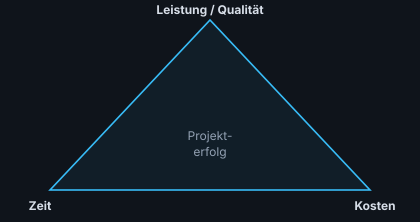
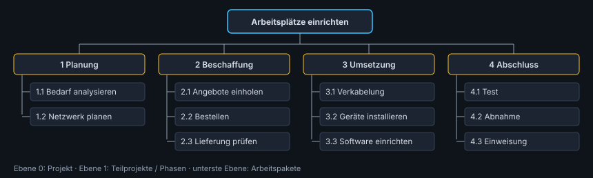
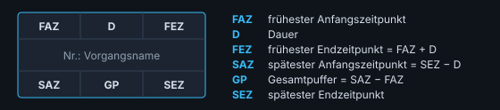
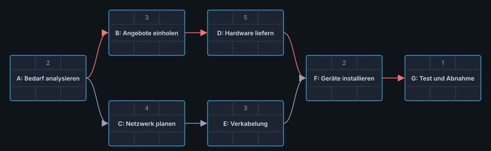
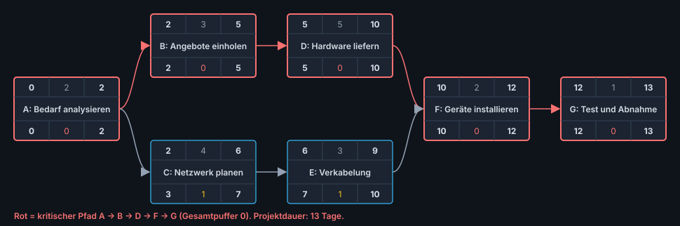
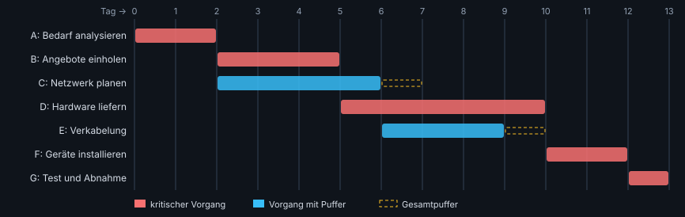

# 📋 Projektmanagement

*Bereich: Planung · Prüfungsrelevanz: ★★★*

> Projektmerkmale, Phasen, SMART, Wasserfall vs. Scrum, Gantt, Netzplan.

[⬅ Inhaltsverzeichnis](README.md)

---

In der AP1 bist du meist Teil eines kleinen Projekts: Arbeitsplätze einrichten, eine Software einführen, ein Netzwerk erweitern. Die Prüfung will sehen, dass du ein Projekt planen kannst – Ziele formulieren, Aufgaben zerlegen, Termine berechnen, Risiken einschätzen – und dass du die zwei Vorgehensmodelle Wasserfall und Scrum begründet auswählen kannst. Am meisten Punkte bringt der **Netzplan**. Den rechnen wir weiter unten Schritt für Schritt durch.

> [!WARNING]
> **Prüfungskatalog 2025:** Von den Vorgehensmodellen sind nur noch **Wasserfall und Scrum** AP1-Stoff (V-Modell, Spiralmodell usw. sind gestrichen), ebenso die SWOT-Analyse. Neu betont sind die **Merkmale eines Projekts** und **SMART-Ziele**.

## Was ist ein Projekt?

Nicht jede Aufgabe ist ein Projekt. Die Norm DIN 69901-5 beschreibt ein Projekt als Vorhaben, das im Wesentlichen durch die **Einmaligkeit der Bedingungen in ihrer Gesamtheit** gekennzeichnet ist – etwa durch eine Zielvorgabe, zeitliche, finanzielle und personelle Begrenzungen und eine projektspezifische Organisation.

**Warum ist die Unterscheidung wichtig?** Routineaufgaben erledigt die normale Organisation (die „Linie“) nach eingespielten Abläufen. Ein Projekt dagegen ist neu, hat ein festes Ende und ist riskant. Deshalb braucht es eigene Planung, eine eigene Leitung und eine laufende Kontrolle. Wer ein Projekt wie Routine behandelt, merkt zu spät, dass Termin oder Budget nicht halten.

<table><tr><th>Merkmal</th><th>Bedeutung</th><th>Beispiel „25 Arbeitsplätze für die neue Filiale einrichten“</th></tr>
<tr><td>Einmaligkeit</td><td>In dieser Kombination gab es das Vorhaben noch nicht.</td><td>neue Filiale, neue Räume, neue Hardware</td></tr>
<tr><td>klares Ziel</td><td>Es ist festgelegt, was am Ende erreicht sein muss.</td><td>25 funktionsfähige, abgesicherte Arbeitsplätze</td></tr>
<tr><td>zeitliche Begrenzung</td><td>fester Anfang und festes Ende</td><td>Start 01.03., Eröffnung 15.04.</td></tr>
<tr><td>begrenzte Ressourcen</td><td>Budget, Personal und Sachmittel sind vorgegeben.</td><td>Budget 40.000 €, zwei IT-Mitarbeitende</td></tr>
<tr><td>eigene Organisation</td><td>Projektleitung, Team, Rollen außerhalb der normalen Hierarchie</td><td>Projektleiterin aus der IT, je eine Person aus Einkauf und Filiale</td></tr>
<tr><td>Komplexität und Risiko</td><td>viele Beteiligte und Abhängigkeiten, unsicherer Ausgang</td><td>Lieferzeiten, Bauverzögerung, Netzanschluss</td></tr></table>

> [!NOTE]
> **Beispiel**
>
> **Projekt oder nicht?**  
> „Ein Passwort zurücksetzen“ → kein Projekt: Routine, wiederholt sich täglich, keine eigene Organisation.  
> „Monatliche Datensicherung prüfen“ → kein Projekt: wiederkehrend, kein Ende.  
> „Umstellung aller 120 Rechner auf Windows 11 bis zum Supportende von Windows 10“ → Projekt: einmalig, klares Ziel, Termin, Budget, Team, Risiken.

## Das magische Dreieck

Jedes Projekt wird an drei Größen gemessen: **Leistung bzw. Qualität** (was geliefert wird), **Zeit** (bis wann) und **Kosten** (zu welchem Preis). „Magisch“ heißt das Dreieck, weil sich keine Ecke ändern lässt, ohne dass sich mindestens eine andere mitbewegt.

> [!NOTE]
> **Beispiel**
>
> **Zielkonflikt**  
> Der Kunde möchte die 25 Arbeitsplätze eine Woche früher haben (Zeit ↓). Das geht nur, wenn mehr Personal oder ein externer Dienstleister eingesetzt wird (Kosten ↑) oder wenn ein Teil der Leistung wegfällt, z. B. die Einweisung der Mitarbeitenden wird verschoben (Leistung ↓).

Manche Lehrbücher trennen Leistung und Qualität und sprechen vom **Teufelsquadrat**. Die Aussage bleibt dieselbe.

## Beteiligte: Rollen und Stakeholder

<table><tr><th>Rolle</th><th>Aufgabe</th></tr>
<tr><td>Auftraggeber</td><td>will das Ergebnis, stellt Budget bereit, erteilt den Projektauftrag und nimmt das Ergebnis ab</td></tr>
<tr><td>Projektleitung</td><td>plant, steuert und kontrolliert das Projekt, ist verantwortlich für Termine, Kosten und Ergebnis, berichtet an den Auftraggeber</td></tr>
<tr><td>Projektteam</td><td>bearbeitet die Arbeitspakete</td></tr>
<tr><td>Lenkungsausschuss</td><td>bei größeren Projekten: trifft grundlegende Entscheidungen, z. B. über Budgeterhöhungen oder Abbruch</td></tr></table>

**Stakeholder** sind alle Personen und Gruppen, die vom Projekt betroffen sind oder es beeinflussen können: Geschäftsleitung, künftige Nutzer, Betriebsrat, Datenschutzbeauftragte, Lieferanten, Kunden. In der **Stakeholderanalyse** listest du sie auf und bewertest ihren **Einfluss** und ihre **Einstellung** zum Projekt.

**Warum?** Projekte scheitern oft nicht an der Technik, sondern an Menschen: Der Betriebsrat muss bei technischen Einrichtungen, die Leistung oder Verhalten überwachen können, mitbestimmen; Nutzer, die nicht einbezogen werden, lehnen das neue System ab. Wer Stakeholder früh kennt, kann sie informieren und einbinden.

## Projektphasen

Klassisch verläuft ein Projekt in Phasen. Am Ende jeder Phase steht ein **Meilenstein**: ein Ereignis **ohne Dauer**, an dem geprüft wird, ob ein festgelegtes Ergebnis vorliegt – erst dann geht es weiter.

<table><tr><th>Phase</th><th>Was passiert</th><th>typische Ergebnisse</th></tr>
<tr><td>Initialisierung</td><td>Idee prüfen, Ziel grob festlegen, Machbarkeit klären, Projekt freigeben</td><td>Projektauftrag, Machbarkeitsstudie</td></tr>
<tr><td>Definition</td><td>Anforderungen erheben, Ziele SMART formulieren, Rahmen abstecken</td><td>Lastenheft, Pflichtenheft, Stakeholderliste</td></tr>
<tr><td>Planung</td><td>Aufgaben zerlegen, Reihenfolge, Termine, Kosten, Ressourcen und Risiken planen</td><td>Projektstrukturplan, Netzplan, Gantt-Diagramm, Kostenplan, Risikoliste</td></tr>
<tr><td>Durchführung</td><td>Arbeitspakete umsetzen; begleitend <b>Controlling</b>: Soll-Ist-Vergleich, Gegensteuern</td><td>Zwischenergebnisse, Statusberichte</td></tr>
<tr><td>Abschluss</td><td>Ergebnis übergeben und abnehmen lassen, Erfahrungen sichern, Team auflösen</td><td>Abnahmeprotokoll, Abschlussbericht, Lessons Learned</td></tr></table>

**Machbarkeit** prüfst du aus mehreren Blickwinkeln: technisch (geht es überhaupt?), wirtschaftlich (lohnt es sich?), rechtlich (Datenschutz, Lizenzen, Mitbestimmung), personell (haben wir die Leute?) und terminlich (schaffen wir es bis zum Stichtag?).

## SMART-Ziele

Ein Ziel wie „Die IT soll moderner werden“ klingt gut, ist aber unbrauchbar: Niemand kann am Ende sagen, ob es erreicht wurde. Deshalb formuliert man Projektziele **SMART**:

<table><tr><th></th><th>Bedeutung</th><th>Prüffrage</th></tr>
<tr><td><b>S</b></td><td>spezifisch</td><td>Ist eindeutig beschrieben, was genau erreicht werden soll?</td></tr>
<tr><td><b>M</b></td><td>messbar</td><td>Lässt sich am Ende objektiv feststellen, ob das Ziel erreicht ist (Zahl, Kriterium)?</td></tr>
<tr><td><b>A</b></td><td>attraktiv, akzeptiert (auch: erreichbar, englisch <i>achievable</i>)</td><td>Tragen Auftraggeber und Team das Ziel mit?</td></tr>
<tr><td><b>R</b></td><td>realistisch</td><td>Ist das Ziel mit den vorhandenen Mitteln erreichbar?</td></tr>
<tr><td><b>T</b></td><td>terminiert</td><td>Gibt es einen festen Termin?</td></tr></table>

> [!NOTE]
> **Beispiel**
>
> **Von unscharf zu SMART**  
> Unscharf: „Die Vertriebsmitarbeiter sollen bessere Notebooks bekommen.“  
> SMART: „Bis zum **30.06.** (T) sind alle **18 Notebooks des Außendienstes** (S) durch Geräte mit mindestens 16 GB RAM, SSD und **BitLocker-Verschlüsselung** ersetzt (M). Das Budget von 25.000 € (R) wurde mit der Vertriebsleitung abgestimmt (A).“

> [!TIP]
> In der Prüfung sollst du oft ein vorgegebenes Ziel bewerten oder umformulieren. Geh die fünf Buchstaben einzeln durch und nenne, was fehlt – meistens fehlen **Messbarkeit** und **Termin**.

## Lastenheft und Pflichtenheft

<table><tr><th></th><th>Lastenheft</th><th>Pflichtenheft</th></tr>
<tr><td>Wer schreibt es?</td><td><b>Auftraggeber</b></td><td><b>Auftragnehmer</b></td></tr>
<tr><td>Inhalt</td><td><b>Was</b> soll erreicht werden und <b>wofür</b>? Anforderungen aus Sicht des Kunden</td><td><b>Wie</b> und <b>womit</b> werden die Anforderungen umgesetzt? Konkrete technische Lösung</td></tr>
<tr><td>Beispiel</td><td>„Die Außendienstmitarbeiter müssen unterwegs sicher auf das CRM zugreifen können.“</td><td>„Zugriff über VPN (WireGuard) auf den CRM-Server, Anmeldung mit Zwei-Faktor-Authentifizierung über Authenticator-App.“</td></tr>
<tr><td>Zeitpunkt</td><td>zuerst – Grundlage für Angebote</td><td>danach – wird vom Auftraggeber genehmigt und ist Grundlage für Umsetzung und Abnahme</td></tr></table>

> [!IMPORTANT]
> Eselsbrücke: **L**asten = was der Kunde **l**ast-et (fordert). **P**flichten = wozu sich der Auftragnehmer **verpflichtet**.

## Risiken einschätzen

Ein Risiko ist ein mögliches Ereignis, das dem Projekt schadet. Um zu entscheiden, um welche Risiken man sich zuerst kümmert, bewertet man sie:

> [!IMPORTANT]
> **Risiko (Erwartungswert) = Eintrittswahrscheinlichkeit × Schadenshöhe**

> [!NOTE]
> **Beispiel**
>
> **Risikobewertung**  
>
> | Risiko | Wahrscheinlichkeit | Schaden | Risikowert |
> | --- | --- | --- | --- |
> | Lieferverzug der Hardware | 30 % | 4.000 € | **1.200 €** |
> | Ausfall eines Teammitglieds | 10 % | 6.000 € | 600 € |
> | Datenverlust bei der Migration | 5 % | 20.000 € | **1.000 €** |
>
> Rechnung für die erste Zeile: 0,30 × 4.000 € = 1.200 €. Der Lieferverzug hat den höchsten Risikowert und bekommt zuerst eine Maßnahme, z. B. frühzeitig bestellen oder einen zweiten Lieferanten anfragen.

Für jedes wichtige Risiko legt man eine **Strategie** fest: **vermeiden** (Ursache beseitigen), **vermindern** (Wahrscheinlichkeit oder Schaden senken, z. B. Backup vor der Migration), **übertragen** (z. B. Versicherung, Vertragsstrafe des Lieferanten) oder **akzeptieren** (bei geringem Risiko bewusst tragen).

## Vorgehensmodelle: Wasserfall und Scrum

#### Wasserfallmodell

Das Wasserfallmodell arbeitet die Phasen **nacheinander** ab: Anforderungsanalyse → Entwurf → Implementierung → Test → Einführung und Wartung. Jede Phase muss abgeschlossen und dokumentiert sein, bevor die nächste beginnt – wie Wasser, das von Stufe zu Stufe fällt. Ein Rücksprung ist höchstens zur vorherigen Phase vorgesehen.

**Warum funktioniert das?** Wenn die Anforderungen von Anfang an klar und stabil sind, lässt sich das ganze Projekt im Voraus planen: Termine, Kosten und Ergebnis stehen früh fest. **Wo liegt das Problem?** Der Kunde sieht das Ergebnis erst am Ende. Hat man eine Anforderung falsch verstanden, fällt das erst im Test auf – dann sind Änderungen teuer, weil Entwurf und Programmierung schon fertig sind.

#### Scrum

Scrum ist ein **agiles** Rahmenwerk. Statt alles am Anfang festzulegen, entwickelt das Team in kurzen Zyklen, den **Sprints** (höchstens ein Monat, oft zwei Wochen). Am Ende jedes Sprints steht ein nutzbares Zwischenergebnis, das **Inkrement**. Der Kunde gibt Rückmeldung, und die Anforderungen für den nächsten Sprint werden neu priorisiert.

<table><tr><th colspan="2">Rollen (Verantwortlichkeiten)</th></tr>
<tr><td>Product Owner</td><td>verantwortet den Wert des Produkts, pflegt und priorisiert das Product Backlog, ist Ansprechperson für die Stakeholder</td></tr>
<tr><td>Scrum Master</td><td>sorgt dafür, dass Scrum richtig gelebt wird, beseitigt Hindernisse (Impediments), schützt das Team vor Störungen – ist <b>kein</b> Projektleiter mit Weisungsbefugnis</td></tr>
<tr><td>Developers</td><td>organisieren sich selbst und erstellen in jedem Sprint das Inkrement (früher „Entwicklungsteam“)</td></tr></table>

<table><tr><th>Event</th><th>Zweck</th><th>Dauer (bei 1-Monats-Sprint)</th></tr>
<tr><td>Sprint Planning</td><td>Was schaffen wir in diesem Sprint (Sprint-Ziel) und wie?</td><td>max. 8 Std.</td></tr>
<tr><td>Daily Scrum</td><td>tägliche Abstimmung der Developers: Fortschritt zum Sprint-Ziel, Hindernisse</td><td>15 Min.</td></tr>
<tr><td>Sprint Review</td><td><b>Was</b> wurde geliefert? Inkrement den Stakeholdern zeigen, Feedback einholen</td><td>max. 4 Std.</td></tr>
<tr><td>Sprint Retrospektive</td><td><b>Wie</b> haben wir gearbeitet? Zusammenarbeit und Prozess verbessern</td><td>max. 3 Std.</td></tr></table>

**Artefakte:** Das **Product Backlog** ist die priorisierte Liste aller Anforderungen (oft als User Stories: „Als Außendienstmitarbeiterin möchte ich …, damit …“). Das **Sprint Backlog** enthält die für den Sprint ausgewählten Einträge und den Plan dazu. Das **Inkrement** ist das fertige Ergebnis; „fertig“ heißt, es erfüllt die gemeinsam festgelegte **Definition of Done** (z. B. getestet, dokumentiert, abgenommen).

<table><tr><th>Kriterium</th><th>Wasserfall</th><th>Scrum</th></tr>
<tr><td>Ablauf</td><td>sequenziell, jede Phase einmal</td><td>iterativ und inkrementell in Sprints</td></tr>
<tr><td>Anforderungen</td><td>zu Beginn vollständig festgelegt</td><td>entwickeln sich, Backlog wird laufend neu priorisiert</td></tr>
<tr><td>Kundeneinbindung</td><td>am Anfang und bei der Abnahme</td><td>laufend, in jedem Sprint Review</td></tr>
<tr><td>Planbarkeit von Kosten und Termin</td><td>hoch</td><td>Gesamtumfang schwer vorherzusagen</td></tr>
<tr><td>Reaktion auf Änderungen</td><td>aufwendig und teuer</td><td>vorgesehen, ab dem nächsten Sprint</td></tr>
<tr><td>Fehler werden entdeckt</td><td>spät (Testphase)</td><td>früh (nach jedem Sprint)</td></tr>
<tr><td>geeignet für</td><td>klare, stabile Anforderungen, Festpreis, Hardware-Rollouts</td><td>unklare oder sich ändernde Anforderungen, Softwareentwicklung</td></tr></table>

> [!NOTE]
> **Beispiel**
>
> **Begründete Auswahl**  
> *Situation:* Ein Steuerbüro lässt 15 Arbeitsplätze austauschen. Hardware, Software und Termin sind genau vorgegeben.  
> → „Ich empfehle das Wasserfallmodell, weil die Anforderungen vollständig bekannt sind und sich nicht ändern werden. So lassen sich Termin und Kosten für das Steuerbüro verbindlich planen.“  
>
> *Situation:* Ein Start-up möchte eine App für Kundentermine. Welche Funktionen die Kunden wirklich nutzen, weiß es noch nicht.  
> → „Ich empfehle Scrum, weil die Anforderungen noch unklar sind. Nach jedem Sprint kann das Start-up eine nutzbare Version testen und die Prioritäten anhand des Kundenfeedbacks anpassen.“

## Projektstrukturplan (PSP)

Ein großes Projekt kann man nicht auf einmal planen. Der **Projektstrukturplan** zerlegt es hierarchisch in **Teilprojekte** und diese in **Arbeitspakete**. Er beantwortet die Frage **„Was ist alles zu tun?“** – ohne Reihenfolge und ohne Termine.

Ein **Arbeitspaket** ist die kleinste Einheit im PSP. Es muss eindeutig abgegrenzt sein, eine verantwortliche Person haben und sich in Aufwand, Dauer und Kosten schätzen lassen. Gliedern kannst du **phasenorientiert** (wie oben: Planung, Beschaffung, Umsetzung, Abschluss) oder **objektorientiert** (nach Bestandteilen, z. B. Hardware, Netzwerk, Software, Schulung).

**Warum zuerst der PSP?** Er ist die Grundlage für alles Weitere: Aus den Arbeitspaketen werden die Vorgänge im Netzplan und die Balken im Gantt-Diagramm, und für jedes Paket lassen sich Kosten schätzen. Was im PSP fehlt, wird vergessen.

## Netzplan: die Begriffe

Der Netzplan zeigt, in welcher **Reihenfolge** die Vorgänge ablaufen müssen, wie lange das Projekt mindestens dauert und welche Vorgänge sich verzögern dürfen. In der AP1 wird der **Vorgangsknotennetzplan** verwendet: Jeder Vorgang ist ein Kasten (Knoten), Pfeile zeigen die Abhängigkeiten.

Die Zeitangaben sind **Zeitpunkte** auf einer Zeitachse, die bei 0 beginnt. FAZ = 2 heißt: Der Vorgang kann frühestens am Ende von Tag 2 (also zu Beginn des dritten Tages) anfangen.

> [!WARNING]
> Die Anordnung der Felder im Knoten ist nicht genormt. In der Prüfung ist das Schema im Belegsatz oder in der Aufgabe vorgegeben – halte dich genau daran. Manchmal steht dort auch der **freie Puffer** (FP) im Knoten.

## Netzplan Schritt für Schritt

Die Firma richtet die Arbeitsplätze einer neuen Abteilung ein. Gegeben ist diese Vorgangsliste (Dauer in Tagen):

<table><tr><th>Nr.</th><th>Vorgang</th><th>Dauer</th><th>Vorgänger</th></tr>
<tr><td>A</td><td>Bedarf analysieren</td><td>2</td><td>–</td></tr>
<tr><td>B</td><td>Angebote einholen</td><td>3</td><td>A</td></tr>
<tr><td>C</td><td>Netzwerk planen</td><td>4</td><td>A</td></tr>
<tr><td>D</td><td>Hardware liefern</td><td>5</td><td>B</td></tr>
<tr><td>E</td><td>Verkabelung</td><td>3</td><td>C</td></tr>
<tr><td>F</td><td>Geräte installieren</td><td>2</td><td>D, E</td></tr>
<tr><td>G</td><td>Test und Abnahme</td><td>1</td><td>F</td></tr></table>

#### Schritt 1: Netzplan zeichnen

Jeder Vorgang wird ein Knoten. Ein Pfeil führt von jedem Vorgänger zu seinem Nachfolger. A hat zwei Nachfolger (B und C), der Plan **verzweigt** sich. F hat zwei Vorgänger (D und E), die Pfade **laufen zusammen**. Die Dauer trägst du gleich ein.

#### Schritt 2: Vorwärtsrechnung (FAZ und FEZ)

Du gehst von links nach rechts. Der erste Vorgang beginnt bei 0. Für jeden Vorgang gilt **FEZ = FAZ + Dauer**. Der FAZ eines Nachfolgers ist der FEZ seines Vorgängers. Hat ein Vorgang **mehrere Vorgänger**, nimmst du den **größten** FEZ – denn er kann erst anfangen, wenn **alle** Vorgänger fertig sind.

<table><tr><th>Vorgang</th><th>FAZ</th><th>Rechnung FEZ</th><th>Begründung</th></tr>
<tr><td>A</td><td>0</td><td>0 + 2 = 2</td><td>Startvorgang</td></tr>
<tr><td>B</td><td>2</td><td>2 + 3 = 5</td><td>FEZ von A</td></tr>
<tr><td>C</td><td>2</td><td>2 + 4 = 6</td><td>FEZ von A</td></tr>
<tr><td>D</td><td>5</td><td>5 + 5 = 10</td><td>FEZ von B</td></tr>
<tr><td>E</td><td>6</td><td>6 + 3 = 9</td><td>FEZ von C</td></tr>
<tr><td>F</td><td><b>10</b></td><td>10 + 2 = 12</td><td>max(FEZ D = 10, FEZ E = 9) = <b>10</b></td></tr>
<tr><td>G</td><td>12</td><td>12 + 1 = 13</td><td>FEZ von F</td></tr></table>

Der FEZ des letzten Vorgangs ist die **Projektdauer: 13 Tage**.

#### Schritt 3: Rückwärtsrechnung (SEZ und SAZ)

Jetzt gehst du von rechts nach links. Beim letzten Vorgang ist **SEZ = FEZ** (das Projekt soll nicht später fertig werden als möglich). Für jeden Vorgang gilt **SAZ = SEZ − Dauer**. Der SEZ eines Vorgängers ist der SAZ seines Nachfolgers. Hat ein Vorgang **mehrere Nachfolger**, nimmst du den **kleinsten** SAZ – denn er muss fertig sein, bevor der **früheste** dieser Nachfolger spätestens anfangen muss.

<table><tr><th>Vorgang</th><th>SEZ</th><th>Rechnung SAZ</th><th>Begründung</th></tr>
<tr><td>G</td><td>13</td><td>13 − 1 = 12</td><td>Endvorgang: SEZ = FEZ</td></tr>
<tr><td>F</td><td>12</td><td>12 − 2 = 10</td><td>SAZ von G</td></tr>
<tr><td>D</td><td>10</td><td>10 − 5 = 5</td><td>SAZ von F</td></tr>
<tr><td>E</td><td>10</td><td>10 − 3 = 7</td><td>SAZ von F</td></tr>
<tr><td>B</td><td>5</td><td>5 − 3 = 2</td><td>SAZ von D</td></tr>
<tr><td>C</td><td>7</td><td>7 − 4 = 3</td><td>SAZ von E</td></tr>
<tr><td>A</td><td><b>2</b></td><td>2 − 2 = 0</td><td>min(SAZ B = 2, SAZ C = 3) = <b>2</b></td></tr></table>

> [!IMPORTANT]
> **Vorwärts das Größte, rückwärts das Kleinste.**  
> Zur Kontrolle: Beim Startvorgang muss die Rückwärtsrechnung wieder bei SAZ = 0 ankommen. Kommt etwas anderes heraus, steckt ein Rechenfehler im Plan.

#### Schritt 4: Puffer berechnen

Der **Gesamtpuffer (GP)** gibt an, um wie viel sich ein Vorgang verschieben oder verlängern darf, **ohne dass sich das Projektende verschiebt**: GP = SAZ − FAZ (oder gleichwertig SEZ − FEZ).

Der **freie Puffer (FP)** gibt an, um wie viel sich ein Vorgang verschieben darf, **ohne dass sich der frühestmögliche Beginn eines Nachfolgers verschiebt**: FP = kleinster FAZ der Nachfolger − eigener FEZ.

<table><tr><th>Vorgang</th><th>GP = SAZ − FAZ</th><th>FP = FAZ Nachfolger − FEZ</th></tr>
<tr><td>A</td><td>0 − 0 = <b>0</b></td><td>min(2, 2) − 2 = 0</td></tr>
<tr><td>B</td><td>2 − 2 = <b>0</b></td><td>5 − 5 = 0</td></tr>
<tr><td>C</td><td>3 − 2 = <b>1</b></td><td>FAZ E 6 − FEZ C 6 = <b>0</b></td></tr>
<tr><td>D</td><td>5 − 5 = <b>0</b></td><td>10 − 10 = 0</td></tr>
<tr><td>E</td><td>7 − 6 = <b>1</b></td><td>FAZ F 10 − FEZ E 9 = <b>1</b></td></tr>
<tr><td>F</td><td>10 − 10 = <b>0</b></td><td>12 − 12 = 0</td></tr>
<tr><td>G</td><td>12 − 12 = <b>0</b></td><td>Ende 13 − 13 = 0</td></tr></table>

**Warum hat C einen Gesamtpuffer, aber keinen freien Puffer?** Wenn C einen Tag länger dauert, kann E erst einen Tag später anfangen (FAZ von E wird 7) – der Nachfolger verschiebt sich also, deshalb FP = 0. Das Projektende verschiebt sich aber nicht, weil E selbst noch einen Tag Luft bis F hat. C und E **teilen sich** diesen einen Tag Puffer. Verbraucht C ihn, hat E keinen mehr.

#### Schritt 5: Kritischer Pfad

Der **kritische Pfad** ist die durchgehende Kette von Vorgängen mit **Gesamtpuffer 0**. Er ist zugleich der **längste Weg** durch den Netzplan und bestimmt die Projektdauer. Hier: **A → B → D → F → G** mit 2 + 3 + 5 + 2 + 1 = 13 Tagen. Der andere Weg A → C → E → F → G dauert nur 2 + 4 + 3 + 2 + 1 = 12 Tage – daher der eine Tag Puffer.

#### Schritt 6: Auswirkungen beurteilen

Genau danach fragen Prüfungsaufgaben gern:

<table><tr><th>Ereignis</th><th>Auswirkung</th><th>Begründung</th></tr>
<tr><td>D (Lieferung) dauert 2 Tage länger</td><td>Projektende Tag <b>15</b></td><td>D liegt auf dem kritischen Pfad (GP 0), jede Verzögerung schlägt voll aufs Ende durch.</td></tr>
<tr><td>E (Verkabelung) dauert 1 Tag länger</td><td>keine, Ende bleibt Tag 13</td><td>E hat GP 1 – der Puffer wird vollständig verbraucht, danach ist auch E kritisch.</td></tr>
<tr><td>C dauert 3 Tage länger</td><td>Projektende Tag <b>15</b></td><td>GP von C ist 1, also verschiebt sich das Ende um 3 − 1 = 2 Tage. Der kritische Pfad wechselt zu A → C → E → F → G.</td></tr></table>

> [!TIP]
> Soll das Projekt **schneller** fertig werden, bringt es nur etwas, Vorgänge **auf dem kritischen Pfad** zu verkürzen – z. B. Expresslieferung für D oder mehr Personal für F. Wer einen Vorgang mit Puffer beschleunigt, gewinnt keinen einzigen Tag. Achtung: Verkürzt du den kritischen Pfad zu stark, wird ein anderer Pfad kritisch.

> [!WARNING]
> **Start bei 1 statt 0:** Manche Aufgaben zählen Tage ab 1 („Tag 1 bis Tag 2“). Dann gilt FEZ = FAZ + D − 1 und der Nachfolger beginnt bei FEZ + 1. Lies die Vorgabe genau und bleib in einer Aufgabe bei einer Zählweise.

## Gantt-Diagramm

Das **Gantt-Diagramm** (Balkenplan) stellt jeden Vorgang als Balken auf einer Zeitachse dar. Die Länge des Balkens ist die Dauer. Hier dasselbe Projekt, die Vorgänge beginnen zum frühesten Zeitpunkt (FAZ):

Auf einen Blick ist zu sehen, was wann passiert, welche Vorgänge parallel laufen und wo Luft ist. Deshalb eignet es sich gut für Besprechungen und für die Fortschrittskontrolle: Man markiert den heutigen Tag und sieht, welche Balken schon fertig sein müssten.

<table><tr><th></th><th>Netzplan</th><th>Gantt-Diagramm</th></tr>
<tr><td>Stärke</td><td>Abhängigkeiten, Puffer und kritischer Pfad sind exakt berechnet</td><td>anschauliche Zeitachse, leicht verständlich auch für Nicht-Fachleute</td></tr>
<tr><td>Schwäche</td><td>bei vielen Vorgängen unübersichtlich, keine Zeitachse</td><td>Abhängigkeiten und Puffer nur begrenzt sichtbar</td></tr>
<tr><td>Einsatz</td><td>Terminplanung, Auswirkungen von Verzögerungen berechnen</td><td>Überblick, Kommunikation, Fortschrittskontrolle</td></tr></table>

## Controlling und Projektabschluss

Während der Durchführung vergleicht die Projektleitung regelmäßig **Soll und Ist**: Sind die Arbeitspakete termingerecht fertig? Wie viel Budget ist verbraucht, wie viel Leistung erbracht? Bei Abweichungen wird gegengesteuert, z. B. durch Umverteilen von Personal oder Anpassen des Umfangs in Absprache mit dem Auftraggeber. Der Stand wird in **Statusberichten** festgehalten, oft mit einer **Ampel** (grün: im Plan, gelb: gefährdet, rot: Maßnahmen nötig).

Am Ende steht die **Abnahme**. Der Auftraggeber prüft das Ergebnis gegen das Pflichtenheft und bestätigt es im **Abnahmeprotokoll**. Es enthält: Projekt und Beteiligte, Datum, geprüfte Leistungen, festgestellte Mängel mit Frist zur Beseitigung, Ergebnis (abgenommen / unter Vorbehalt / verweigert) und die Unterschriften beider Seiten.

**Warum ist die Abnahme so wichtig?** Mit ihr gilt die Leistung rechtlich als erbracht: Die Rechnung wird fällig und die Gewährleistungsfrist beginnt. Deshalb sollte sie nie nur mündlich erfolgen.

Zum Abschluss gehören auch der **Abschlussbericht** (Ziele erreicht? Soll-Ist bei Kosten und Terminen) und die **Lessons Learned**: Was lief gut, was würden wir beim nächsten Projekt anders machen? Die Erkenntnisse werden dokumentiert, damit spätere Projekte davon profitieren.

**Teamentwicklung nach Tuckman:** Neue Projektteams durchlaufen typische Phasen – **Forming** (Kennenlernen, Unsicherheit), **Storming** (Konflikte um Rollen und Vorgehen), **Norming** (Regeln und Zusammenhalt entstehen), **Performing** (produktive Arbeit) und **Adjourning** (Auflösung am Projektende). Konflikte in der Storming-Phase sind also normal und kein Zeichen, dass das Team scheitert.

> [!CAUTION]
> **Typische Fehler**
>
> - Vorwärtsrechnung bei mehreren Vorgängern den kleinsten statt den **größten** FEZ nehmen (oder rückwärts den größten statt den **kleinsten** SAZ).
> - Gesamtpuffer und freien Puffer verwechseln.
> - Den kritischen Pfad nur nennen, aber nicht begründen („Gesamtpuffer 0, längster Weg“).
> - Bei der Frage nach Beschleunigung einen Vorgang mit Puffer verkürzen.
> - Lastenheft und Pflichtenheft vertauschen.
> - Ziele ohne Zahl und ohne Termin formulieren und trotzdem „SMART“ nennen.
> - Den Scrum Master als Projektleiter oder Chef beschreiben.
> - Bei „Wasserfall oder Scrum?“ nur Vorteile aufzählen statt mit der Ausgangssituation zu begründen.

**📝 Prüfungsaufgabe:** **Ein Kollege formuliert das Projektziel: „Wir verbessern die IT-Sicherheit in der Buchhaltung.“ Prüfen Sie das Ziel anhand der SMART-Regel und formulieren Sie es neu. (4 Punkte)**

Lösung anzeigen

Das Ziel ist nicht spezifisch (was genau wird verbessert?), nicht messbar und nicht terminiert (2). Beispiel: „Bis zum 31.05. sind alle 12 Arbeitsplätze der Buchhaltung mit Zwei-Faktor-Anmeldung und verschlüsselten Festplatten ausgestattet; das Budget von 3.000 € ist mit der Geschäftsleitung abgestimmt.“ (2)

**📝 Prüfungsaufgabe:** **Im Beispiel-Netzplan oben verzögert sich die Verkabelung (E) um 2 Tage. Ermitteln Sie das neue Projektende und den neuen kritischen Pfad. (3 Punkte)**

Lösung anzeigen

E hat einen Gesamtpuffer von 1 Tag. Bei 2 Tagen Verzögerung verschiebt sich das Ende um 2 − 1 = 1 Tag auf **Tag 14** (1). Rechnung: E dauert 5 Tage, FEZ E = 6 + 5 = 11, damit FAZ F = max(10, 11) = 11, FEZ G = 14 (1). Neuer kritischer Pfad: **A → C → E → F → G** (1).

**📝 Prüfungsaufgabe:** **Ein Vorgang hat FAZ 4, Dauer 3 und SEZ 9. Er hat einen Nachfolger mit FAZ 8. Berechnen Sie den Gesamtpuffer und den freien Puffer. (2 Punkte)**

Lösung anzeigen

FEZ = 4 + 3 = 7. GP = SEZ − FEZ = 9 − 7 = **2** (1). FP = FAZ Nachfolger − FEZ = 8 − 7 = **1** (1).

**📝 Prüfungsaufgabe:** **Eine Agentur soll für einen Kunden ein neues Kundenportal entwickeln. Der Kunde kann seine Anforderungen noch nicht genau beschreiben und möchte früh erste Ergebnisse sehen. Begründen Sie, welches Vorgehensmodell Sie empfehlen. (3 Punkte)**

Lösung anzeigen

Scrum (1), weil die Anforderungen noch unklar sind und sich im Projekt verändern werden – im Product Backlog können sie laufend neu priorisiert werden (1). Nach jedem Sprint erhält der Kunde ein nutzbares Inkrement und kann im Sprint Review Rückmeldung geben, sodass Missverständnisse früh auffallen (1).

**📝 Prüfungsaufgabe:** **Ein Lieferverzug tritt mit 20 % Wahrscheinlichkeit ein und verursacht einen Schaden von 7.500 €. Ein Ausfall des Servers während der Umstellung hat 5 % Wahrscheinlichkeit und 25.000 € Schaden. Welches Risiko behandeln Sie zuerst? (3 Punkte)**

Lösung anzeigen

Lieferverzug: 0,20 × 7.500 € = **1.500 €** (1). Serverausfall: 0,05 × 25.000 € = **1.250 €** (1). Der Lieferverzug hat den höheren Risikowert und wird zuerst behandelt, z. B. durch frühere Bestellung (1).

---

## 🃏 Karteikarten (20)

| Frage | Antwort |
|---|---|
| Merkmale eines Projekts | Einmaligkeit, klares Ziel, zeitlich begrenzt, begrenzte Ressourcen, eigene Organisation, Komplexität/Risiko. |
| Magisches Dreieck | Leistung/Qualität, Zeit, Kosten – beeinflussen sich gegenseitig. |
| Meilenstein | Ereignis ohne Dauer, an dem ein definiertes (Teil-)Ergebnis überprüft wird. |
| Lastenheft vs. Pflichtenheft | Lastenheft: Auftraggeber, WAS/WOFÜR. Pflichtenheft: Auftragnehmer, WIE/WOMIT – Grundlage für die Umsetzung. |
| SMART | Spezifisch, Messbar, Attraktiv/Akzeptiert, Realistisch, Terminiert. |
| Wasserfallmodell – Vor- und Nachteil | + Planbarkeit, klare Phasen/Dokumentation; − Änderungen spät & teuer, Kunde sieht Ergebnis erst am Ende. |
| Scrum-Rollen | Product Owner, Scrum Master, Developers. |
| Scrum-Events | Sprint, Sprint Planning, Daily Scrum, Sprint Review, Sprint Retrospektive. |
| Scrum-Artefakte | Product Backlog, Sprint Backlog, Increment. |
| Sprint Review vs. Retrospektive | Review: WAS wurde geliefert (mit Stakeholdern). Retro: WIE haben wir gearbeitet (Team, Prozessverbesserung). |
| FAZ eines Vorgangs mit mehreren Vorgängern | Der größte FEZ der Vorgänger. |
| SEZ eines Vorgangs mit mehreren Nachfolgern | Der kleinste SAZ der Nachfolger. |
| Gesamtpuffer | GP = SAZ − FAZ = SEZ − FEZ. |
| Freier Puffer | FP = min(FAZ der Nachfolger) − FEZ. |
| Kritischer Pfad | Kette von Vorgängen mit Gesamtpuffer 0; bestimmt die Projektdauer. |
| PSP | Projektstrukturplan: hierarchische Zerlegung des Projekts in Teilaufgaben und Arbeitspakete, ohne Zeitbezug. |
| Gantt-Diagramm | Balkendiagramm: Vorgänge auf einer Zeitachse, gut für Überblick und Fortschritt. |
| Risiko berechnen | Risiko = Eintrittswahrscheinlichkeit × Schadenshöhe. |
| Phasen der Teamentwicklung (Tuckman) | Forming, Storming, Norming, Performing (Adjourning). |
| Lessons Learned | Systematische Sammlung von Erfahrungen am Projektende für künftige Projekte. |

## ✍️ Übungsfragen (15)

**1.** Nennen Sie vier Merkmale eines Projekts.

Lösung

**Musterlösung (4 P):** Je 1 Punkt (max. 4): Einmaligkeit; klare Zielvorgabe; zeitliche Begrenzung (Anfang und Ende); begrenzte Ressourcen (Budget, Personal); eigene Projektorganisation; Neuartigkeit/Komplexität/Risiko. Kein Merkmal: dauerhafte Routinetätigkeit – das ist Linienarbeit. Routine ist Linienarbeit, kein Projekt.

**2.** Wer erstellt das Pflichtenheft?

Lösung

**Musterlösung (2 P):** Auftragnehmer Der Auftragnehmer beschreibt im Pflichtenheft, WIE er die Anforderungen des Lastenhefts umsetzt.

**3.** Vorgang C hat die Vorgänger A (FEZ 5) und B (FEZ 8). Wie groß ist FAZ von C?

Lösung

**Musterlösung (2 P):** 8 Bei Zusammenführung zählt der größte FEZ der Vorgänger.

**4.** Ein Vorgang hat FAZ = 4, Dauer = 3, SAZ = 6. Wie groß ist der Gesamtpuffer?

Lösung

**2 Tage** GP = SAZ − FAZ = 6 − 4 = 2.

**5.** Erläutern Sie, was der kritische Pfad eines Netzplans ist und was eine Verzögerung auf ihm bewirkt.

Lösung

**Musterlösung (2 P):** Der kritische Pfad ist die Kette der Vorgänge ohne Puffer (Gesamtpuffer 0) und damit der längste Weg durch den Netzplan (1). Jede Verzögerung eines Vorgangs auf ihm verschiebt das Projektende (1). Kritischer Pfad: GP = 0 und längster Weg durch den Netzplan.

**6.** Welche Scrum-Rolle priorisiert das Product Backlog?

Lösung

**Musterlösung (2 P):** Product Owner Der Product Owner verantwortet Wert und Reihenfolge des Backlogs.

**7.** In welchem Scrum-Event wird die Zusammenarbeit des Teams reflektiert?

Lösung

**Musterlösung (2 P):** Sprint Retrospektive Die Retrospektive verbessert den Prozess, das Review betrachtet das Produkt.

**8.** Nennen Sie drei Merkmale des Wasserfallmodells.

Lösung

**Musterlösung (3 P):** Je 1: Phasen laufen streng nacheinander ab; Anforderungen werden zu Beginn festgelegt; gute Planbarkeit bei stabilen Anforderungen; umfangreiche Dokumentation je Phase; Änderungen in späten Phasen sind aufwendig und teuer; der Kunde sieht das Ergebnis erst am Ende. Sprints und laufende Priorisierung gehören zu Scrum.

**9.** Das Ziel „Wir wollen die Vertriebsnotebooks besser absichern“ ist nicht SMART. Formulieren Sie es SMART und nennen Sie zwei Kriterien, die Ihre Formulierung erfüllt.

Lösung

**Musterlösung (3 P):** Z. B.: „Bis zum 30.04. sind alle 12 Vertriebsnotebooks mit BitLocker verschlüsselt.“ (1) Kriterien (je 1): spezifisch (Vertriebsnotebooks, BitLocker); messbar (12 Geräte); terminiert (30.04.); realistisch/akzeptiert. Spezifisch (Vertriebsnotebooks), messbar (12, BitLocker), terminiert (30.04.).

**10.** Wofür steht das „T“ in SMART?

Lösung

**Musterlösung (2 P):** Terminiert T = terminiert (time-bound).

**11.** Vorgang X: FEZ = 10. Nachfolger Y hat FAZ 12, Nachfolger Z hat FAZ 10. Wie groß ist der freie Puffer von X?

Lösung

**0 Tage** FP = min(FAZ Nachfolger) − FEZ = 10 − 10 = 0.

**12.** Was zeigt ein Projektstrukturplan?

Lösung

**Musterlösung (2 P):** Hierarchische Zerlegung in Arbeitspakete Der PSP beantwortet WAS zu tun ist, nicht WANN.

**13.** Das Projekt „Rollout 40 neue Arbeitsplätze“ droht den Endtermin zu verfehlen, weil ein Vorgang auf dem kritischen Pfad verzögert ist. Nennen Sie drei Maßnahmen. (3 Punkte)

Lösung

**Musterlösung (3 P):** Je 1 Punkt, z. B.: zusätzliche Ressourcen/Personal auf dem kritischen Vorgang einsetzen; Vorgänge parallelisieren statt nacheinander; Leistungsumfang reduzieren (z. B. Teilrollout); Überstunden/externe Dienstleister; Puffer anderer Vorgänge nutzen und Ressourcen umschichten.

**14.** Vergleichen Sie Wasserfallmodell und Scrum anhand der Kriterien „Umgang mit Anforderungsänderungen“ und „Kundeneinbindung“. (4 Punkte)

Lösung

**Musterlösung (4 P):** Änderungen: Im Wasserfall werden Anforderungen zu Beginn fixiert; spätere Änderungen sind aufwendig/teuer (1). In Scrum werden Anforderungen im Product Backlog laufend angepasst und je Sprint neu priorisiert (1). Kunde: Im Wasserfall v. a. am Anfang (Anforderungen) und am Ende (Abnahme) eingebunden (1). In Scrum regelmäßig über Product Owner und Sprint Reviews mit Feedback nach jedem Inkrement (1).

**15.** Erläutern Sie den Begriff „Gesamtpuffer“ und wie er berechnet wird. (2 Punkte)

Lösung

**Musterlösung (2 P):** Der Gesamtpuffer gibt an, um wie viele Zeiteinheiten ein Vorgang verschoben/verlängert werden kann, ohne dass sich das Projektende verzögert (1). Berechnung: GP = SAZ − FAZ bzw. SEZ − FEZ (1).

[⬅ Inhaltsverzeichnis](README.md)
