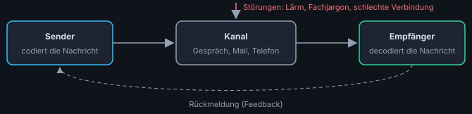
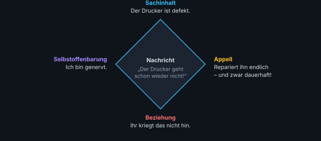
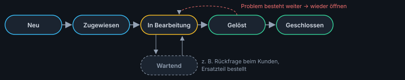

# 🗣️ Kundenberatung & Kommunikation

*Bereich: Planung · Prüfungsrelevanz: ★★☆*

> Kommunikationsmodelle, Fragetechniken, Bedarfsanalyse, Support, Markt & Organisation.

[⬅ Inhaltsverzeichnis](README.md)

---

IT ist eine Dienstleistung: Am Anfang jedes Auftrags steht ein Mensch mit einem Problem oder Wunsch, am Ende ein Mensch, der mit dem Ergebnis arbeiten soll. In der AP1 geht es deshalb immer wieder darum, Kunden richtig zu verstehen, Anfragen im Support sauber abzuarbeiten, Informationen aus Unterlagen (auch auf Englisch) zu ziehen und Ergebnisse verständlich zu präsentieren.

> [!WARNING]
> **Prüfungskatalog 2025:** Gestrichen bzw. nicht mehr ausdrücklich genannt sind Fragetechniken, aktives Zuhören, Eisbergmodell, Cross- und Upselling, Suchoperatoren, Benchmarking und SWOT. **Weiterhin wichtig:** Sender-Empfänger- und Vier-Seiten-Modell, situationsgerechte Kommunikation, Support-Level und Ticketsystem, Informationen aus deutschen und englischen Unterlagen auswerten, Präsentieren, Veränderungsprozesse begleiten. Die quantitative und qualitative Bewertung von Angeboten steht im Thema „Wirtschaftlichkeit“.

## Wie Kommunikation funktioniert

#### Sender-Empfänger-Modell

Wer etwas mitteilen will (Sender), muss seinen Gedanken in Zeichen übersetzen – Wörter, Bilder, Gesten. Das nennt man **codieren**. Die Nachricht geht über einen **Kanal** (Gespräch, Telefon, E-Mail, Ticket) zum Empfänger, der sie wieder in einen Gedanken übersetzt (**decodieren**).

**Warum entstehen Missverständnisse?** Weil Sender und Empfänger nicht denselben „Code“ benutzen. Für dich ist „Der DHCP-Server vergibt keine Leases mehr“ eine präzise Aussage, für die Buchhalterin am Telefon ist es Rauschen. Dazu kommen **Störungen** im Kanal: schlechte Verbindung, Lärm, eine missverständlich knappe Mail. Gegenmittel ist die **Rückmeldung**: nachfragen, mit eigenen Worten zusammenfassen, bestätigen lassen.

#### Vier-Seiten-Modell (Schulz von Thun)

Jede Nachricht enthält gleichzeitig vier Botschaften. Welche davon beim Empfänger ankommt, hängt davon ab, mit welchem „Ohr“ er hört.

<table><tr><th>Seite</th><th>Frage</th><th>im Beispiel</th></tr>
<tr><td><b>Sachinhalt</b></td><td>Worüber informiere ich?</td><td>Der Drucker funktioniert nicht.</td></tr>
<tr><td><b>Selbstoffenbarung</b></td><td>Was gebe ich von mir preis?</td><td>Ich bin genervt und unter Zeitdruck.</td></tr>
<tr><td><b>Beziehung</b></td><td>Was halte ich von dir, wie stehen wir zueinander?</td><td>Ich traue euch in der IT nicht viel zu.</td></tr>
<tr><td><b>Appell</b></td><td>Wozu will ich dich bringen?</td><td>Kümmert euch sofort und dauerhaft darum!</td></tr></table>

**Warum hilft das Modell im Support?** Wer nur mit dem „Beziehungsohr“ hört, fühlt sich angegriffen und antwortet gereizt – das Gespräch eskaliert. Professionell ist es, auf den **Sachinhalt** und den **Appell** einzugehen und die Selbstoffenbarung anzuerkennen, ohne den Vorwurf persönlich zu nehmen.

> [!NOTE]
> **Beispiel**
>
> **Professionelle Antwort**  
> „Das ist ärgerlich, gerade wenn Sie es eilig haben (Selbstoffenbarung anerkannt). Ich schaue mir das jetzt an (Appell aufgenommen). Welche Meldung zeigt der Drucker im Display? (Sachebene) Wenn es derselbe Fehler wie letzte Woche ist, tauschen wir die Einzugsrolle, damit es nicht wieder passiert.“

#### Situationsgerecht kommunizieren

Gute Kommunikation passt sich an die Person und die Lage an:

- **Zielgruppe:** Gegenüber Fachleuten darfst du Fachbegriffe verwenden. Gegenüber Laien erklärst du mit Alltagsvergleichen („Die Firewall ist wie der Pförtner am Eingang …“) und stellst den **Nutzen** in den Vordergrund statt die Technik.
- **Kanal:** Komplexes und Verbindliches schriftlich (Mail, Ticket, Protokoll), Dringendes und Emotionales mündlich (Telefon, persönlich). Ergebnisse aus Telefonaten schriftlich festhalten.
- **Sachlich bleiben:** Ich-Botschaften („Ich brauche noch die Fehlermeldung, um weiterzukommen“) statt Du-Vorwürfe („Sie haben wieder falsch geklickt“).
- **Bei Beschwerden:** ausreden lassen, Verständnis zeigen, das Problem zusammenfassen, eine konkrete nächste Handlung mit Zeitangabe zusagen und dann einhalten.

## Kundenbedarf ermitteln

Bevor du etwas anbietest, musst du verstehen, was der Kunde wirklich braucht. Kunden beschreiben oft eine Lösung („Wir brauchen schnellere PCs“), obwohl das eigentliche Problem woanders liegt (z. B. ein überlastetes Netzwerk). Deshalb geht man in drei Schritten vor:

1. **Ist-Analyse:** Was ist vorhanden? Hardware, Software, Netzwerk, Abläufe, Anzahl Nutzer, bekannte Probleme.
2. **Anforderungen erheben:** Was soll künftig möglich sein? Welche Rahmenbedingungen gelten (Budget, Termin, Datenschutz)?
3. **Soll-Konzept:** Lösungsvorschlag, der die Lücke zwischen Ist und Soll schließt.

Anforderungen unterscheidet man in zwei Arten:

<table><tr><th></th><th>funktionale Anforderung</th><th>nicht-funktionale Anforderung</th></tr>
<tr><td>beschreibt</td><td><b>was</b> das System tun soll</td><td><b>wie gut</b> bzw. unter welchen Bedingungen es das tun soll</td></tr>
<tr><td>Beispiele</td><td>„Außendienstmitarbeiter können Kundendaten offline bearbeiten.“ „Rechnungen werden als PDF exportiert.“</td><td>„Die Anwendung startet in unter 3 Sekunden.“ „Verfügbarkeit 99,5 %.“ „Bedienung barrierefrei.“ „Daten werden in der EU gespeichert.“</td></tr></table>

**Methoden**, um Anforderungen zu erheben:

<table><tr><th>Methode</th><th>Vorteil</th><th>Nachteil</th></tr>
<tr><td>Interview</td><td>Rückfragen möglich, auch unausgesprochene Bedürfnisse werden sichtbar</td><td>zeitaufwendig, nur wenige Personen</td></tr>
<tr><td>Fragebogen</td><td>viele Personen, Ergebnisse gut auswertbar</td><td>keine Rückfragen, Antworten oft oberflächlich</td></tr>
<tr><td>Beobachtung am Arbeitsplatz</td><td>zeigt tatsächliche Arbeitsweise</td><td>aufwendig, Beobachtete verhalten sich evtl. anders</td></tr>
<tr><td>Auswertung vorhandener Daten (Ticketstatistik, Inventarliste)</td><td>objektiv, schnell verfügbar</td><td>zeigt nur die Vergangenheit</td></tr></table>

## IT-Support: Ticketsystem und Support-Level

Ein IT-Service-Desk bekommt täglich viele Anfragen. Damit nichts verloren geht und die wichtigsten zuerst erledigt werden, wird jede Anfrage als **Ticket** erfasst.

**Ein Ticket enthält:** eindeutige Nummer, Meldende Person und Kontakt, betroffenes Gerät oder System, Beschreibung und Fehlermeldung, Kategorie, Priorität, zuständige Person, Status, Zeitstempel und alle Bearbeitungsschritte.

**Warum ein Ticketsystem?** Jede Anfrage ist nachvollziehbar und kann nicht vergessen werden. Mehrere Bearbeiter sehen den Stand. Gelöste Fälle landen in einer **Wissensdatenbank**, sodass das nächste Mal schneller geholfen werden kann. Und die Auswertung zeigt, ob vereinbarte Zeiten (SLA) eingehalten werden und wo sich Probleme häufen.

#### Support-Level

<table><tr><th>Level</th><th>Wer</th><th>Aufgabe</th></tr>
<tr><td>1st Level</td><td>Service Desk / Hotline</td><td>Anfragen annehmen, erfassen, kategorisieren; Standardprobleme sofort lösen (Passwort zurücksetzen, bekannte Fehler aus der Wissensdatenbank)</td></tr>
<tr><td>2nd Level</td><td>Fachspezialisten der IT</td><td>komplexere Fälle, die Fachwissen oder Zugriff auf Systeme brauchen (Server, Netzwerk, Fachanwendung)</td></tr>
<tr><td>3rd Level</td><td>Hersteller, Entwickler, externe Dienstleister</td><td>Fehler im Produkt selbst, Programmkorrekturen, Hardwaretausch durch den Hersteller</td></tr></table>

Die Weitergabe an das nächste Level heißt **funktionale Eskalation**. Wird stattdessen eine Führungskraft eingeschaltet, z. B. weil eine Frist zu reißen droht oder Entscheidungen über Kosten nötig sind, ist das eine **hierarchische Eskalation**.

#### Priorität festlegen

Die Priorität ergibt sich aus zwei Fragen: **Wie viele bzw. wie wichtige Bereiche sind betroffen (Auswirkung)?** und **Wie schnell muss es gehen (Dringlichkeit)?**

<table><tr><th>Auswirkung ↓ / Dringlichkeit →</th><th>hoch</th><th>mittel</th><th>niedrig</th></tr>
<tr><td><b>hoch</b> (ganze Abteilung, Kernprozess)</td><td>1 kritisch</td><td>2 hoch</td><td>3 mittel</td></tr>
<tr><td><b>mittel</b> (mehrere Nutzer)</td><td>2 hoch</td><td>3 mittel</td><td>4 niedrig</td></tr>
<tr><td><b>niedrig</b> (eine Person, Umgehung möglich)</td><td>3 mittel</td><td>4 niedrig</td><td>5 geplant</td></tr></table>

> [!NOTE]
> **Beispiel**
>
> **Priorisieren**  
> Ticket 1: Der Kassenserver im Laden ist ausgefallen, es kann nicht verkauft werden → Auswirkung hoch, Dringlichkeit hoch → **Priorität 1**.  
> Ticket 2: Eine Mitarbeiterin wünscht sich ein zweites Wörterbuch in Word → Auswirkung niedrig, Dringlichkeit niedrig → **Priorität 5**.  
> Ticket 3: Der Drucker im 2. Stock druckt nicht, im 1. Stock steht ein weiterer → Auswirkung mittel, Dringlichkeit mittel (Umweg möglich) → **Priorität 3**.

#### Incident und Problem

Ein **Incident** ist eine einzelne Störung: Der Dienst soll so schnell wie möglich wieder laufen, notfalls mit einer Behelfslösung (Workaround). Ein **Problem** ist die **Ursache** hinter einem oder mehreren Incidents. Wenn dieselbe VPN-Verbindung jeden Montag abbricht, wird jeder Abbruch als Incident schnell behoben – zusätzlich wird ein Problem eröffnet, um die Ursache zu finden und dauerhaft zu beseitigen.

#### Service Level Agreement (SLA)

In einem SLA vereinbaren Dienstleister und Kunde messbare Leistungen, z. B. **Servicezeiten** (Mo–Fr 8–18 Uhr), **Reaktionszeit** (bis jemand das Ticket bearbeitet), **Lösungszeit** und **Verfügbarkeit**.

> [!NOTE]
> **Beispiel**
>
> **Verfügbarkeit umrechnen**  
> Vereinbart sind 99,5 % Verfügbarkeit pro Monat (30 Tage, rund um die Uhr).  
> Gesamtzeit: 30 × 24 h = 720 h  
> Erlaubte Ausfallzeit: 720 h × (100 % − 99,5 %) = 720 h × 0,005 = **3,6 h** = 3 h 36 min

## Informationen beschaffen und auswerten

Für Beratung und Auswahl brauchst du verlässliche Informationen. Nicht jede Quelle ist gleich gut:

- **Primärquellen** (Herstellerdatenblatt, Gesetzestext, BSI, offizielle Dokumentation) haben Vorrang vor Sekundärquellen (Foren, Blogs, Vergleichsportale, KI-Zusammenfassungen).
- **Kriterien** für eine Quelle: Wer ist Autor oder Herausgeber und welches Interesse hat er? Wie aktuell ist sie (Datum, Version)? Ist sie sachlich oder Werbung? Werden Belege genannt?
- **Urheberrecht:** Fremde Texte als Zitat kennzeichnen, Bilder nur mit passender Lizenz verwenden.

#### Englische Unterlagen

In der AP1 kann eine Anlage auf Englisch sein: ein Datenblatt, ein Auszug aus einem Handbuch, eine Sicherheitswarnung oder Lizenzbedingungen. Du musst den Text nicht übersetzen, sondern gezielt Informationen herausholen. Vorgehen: erst die Frage lesen, dann im Text nach den Schlüsselwörtern suchen, Antwort auf Deutsch formulieren.

<table><tr><th>Englisch</th><th>Deutsch</th><th>Englisch</th><th>Deutsch</th></tr>
<tr><td>requirements</td><td>Anforderungen</td><td>warranty</td><td>Garantie</td></tr>
<tr><td>power consumption</td><td>Leistungsaufnahme</td><td>supported / not supported</td><td>unterstützt / nicht unterstützt</td></tr>
<tr><td>vulnerability</td><td>Schwachstelle</td><td>affected versions</td><td>betroffene Versionen</td></tr>
<tr><td>patch / firmware</td><td>Korrektur / Gerätesoftware</td><td>workaround / mitigation</td><td>Behelfslösung / Abschwächung</td></tr>
<tr><td>license / licensee</td><td>Lizenz / Lizenznehmer</td><td>subscription</td><td>Abonnement</td></tr>
<tr><td>device / seat</td><td>Gerät / Arbeitsplatz-Lizenz</td><td>transfer</td><td>übertragen</td></tr>
<tr><td>backward compatible</td><td>abwärtskompatibel</td><td>end of life (EOL)</td><td>Ende des Supports</td></tr>
<tr><td>throughput</td><td>Datendurchsatz</td><td>refresh rate</td><td>Bildwiederholrate</td></tr>
<tr><td>height-adjustable / tilt / swivel / pivot</td><td>höhenverstellbar / neigen / seitlich drehen / hochkant drehen</td><td>color gamut</td><td>Farbraum</td></tr>
<tr><td>shall / must / may</td><td>muss / muss / darf</td><td>prior written consent</td><td>vorherige schriftliche Zustimmung</td></tr></table>

> [!NOTE]
> **Beispiel**
>
> **Information aus englischem Text**  
> Auszug aus einer Lizenz: *„The software may be installed on up to three devices per licensee. Transfer to another person requires prior written consent of the vendor.“*  
> Frage: Darf die Mitarbeiterin die Software auf ihrem Notebook, ihrem PC und ihrem Tablet nutzen und sie später einem Kollegen weitergeben?  
> Antwort: Die Installation auf drei Geräten ist erlaubt („up to three devices“). Die Weitergabe an den Kollegen ist nur mit vorheriger schriftlicher Zustimmung des Herstellers zulässig.

## Präsentieren und moderieren

Am Ende einer Beratung oder eines Projekts stellst du Ergebnisse vor – der Geschäftsleitung, dem Team oder den künftigen Nutzern. Eine gute Präsentation entsteht in der Vorbereitung:

1. **Ziel klären:** Informieren, überzeugen, eine Entscheidung herbeiführen?
2. **Zielgruppe einschätzen:** Vorwissen, Interessen, Erwartungen. Die Geschäftsleitung will Kosten, Nutzen und eine Empfehlung, das Team will wissen, was sich für seine Arbeit ändert.
3. **Rahmen festlegen:** Zeit, Raum, Medien.

**Aufbau:** **Einleitung** (Thema, Ziel, Ablauf) – **Hauptteil** (wenige Kernaussagen mit rotem Faden) – **Schluss** (Zusammenfassung, Empfehlung, Fragen).

**Folien:** eine Aussage pro Folie, Stichworte statt ganzer Sätze, gut lesbare Schrift (mindestens etwa 18 pt), Zahlen als Diagramm, einheitliches Design im Corporate Design des Unternehmens. Die Folien unterstützen den Vortrag – sie ersetzen ihn nicht.

<table><tr><th>Medium</th><th>geeignet für</th></tr>
<tr><td>Präsentation mit Beamer/Bildschirm</td><td>Ergebnisse vor einer Gruppe vorstellen</td></tr>
<tr><td>Handout</td><td>Inhalte zum Nachlesen, Zahlen zum Mitnehmen</td></tr>
<tr><td>Webinar, Videokonferenz</td><td>verteilte Teilnehmende, Schulungen ohne Anreise</td></tr>
<tr><td>Video-Tutorial</td><td>Bedienschritte, die man sich jederzeit wieder ansehen kann</td></tr>
<tr><td>FAQ, Wiki, Wissensdatenbank</td><td>häufige Fragen dauerhaft beantworten, Support entlasten</td></tr>
<tr><td>Flipchart, Whiteboard</td><td>gemeinsames Erarbeiten in Workshops</td></tr></table>

**Moderation:** Die Moderatorin leitet eine Besprechung oder einen Workshop **neutral**. Sie bringt keine eigene Meinung ein, sondern achtet auf Ziel und Zeit, sorgt dafür, dass alle zu Wort kommen, und hält Ergebnisse fest. Zum Ideensammeln eignen sich **Brainstorming** (Ideen frei sammeln, Bewertung erst danach – denn Kritik bremst Kreativität) und die **Mindmap** (Gedanken um einen zentralen Begriff in Äste ordnen).

## Feedback und Reflexion

Feedback hilft dir und anderen, besser zu werden – aber nur, wenn es so gegeben wird, dass man es annehmen kann.

<table><tr><th>Feedback geben</th><th>Feedback nehmen</th></tr>
<tr><td>Ich-Botschaften („Mir ist aufgefallen …“) konkret beschreiben statt bewerten zeitnah und unter vier Augen auf veränderbares Verhalten beziehen Positives nennen und einen Verbesserungsvorschlag machen</td><td>zuhören und ausreden lassen nicht rechtfertigen oder verteidigen nachfragen, wenn etwas unklar ist bedanken selbst entscheiden, was man umsetzt</td></tr></table>

> [!NOTE]
> **Beispiel**
>
> Statt: „Deine Präsentation war chaotisch.“  
> Besser: „Mir fiel es schwer, dem Teil über die Kosten zu folgen, weil die Zahlen auf drei Folien verteilt waren. Eine Tabelle auf einer Folie wäre für mich übersichtlicher gewesen. Die Live-Demo am Anfang fand ich sehr anschaulich.“

Im Team reflektiert man die Zusammenarbeit regelmäßig, z. B. in einer **Retrospektive** (Was lief gut? Was lief nicht gut? Was probieren wir als Nächstes?) oder am Projektende mit **Lessons Learned**.

## Kommunikationssysteme im Unternehmen

<table><tr><th>System</th><th>Zweck / Beispiele</th></tr>
<tr><td>E-Mail und Groupware</td><td>Mail, Kalender, Kontakte, Aufgaben gemeinsam nutzen – Exchange/Outlook, Microsoft 365</td></tr>
<tr><td>Unified Communications and Collaboration</td><td>Chat, Telefonie, Videokonferenz, Dateiablage und gemeinsames Bearbeiten auf einer Plattform – Teams, Zoom, Slack</td></tr>
<tr><td>VoIP-Telefonie</td><td>Telefonieren über das IP-Netz (Protokoll SIP), IP-Telefone mit PoE, Softphones, Cloud-Telefonanlage; QoS und eigenes VLAN für gute Sprachqualität</td></tr>
<tr><td>Intranet, Wiki</td><td>interne Informationen und Wissensdatenbank – SharePoint, Confluence</td></tr>
<tr><td>Ticketsystem</td><td>Support-Anfragen strukturiert bearbeiten</td></tr></table>

**Benutzeroberflächen:** Eine **GUI** (grafische Oberfläche) ist intuitiv und für Endanwender gedacht. Eine **CLI** (Kommandozeile) ist schneller für Fachleute und lässt sich per Skript automatisieren, etwa um 50 Benutzerkonten auf einmal anzulegen. Eine **Web-Oberfläche** läuft im Browser und ist damit unabhängig vom Betriebssystem.

## Veränderungsprozesse begleiten

Wird ein neues System eingeführt – neue Software, neues Betriebssystem, Umstieg in die Cloud –, reagieren Mitarbeitende oft mit **Widerstand**. **Warum?** Sie haben sich an die alten Abläufe gewöhnt, fürchten, mit dem Neuen nicht klarzukommen oder überflüssig zu werden, haben schlechte Erfahrungen mit früheren Umstellungen oder wissen schlicht nicht, warum die Änderung nötig ist.

Widerstand ist normal und ein Hinweis darauf, dass Information oder Beteiligung fehlt. Maßnahmen:

- **früh und offen informieren:** warum die Änderung kommt, was sich ändert, wann
- **Betroffene beteiligen:** Anforderungen abfragen, Testnutzer einbinden
- **Nutzen zeigen:** was wird für die Mitarbeitenden leichter?
- **schulen:** Präsenzschulung, Video-Tutorials, Key-User (Multiplikatoren) als Ansprechpartner in den Abteilungen
- **Unterstützer gewinnen** (Promotoren) und die Bedenken von Skeptikern ernst nehmen – sie weisen oft auf echte Schwachstellen hin
- **Betriebsrat** einbeziehen, wenn das System Leistung oder Verhalten überwachen kann

## Markt und Unternehmen

Wie viel Verhandlungsspielraum du beim Einkauf hast oder wie du als IT-Dienstleister Preise setzen kannst, hängt von der **Marktsituation** ab.

<table><tr><th>Marktform</th><th>Anbieter</th><th>Nachfrager</th><th>Beispiel</th></tr>
<tr><td>Polypol</td><td>viele</td><td>viele</td><td>Händler für Standard-Hardware</td></tr>
<tr><td>Oligopol</td><td>wenige</td><td>viele</td><td>Prozessorhersteller, große Cloud-Anbieter</td></tr>
<tr><td>Monopol</td><td>einer</td><td>viele</td><td>Hersteller einer speziellen Branchensoftware</td></tr></table>

Ist das Angebot größer als die Nachfrage, spricht man vom **Käufermarkt**: Käufer können wählen, die Preise sinken. Ist die Nachfrage größer (z. B. Chipmangel), herrscht ein **Verkäufermarkt**: Preise steigen, Lieferzeiten werden länger. Beim **Gleichgewichtspreis** sind angebotene und nachgefragte Menge gleich.

**Vertriebswege:** direkt (der Hersteller verkauft selbst, z. B. im Onlineshop) oder indirekt (über Händler oder Systemhäuser, die zusätzlich beraten und installieren).

**Geschäftsprozesse:** **Kernprozesse** schaffen den Wert für den Kunden (bei einem IT-Dienstleister: Beratung, Installation, Support). **Unterstützungsprozesse** halten den Betrieb am Laufen (Personal, Buchhaltung, interne IT). **Managementprozesse** steuern das Unternehmen (Strategie, Controlling).

**Aufbauorganisation:** Im **Einliniensystem** hat jede Stelle genau einen Vorgesetzten – klare Zuständigkeit, aber lange Dienstwege. Im **Mehrliniensystem** gibt es mehrere fachliche Vorgesetzte – kurze Wege, aber mögliche Kompetenzkonflikte. Die **Matrixorganisation** überlagert Funktionsbereiche und Projekte oder Produkte – flexibel, aber mit Konfliktpotenzial zwischen den Leitungen.

## Hintergrund: Gesprächstechniken

Nicht mehr ausdrücklich im Katalog, im Beratungsalltag aber nützlich: **Offene Fragen** (W-Fragen: „Welche Programme nutzen Sie täglich?“) sammeln Informationen. **Geschlossene Fragen** („Arbeiten Sie auch mobil?“) klären Einzelheiten. **Kontrollfragen** („Habe ich richtig verstanden, dass …?“) sichern das Verständnis. Beim **aktiven Zuhören** zeigst du Aufmerksamkeit, fasst mit eigenen Worten zusammen und fragst nach. Das **Eisbergmodell** besagt, dass der größte Teil der Kommunikation unter der sichtbaren Sachebene auf der Beziehungsebene abläuft.

> [!CAUTION]
> **Typische Fehler**
>
> - Die vier Seiten nur aufzählen, statt sie auf das konkrete Beispiel der Aufgabe anzuwenden.
> - Selbstoffenbarung und Beziehung verwechseln: Selbstoffenbarung = etwas über **mich**, Beziehung = etwas über **uns** bzw. über **dich**.
> - Funktionale und nicht-funktionale Anforderungen vertauschen – Antwortzeit, Verfügbarkeit, Sicherheit und Bedienbarkeit sind **nicht-funktional**.
> - Bei der Priorität nur die Dringlichkeit beachten und die Auswirkung (Anzahl Betroffene, Kernprozess) vergessen.
> - Incident und Problem gleichsetzen.
> - Bei englischen Anlagen Wort für Wort übersetzen, statt gezielt nach der gefragten Information zu suchen.
> - Bei der Präsentation nur Folienregeln nennen und die Zielgruppe vergessen.

**📝 Prüfungsaufgabe:** **Eine Kundin sagt am Telefon: „Seit Ihrem Update letzte Woche stürzt unser Warenwirtschaftsprogramm ständig ab.“ Ordnen Sie der Aussage die vier Seiten einer Nachricht zu. (4 Punkte)**

Lösung anzeigen

Sachinhalt: Das Warenwirtschaftsprogramm stürzt seit dem Update regelmäßig ab (1). Selbstoffenbarung: Ich bin verärgert bzw. kann nicht richtig arbeiten (1). Beziehung: Sie haben mit Ihrem Update den Fehler verursacht, ich bin mit Ihrer Arbeit unzufrieden (1). Appell: Beheben Sie das schnell (1).

**📝 Prüfungsaufgabe:** **Ordnen Sie zu, ob es sich um eine funktionale oder nicht-funktionale Anforderung handelt: a) Benutzer können Urlaubsanträge online stellen. b) Die Seite lädt in höchstens 2 Sekunden. c) Die Anwendung ist mit Screenreadern bedienbar. (3 Punkte)**

Lösung anzeigen

a) funktional – beschreibt eine Funktion (1). b) nicht-funktional – Leistung/Antwortzeit (1). c) nicht-funktional – Bedienbarkeit/Barrierefreiheit (1).

**📝 Prüfungsaufgabe:** **Erläutern Sie den Unterschied zwischen 1st- und 2nd-Level-Support und nennen Sie je ein typisches Beispiel. (4 Punkte)**

Lösung anzeigen

Der 1st-Level-Support nimmt alle Anfragen an, erfasst sie im Ticketsystem und löst Standardprobleme direkt, z. B. ein Passwort zurücksetzen (2). Was er nicht lösen kann, gibt er an den 2nd Level weiter: Fachspezialisten mit tieferem Wissen und Systemzugriff, z. B. für einen Fehler in der Konfiguration des Mailservers (2).

**📝 Prüfungsaufgabe:** **Der Dienstleister sichert 99,8 % Verfügbarkeit pro Jahr (365 Tage) zu. Berechnen Sie die maximal zulässige Ausfallzeit in Stunden. (2 Punkte)**

Lösung anzeigen

365 × 24 h = 8.760 h (1). 8.760 h × 0,002 = **17,52 h** (1).

**📝 Prüfungsaufgabe:** **In einer Abteilung wird ein neues Dokumentenmanagementsystem eingeführt. Mehrere Mitarbeitende lehnen es ab. Nennen Sie zwei mögliche Ursachen und zwei geeignete Maßnahmen. (4 Punkte)**

Lösung anzeigen

Ursachen (je 1): Angst, mit dem neuen System nicht zurechtzukommen; Gewohnheit an bisherige Abläufe; fehlende Information über den Sinn der Umstellung; schlechte Erfahrungen mit früheren Einführungen. Maßnahmen (je 1): frühzeitig informieren und den Nutzen erklären; Mitarbeitende beteiligen (z. B. als Testnutzer); Schulungen und Key-User als Ansprechpartner.

---

## 🃏 Karteikarten (39)

| Frage | Antwort |
|---|---|
| Vier Seiten einer Nachricht (Schulz von Thun) | Sachinhalt, Selbstoffenbarung, Beziehung, Appell. |
| Eisbergmodell | Kleiner sichtbarer Teil = Sachebene; großer unsichtbarer Teil = Beziehungsebene (Gefühle, Werte). |
| Sender-Empfänger-Modell – Hauptproblem | Nachricht wird codiert/decodiert; unterschiedliche Codes (z. B. Fachsprache) und Störungen führen zu Missverständnissen. |
| Offene Frage – wofür? | Informationen sammeln, Kunde erzählt frei (W-Fragen). |
| Geschlossene Frage – wofür? | Ja/Nein-Antwort, Bestätigung konkreter Punkte. |
| Aktives Zuhören | Aufmerksam zuhören, nicht unterbrechen, paraphrasieren, nachfragen, Gefühle spiegeln. |
| Upselling vs. Cross-Selling | Upselling: höherwertiges Produkt. Cross-Selling: ergänzendes Zusatzprodukt. |
| 1st/2nd/3rd Level Support | 1st: Service Desk, Annahme & Standardlösung. 2nd: Spezialisten. 3rd: Hersteller/Entwicklung. |
| Incident vs. Problem | Incident: einzelne Störung, schnell beheben. Problem: zugrundeliegende Ursache, dauerhaft lösen. |
| Funktionen eines Ticketsystems | Erfassen, priorisieren, zuweisen, Status verfolgen, dokumentieren, auswerten, Wissensdatenbank. |
| Polypol / Oligopol / Monopol | Viele / wenige / ein Anbieter bei vielen Nachfragern. |
| Käufermarkt | Angebot übersteigt Nachfrage – Käufer hat Verhandlungsmacht. |
| Einliniensystem | Jede Stelle hat genau einen Vorgesetzten; klare Zuständigkeit, lange Dienstwege. |
| Matrixorganisation | Überlagerung von Funktions- und Projekt-/Produktlinie; flexibel, aber Kompetenzkonflikte. |
| Promotor im Change-Prozess | Unterstützer, der die Veränderung aktiv vorantreibt und andere motiviert. |
| Direkter vs. indirekter Vertrieb | Direkt: Hersteller verkauft selbst an Kunden. Indirekt: über Händler/Systemhaus. |
| Suchoperator für exakte Wortfolge | Anführungszeichen "…". |
| site: | Begrenzt die Suche auf eine Website/Domain, z. B. site:bsi.bund.de. |
| filetype: | Findet nur einen Dateityp, z. B. filetype:pdf. |
| Minus-Operator | Schließt einen Begriff aus: Drucker -Tinte. |
| Kriterien für vertrauenswürdige Quellen | Autor/Herausgeber, Aktualität, Objektivität, Belege, Primärquelle. |
| vulnerability / mitigation | Schwachstelle / Maßnahme zur Abschwächung. |
| end of life (EOL) | Produkt wird nicht mehr unterstützt – keine Updates mehr. |
| pivot / swivel / tilt | Hochkant drehen / seitlich drehen / neigen (Monitor-Ergonomie). |
| Feedbackregeln | Ich-Botschaften, konkret/beschreibend, zeitnah, konstruktiv, Positives nennen, veränderbares Verhalten, unter vier Augen. |
| Sandwich-Methode | Positiv – Kritik/Verbesserung – positiv. |
| Retrospektive – Leitfragen | Was lief gut? Was lief schlecht? Was verbessern wir? |
| Groupware | Software für Mail, Kalender, Kontakte, Aufgaben im Team (z. B. Exchange/Outlook). |
| Unified Communications | Chat, Telefonie, Video, Dateien in einer Plattform (z. B. Teams). |
| VoIP – Voraussetzungen im Netz | PoE für IP-Telefone, QoS/VLAN für Sprachqualität, ausreichende Bandbreite, geringe Latenz. |
| GUI vs. CLI | GUI: grafisch, intuitiv. CLI: Kommandozeile, schnell, automatisierbar per Skript. |
| Aufbau einer Präsentation | Einleitung (Thema, Ablauf) – Hauptteil (Kernaussagen) – Schluss (Zusammenfassung, Empfehlung, Fragen). |
| Regeln für gute Folien | Wenig Text, eine Aussage pro Folie, lesbare Schrift, Zahlen als Diagramm, einheitliches Design. |
| Präsentation vor Fachfremden | Fachbegriffe erklären, Beispiele nutzen, den Nutzen statt der Technik betonen. |
| Aufgabe des Moderators | Leitet das Gespräch neutral, achtet auf Zeit und Ziel, hält Ergebnisse fest. |
| Brainstorming – Regeln | Ideen frei sammeln, keine Bewertung oder Kritik währenddessen, Menge vor Qualität, Ideen anderer aufgreifen. |
| Mindmap | Gedanken werden um einen zentralen Begriff in Haupt- und Nebenästen geordnet. |
| Käufermarkt vs. Verkäufermarkt | Käufermarkt: Angebot > Nachfrage, Preise sinken. Verkäufermarkt: Nachfrage > Angebot, Preise steigen. |
| Kern- vs. Unterstützungsprozess | Kernprozess schafft Wert für den Kunden (Beratung, Support). Unterstützungsprozess hält den Betrieb am Laufen (Personal, Buchhaltung). |

## ✍️ Übungsfragen (22)

**1.** Ein Kollege sagt: „Die Grafikkarte ist ja schon wieder überhitzt.“ Welche Seite steht beim Satz „Kümmer dich endlich darum!“ im Vordergrund?

Lösung

**Musterlösung (2 P):** Appell Aufforderung zum Handeln = Appell.

**2.** Formulieren Sie eine Frage, mit der Sie im Erstgespräch den Bedarf einer Kundin für einen neuen Arbeitsplatz-PC ermitteln, und begründen Sie die Frageform.

Lösung

**Musterlösung (2 P):** Z. B. „Welche Anwendungen nutzen Sie im Arbeitsalltag?“ (1) – eine offene W-Frage: Die Kundin erzählt frei und liefert viele Informationen. Geschlossene oder Suggestivfragen („Sie möchten doch sicher 32 GB RAM?“) schränken die Antwort ein (1). Offene W-Frage – der Kunde liefert Informationen.

**3.** Eine Kundin kauft ein Notebook. Der Verkäufer empfiehlt zusätzlich eine Dockingstation. Das ist …

Lösung

**Musterlösung (2 P):** Cross-Selling Ergänzendes Produkt = Cross-Selling.

**4.** Welche Support-Ebene nimmt Störungsmeldungen an und löst Standardprobleme?

Lösung

**Musterlösung (2 P):** 1st Level Der Service Desk (1st Level) ist der Single Point of Contact.

**5.** Wenige Anbieter stehen vielen Nachfragern gegenüber. Welche Marktform?

Lösung

**Musterlösung (2 P):** Oligopol Oligopol, z. B. Betriebssysteme oder CPU-Hersteller.

**6.** Welche Merkmale gehören zum aktiven Zuhören? Nennen Sie drei.

Lösung

**Musterlösung (3 P):** Je 1 Punkt (max. 3): Paraphrasieren; Nachfragen; Blickkontakt halten. Unterbrechen widerspricht aktivem Zuhören.

**7.** Was liegt laut Eisbergmodell „unter Wasser“?

Lösung

**Musterlösung (2 P):** Gefühle, Werte, Erfahrungen Beziehungsebene = großer unsichtbarer Teil.

**8.** Bei welcher Organisationsform hat ein Mitarbeiter mehrere fachliche Vorgesetzte?

Lösung

**Musterlösung (2 P):** Mehrliniensystem Mehrliniensystem (Taylor): kurze Wege, aber mögliche Weisungskonflikte.

**9.** Was unterscheidet ein Problem von einem Incident?

Lösung

**Musterlösung (2 P):** Ein Problem ist die Ursache einer oder mehrerer Störungen. Incident = Symptom/Störung, Problem = Ursache.

**10.** Ein Mitarbeiter lehnt die Einführung eines neuen Ticketsystems ab. Nennen Sie zwei mögliche Ursachen für Widerstand und zwei Gegenmaßnahmen. (4 Punkte)

Lösung

**Musterlösung (4 P):** Ursachen (je 1): Angst vor Kompetenzverlust/Überforderung; Wissenslücken zum neuen System; schlechte Erfahrungen mit früheren Einführungen; Angst vor Kontrolle. Maßnahmen (je 1): frühzeitig informieren und Nutzen erklären; Mitarbeiter einbeziehen (Feedback, Testphase); Schulungen/Key-User als Multiplikatoren; Unterstützung/Ansprechpartner während der Einführung.

**11.** Nennen Sie vier Funktionen eines Ticketsystems. (4 Punkte)

Lösung

**Musterlösung (4 P):** Je 1 Punkt: Erfassung von Anfragen; Priorisierung/Kategorisierung; Zuweisung an Bearbeiter/Level; Verfolgung des Bearbeitungsstatus; Dokumentation der Lösung/Wissensdatenbank; Auswertungen/Statistiken und SLA-Überwachung; Benachrichtigung des Kunden.

**12.** Erklären Sie anhand des Vier-Seiten-Modells die Aussage eines Kunden: „Das neue Programm ist ja total kompliziert.“ (4 Punkte)

Lösung

**Musterlösung (4 P):** Sachinhalt: Das Programm ist komplex zu bedienen (1). Selbstoffenbarung: Ich fühle mich überfordert/unsicher (1). Beziehung: Ihr habt mir etwas Ungeeignetes gegeben bzw. mich nicht gut eingewiesen (1). Appell: Erklärt es mir/schult mich bzw. vereinfacht es (1).

**13.** Sie suchen nur PDF-Datenblätter eines Monitors auf der Herstellerseite example.com. Welche Suchanfrage passt?

Lösung

**Musterlösung (2 P):** site:example.com Datenblatt filetype:pdf

**14.** Welche Quelle ist für die Frage „Unterstützt Gerät X DisplayPort Alt Mode?“ am verlässlichsten?

Lösung

**Musterlösung (2 P):** Das aktuelle Datenblatt des Herstellers Primärquelle, aktuell.

**15.** In einer Sicherheitsmeldung steht „Affected versions: 2.1.0 – 2.3.4. Fixed in 2.3.5“. Ihre Firmware ist 2.3.4. Was tun?

Lösung

**Musterlösung (2 P):** Auf 2.3.5 oder neuer aktualisieren 2.3.4 ist betroffen; die Korrektur ist in 2.3.5.

**16.** Was bedeutet „The licensee may not transfer the software without prior written consent“?

Lösung

**Musterlösung (2 P):** Der Lizenznehmer darf die Software nur mit vorheriger schriftlicher Zustimmung übertragen

**17.** Ein Kollege kam diese Woche zweimal zu spät zum Daily. Formulieren Sie ein Feedback nach den Feedbackregeln und nennen Sie zwei Regeln, die Sie dabei beachtet haben.

Lösung

**Musterlösung (3 P):** Z. B.: „Mir ist aufgefallen, dass du diese Woche zweimal zu spät zum Daily kamst. Dadurch mussten wir Themen wiederholen. Können wir das ändern?“ (1) Regeln (je 1): Ich-Botschaft; konkret und beschreibend statt verallgemeinernd („immer“); zeitnah; auf veränderbares Verhalten bezogen; lösungsorientiert; unter vier Augen. Ich-Botschaft, konkret, beschreibend, lösungsorientiert.

**18.** Ein Unternehmen stellt auf IP-Telefonie um. Was ist im Netzwerk besonders wichtig?

Lösung

**Musterlösung (2 P):** PoE für die Telefone und QoS/VLAN zur Priorisierung der Sprachdaten

**19.** Ein Admin will 200 Benutzerkonten automatisiert anlegen. Welche Oberfläche ist am besten geeignet?

Lösung

**Musterlösung (2 P):** CLI/Skript (z. B. PowerShell) Automatisierbar und schnell.

**20.** Sie sollen der Geschäftsführung in zehn Minuten Ihr Konzept für neue Arbeitsplätze vorstellen. Nennen Sie vier Punkte, die Sie bei Vorbereitung und Gestaltung beachten.

Lösung

**Musterlösung (4 P):** Je 1: Ziel und Kernaussage festlegen; Zielgruppe berücksichtigen – Nutzen und Kosten statt technischer Details; klarer Aufbau aus Einleitung, Hauptteil, Schluss; wenig Text und Diagramme auf den Folien; Fachbegriffe erklären; Zeit einhalten und Probedurchlauf; mit einer klaren Empfehlung enden und Fragen zulassen.

**21.** Nennen Sie zwei Regeln für ein Brainstorming.

Lösung

**Musterlösung (2 P):** Je 1: Ideen werden während der Sammlung nicht bewertet oder kritisiert; Menge geht vor Qualität; freies Assoziieren ist erwünscht; Ideen anderer dürfen aufgegriffen werden; alle Ideen werden sichtbar festgehalten.

**22.** Wie heißt die Marktsituation, in der das Angebot größer ist als die Nachfrage?

Lösung

**Musterlösung (2 P):** Käufermarkt

[⬅ Inhaltsverzeichnis](README.md)
