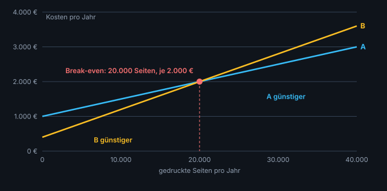

# 💶 Wirtschaftlichkeit & Kalkulation

*Bereich: Planung · Prüfungsrelevanz: ★★★*

> Kostenarten, TCO, Kauf/Miete/Leasing, Amortisation, Nutzwertanalyse, Angebotsvergleich.

[⬅ Inhaltsverzeichnis](README.md)

---

Fast jede AP1 enthält eine Rechenaufgabe zur Wirtschaftlichkeit: Welches Angebot ist günstiger? Ab wann lohnt sich ein Gerät? Kaufen oder leasen? Diese Aufgaben sind sichere Punkte, wenn du die wenigen Formeln kennst und den Rechenweg sauber aufschreibst. Dazu kommt die **Nutzwertanalyse**, mit der man auch Dinge vergleicht, die sich nicht in Euro ausdrücken lassen.

> [!WARNING]
> **Prüfungskatalog 2025:** Gestrichen sind Deckungsbeitrag, Vor- und Nachkalkulation sowie Stamm- und Bewegungsdaten. **Weiterhin wichtig:** fixe und variable Kosten, Kauf, Miete und Leasing, Amortisationszeit, Nutzwertanalyse, quantitativer und qualitativer Angebotsvergleich, Umsatz und Gewinn, ökonomische, ökologische und soziale Ziele. Die Verkaufskalkulation unten ist Zusatzwissen.

## Kostenarten

Wer Kosten vergleichen will, muss sie zuerst sortieren. Die wichtigste Unterscheidung ist, ob Kosten von der Nutzung abhängen:

<table><tr><th>Kostenart</th><th>Bedeutung</th><th>Beispiele</th></tr>
<tr><td><b>Fixkosten</b></td><td>fallen unabhängig von der Nutzungsmenge an</td><td>Miete, Leasingrate, Wartungspauschale, Lizenz-Abo pro Nutzer, Abschreibung</td></tr>
<tr><td><b>variable Kosten</b></td><td>steigen mit der Nutzung</td><td>Toner und Papier pro Seite, Strom, Cloud-Abrechnung nach Verbrauch</td></tr>
<tr><td><b>einmalige Kosten</b></td><td>fallen einmal zu Beginn an</td><td>Anschaffung, Installation, Einrichtung, Schulung</td></tr>
<tr><td><b>laufende Kosten</b></td><td>fallen regelmäßig während der Nutzung an</td><td>Strom, Support, Wartung, Abonnements</td></tr></table>

> [!IMPORTANT]
> **Gesamtkosten = Fixkosten + variable Kosten pro Stück × Menge**  
> K = Kfix + kvar × x

**Warum reicht der Anschaffungspreis nicht?** Ein billiger Drucker mit teuren Patronen oder ein günstiger PC mit hohem Stromverbrauch kann über die Jahre teurer sein als ein Gerät, das in der Anschaffung mehr kostet. Deshalb betrachtet man die **TCO** (Total Cost of Ownership): alle Kosten über die gesamte Nutzungsdauer – Anschaffung, Betrieb, Wartung, Support und Entsorgung.

> [!NOTE]
> **Beispiel**
>
> **TCO zweier PCs über 4 Jahre**  
> PC A: 650 €, Leistungsaufnahme 45 W, 3 Jahre Vor-Ort-Service müssen für 120 € dazugekauft werden.  
> PC B: 800 €, 25 W, 4 Jahre Vor-Ort-Service inklusive.  
> Betrieb: 8 h an 220 Tagen = 1.760 h pro Jahr, Strompreis 0,30 €/kWh.  
>
> Strom A: 0,045 kW × 1.760 h = 79,2 kWh/Jahr × 0,30 € = 23,76 €/Jahr → 4 Jahre: 95,04 €  
> Strom B: 0,025 kW × 1.760 h = 44 kWh/Jahr × 0,30 € = 13,20 €/Jahr → 4 Jahre: 52,80 €  
>
> TCO A: 650 + 95,04 + 120 = **865,04 €**  
> TCO B: 800 + 52,80 = **852,80 €**  
> PC B ist trotz höherem Preis über die Nutzungsdauer günstiger – und bei 30 Geräten macht das schon über 360 € aus.

## Kostenvergleich und Break-even

Oft konkurrieren zwei Angebote, von denen eines höhere Fixkosten, aber niedrigere variable Kosten hat. Welches günstiger ist, hängt dann von der **Menge** ab. Die Menge, bei der beide gleich viel kosten, heißt **Break-even-Punkt** (kritische Menge).

> [!NOTE]
> **Beispiel**
>
> **Zwei Drucker**  
> Drucker A: 1.000 € Fixkosten pro Jahr (Leasing + Wartung), 0,05 € pro Seite  
> Drucker B: 400 € Fixkosten pro Jahr, 0,08 € pro Seite  
>
> **Schritt 1 – Kostenfunktionen aufstellen:** KA = 1.000 + 0,05x · KB = 400 + 0,08x  
> **Schritt 2 – gleichsetzen:** 1.000 + 0,05x = 400 + 0,08x  
> **Schritt 3 – auflösen:** 1.000 − 400 = 0,08x − 0,05x → 600 = 0,03x → x = 600 ÷ 0,03 = **20.000 Seiten**  
> **Schritt 4 – Probe:** KA = 1.000 + 0,05 × 20.000 = 2.000 € · KB = 400 + 0,08 × 20.000 = 2.000 € ✓  
> **Schritt 5 – deuten:** Unter 20.000 Seiten pro Jahr ist B günstiger, darüber A. Druckt die Abteilung 30.000 Seiten, kostet A 2.500 € und B 2.800 € – also A.

> [!TIP]
> Merke dir die Kurzform: **kritische Menge = Differenz der Fixkosten ÷ Differenz der variablen Kosten**. Hier: 600 € ÷ 0,03 € = 20.000.

## Amortisationszeit

Eine Investition kostet erst einmal Geld, spart aber danach laufende Kosten. Die **Amortisationszeit** gibt an, nach wie vielen Monaten oder Jahren die Einsparungen die Anschaffungskosten wieder eingebracht haben. Je kürzer, desto geringer das Risiko – denn je länger es dauert, desto eher ist das Gerät veraltet, bevor es sich bezahlt gemacht hat.

> [!IMPORTANT]
> **Amortisationszeit = Anschaffungskosten ÷ Einsparung pro Zeiteinheit**  
> Einsparung = bisherige laufende Kosten − neue laufende Kosten

> [!NOTE]
> **Beispiel**
>
> **Neues Druckkonzept**  
> Eine Firma ersetzt 15 Arbeitsplatzdrucker durch 3 Multifunktionsgeräte. Anschaffung und Einrichtung: 9.000 €.  
> Bisher: 750 € pro Monat für Toner, Wartung und Strom. Künftig: 450 € pro Monat.  
>
> Einsparung: 750 € − 450 € = 300 € pro Monat  
> Amortisationszeit: 9.000 € ÷ 300 €/Monat = **30 Monate** = 2,5 Jahre  
> Bei einer geplanten Nutzungsdauer von 5 Jahren spart die Firma danach noch 30 × 300 € = 9.000 €. Die Investition lohnt sich.

> [!CAUTION]
> **Typische Fehler**
>
> Die neuen laufenden Kosten vergessen und die alten Kosten komplett als Einsparung rechnen. Oder Monate und Jahre mischen: Wird die Einsparung pro Jahr angegeben, kommt die Amortisationszeit in Jahren heraus.

## Kauf, Miete, Leasing, Pay-per-Use

<table><tr><th>Form</th><th>Vorteile</th><th>Nachteile</th></tr>
<tr><td><b>Kauf</b></td><td>Eigentum, bei langer Nutzung meist am günstigsten, freie Verfügung</td><td>hohe Kapitalbindung auf einmal, Risiko der Veralterung, Wartung und Entsorgung selbst</td></tr>
<tr><td><b>Miete</b></td><td>sehr flexibel, kurze Laufzeiten, keine Kapitalbindung</td><td>auf Dauer teuer, kein Eigentum</td></tr>
<tr><td><b>Leasing</b></td><td>Liquidität bleibt erhalten, planbare monatliche Raten, regelmäßige Erneuerung, Raten sind Betriebsausgaben</td><td>insgesamt teurer als Kauf, feste Vertragsbindung, kein Eigentum</td></tr>
<tr><td><b>Pay-per-Use</b></td><td>nur die tatsächliche Nutzung bezahlen, gut skalierbar (Cloud)</td><td>bei schwankender oder steigender Nutzung schwer planbar</td></tr></table>

**Liquidität** heißt: Wie viel Geld steht kurzfristig zur Verfügung? Ein junges Unternehmen, das sein Geld für Personal und Marketing braucht, least lieber, auch wenn es am Ende teurer ist. Ein etabliertes Unternehmen mit Rücklagen kauft eher.

> [!NOTE]
> **Beispiel**
>
> **Kauf oder Leasing?**  
> Server: Kaufpreis 6.000 €. Leasing: 36 Monatsraten à 185 €.  
> Leasing gesamt: 36 × 185 € = 6.660 €. Mehrkosten gegenüber Kauf: 660 €.  
> *Begründung für Leasing:* „Ich empfehle Leasing, weil das Unternehmen die 6.000 € nicht auf einmal aufbringen muss und nach drei Jahren ein aktuelles Gerät bekommt. Die Mehrkosten von 660 € sind dafür vertretbar.“  
> *Begründung für Kauf:* „Ich empfehle den Kauf, weil er 660 € günstiger ist und der Server erfahrungsgemäß länger als drei Jahre genutzt werden kann.“  
> Beides ist richtig – entscheidend ist die Begründung mit der Situation des Unternehmens.

## Angebotsvergleich (quantitativ)

Angebote lassen sich nur vergleichen, wenn man den Preis berechnet, den man **tatsächlich** bezahlt. Dafür rechnet man vom Listenpreis zum **Bezugspreis** (Einstandspreis):

<table><tr><td></td><td>Listeneinkaufspreis</td></tr>
<tr><td>−</td><td>Rabatt (Preisnachlass, z. B. Mengenrabatt)</td></tr>
<tr><td>=</td><td><b>Zieleinkaufspreis</b></td></tr>
<tr><td>−</td><td>Skonto (Nachlass bei Zahlung innerhalb einer kurzen Frist)</td></tr>
<tr><td>=</td><td><b>Bareinkaufspreis</b></td></tr>
<tr><td>+</td><td>Bezugskosten (Versand, Verpackung, Versicherung, Installation)</td></tr>
<tr><td>=</td><td><b>Bezugspreis (Einstandspreis)</b></td></tr></table>

> [!NOTE]
> **Beispiel**
>
> **12 Notebooks**  
>
> |  | Angebot A | Angebot B |
> | --- | --- | --- |
> | Listenpreis | 12 × 950 € = 11.400,00 € | 11.000,00 € |
> | − Rabatt | 10 % = 1.140,00 € | 5 % = 550,00 € |
> | = Zieleinkaufspreis | 10.260,00 € | 10.450,00 € |
> | − Skonto | 2 % = 205,20 € | – |
> | = Bareinkaufspreis | 10.054,80 € | 10.450,00 € |
> | + Bezugskosten | 150,00 € | frei Haus |
> | = Bezugspreis | **10.204,80 €** | **10.450,00 €** |
>
> A ist um 245,20 € günstiger – **wenn** die Firma innerhalb der Skontofrist zahlt. Wichtig: Skonto wird vom **Zieleinkaufspreis** berechnet, also nach Abzug des Rabatts.

**Netto und brutto:** Unternehmen vergleichen **Nettopreise**, weil sie die Umsatzsteuer als Vorsteuer vom Finanzamt zurückbekommen. Brutto = Netto × 1,19. Netto = Brutto ÷ 1,19 – **nicht** Brutto × 0,81, denn die 19 % beziehen sich auf den Nettopreis.

> [!NOTE]
> **Beispiel**
>
> 1.190 € brutto ÷ 1,19 = 1.000 € netto. Falsch: 1.190 € × 0,81 = 963,90 €.

#### Qualitativer Vergleich

Der billigste Anbieter ist nicht automatisch der beste. Qualitative Kriterien sind z. B. Lieferzeit, Garantie und Service (Vor-Ort-Service, Reaktionszeit), Zuverlässigkeit und Erfahrung des Lieferanten, Erreichbarkeit, Kompatibilität mit vorhandener Hardware und Nachhaltigkeit. Um Preis und qualitative Kriterien gemeinsam zu bewerten, nutzt man die Nutzwertanalyse.

## Nutzwertanalyse

Die Nutzwertanalyse (Scoring-Modell) macht Alternativen vergleichbar, die sich in vielen, auch nicht messbaren Eigenschaften unterscheiden. **Warum?** Ohne Verfahren entscheidet oft das Bauchgefühl oder nur der Preis. Mit der Nutzwertanalyse wird die Entscheidung nachvollziehbar und lässt sich dem Auftraggeber begründen.

1. **K.-o.-Kriterien prüfen:** Alternativen, die eine Mindestanforderung nicht erfüllen (z. B. „muss Windows 11 Pro haben“), fallen vorher heraus.
2. **Kriterien festlegen:** z. B. Preis, Leistung, Service, Energieverbrauch, Ergonomie.
3. **Kriterien gewichten:** Wie wichtig ist jedes Kriterium? Die Gewichte ergeben zusammen 100 %.
4. **Alternativen bewerten:** Jede Alternative bekommt je Kriterium Punkte, z. B. 1 (schlecht) bis 10 (sehr gut).
5. **Teilnutzen berechnen:** Gewicht × Punkte.
6. **Gesamtnutzwert:** Summe der Teilnutzen. Die Alternative mit dem höchsten Wert wird empfohlen.

> [!NOTE]
> **Beispiel**
>
> **Drei Monitore**  
>
> | Kriterium | Gewicht | A Pkt. | A Teilnutzen | B Pkt. | B Teilnutzen | C Pkt. | C Teilnutzen |
> | --- | --- | --- | --- | --- | --- | --- | --- |
> | Preis | 40 % | 8 | 3,20 | 6 | 2,40 | 9 | 3,60 |
> | Ergonomie | 30 % | 5 | 1,50 | 9 | 2,70 | 4 | 1,20 |
> | Energieverbrauch | 20 % | 7 | 1,40 | 8 | 1,60 | 5 | 1,00 |
> | Garantie | 10 % | 6 | 0,60 | 8 | 0,80 | 5 | 0,50 |
> | **Summe** | 100 % |  | **6,70** |  | **7,50** |  | **6,30** |
>
> Rechnung für A, Preis: 0,40 × 8 = 3,20. Monitor B hat den höchsten Nutzwert und wird empfohlen, obwohl er teurer ist als A und C.

**Vorteil:** qualitative und quantitative Kriterien werden vergleichbar, die Entscheidung ist nachvollziehbar dokumentiert. **Nachteil:** Gewichte und Punkte sind subjektiv – wer anders gewichtet, kann zu einem anderen Ergebnis kommen. Deshalb sollte die Gewichtung mit dem Auftraggeber abgestimmt werden.

## Umsatz, Gewinn, Abschreibung

- **Umsatz** = Verkaufspreis × verkaufte Menge
- **Gewinn** = Umsatz − Kosten (ist das Ergebnis negativ, spricht man von Verlust)
- **Abschreibung** (AfA): Ein teures Gerät wird nicht im Jahr des Kaufs komplett als Kosten verbucht, sondern über die Nutzungsdauer verteilt. Linear: Anschaffungskosten ÷ Nutzungsdauer. Beispiel: Server für 3.600 € über 3 Jahre → 1.200 € pro Jahr. Für Computerhardware und Software darf seit 2021 auch eine Nutzungsdauer von einem Jahr angesetzt werden.

**Prozentrechnung in Kurzform:** Prozentwert = Grundwert × Prozentsatz ÷ 100. Erhöhung um p %: × (1 + p/100). Verminderung um p %: × (1 − p/100). Vom erhöhten Wert zurück zum Grundwert: ÷ (1 + p/100).

## Finanzierung: Zinsen und Skonto

Wird eine Anschaffung mit einem Kredit bezahlt, kommen Zinsen hinzu:

> [!IMPORTANT]
> **Zinsen = Kapital × Zinssatz × Zeit ÷ 100** (Zeit in Jahren)  
> bei Monaten: K × p × m ÷ 1.200 · bei Tagen (kaufmännisch 360 Tage): K × p × d ÷ 36.000

> [!NOTE]
> **Beispiel**
>
> 20.000 € Kredit, 6 % pro Jahr, 9 Monate: 20.000 × 6 × 9 ÷ 1.200 = **900 € Zinsen**.

**Lohnt sich Skonto?** Zahlungsbedingung „30 Tage netto, 10 Tage 2 % Skonto“: Wer am 10. statt am 30. Tag zahlt, spart 2 % für 20 Tage früheres Zahlen. Aufs Jahr hochgerechnet: 2 % ÷ 20 Tage × 360 Tage ≈ **36 % pro Jahr**. Das ist mehr als jeder übliche Kreditzins – Skonto lohnt sich deshalb fast immer, selbst wenn man dafür kurzfristig das Konto überzieht.

## Ökonomische, ökologische und soziale Ziele

Viele Unternehmen verfolgen nicht nur das Ziel, Geld zu sparen, sondern auch Ziele für Umwelt und Gesellschaft (Nachhaltigkeit). In der Prüfung sollst du Beschaffungsentscheidungen danach einordnen und abwägen.

<table><tr><th>Dimension</th><th>Beispiele bei der IT-Beschaffung</th></tr>
<tr><td>ökonomisch</td><td>niedriger Preis, geringe TCO, Wirtschaftlichkeit, Liquidität</td></tr>
<tr><td>ökologisch</td><td>geringer Energieverbrauch, langlebig, reparierbar und aufrüstbar, Refurbished-Geräte, Rücknahme und Recycling, Umweltsiegel (Blauer Engel, TCO Certified, EPEAT)</td></tr>
<tr><td>sozial</td><td>faire Arbeitsbedingungen in der Lieferkette (Lieferkettensorgfaltspflichtengesetz), Ergonomie, Barrierefreiheit, Gesundheitsschutz der Mitarbeitenden</td></tr></table>

Ziele können sich widersprechen (**Zielkonflikt**): Das billigste Gerät ist oft nicht das langlebigste. Sie können sich auch ergänzen (**Zielharmonie**): Ein energiesparender PC schont die Umwelt **und** senkt die Stromkosten, wie das TCO-Beispiel oben zeigt.

**Zukunftssicherheit** ist ebenfalls ein Kriterium: freie Steckplätze für mehr RAM, ausreichende Anschlüsse, Leistungsreserven, lange Herstellerunterstützung mit Updates und Kompatibilität mit kommenden Standards.

## Zusatzwissen: Verkaufskalkulation

Wenn du als IT-Dienstleister einem Kunden ein Angebot machst, rechnest du vom Einkauf zum Verkaufspreis. **Achtung:** Kundenskonto und Kundenrabatt werden später vom höheren Preis abgezogen. Deshalb rechnet man sie **im Hundert** auf: Preis ÷ (1 − Prozentsatz).

> [!NOTE]
> **Beispiel**
>
> |  |  |  |
> | --- | --- | --- |
> |  | Bezugspreis | 800,00 € |
> | + | Handlungskosten 25 % | 200,00 € |
> | = | Selbstkosten | 1.000,00 € |
> | + | Gewinnzuschlag 10 % | 100,00 € |
> | = | Barverkaufspreis | 1.100,00 € |
> | + | Kundenskonto 2 % im Hundert: 1.100 ÷ 0,98 | → 1.122,45 € |
> | + | Kundenrabatt 10 % im Hundert: 1.122,45 ÷ 0,90 | → 1.247,17 € |
> | = | Listenverkaufspreis netto | 1.247,17 € |
> | + | Umsatzsteuer 19 % | 236,96 € |
> | = | Listenverkaufspreis brutto | **1.484,13 €** |
>
> Probe: 1.247,17 € − 10 % Rabatt = 1.122,45 €; davon − 2 % Skonto = 1.100,00 € ✓

Dienstleistungen kalkulierst du über Stundensätze: Stunden × Stundensatz (+ Anfahrtspauschale). Beispiel: 6 h Einrichtung × 85 € = 510 € netto.

*Hintergrund (gestrichen):* Der **Deckungsbeitrag** ist Umsatz minus variable Kosten – der Betrag, der zur Deckung der Fixkosten beiträgt.

> [!CAUTION]
> **Typische Fehler**
>
> - Nur den Anschaffungspreis vergleichen und laufende Kosten (Strom, Wartung, Verbrauchsmaterial) vergessen.
> - Skonto vom Listenpreis statt vom Zieleinkaufspreis berechnen.
> - Netto aus Brutto mit × 0,81 statt ÷ 1,19 ausrechnen.
> - Bei der Amortisation die alten Kosten als Einsparung nehmen, ohne die neuen abzuziehen.
> - Bei der Nutzwertanalyse die Punkte addieren, ohne sie zu gewichten – oder Gewichte verwenden, die nicht 100 % ergeben.
> - Den Break-even berechnen, aber nicht deuten (welche Alternative bei welcher Menge?).
> - Ergebnis ohne Einheit oder ohne Rechenweg.

**📝 Prüfungsaufgabe:** **Ein Cloud-Speicher kostet 20 € Grundgebühr pro Monat plus 0,02 € je GB. Eine eigene NAS kostet 60 € pro Monat (Abschreibung, Strom, Wartung) plus 0,004 € je GB. Ab welcher Datenmenge ist die NAS günstiger? (4 Punkte)**

Lösung anzeigen

20 + 0,02x = 60 + 0,004x (1) → 0,016x = 40 (1) → x = **2.500 GB** (1). Ab mehr als 2.500 GB pro Monat ist die NAS günstiger, darunter die Cloud (1).

**📝 Prüfungsaufgabe:** **Ein neues Telefonsystem kostet 14.400 €. Die monatlichen Kosten sinken von 1.150 € auf 750 €. Berechnen Sie die Amortisationszeit in Monaten und in Jahren. (3 Punkte)**

Lösung anzeigen

Einsparung: 1.150 € − 750 € = 400 € pro Monat (1). 14.400 € ÷ 400 € = **36 Monate** (1) = **3 Jahre** (1).

**📝 Prüfungsaufgabe:** **Ein Lieferant bietet einen Switch für 2.400 € netto an, abzüglich 5 % Rabatt und 3 % Skonto, Versand 35 €. Berechnen Sie den Bezugspreis. (3 Punkte)**

Lösung anzeigen

2.400 € − 5 % (120 €) = 2.280 € Zieleinkaufspreis (1). 2.280 € − 3 % (68,40 €) = 2.211,60 € Bareinkaufspreis (1). + 35 € = **2.246,60 €** Bezugspreis (1).

**📝 Prüfungsaufgabe:** **Bei einer Nutzwertanalyse hat Angebot X den Gesamtnutzwert 7,2 und Angebot Y 7,4. Y ist 15 % teurer. Die Geschäftsleitung fragt, ob das Ergebnis eindeutig ist. Beurteilen Sie. (3 Punkte)**

Lösung anzeigen

Der Unterschied ist gering (1). Gewichte und Punkte sind subjektiv; schon eine leicht andere Gewichtung, z. B. ein höheres Gewicht für den Preis, könnte das Ergebnis umkehren (1). Die Gewichtung sollte deshalb mit der Geschäftsleitung abgestimmt und das Ergebnis z. B. mit einer veränderten Gewichtung überprüft werden, bevor entschieden wird (1).

**📝 Prüfungsaufgabe:** **Erläutern Sie an einem Beispiel einen Zielkonflikt zwischen ökonomischen und ökologischen Zielen bei der Beschaffung von Notebooks. (2 Punkte)**

Lösung anzeigen

Ökonomisch wäre das billigste Notebook am besten. Ökologisch wäre ein teureres, langlebiges und reparierbares Gerät mit Umweltsiegel besser, weil es seltener ersetzt werden muss und weniger Ressourcen verbraucht (1). Beide Ziele lassen sich nicht gleichzeitig maximal erfüllen, die Firma muss abwägen (1).

---

## 🃏 Karteikarten (28)

| Frage | Antwort |
|---|---|
| Fixe vs. variable Kosten | Fix: unabhängig von der Nutzung (Miete, Leasingrate). Variabel: abhängig von der Nutzung (Strom, Toner). |
| TCO | Total Cost of Ownership – alle Kosten über die Nutzungsdauer: Anschaffung, Betrieb, Wartung, Schulung, Entsorgung. |
| Amortisationszeit – Formel | Anschaffungskosten ÷ Einsparung pro Periode. |
| Break-even zweier Kostenmodelle | Kostenfunktionen gleichsetzen: Kfix1 + k1·x = Kfix2 + k2·x → x berechnen. |
| Leasing – Vorteile | Liquidität bleibt erhalten, planbare Raten, regelmäßige Hardwareerneuerung, Raten als Betriebsausgabe. |
| Leasing – Nachteile | Insgesamt teurer als Kauf, Vertragsbindung, kein Eigentum. |
| Kauf – Vorteile/Nachteile | + Eigentum, langfristig günstig. − Kapitalbindung, Veralterungsrisiko. |
| Schritte der Nutzwertanalyse | Kriterien → Gewichtung (100 %) → Punkte vergeben → Teilnutzen (G × P) → Summe → Entscheidung. |
| Nachteil der Nutzwertanalyse | Gewichtung und Punktevergabe sind subjektiv. |
| Schema Bezugspreis | Listenpreis − Rabatt = Zieleinkaufspreis − Skonto = Bareinkaufspreis + Bezugskosten = Bezugspreis. |
| Rabatt vs. Skonto | Rabatt: Preisnachlass (Menge, Treue). Skonto: Nachlass für Zahlung innerhalb einer Frist. |
| Brutto aus Netto | Netto × 1,19 (bei 19 % USt). |
| Deckungsbeitrag | [Hintergrund – nicht mehr AP1-Stoff] Umsatz − variable Kosten; trägt zur Deckung der Fixkosten bei. |
| Lineare Abschreibung | Anschaffungskosten ÷ Nutzungsdauer = jährlicher Abschreibungsbetrag. |
| Qualitative Kriterien Angebotsvergleich | Lieferzeit, Service, Garantie, Zuverlässigkeit, Erreichbarkeit, Nachhaltigkeit. |
| Schema Verkaufskalkulation | Bezugspreis + Handlungskosten = Selbstkosten + Gewinn = Barverkaufspreis + Skonto (i. H.) = Zielverkaufspreis + Rabatt (i. H.) = Listenverkaufspreis. |
| Warum Skonto/Rabatt „im Hundert“? | Weil sie später vom höheren Preis abgezogen werden: Zielpreis = Barpreis ÷ (1 − p/100). |
| Selbstkosten | Bezugspreis + Handlungskosten (Gemeinkosten). |
| Kalkulationszuschlag | (Verkaufspreis − Einkaufspreis) ÷ Einkaufspreis × 100. |
| Handelsspanne | (Verkaufspreis − Einkaufspreis) ÷ Verkaufspreis × 100. |
| Zinsformel (Jahre) | Z = K × p × t / 100. |
| Zinsformel (Monate) | Z = K × p × m / 1.200. |
| Skonto-Effektivzins (Faustformel) | Skontosatz ÷ (Zahlungsziel − Skontofrist) × 360. |
| Drei Nachhaltigkeitsdimensionen | Ökonomisch, ökologisch, sozial. |
| Ökologische Kriterien IT-Beschaffung | Energieeffizienz, Langlebigkeit/Reparierbarkeit, Recycling, Umweltsiegel, Refurbished. |
| Soziale Kriterien IT-Beschaffung | Faire Arbeitsbedingungen in der Lieferkette, Ergonomie, Barrierefreiheit, Gesundheitsschutz. |
| Zielkonflikt – Beispiel | Billigstes Gerät (ökonomisch) vs. energieeffizientes, langlebiges Gerät (ökologisch). |
| Benchmarking | [Hintergrund – nicht mehr AP1-Stoff] Vergleich mit dem Besten (Best Practice) bzw. Leistungsvergleich per Benchmark-Test. |

## ✍️ Übungsfragen (23)

**1.** Eine Investition kostet 9.000 € und spart monatlich 250 € ein. Nach wie vielen Monaten hat sie sich amortisiert?

Lösung

**36 Monate** 9.000 ÷ 250 = 36 Monate.

**2.** Drucker A: 800 € + 0,04 €/Seite. Drucker B: 200 € + 0,07 €/Seite. Bei welcher Seitenzahl sind beide gleich teuer (Break-even-Menge)?

Lösung

**20000 Seiten** 800 + 0,04x = 200 + 0,07x → 600 = 0,03x → x = 20.000. Darüber ist A günstiger, darunter B.

**3.** Listenpreis 2.000 €, 10 % Rabatt, 2 % Skonto, 30 € Versand. Wie hoch ist der Bezugspreis?

Lösung

**1794 €** 2000 − 200 = 1800; − 2 % (36) = 1764; + 30 = 1794 €.

**4.** Ein Monitor kostet brutto 357 €. Wie hoch ist der Nettopreis (19 % USt)?

Lösung

**300 €** 357 ÷ 1,19 = 300 €.

**5.** Nennen Sie je zwei Beispiele für fixe und variable Kosten eines IT-Arbeitsplatzes.

Lösung

**Musterlösung (4 P):** Fix (je 1): monatliche Leasingrate; Miete; Lizenz-Abo pro Monat; Wartungsvertrag; Abschreibung. Variabel (je 1): Strom nach Verbrauch; Toner/Papier pro Seite; Cloud-Kosten pro Rechenstunde bzw. nach Nutzung. Die Leasingrate fällt unabhängig von der Nutzung an.

**6.** Wofür steht TCO?

Lösung

**Musterlösung (2 P):** Total Cost of Ownership Gesamtkosten über den Lebenszyklus.

**7.** Nutzwertanalyse: Kriterium Preis 40 %, Bewertung 7 Punkte. Wie hoch ist der Teilnutzen?

Lösung

**2.8** 0,40 × 7 = 2,8.

**8.** Welcher Vorteil spricht für Leasing statt Kauf?

Lösung

**Musterlösung (2 P):** Schonung der Liquidität Leasing bindet kein Kapital; insgesamt ist es meist teurer.

**9.** Neue Rechner kosten 18.000 €. Alte Kosten pro Jahr: 7.000 €, neue Kosten pro Jahr: 1.000 €. Amortisationszeit in Jahren?

Lösung

**3 Jahre** Einsparung = 7.000 − 1.000 = 6.000 €/Jahr; 18.000 ÷ 6.000 = 3 Jahre.

**10.** Ein Server kostet 6.000 € und wird linear über 3 Jahre abgeschrieben. Jährliche Abschreibung?

Lösung

**2000 €** 6.000 ÷ 3 = 2.000 € pro Jahr.

**11.** Welche sind qualitative Kriterien eines Angebotsvergleichs? Nennen Sie drei.

Lösung

**Musterlösung (3 P):** Je 1 Punkt (max. 3): Lieferzeit; Service/Support; Garantie; Zuverlässigkeit des Lieferanten; Erreichbarkeit; Nachhaltigkeit. Preis, Rabatt und Bezugspreis sind quantitative Kriterien.

**12.** Ihr Betrieb überlegt, 30 Notebooks zu leasen statt zu kaufen. Nennen Sie je zwei Vor- und Nachteile des Leasings. (4 Punkte)

Lösung

**Musterlösung (4 P):** Vorteile (je 1): keine hohe Kapitalbindung/Liquidität bleibt; planbare monatliche Raten; regelmäßiger Austausch → aktuelle Technik; Leasingraten als Betriebsausgabe; ggf. Service inklusive. Nachteile (je 1): insgesamt höhere Kosten als Kauf; kein Eigentum; Vertragsbindung/Laufzeit; Auflagen zum Zustand bei Rückgabe.

**13.** Beschreiben Sie das Vorgehen bei einer Nutzwertanalyse in vier Schritten. (4 Punkte)

Lösung

**Musterlösung (4 P):** 1. Bewertungskriterien festlegen (1). 2. Kriterien gewichten, Summe 100 % (1). 3. Alternativen je Kriterium mit Punkten bewerten und Teilnutzen = Gewicht × Punkte berechnen (1). 4. Teilnutzen addieren und die Alternative mit dem höchsten Gesamtnutzwert wählen (1).

**14.** Bezugspreis 800 €, Handlungskosten 25 %, Gewinn 10 %. Wie hoch ist der Barverkaufspreis?

Lösung

**1100 €** 800 × 1,25 = 1.000 (Selbstkosten) × 1,10 = 1.100 €.

**15.** Barverkaufspreis 1.176 €, der Kunde darf 2 % Skonto abziehen. Wie hoch ist der Zielverkaufspreis?

Lösung

**1200 €** 1.176 ÷ 0,98 = 1.200 € (im Hundert).

**16.** Zielverkaufspreis 1.800 €, Kundenrabatt 10 %. Wie hoch ist der Listenverkaufspreis netto?

Lösung

**2000 €** 1.800 ÷ 0,90 = 2.000 €.

**17.** Ein Angebot umfasst 3 Notebooks à 950 € netto und 5 Stunden Einrichtung à 80 €. Wie hoch ist der Bruttobetrag (19 % USt)?

Lösung

**3867.5 €** 2.850 + 400 = 3.250 € netto × 1,19 = 3.867,50 €.

**18.** Warum wird bei der Verkaufskalkulation der Kundenskonto „im Hundert“ aufgeschlagen?

Lösung

**Musterlösung (2 P):** Weil der Kunde den Skonto vom höheren Zielverkaufspreis abzieht und danach genau der Barverkaufspreis übrig bleiben soll

**19.** Ein Kredit über 15.000 € wird zu 8 % p. a. für 6 Monate aufgenommen. Wie hoch sind die Zinsen?

Lösung

**600 €** 15.000 × 8 × 6 / 1.200 = 600 €.

**20.** Ein Lieferant gewährt 3 % Skonto bei Zahlung innerhalb von 10 Tagen, sonst 40 Tage Zahlungsziel. Wie hoch ist der Effektivzins p. a. (Faustformel, 360 Tage)?

Lösung

**36 %** 3 ÷ (40 − 10) × 360 = 36 %.

**21.** Nennen Sie zwei ökologische Kriterien für die Beschaffung von IT-Geräten.

Lösung

**Musterlösung (2 P):** Je 1: geringer Energieverbrauch/gute Energieeffizienz; Recyclingfähigkeit; Langlebigkeit und Reparierbarkeit; Umweltsiegel (Blauer Engel, EPEAT, TCO Certified); generalüberholte Geräte; wenig Verpackung. Preis/Liquidität = ökonomisch, faire Löhne = sozial.

**22.** Eine Firma kauft das günstigste Notebook, obwohl ein teureres Modell 40 % weniger Strom braucht und doppelt so lange Support erhält. Das ist ein Beispiel für …

Lösung

**Musterlösung (2 P):** Zielkonflikt zwischen ökonomischen und ökologischen Zielen

**23.** Ihr Unternehmen hat sich im Leitbild zu Nachhaltigkeit verpflichtet. Nennen Sie je ein ökologisches und ein soziales Kriterium für die Beschaffung von 50 Monitoren. (2 Punkte)

Lösung

**Musterlösung (2 P):** Ökologisch (1): geringe Leistungsaufnahme/gute Energieeffizienzklasse, Umweltsiegel (Blauer Engel, TCO Certified, EPEAT), langlebig/reparierbar, Rücknahme durch Hersteller, wenig Verpackung. Sozial (1): faire Arbeitsbedingungen in der Lieferkette (z. B. TCO Certified), ergonomische Eigenschaften (höhenverstellbar, flimmerfrei), Barrierefreiheit.

[⬅ Inhaltsverzeichnis](README.md)
