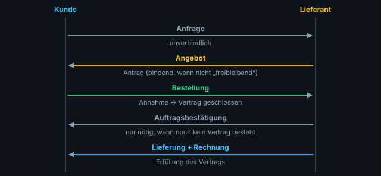

# ⚖️ Verträge, Lizenzen & Abnahme

*Bereich: Planung · Prüfungsrelevanz: ★★☆*

> Vertragsarten, SLA, Mängel & Verzug, Lizenzmodelle, Abnahme und Dokumentation.

[⬅ Inhaltsverzeichnis](README.md)

---

Jede Beschaffung und jeder IT-Auftrag ist ein Vertrag – auch wenn niemand ein Dokument unterschreibt. In der AP1 musst du erkennen, welcher Vertrag vorliegt, wann er zustande gekommen ist und welche Rechte bestehen, wenn etwas schiefgeht: Die Ware ist defekt, kommt zu spät oder wird nicht bezahlt. Dazu kommen Lizenzmodelle für Software und die Abnahme von Leistungen.

> [!WARNING]
> **Prüfungskatalog 2025:** Gestrichen sind die Grundlagen des Urheberrechts, Rollout-Prozesse, Arten der zu übergebenden Dokumentation und die Stilllegung von Altsystemen. **Weiterhin wichtig:** Vertragsarten, Vertragsbestandteile einschließlich Vertragsstrafen, Vertragsstörungen, Inhalt des Abnahmeprotokolls, Lizenzmodelle und SLA.

## Wie ein Vertrag zustande kommt

Ein Vertrag entsteht durch **zwei übereinstimmende Willenserklärungen**: einen **Antrag** und dessen **Annahme**. Eine Unterschrift oder Schriftform ist dafür in den meisten Fällen nicht nötig – auch eine E-Mail, ein Telefonat oder ein Klick im Onlineshop reicht. Schriftlich festgehalten wird ein Vertrag trotzdem, damit man später beweisen kann, was vereinbart war.

<table><tr><th>Schritt</th><th>rechtliche Bedeutung</th></tr>
<tr><td>Anfrage des Kunden</td><td>unverbindlich – nur die Bitte um ein Angebot. Man kann bei mehreren Lieferanten anfragen.</td></tr>
<tr><td>Angebot des Lieferanten</td><td><b>verbindlicher Antrag</b> – der Lieferant ist daran gebunden, außer es enthält eine Freizeichnungsklausel („freibleibend“, „unverbindlich“, „solange der Vorrat reicht“).</td></tr>
<tr><td>Bestellung des Kunden</td><td><b>Annahme</b> – wenn sie rechtzeitig und ohne Änderungen erfolgt, ist der Vertrag geschlossen.</td></tr>
<tr><td>Auftragsbestätigung</td><td>nur rechtlich nötig, wenn noch kein Vertrag besteht: bei freibleibendem Angebot, bei verspäteter oder geänderter Bestellung, bei Bestellung ohne vorheriges Angebot.</td></tr></table>

**Wie lange ist ein Angebot bindend?** Unter Anwesenden (auch am Telefon) nur sofort. Unter Abwesenden (Brief, E-Mail) so lange, wie man unter normalen Umständen mit einer Antwort rechnen darf – bei einer E-Mail also wenige Tage. Ist eine Frist genannt („gültig bis 30.11.“), gilt diese.

**Warum ist ein Onlineshop kein Angebot?** Würde jede Produktseite als verbindlicher Antrag gelten, müsste der Händler an jeden liefern, der bestellt – auch wenn der Vorrat längst weg ist. Deshalb ist die Darstellung im Shop, im Katalog oder im Schaufenster nur eine **Aufforderung, ein Angebot abzugeben**. Der Antrag kommt vom Kunden mit der Bestellung, die Annahme vom Händler (Auftragsbestätigung oder Lieferung).

> [!NOTE]
> **Beispiel**
>
> **Kommt ein Vertrag zustande?**  
> 1. Lieferant bietet am 02.11. 10 Switches zu je 320 € an, gültig bis 15.11. Der Kunde bestellt am 10.11. 10 Switches zu je 320 €. → **Ja**, Antrag und Annahme stimmen überein, rechtzeitig.  
> 2. Der Kunde bestellt am 10.11. 10 Switches zu je **300 €**. → **Nein.** Die geänderte Bestellung ist ein **neuer Antrag**. Der Vertrag entsteht erst, wenn der Lieferant ihn annimmt, z. B. per Auftragsbestätigung.  
> 3. Der Kunde bestellt am 20.11. zu den Bedingungen des Angebots. → **Nein**, das Angebot ist abgelaufen. Auch die verspätete Bestellung ist ein neuer Antrag.

## Vertragsarten

Welche Rechte und Pflichten gelten, hängt von der Vertragsart ab. Die wichtigste Frage ist: **Was genau wird geschuldet?**

<table><tr><th>Vertrag</th><th>geschuldet wird …</th><th>IT-Beispiel</th></tr>
<tr><td><b>Kaufvertrag</b> (§ 433 BGB)</td><td>Übergabe einer Sache und Eigentum gegen Zahlung des Kaufpreises</td><td>20 Monitore kaufen</td></tr>
<tr><td><b>Werkvertrag</b> (§ 631 BGB)</td><td>ein <b>Erfolg</b>, ein fertiges Werk – mit Abnahme</td><td>Individualsoftware programmieren, Netzwerk einrichten, Website erstellen</td></tr>
<tr><td><b>Dienstvertrag</b> (§ 611 BGB)</td><td>eine <b>Tätigkeit</b>, kein Erfolg</td><td>Beratung, Schulung, IT-Support nach Stunden, externer Administrator</td></tr>
<tr><td><b>Mietvertrag</b> (§ 535 BGB)</td><td>Überlassung zum Gebrauch auf Zeit gegen Miete</td><td>Server für ein halbes Jahr mieten</td></tr>
<tr><td><b>Leasingvertrag</b></td><td>Sonderform der Miete: Nutzung gegen Raten, oft mit Erneuerung</td><td>Notebook-Flotte leasen</td></tr>
<tr><td><b>Werklieferungsvertrag</b> (§ 650 BGB)</td><td>Herstellung einer beweglichen Sache – es gilt Kaufrecht</td><td>PCs nach Kundenwunsch zusammenbauen</td></tr>
<tr><td><b>Lizenzvertrag</b></td><td>Recht, Software zu nutzen</td><td>Microsoft-365-Abonnement</td></tr></table>

**Warum ist die Unterscheidung Werk- oder Dienstvertrag so wichtig?** Beim Werkvertrag haftet der Auftragnehmer dafür, dass das Ergebnis funktioniert. Läuft die bestellte Software nicht, muss er nachbessern, und bezahlt wird erst nach der Abnahme. Beim Dienstvertrag wird die Arbeitszeit bezahlt, auch wenn das Problem am Ende nicht gelöst ist – solange ordentlich gearbeitet wurde.

> [!NOTE]
> **Beispiel**
>
> **Werk oder Dienst?**  
> „Richten Sie unser WLAN so ein, dass es in allen Räumen funktioniert.“ → Werkvertrag (Erfolg: funktionierendes WLAN).  
> „Unterstützen Sie unsere IT-Abteilung zwei Tage pro Woche.“ → Dienstvertrag (Tätigkeit).  
> „Schulen Sie unsere Mitarbeitenden in Microsoft Teams.“ → Dienstvertrag (Schulung als Tätigkeit, der Lernerfolg ist nicht geschuldet).

## Pflichten und Vertragsbestandteile

Beim **Kaufvertrag** muss der Verkäufer die Ware mangelfrei und rechtzeitig übergeben und das Eigentum verschaffen. Der Käufer muss die Ware annehmen und rechtzeitig bezahlen.

**Typische Vertragsbestandteile:** Art, Beschaffenheit und Menge der Ware oder Leistung · Preis und Preisnachlässe · Lieferzeit · Lieferbedingungen (z. B. „frei Haus“: Verkäufer trägt die Versandkosten) · Zahlungsbedingungen (z. B. „30 Tage netto, 2 % Skonto bei Zahlung innerhalb von 10 Tagen“) · Gewährleistung und Garantie · Erfüllungsort und Gerichtsstand · Vertragsstrafen.

**Konventionalstrafe (Vertragsstrafe):** ein vorher vereinbarter Betrag, den eine Seite zahlen muss, wenn sie eine Pflicht verletzt, z. B. 500 € pro Tag Verspätung bei der Fertigstellung. **Warum?** Ohne sie müsste der Kunde im Streitfall seinen Schaden genau nachweisen. Mit ihr ist die Folge klar und der Druck, Termine einzuhalten, steigt.

**AGB** (Allgemeine Geschäftsbedingungen) sind vorformulierte Vertragsbedingungen für viele Verträge. Sie gelten nur, wenn vor Vertragsschluss deutlich auf sie hingewiesen wurde und der Kunde sie zur Kenntnis nehmen konnte. Individuelle Absprachen gehen den AGB vor, überraschende oder unangemessen benachteiligende Klauseln sind unwirksam.

**Eigentumsvorbehalt:** Die Ware bleibt Eigentum des Verkäufers, bis sie vollständig bezahlt ist. Zahlt der Kunde nicht, kann der Verkäufer vom Vertrag zurücktreten und die Ware zurückverlangen. Der Kunde ist also schon **Besitzer** (er hat die Ware), aber noch nicht **Eigentümer** (sie gehört ihm rechtlich noch nicht).

**SLA** (Service Level Agreement): Bei Dienstleistungen wie Hosting oder Support werden messbare Leistungen vereinbart – Verfügbarkeit, Reaktions- und Lösungszeiten, Servicezeiten, Eskalation, Berichte und Vertragsstrafen bei Unterschreitung. Wie man die erlaubte Ausfallzeit berechnet, steht im Thema Kundenberatung.

## Mangelhafte Lieferung

Eine Ware ist mangelhaft, wenn sie bei der Übergabe nicht die vereinbarte oder übliche Beschaffenheit hat.

<table><tr><th>Mangelart</th><th>Beispiel</th></tr>
<tr><td>Sachmangel: Beschaffenheit</td><td>Monitor hat Pixelfehler, Notebook mit 8 statt vereinbarten 16 GB RAM</td></tr>
<tr><td>Falschlieferung</td><td>Drucker eines anderen Modells geliefert</td></tr>
<tr><td>Zuweniglieferung</td><td>18 statt 20 Docking-Stationen</td></tr>
<tr><td>Montagemangel, fehlerhafte Montageanleitung</td><td>Servicetechniker baut den Server falsch ins Rack ein; Anleitung beschreibt das falsche Gerät</td></tr>
<tr><td>Rechtsmangel</td><td>Software ohne gültige Lizenz, Ware gehört einem Dritten</td></tr></table>

Nach der **Erkennbarkeit** unterscheidet man **offene** Mängel (sofort sichtbar, z. B. zerbrochenes Display), **versteckte** Mängel (zeigen sich erst später, z. B. Netzteil fällt nach drei Monaten aus) und **arglistig verschwiegene** Mängel (der Verkäufer wusste davon und hat es verschwiegen).

**Wann muss gerügt werden?** Sind beide Seiten Kaufleute (zweiseitiger Handelskauf), muss der Käufer die Ware **unverzüglich prüfen** und einen offenen Mangel **unverzüglich rügen**, einen versteckten unverzüglich nach Entdeckung – sonst verliert er seine Rechte (§ 377 HGB). Die gesetzliche Gewährleistungsfrist beträgt **zwei Jahre** ab Übergabe, bei arglistig verschwiegenen Mängeln gilt die längere regelmäßige Verjährung.

#### Rechte des Käufers – in dieser Reihenfolge

1. **Vorrangig: Nacherfüllung.** Der Käufer wählt zwischen **Nachbesserung** (Reparatur) und **Ersatzlieferung** (neue Ware). Der Verkäufer bekommt also zuerst die Chance, den Fehler zu beheben.
2. **Nachrangig**, wenn die Nacherfüllung fehlschlägt, verweigert wird oder eine angemessene Frist erfolglos abgelaufen ist:
   - **Rücktritt** vom Vertrag (Ware zurück, Geld zurück) – nicht bei nur unerheblichen Mängeln
   - **Minderung** (Ware behalten, Kaufpreis wird herabgesetzt)
   - **Schadensersatz**, wenn den Verkäufer ein Verschulden trifft, oder Ersatz vergeblicher Aufwendungen

> [!IMPORTANT]
> **Gewährleistung** ist gesetzlich vorgeschrieben (2 Jahre), gilt gegenüber dem **Verkäufer** und betrifft Mängel, die schon bei Übergabe vorhanden waren. **Garantie** ist eine **freiwillige** Zusage, meist des Herstellers, mit selbst festgelegten Bedingungen und Fristen – sie gilt zusätzlich, nicht stattdessen.

Bei Verbrauchern wird zugunsten des Käufers vermutet, dass ein Mangel, der sich innerhalb eines Jahres nach Übergabe zeigt, schon bei der Übergabe vorlag (Beweislastumkehr). Danach muss der Käufer das beweisen.

## Lieferungsverzug

Der Verkäufer liefert nicht rechtzeitig. Verzug liegt vor, wenn drei Voraussetzungen erfüllt sind:

1. **Fälligkeit:** Der Liefertermin ist erreicht.
2. **Mahnung:** Der Käufer hat den Verkäufer zur Lieferung aufgefordert. Sie ist **entbehrlich**, wenn der Termin kalendermäßig bestimmt ist („Lieferung am 15.03.“ oder „bis 15.03.“).
3. **Verschulden:** Der Verkäufer hat die Verzögerung zu vertreten (Vorsatz oder Fahrlässigkeit). Bei höherer Gewalt (Streik, Naturkatastrophe) fehlt das Verschulden – dann gibt es keinen Schadensersatz.

<table><tr><th>ohne Nachfrist</th><th>nach erfolglos abgelaufener Nachfrist</th></tr>
<tr><td>auf Lieferung bestehen und zusätzlich den Verzögerungsschaden ersetzt verlangen (bei Verschulden)</td><td>Lieferung ablehnen und vom Vertrag <b>zurücktreten</b> und/oder <b>Schadensersatz statt der Leistung</b> verlangen, z. B. die Mehrkosten eines teureren Ersatzkaufs (Deckungskauf)</td></tr></table>

Bei einem **Fixgeschäft** („Lieferung genau am 20.12., später sinnlos“, z. B. Technik für eine Messe) kann der Käufer bei Verspätung sofort ohne Nachfrist zurücktreten.

## Zahlungsverzug und Annahmeverzug

**Zahlungsverzug:** Der Käufer zahlt nicht rechtzeitig. Verzug tritt ein nach Fälligkeit und Mahnung, ohne Mahnung spätestens **30 Tage nach Fälligkeit und Zugang der Rechnung** (bei Verbrauchern nur, wenn die Rechnung darauf hinweist). Der Verkäufer kann Verzugszinsen verlangen – gegenüber Verbrauchern 5 Prozentpunkte, unter Unternehmen 9 Prozentpunkte über dem Basiszinssatz –, dazu Mahnkosten und Schadensersatz. Nach erfolgloser Frist kann er zurücktreten und bei Eigentumsvorbehalt die Ware zurückholen.

**Annahmeverzug:** Der Käufer nimmt die ordnungsgemäß angebotene Ware nicht an. Der Verkäufer kann die Ware auf Kosten des Käufers einlagern, weiter auf Abnahme und Zahlung bestehen oder die Ware verkaufen lassen (Selbsthilfeverkauf). Die Haftung des Verkäufers für die Ware ist während des Annahmeverzugs auf Vorsatz und grobe Fahrlässigkeit beschränkt.

> [!TIP]
> Bei jeder Vertragsstörung schreibst du drei Dinge: **welche Störung** vorliegt, **warum** (Voraussetzungen am Fall prüfen: fällig? gemahnt? Verschulden?) und **welche Rechte** daraus folgen – das vorrangige Recht zuerst.

> [!NOTE]
> **Beispiel**
>
> **Fall**  
> Die Firma hat 15 Notebooks fest „zum 01.10.“ bestellt. Am 05.10. sind sie immer noch nicht da, der Lieferant hat die Bestellung vergessen.  
> **Störung:** Lieferungsverzug.  
> **Voraussetzungen:** fällig seit 01.10.; Mahnung ist entbehrlich, weil der Termin kalendermäßig bestimmt ist; Verschulden liegt vor (Bestellung vergessen = Fahrlässigkeit).  
> **Rechte:** Die Firma kann weiter Lieferung verlangen und den Verzögerungsschaden ersetzt bekommen, z. B. Kosten für Mietgeräte in der Zwischenzeit. Setzt sie eine angemessene Nachfrist und läuft diese erfolglos ab, kann sie zurücktreten und bei einem anderen Händler kaufen; Mehrkosten trägt der Lieferant als Schadensersatz.

## Abnahme und Abnahmeprotokoll

Beim **Werkvertrag** muss der Kunde das fertige Werk **abnehmen**, also bestätigen, dass es im Wesentlichen vertragsgemäß ist. Bei unwesentlichen Mängeln darf er die Abnahme nicht verweigern; diese Mängel werden im Protokoll festgehalten und später beseitigt.

**Warum ist die Abnahme so wichtig?** Mit ihr

- wird die **Vergütung fällig** – vorher muss der Kunde nicht bezahlen,
- geht die **Gefahr** auf den Kunden über – wird das Werk danach beschädigt, trägt er das Risiko,
- beginnt die **Verjährung** der Mängelansprüche,
- kehrt sich die **Beweislast** um – nach der Abnahme muss der Kunde beweisen, dass ein Mangel vorliegt.

**Inhalt eines Abnahmeprotokolls:** Projekt bzw. Gegenstand der Abnahme, Auftraggeber und Auftragnehmer mit den anwesenden Personen, Ort, Datum und Uhrzeit, geprüfte Leistungen und Funktionen (oft als Checkliste anhand des Pflichtenhefts), festgestellte Mängel mit Frist zur Beseitigung, Ergebnis (abgenommen / abgenommen unter Vorbehalt / verweigert), Unterschriften beider Seiten.

## Softwarelizenzen

Software ist urheberrechtlich geschützt. Wer Software kauft, erwirbt nicht das Programm selbst, sondern ein **Nutzungsrecht**: die Lizenz. Was genau erlaubt ist – auf wie vielen Geräten, von wie vielen Personen, wie lange, ob man sie weitergeben darf –, regelt der Lizenzvertrag (EULA, End User License Agreement).

<table><tr><th>Lizenzmodell</th><th>Merkmal</th><th>passt, wenn …</th></tr>
<tr><td>Einzelplatzlizenz</td><td>ein Gerät</td><td>wenige feste Arbeitsplätze</td></tr>
<tr><td>Volumenlizenz</td><td>viele Lizenzen mit einem Vertrag, Mengenrabatt, zentrale Verwaltung</td><td>viele Arbeitsplätze</td></tr>
<tr><td>OEM-Lizenz</td><td>an die mitgekaufte Hardware gebunden, günstig, meist nicht übertragbar</td><td>Betriebssystem auf neuem PC</td></tr>
<tr><td>Named User</td><td>pro namentlich benannter Person, auf mehreren Geräten</td><td>Mitarbeitende mit PC, Notebook und Smartphone</td></tr>
<tr><td>Concurrent User (Floating)</td><td>Höchstzahl gleichzeitiger Nutzer</td><td>viele gelegentliche Nutzer, z. B. Schichtbetrieb</td></tr>
<tr><td>Subscription (Abo)</td><td>zeitlich begrenzt, laufende Updates inklusive, monatlich oder jährlich kündbar</td><td>immer aktuelle Version, planbare Kosten, SaaS</td></tr>
<tr><td>Kauflizenz (dauerhaft)</td><td>einmal zahlen, unbegrenzt nutzen, Updates oft extra</td><td>Software wird lange unverändert genutzt</td></tr>
<tr><td>Pay-per-Use</td><td>Abrechnung nach tatsächlicher Nutzung</td><td>stark schwankende Nutzung, Cloud</td></tr></table>

> [!NOTE]
> **Beispiel**
>
> **Named oder Concurrent?**  
> Ein Callcenter hat 60 Mitarbeitende in drei Schichten, gleichzeitig arbeiten höchstens 20 mit dem Programm.  
> Named User: 60 Lizenzen. Concurrent User: 20 Lizenzen. → Concurrent User ist hier deutlich günstiger, weil nie mehr als 20 Personen gleichzeitig angemeldet sind.

**Proprietäre Software**: Quellcode ist nicht einsehbar, der Hersteller bestimmt die Nutzung. **Open Source**: Quellcode ist offen und darf genutzt, verändert und weitergegeben werden – nach den Regeln der jeweiligen Lizenz:

- **Copyleft-Lizenzen** wie die **GPL**: Wer veränderte Software weitergibt, muss sie wieder unter der GPL mit Quellcode weitergeben. Für ein Unternehmen, das sein eigenes Produkt verkaufen will, ohne den Code offenzulegen, ist das ein Hindernis.
- **Freizügige (permissive) Lizenzen** wie MIT, BSD oder Apache: Der Code darf auch in proprietärer Software verwendet werden; der Lizenz- und Urheberhinweis muss erhalten bleiben.

Außerdem: **Freeware** ist kostenlos, aber nicht unbedingt quelloffen. **Shareware** darf kostenlos getestet werden, danach ist sie kostenpflichtig. **Public Domain** ist gemeinfrei, ohne urheberrechtliche Einschränkungen.

> [!WARNING]
> „Kostenlos“ heißt nicht „für alles erlaubt“. Viele Freeware-Programme sind nur für private Nutzung frei. Im Unternehmen ist dann eine kostenpflichtige Lizenz nötig – sonst drohen Abmahnungen und Nachzahlungen.

## Rechnung und Aufbewahrung

**Pflichtangaben einer Rechnung** (§ 14 UStG): Name und Anschrift von Lieferant und Kunde · Steuernummer oder USt-IdNr. des Lieferanten · Rechnungsdatum · fortlaufende Rechnungsnummer · Menge und Bezeichnung der Leistung · Liefer- bzw. Leistungsdatum · Nettobetrag, Steuersatz, Steuerbetrag und Bruttobetrag · gegebenenfalls Hinweis auf vereinbarte Preisnachlässe wie Skonto. Unter Unternehmen ist die elektronische Rechnung (E-Rechnung in strukturiertem Format) schrittweise Pflicht; empfangen können müssen sie alle Unternehmen seit 2025.

**Aufbewahrungsfristen** (Hintergrund): Handels- und Geschäftsbriefe 6 Jahre, Buchungsbelege wie Rechnungen 8 Jahre (seit 2025), Bücher und Jahresabschlüsse 10 Jahre. Werden Altsysteme abgeschaltet, müssen diese Daten weiter lesbar bleiben.

> [!CAUTION]
> **Typische Fehler**
>
> - Den Onlineshop oder einen Katalog als verbindliches Angebot werten.
> - Eine geänderte oder verspätete Bestellung als Annahme werten – sie ist ein neuer Antrag.
> - Werk- und Dienstvertrag verwechseln: Entscheidend ist, ob ein Erfolg oder eine Tätigkeit geschuldet wird.
> - Bei Mängeln sofort Rücktritt oder Minderung nennen – zuerst kommt die **Nacherfüllung**.
> - Gewährleistung und Garantie gleichsetzen.
> - Beim Lieferungsverzug die Mahnung verlangen, obwohl ein kalendermäßig bestimmter Termin vereinbart war.
> - Bei Lizenzen nur das Modell nennen, ohne es mit der Situation zu begründen (Anzahl Nutzer, Geräte, gleichzeitige Nutzung).

**📝 Prüfungsaufgabe:** **Ein Systemhaus bietet am 03.03. per E-Mail „freibleibend“ 25 Monitore an. Der Kunde bestellt am 05.03. genau zu diesen Bedingungen. Ist ein Kaufvertrag zustande gekommen? Begründen Sie. (3 Punkte)**

Lösung anzeigen

Nein (1). Wegen der Freizeichnungsklausel „freibleibend“ ist das Angebot nicht bindend, also kein Antrag, sondern nur eine Aufforderung zur Abgabe eines Angebots (1). Die Bestellung ist der Antrag; der Vertrag kommt erst durch die Annahme des Systemhauses zustande, z. B. durch eine Auftragsbestätigung oder die Lieferung (1).

**📝 Prüfungsaufgabe:** **Ein IT-Dienstleister soll für eine Arztpraxis ein neues Netzwerk einrichten, das am Ende in allen Räumen funktionieren muss. Um welche Vertragsart handelt es sich? Nennen Sie zwei Folgen der Abnahme. (3 Punkte)**

Lösung anzeigen

Werkvertrag, weil ein Erfolg (funktionierendes Netzwerk) geschuldet wird (1). Folgen der Abnahme (je 1): Vergütung wird fällig; Gefahr geht auf den Kunden über; Verjährungsfrist für Mängelansprüche beginnt; Beweislast für Mängel liegt danach beim Kunden.

**📝 Prüfungsaufgabe:** **Bei drei von 20 gelieferten Notebooks flackert das Display. Die Firma hat die Lieferung sofort geprüft und den Mangel noch am selben Tag gemeldet. Welche Rechte hat sie? (4 Punkte)**

Lösung anzeigen

Es liegt eine mangelhafte Lieferung (Sachmangel) vor, die rechtzeitig gerügt wurde (1). Vorrangig hat die Firma das Recht auf Nacherfüllung und kann zwischen Reparatur und Ersatzlieferung der drei Geräte wählen (1). Erst wenn diese scheitert oder eine gesetzte Frist erfolglos abläuft (1), kann sie vom Vertrag zurücktreten, den Preis mindern oder bei Verschulden Schadensersatz verlangen (1).

**📝 Prüfungsaufgabe:** **Ein Ingenieurbüro hat 12 Mitarbeitende, die eine CAD-Software nutzen. Gleichzeitig arbeiten höchstens 5 damit. Die Software soll immer auf dem neuesten Stand sein. Empfehlen Sie ein Lizenzmodell und begründen Sie. (3 Punkte)**

Lösung anzeigen

Concurrent-User-Lizenzen (5 Stück) im Abonnement (1). Concurrent, weil nie mehr als 5 Personen gleichzeitig arbeiten – das ist günstiger als 12 Named-User-Lizenzen (1). Abonnement, weil darin laufende Updates enthalten sind und die Software so immer aktuell bleibt (1).

**📝 Prüfungsaufgabe:** **Erläutern Sie den Unterschied zwischen Gewährleistung und Garantie. (2 Punkte)**

Lösung anzeigen

Die Gewährleistung ist gesetzlich vorgeschrieben, gilt zwei Jahre gegenüber dem Verkäufer und betrifft Mängel, die bei der Übergabe schon vorhanden waren (1). Die Garantie ist eine freiwillige Zusage, meist des Herstellers, dessen Bedingungen und Dauer er selbst festlegt; sie gilt zusätzlich zur Gewährleistung (1).

---

## 🃏 Karteikarten (36)

| Frage | Antwort |
|---|---|
| Werkvertrag vs. Dienstvertrag | Werkvertrag: Erfolg geschuldet, Abnahme. Dienstvertrag: nur Tätigkeit geschuldet. |
| Beispiel Werkvertrag in der IT | Erstellung einer Individualsoftware oder Installation eines funktionierenden Netzwerks. |
| Beispiel Dienstvertrag in der IT | Schulung, Beratung, Support auf Stundenbasis. |
| Inhalte eines SLA | Verfügbarkeit, Reaktionszeit, Wiederherstellungszeit, Servicezeiten, Eskalation, Reporting, Vertragsstrafen. |
| Ausfallzeit bei 99,9 % Verfügbarkeit/Jahr | 8,76 Stunden (0,1 % von 8.760 h). |
| Erstes Recht des Käufers bei Mangel | Nacherfüllung: Nachbesserung oder Ersatzlieferung. |
| Gewährleistung vs. Garantie | Gewährleistung: gesetzlich, 2 Jahre, Verkäufer haftet. Garantie: freiwillige Zusage, Bedingungen frei gestaltbar. |
| Mangelarten (Art) | Sachmangel, Falschlieferung, Minderlieferung, Montagemangel, Rechtsmangel. |
| OEM-Lizenz | An Hardware gebunden, günstig, meist nicht übertragbar. |
| GPL | Copyleft-Open-Source-Lizenz: abgeleitete Werke müssen ebenfalls unter GPL mit Quellcode weitergegeben werden. |
| Named User vs. Concurrent User | Named: pro benannter Person. Concurrent: pro gleichzeitig aktivem Nutzer. |
| EULA | End User License Agreement – Lizenzbedingungen für den Endnutzer. |
| Inhalt Abnahmeprotokoll | Gegenstand, Beteiligte, Ort, Datum/Uhrzeit, geprüfte Funktionen, Mängel, Unterschriften. |
| Konventionalstrafe | Vertraglich vereinbarte Strafzahlung bei Pflichtverletzung, z. B. Verzug. |
| Wie kommt ein Vertrag zustande? | Durch zwei übereinstimmende Willenserklärungen: Antrag und Annahme. |
| Ist eine Anfrage rechtlich bindend? | Nein – sie ist nur die unverbindliche Bitte um ein Angebot. |
| Ist ein Angebot bindend? | Ja, es ist ein verbindlicher Antrag – außer mit Freizeichnungsklausel wie „freibleibend“ oder „unverbindlich“. |
| Freizeichnungsklauseln – Beispiele | „freibleibend“, „unverbindlich“, „solange der Vorrat reicht“, „Preis freibleibend“. |
| Wann ist eine Auftragsbestätigung nötig? | Wenn noch kein Vertrag besteht: freibleibendes Angebot, verspätete oder geänderte Bestellung, Bestellung ohne Angebot. |
| Bestellung weicht vom Angebot ab – Folge? | Sie gilt als neuer Antrag; Vertrag erst durch Auftragsbestätigung oder Lieferung. |
| Pflichten des Verkäufers | Ware mangelfrei und rechtzeitig übergeben, Eigentum verschaffen. |
| Pflichten des Käufers | Ware annehmen und Kaufpreis rechtzeitig zahlen. |
| AGB | Vorformulierte Vertragsbedingungen für viele Verträge; gelten nur bei Hinweis und Möglichkeit zur Kenntnisnahme vor Vertragsschluss. |
| Eigentumsvorbehalt | Ware bleibt bis zur vollständigen Bezahlung Eigentum des Verkäufers. |
| Vier Vertragsstörungen beim Kaufvertrag | Mangelhafte Lieferung, Lieferungsverzug, Zahlungsverzug, Annahmeverzug. |
| Voraussetzungen Lieferungsverzug | Fälligkeit, Mahnung (entfällt bei festem Kalendertermin) und Verschulden des Lieferanten. |
| Rechte bei Lieferungsverzug | Lieferung + Ersatz des Verzugsschadens; nach erfolgloser Nachfrist Rücktritt und/oder Schadensersatz statt der Leistung. |
| Wann tritt Zahlungsverzug ohne Mahnung ein? | Spätestens 30 Tage nach Fälligkeit und Zugang der Rechnung. |
| Rechte bei Zahlungsverzug | Verzugszinsen und Mahnkosten verlangen; nach Fristsetzung Rücktritt/Schadensersatz; bei Eigentumsvorbehalt Ware zurückfordern. |
| Annahmeverzug – Rechte des Verkäufers | Auf Abnahme bestehen, Ware auf Kosten des Käufers einlagern, Selbsthilfeverkauf, Rücktritt. |
| Rügepflicht unter Kaufleuten | Ware unverzüglich nach Lieferung prüfen und Mängel sofort rügen – sonst gilt sie als genehmigt. |
| Freeware vs. Open Source | Freeware: kostenlos, Quellcode nicht offen. Open Source: Quellcode offen, darf geändert und weitergegeben werden. |
| Shareware | Software, die kostenlos getestet werden darf und danach bezahlt werden muss. |
| Proprietäre Software | Quellcode nicht offen; Nutzung nur nach den Lizenzbedingungen des Herstellers. |
| Public Domain | Gemeinfreie Software ohne urheberrechtliche Einschränkungen. |
| Pflichtangaben einer Rechnung | Namen und Anschriften, Steuernummer/USt-IdNr., Datum, Rechnungsnummer, Menge und Art der Leistung, Leistungsdatum, Netto, Steuersatz und -betrag, Brutto. |

## ✍️ Übungsfragen (24)

**1.** Ein Systemhaus verpflichtet sich, ein funktionsfähiges WLAN im Gebäude zu installieren. Welcher Vertrag liegt vor?

Lösung

**Musterlösung (2 P):** Werkvertrag Erfolg (funktionierendes WLAN) ist geschuldet.

**2.** Eine Schulung über 8 Stunden zu Microsoft 365 wird gebucht. Vertragsart?

Lösung

**Musterlösung (2 P):** Dienstvertrag Geschuldet ist die Tätigkeit, nicht ein Lernerfolg.

**3.** Ein SLA garantiert 99,5 % Verfügbarkeit pro Jahr (365 Tage). Wie viele Stunden Ausfall sind maximal erlaubt?

Lösung

**43.8 h** 0,5 % × 8.760 h = 43,8 h.

**4.** Welches Recht muss der Käufer bei einem Mangel in der Regel zuerst geltend machen?

Lösung

**Musterlösung (2 P):** Nacherfüllung Vorrang der Nacherfüllung.

**5.** Statt 20 Monitoren werden 18 geliefert. Welcher Mangel?

Lösung

**Musterlösung (2 P):** Minderlieferung Zu geringe Menge = Minderlieferung.

**6.** Welche Lizenz verlangt, dass Änderungen am Code wieder unter derselben Lizenz veröffentlicht werden?

Lösung

**Musterlösung (2 P):** GPL GPL = Copyleft.

**7.** Eine Windows-Lizenz wird mit einem neuen PC ausgeliefert und ist an diesen gebunden. Das ist eine …

Lösung

**Musterlösung (2 P):** OEM-Lizenz OEM = Original Equipment Manufacturer.

**8.** Welche Angaben gehören in ein Abnahmeprotokoll? Nennen Sie drei.

Lösung

**Musterlösung (3 P):** Je 1 Punkt (max. 3): Gegenstand der Abnahme; Beteiligte Personen; Datum und Ort. Dazu kommen Mängel und Unterschriften.

**9.** Wie lange beträgt die gesetzliche Gewährleistungsfrist bei neuen Waren?

Lösung

**Musterlösung (2 P):** 2 Jahre 2 Jahre (§ 438 BGB).

**10.** Erläutern Sie den Unterschied zwischen Werk- und Dienstvertrag an je einem IT-Beispiel. (4 Punkte)

Lösung

**Musterlösung (4 P):** Beim Werkvertrag schuldet der Auftragnehmer einen konkreten Erfolg, der abgenommen wird (1), z. B. die Programmierung einer lauffähigen Webanwendung (1). Beim Dienstvertrag schuldet er nur die Tätigkeit, nicht den Erfolg (1), z. B. IT-Beratung oder Support nach Stunden (1).

**11.** Nennen Sie vier Inhalte, die in einem SLA für den Support Ihrer Arbeitsplätze geregelt sein sollten. (4 Punkte)

Lösung

**Musterlösung (4 P):** Je 1: Verfügbarkeit in %; Reaktionszeit; Lösungs-/Wiederherstellungszeit; Servicezeiten; Ansprechpartner/Eskalationswege; Prioritätsstufen; Reporting/Messung; Vertragsstrafen bei Nichteinhaltung; Kosten.

**12.** Ein Systemhaus gibt ein verbindliches Angebot ab. Der Kunde bestellt drei Tage später genau zu diesen Bedingungen. Wodurch kommt der Kaufvertrag zustande?

Lösung

**Musterlösung (2 P):** Durch die Bestellung (sie ist die Annahme des Angebots) Angebot = Antrag, rechtzeitige und unveränderte Bestellung = Annahme. Eine Auftragsbestätigung ist nicht nötig.

**13.** Ein Angebot über 15 Notebooks trägt den Vermerk „freibleibend“. Der Kunde bestellt daraufhin. Beurteilen Sie, ob damit ein Kaufvertrag zustande gekommen ist.

Lösung

**Musterlösung (3 P):** Nein (1). Durch die Freizeichnungsklausel ist das Angebot unverbindlich, die Bestellung ist daher erst der Antrag (1). Der Vertrag kommt erst zustande, wenn der Lieferant annimmt – durch Auftragsbestätigung oder Lieferung (1).

**14.** Ein Lieferant bietet 20 Monitore zu je 180 € an. Der Kunde bestellt 20 Monitore „zu je 170 €“. Erläutern Sie die rechtliche Lage.

Lösung

**Musterlösung (3 P):** Die Bestellung weicht vom Angebot ab und ist deshalb keine Annahme, sondern ein neuer Antrag (2). Ein Vertrag entsteht erst, wenn der Lieferant diesen Antrag annimmt, z. B. durch Auftragsbestätigung oder Lieferung zu 170 € (1).

**15.** Die Lieferung von 20 Notebooks war fest für den 01.03. vereinbart. Am 10.03. ist noch nichts geliefert, der Lieferant hat schlicht zu spät bestellt. Prüfen Sie, ob Lieferungsverzug vorliegt, und nennen Sie zwei Rechte des Käufers.

Lösung

**Musterlösung (4 P):** Ja, Lieferungsverzug liegt vor (1): Die Lieferung ist fällig, eine Mahnung ist wegen des kalendermäßig festen Termins nicht nötig, und der Lieferant hat die Verspätung verschuldet (1). Rechte (je 1): auf Lieferung bestehen und Ersatz des Verzugsschadens verlangen; nach erfolgloser Nachfrist vom Vertrag zurücktreten; Schadensersatz statt der Leistung verlangen (z. B. Mehrkosten eines Deckungskaufs).

**16.** Eine Rechnung über 4.800 € geht dem Kunden am 2. Mai zu und ist sofort fällig. Der Kunde zahlt nicht, gemahnt wird nicht. Ab wann befindet sich der Kunde im Zahlungsverzug und was kann der Lieferant dann verlangen?

Lösung

**Musterlösung (3 P):** Ohne Mahnung tritt der Verzug spätestens 30 Tage nach Fälligkeit und Zugang der Rechnung ein, hier also Anfang Juni (1). Der Lieferant kann Verzugszinsen und Mahnkosten verlangen (1) und nach Fristsetzung zurücktreten bzw. Schadensersatz fordern; bei Eigentumsvorbehalt kann er die Ware zurückholen (1).

**17.** Ein Kunde verweigert ohne Grund die Annahme von ordnungsgemäß und pünktlich gelieferten Servern. Benennen Sie die Vertragsstörung und nennen Sie zwei Rechte des Lieferanten.

Lösung

**Musterlösung (3 P):** Annahmeverzug (1). Rechte (je 1): auf Abnahme bestehen bzw. klagen; die Ware auf Kosten und Gefahr des Kunden einlagern; Selbsthilfeverkauf nach Androhung; vom Vertrag zurücktreten.

**18.** Wie heißt die Vereinbarung, nach der gelieferte Ware bis zur vollständigen Bezahlung dem Verkäufer gehört?

Lösung

**Musterlösung (2 P):** Eigentumsvorbehalt

**19.** Ein Kunde zahlt eine fällige Rechnung trotz Mahnung nicht. Welche Vertragsstörung liegt vor?

Lösung

**Musterlösung (2 P):** Zahlungsverzug (Nicht-rechtzeitig-Zahlung)

**20.** Erläutern Sie, was AGB sind und unter welcher Voraussetzung sie Vertragsbestandteil werden.

Lösung

**Musterlösung (2 P):** AGB sind vorformulierte Vertragsbedingungen, die ein Unternehmen für eine Vielzahl von Verträgen verwendet (1). Sie werden nur Vertragsbestandteil, wenn vor Vertragsschluss auf sie hingewiesen wurde und der Kunde sie in zumutbarer Weise zur Kenntnis nehmen konnte und einverstanden ist (1).

**21.** Ein IT-Händler erhält 50 Monitore von seinem Großhändler und lagert sie drei Wochen ungeprüft ein. Dann stellt er fest, dass zehn Geräte defekt sind. Erläutern Sie das Problem.

Lösung

**Musterlösung (3 P):** Unter Kaufleuten gilt die unverzügliche Prüf- und Rügepflicht (1). Der Händler hätte die Ware gleich nach der Lieferung prüfen und erkennbare Mängel sofort melden müssen (1). Durch die verspätete Rüge gilt die Ware als genehmigt – er verliert seine Gewährleistungsrechte für diese Mängel (1).

**22.** Nennen Sie vier Punkte, die in einem Kaufvertrag über 30 Arbeitsplatz-PCs geregelt sein sollten.

Lösung

**Musterlösung (4 P):** Je 1: Art, Ausstattung und Menge der Geräte; Preis, Rabatt und Skonto; Liefertermin; Lieferbedingungen (z. B. frei Haus, Aufstellung); Zahlungsbedingungen; Gewährleistung/Garantie und Service; Eigentumsvorbehalt; Vertragsstrafe bei Verzug; Erfüllungsort und Gerichtsstand.

**23.** Ein Kunde ist mit 12.000 € seit 45 Tagen in Verzug. Der Verzugszinssatz beträgt 11 % pro Jahr (360 Zinstage). Wie hoch sind die Verzugszinsen?

Lösung

**165 €** 12.000 × 11 × 45 ÷ (100 × 360) = 165 €.

**24.** Erläutern Sie den Unterschied zwischen Freeware und Open-Source-Software.

Lösung

**Musterlösung (2 P):** Freeware darf kostenlos genutzt werden, der Quellcode ist aber nicht einsehbar und darf nicht verändert werden (1). Bei Open-Source-Software ist der Quellcode offen und darf nach den Regeln der Lizenz geändert und weitergegeben werden (1).

[⬅ Inhaltsverzeichnis](README.md)
