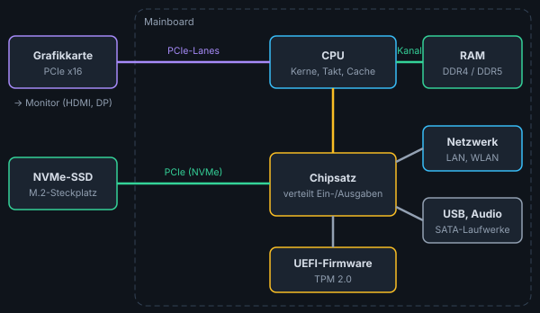

# 🖥️ Hardware & Peripherie

*Bereich: Technik · Prüfungsrelevanz: ★★★*

> CPU, RAM, Speicher, Schnittstellen, Monitore, Docking, Geräteklassen, Energie & Strom.

[⬅ Inhaltsverzeichnis](README.md)

---

Leistung und Energieeffizienz von IT-Systemen gehören zu den Themen, die in fast jeder AP1 vorkommen. Du sollst Datenblätter lesen, Komponenten passend zur Aufgabe auswählen, Stromkosten berechnen und Geräte sicher betreiben. Dafür musst du nicht jedes Bauteil im Detail kennen, aber verstehen, **wofür** es da ist und welche Kennzahl was bedeutet.

## Wie ein PC aufgebaut ist

Das **Mainboard** verbindet alle Bauteile. Der **Prozessor (CPU)** führt die Befehle der Programme aus. Er holt Daten und Befehle aus dem **Arbeitsspeicher (RAM)**, der direkt an ihm angebunden ist. Die **Grafikkarte** und schnelle **NVMe-SSDs** hängen über **PCIe**-Leitungen am Prozessor oder am **Chipsatz**, der weitere Anschlüsse wie USB, Netzwerk, Audio und SATA bereitstellt. Die **UEFI-Firmware** startet den Rechner und übergibt dann an das Betriebssystem.

**Warum ist das wichtig?** Ein Rechner ist nur so schnell wie sein langsamstes beteiligtes Teil. Ein schneller Prozessor nützt wenig, wenn der RAM zu klein ist und ständig auf die Festplatte ausgelagert wird, oder wenn Programme von einer langsamen HDD geladen werden.

## Prozessor (CPU)

<table><tr><th>Kenngröße</th><th>Bedeutung</th><th>wichtig für</th></tr>
<tr><td>Kerne / Threads (z. B. 8C/16T)</td><td>Kerne sind eigenständige Recheneinheiten. Mit Simultaneous Multithreading (SMT, Hyper-Threading) bearbeitet ein Kern zwei Aufgabenstränge (Threads).</td><td>Rendering, Virtualisierung, viele Programme gleichzeitig</td></tr>
<tr><td>Taktfrequenz (GHz)</td><td>Arbeitsschritte pro Sekunde je Kern; „Boost“ ist der kurzzeitige Höchsttakt</td><td>Programme, die nur einen Kern nutzen; nur innerhalb einer Generation direkt vergleichbar</td></tr>
<tr><td>Cache (L1–L3, MB)</td><td>sehr schneller Zwischenspeicher im Prozessor</td><td>weniger Wartezeit auf den RAM</td></tr>
<tr><td>TDP (Watt)</td><td>Wärme, die die Kühlung abführen muss</td><td>Anhaltspunkt für Stromverbrauch, Lautstärke, Bauform</td></tr>
<tr><td>integrierte Grafik (iGPU)</td><td>Grafikeinheit im Prozessor</td><td>reicht für Büroarbeit und Videokonferenzen</td></tr>
<tr><td>NPU</td><td>Recheneinheit für KI-Aufgaben</td><td>KI-Funktionen am Arbeitsplatz (z. B. Hintergrundunschärfe, Spracherkennung) stromsparend lokal ausführen</td></tr></table>

> [!IMPORTANT]
> „Mehr“ ist nicht automatisch „besser“. Viele Kerne helfen beim Videoschnitt, bringen bei Textverarbeitung aber nichts und kosten Strom und Geld. Begründe immer mit der Anforderung.

## Arbeitsspeicher (RAM)

Im RAM liegen die gerade laufenden Programme und ihre Daten. Er ist sehr schnell, verliert seinen Inhalt aber beim Ausschalten (**flüchtig**). Ist er voll, lagert das Betriebssystem Daten auf die SSD aus – das ist um ein Vielfaches langsamer, der Rechner „hängt“.

- **Kapazität:** Büro 16 GB, Softwareentwicklung, virtuelle Maschinen und Videobearbeitung 32 GB und mehr.
- **Typ:** DDR4 und DDR5 sind **nicht** untereinander kompatibel (andere Kerbe, andere Spannung). Das Mainboard bestimmt den Typ.
- **Bauform:** DIMM im Desktop, das kürzere SO-DIMM im Notebook. In vielen dünnen Notebooks ist der RAM fest verlötet und kann nicht aufgerüstet werden – deshalb gleich ausreichend kaufen.
- **Dual Channel:** Zwei gleiche Module in den richtigen Steckplätzen verdoppeln die Bandbreite. 2 × 8 GB ist daher schneller als 1 × 16 GB.
- **ECC-RAM** erkennt und korrigiert einzelne Bitfehler. Er wird in Servern eingesetzt, weil dort ein Speicherfehler viele Nutzer oder Datenbestände betrifft.

## Mainboard, Grafikkarte, Netzteil

**Mainboard:** Sockel und Chipsatz legen fest, welche Prozessoren passen und welche Funktionen es gibt. Der **Formfaktor** (ATX, Micro-ATX, Mini-ITX) muss zum Gehäuse passen. Die Zahl der RAM-, M.2- und PCIe-Steckplätze entscheidet, wie gut sich der Rechner später aufrüsten lässt.

**Grafikkarte:** Für Büroarbeit reicht die integrierte Grafik. Eine **dedizierte** Karte mit eigenem Grafikspeicher (VRAM) braucht man für CAD, Videoschnitt, 3D und KI-Anwendungen. Für CAD-Software gibt es Profikarten, die vom Softwarehersteller zertifiziert sind.

**Netzteil:** Es muss den Bedarf aller Komponenten mit Reserve decken. Der **Wirkungsgrad** gibt an, wie viel der aufgenommenen Leistung tatsächlich bei den Bauteilen ankommt – der Rest wird zu Wärme. Das Siegel **80 PLUS** (Bronze bis Titanium) bescheinigt einen hohen Wirkungsgrad.

> [!IMPORTANT]
> **Wirkungsgrad η = abgegebene Leistung ÷ aufgenommene Leistung**

> [!NOTE]
> **Beispiel**
>
> Die Komponenten eines PCs brauchen 300 W. Das Netzteil hat einen Wirkungsgrad von 90 %.  
> Aufgenommene Leistung = 300 W ÷ 0,90 = **333,3 W**. Verlust als Wärme: 33,3 W.  
> Mit 80 % Wirkungsgrad wären es 375 W – also 41,7 W mehr, die bezahlt und weggekühlt werden müssen.

## Massenspeicher: SSD und HDD

<table><tr><th></th><th>SSD (Flash-Speicher)</th><th>HDD (Magnetfestplatte)</th></tr>
<tr><td>Technik</td><td>Speicherzellen (NAND-Flash), keine beweglichen Teile</td><td>rotierende Magnetscheiben, Schreib-/Lesekopf bewegt sich</td></tr>
<tr><td>Zugriffszeit</td><td>unter 0,1 ms</td><td>5–10 ms</td></tr>
<tr><td>Datenrate</td><td>SATA ca. 550 MB/s, NVMe (PCIe 4.0) bis ca. 7.000 MB/s</td><td>ca. 150–250 MB/s</td></tr>
<tr><td>Robustheit, Geräusch, Strom</td><td>stoßfest, lautlos, sparsam</td><td>stoßempfindlich, hörbar, mehr Strom</td></tr>
<tr><td>Preis pro GB</td><td>höher</td><td>niedrig – gut für große Datenmengen und Archive</td></tr>
<tr><td>Verschleiß</td><td>begrenzte Zahl an Schreibvorgängen (TBW: Terabytes Written)</td><td>mechanischer Verschleiß</td></tr></table>

**Warum ist die SSD so viel schneller?** Bei der HDD muss sich der Lesekopf erst an die richtige Stelle bewegen und warten, bis die Scheibe die Daten vorbeidreht. Bei vielen kleinen Dateien – genau das passiert beim Starten von Windows und Programmen – summiert sich diese Wartezeit. Die SSD greift elektronisch ohne Wartezeit zu.

**Bauformen:** 2,5-Zoll-SATA-SSD, M.2-SSD mit SATA oder mit **NVMe**. **M.2 ist eine Bauform** (ein Steckplatz), **NVMe ist ein Protokoll** über PCIe. Eine M.2-SSD kann also SATA- oder NVMe-Geschwindigkeit haben – das Datenblatt verrät es.

> [!WARNING]
> **Sicher löschen:** Bei SSDs hilft einfaches Überschreiben nicht zuverlässig, weil der Controller Daten intern auf andere Zellen verteilt. Richtig ist der „Secure Erase“-Befehl bzw. das Herstellerwerkzeug – oder die SSD von Anfang an verschlüsseln und zum Löschen den Schlüssel vernichten. Defekte Datenträger mit personenbezogenen Daten werden physisch vernichtet.

**Dateisysteme** legen fest, wie Dateien auf dem Datenträger organisiert werden: **NTFS** (Windows, mit Rechten und Verschlüsselung), **FAT32** (überall lesbar, aber max. 4 GB pro Datei), **exFAT** (für USB-Sticks und Speicherkarten, ohne 4-GB-Grenze), **APFS** (macOS), **ext4** (Linux).

## Schnittstellen

<table><tr><th>Schnittstelle</th><th>max. Datenrate</th><th>Hinweis</th></tr>
<tr><td>USB 2.0</td><td>480 Mbit/s</td><td>Maus, Tastatur</td></tr>
<tr><td>USB 3.2 Gen 1 (früher USB 3.0)</td><td>5 Gbit/s</td><td></td></tr>
<tr><td>USB 3.2 Gen 2</td><td>10 Gbit/s</td><td></td></tr>
<tr><td>USB 3.2 Gen 2x2</td><td>20 Gbit/s</td><td>nur USB-C</td></tr>
<tr><td>USB4 / Thunderbolt 4</td><td>40 Gbit/s</td><td>USB-C; Daten, Bild und Strom über ein Kabel</td></tr>
<tr><td>USB4 v2 / Thunderbolt 5</td><td>80 Gbit/s</td><td>neueste Generation</td></tr>
<tr><td>HDMI 2.1</td><td>48 Gbit/s</td><td>4K mit 120 Hz, Ton; Fernseher, Beamer</td></tr>
<tr><td>DisplayPort 1.4 / 2.1</td><td>32,4 / bis 80 Gbit/s</td><td>Monitore hintereinanderschalten möglich (Daisy Chain)</td></tr></table>

> [!IMPORTANT]
> **USB-C ist nur die Steckerform.** Was eine Buchse kann – welche Datenrate, ob sie ein Bild ausgibt (DisplayPort Alternate Mode), ob sie lädt (USB Power Delivery, bis 100 W bzw. 240 W) –, hängt von Gerät und Kabel ab. Deshalb im Datenblatt nachsehen.

**Docking-Station:** Ein einziges USB-C- bzw. Thunderbolt-Kabel verbindet das Notebook mit Monitoren, Netzwerk, Tastatur, Maus und Stromversorgung. **Warum?** Mitarbeitende wechseln in Sekunden zwischen mobilem Arbeiten und einem ergonomischen Schreibtischplatz mit großen Monitoren. Bei Desk-Sharing kann jeder an jedem Platz andocken.

> [!NOTE]
> **Beispiel**
>
> **Reicht die Schnittstelle?**  
> Eine externe SSD liest mit 1.000 MB/s. Angeschlossen an USB 3.2 Gen 1 (5 Gbit/s): 5 Gbit/s ÷ 8 = 625 MB/s brutto – die Schnittstelle bremst die SSD aus. An USB 3.2 Gen 2 (10 Gbit/s ≈ 1.250 MB/s) erreicht sie ihre volle Geschwindigkeit.

## Monitore

<table><tr><th>Angabe</th><th>Bedeutung</th><th>worauf achten?</th></tr>
<tr><td>Diagonale (Zoll)</td><td>Bildgröße, 1 Zoll = 2,54 cm</td><td>Büro 24–27 Zoll</td></tr>
<tr><td>Auflösung</td><td>Bildpunkte in Breite × Höhe</td><td>Full HD 1920 × 1080, WQHD 2560 × 1440, 4K UHD 3840 × 2160</td></tr>
<tr><td>Pixeldichte (ppi)</td><td>Pixel pro Zoll – je höher, desto schärfer</td><td>ergibt sich aus Auflösung und Diagonale</td></tr>
<tr><td>Seitenverhältnis</td><td>16:9 Standard, 16:10 mehr Höhe für Dokumente, 21:9 sehr breit</td><td>Büro: 16:10 angenehm</td></tr>
<tr><td>Bildwiederholrate (Hz)</td><td>Bilder pro Sekunde</td><td>60 Hz reichen fürs Büro</td></tr>
<tr><td>Reaktionszeit (ms)</td><td>Zeit für einen Farbwechsel</td><td>bei schnellen Bewegungen (Spiele, Video)</td></tr>
<tr><td>Helligkeit (cd/m²), Kontrast</td><td>Leuchtstärke, Verhältnis Hell zu Dunkel</td><td>helle Räume brauchen mehr Helligkeit</td></tr>
<tr><td>Paneltyp</td><td>IPS: farbtreu, blickwinkelstabil · VA: hoher Kontrast · TN: schnell, günstig, schwache Farben · OLED: perfektes Schwarz, teuer</td><td>Grafik und Foto: IPS mit großem Farbraum</td></tr>
<tr><td>Ergonomie</td><td>höhenverstellbar, neigbar, drehbar, Pivot (hochkant), entspiegelt, flimmerfrei</td><td>Pflicht für Bildschirmarbeitsplätze</td></tr></table>

> [!IMPORTANT]
> **Pixeldichte = Diagonale in Pixeln ÷ Diagonale in Zoll**  
> Diagonale in Pixeln = √(Breite² + Höhe²) (Satz des Pythagoras)

> [!NOTE]
> **Beispiel**
>
> **27 Zoll mit WQHD (2560 × 1440)**  
> Diagonale in Pixeln: √(2560² + 1440²) = √(6.553.600 + 2.073.600) = √8.627.200 ≈ 2.937 Pixel  
> Pixeldichte: 2.937 ÷ 27 ≈ **109 ppi**  
> Zum Vergleich 24 Zoll mit Full HD: √(1920² + 1080²) ≈ 2.203 Pixel ÷ 24 ≈ 92 ppi. Der 27-Zöller zeigt also mehr Inhalt **und** ein schärferes Bild.

## Geräteklassen

<table><tr><th>Gerät</th><th>Stärken</th><th>Schwächen</th></tr>
<tr><td>Desktop-PC, Workstation</td><td>viel Leistung fürs Geld, gut aufrüstbar, gut zu kühlen</td><td>nicht mobil, braucht Platz</td></tr>
<tr><td>Notebook</td><td>mobil, Akku; Business-Geräte mit Docking, TPM, Smartcard-Leser</td><td>teurer bei gleicher Leistung, schlecht aufrüstbar</td></tr>
<tr><td>Convertible, 2-in-1</td><td>Notebook mit Touchscreen, als Tablet nutzbar</td><td>Kompromiss bei Tastatur und Leistung</td></tr>
<tr><td>Mini-PC</td><td>klein, sparsam, kann hinter den Monitor geschraubt werden</td><td>kaum aufrüstbar</td></tr>
<tr><td>All-in-One-PC</td><td>Rechner im Monitorgehäuse – wenig Kabel, schick am Empfang</td><td>schlecht aufrüstbar, bei Defekt fällt alles aus</td></tr>
<tr><td>Thin Client</td><td>Anwendungen laufen zentral; günstig, sparsam, zentral verwaltet, keine Daten lokal</td><td>ohne Netzwerk und Server keine Arbeit möglich</td></tr>
<tr><td>Tablet, Smartphone</td><td>mobil, Touch, Kamera</td><td>Verwaltung per MDM nötig, eingeschränkte Programme</td></tr></table>

## Drucker, Scanner und Peripherie

<table><tr><th></th><th>Laserdrucker</th><th>Tintenstrahldrucker</th><th>Thermodrucker</th></tr>
<tr><td>Prinzip</td><td>Toner wird elektrostatisch auf eine Trommel übertragen und auf dem Papier eingebrannt</td><td>Tintentröpfchen werden aufgesprüht</td><td>Wärme schwärzt Spezialpapier</td></tr>
<tr><td>Stärken</td><td>schnell, niedrige Seitenkosten bei Text, wischfest, für große Mengen</td><td>günstig in der Anschaffung, gute Fotos, wenig Strom</td><td>leise, schnell, wartungsarm, kein Verbrauchsmaterial außer Papier</td></tr>
<tr><td>Schwächen</td><td>Feinstaub (Aufstellort beachten), Aufwärmzeit</td><td>höhere Seitenkosten, Tinte trocknet ein</td><td>Ausdrucke verblassen, Spezialpapier</td></tr>
<tr><td>Einsatz</td><td>Büro, Abteilungsdrucker</td><td>Homeoffice, Fotos, kleine Mengen</td><td>Kassenbons, Etiketten, Versand</td></tr></table>

**Kenngrößen:** Seiten pro Minute (ppm), Auflösung (dpi), Duplexdruck, empfohlenes Druckvolumen pro Monat, Anschlüsse. Wichtig für den Datenschutz ist der **PIN- bzw. Follow-Me-Druck**: Der Ausdruck kommt erst, wenn sich die Person am Gerät anmeldet – vertrauliche Dokumente liegen nicht offen im Ausgabefach.

> [!IMPORTANT]
> **Seitenkosten = Preis des Verbrauchsmaterials ÷ Reichweite in Seiten**

> [!NOTE]
> **Beispiel**
>
> Toner für 90 € reicht für 3.000 Seiten → 90 € ÷ 3.000 = 0,03 € pro Seite. Dazu kommen ggf. Trommel (z. B. 120 € für 30.000 Seiten = 0,004 €) und Papier (0,01 €) → **0,044 € pro Seite**.

**Multifunktionsgerät:** Drucken, Scannen, Kopieren in einem Gerät – spart Platz und Kosten, ist zentral verwaltbar. Fällt es aus, fallen aber alle Funktionen aus. Oft gemietet als Managed Print Service mit Preis pro Seite inklusive Toner und Wartung.

**Scanner:** Flachbett für Bücher und Fotos, Einzugsscanner mit automatischem Dokumenteneinzug (ADF) und Duplex für Akten. 300 dpi reichen für Dokumente. Mit **OCR** (Texterkennung) entstehen durchsuchbare PDFs.

**Weitere Peripherie:** Headset (mit Geräuschunterdrückung, für Teams zertifiziert), Webcam, Smartcard-Leser, Barcodescanner, Unterschriftenpad, KVM-Switch (eine Tastatur, Maus und ein Monitor für mehrere Rechner), Grafiktablett, USV.

## Sensoren und IoT

**Sensoren** messen physikalische Größen und wandeln sie in elektrische Signale um. **Aktoren** machen aus Signalen eine Aktion (Lüfter, Motor, Ventil, Relais).

<table><tr><th>Sensor</th><th>Einsatz in der IT</th></tr>
<tr><td>Temperatur, Luftfeuchtigkeit</td><td>Serverraum überwachen, CPU-Temperatur regeln</td></tr>
<tr><td>Bewegung, Präsenz</td><td>Licht und Alarmanlage, Bildschirm sperren, wenn niemand davor sitzt</td></tr>
<tr><td>Helligkeit</td><td>Displayhelligkeit automatisch anpassen</td></tr>
<tr><td>Beschleunigung, Lage</td><td>Bild im Smartphone drehen, Fallschutz bei Festplatten</td></tr>
<tr><td>Fingerabdruck, Infrarot-Kamera</td><td>biometrische Anmeldung (Windows Hello)</td></tr>
<tr><td>Rauch, Wasser, Tür- und Fensterkontakt</td><td>Serverraum absichern</td></tr>
<tr><td>GPS</td><td>Standort von Geräten und Fahrzeugen</td></tr></table>

**IoT** (Internet of Things) bezeichnet vernetzte Geräte mit Sensoren und Aktoren, z. B. im Smart Building. In der **Industrie 4.0** sind Maschinen, Produkte und IT vernetzt; Sensordaten ermöglichen z. B. vorausschauende Wartung (eine Maschine meldet Verschleiß, bevor sie ausfällt). **Risiko:** IoT-Geräte haben oft Standardpasswörter und bekommen selten Updates. Deshalb: Passwort ändern, Firmware aktuell halten, Geräte in ein eigenes VLAN.

## BIOS/UEFI und TPM

Die Firmware (heute **UEFI**, früher BIOS) prüft beim Start die Hardware und lädt das Betriebssystem. Wichtige Einstellungen:

- **Bootreihenfolge** – z. B. von USB oder per Netzwerk (PXE) starten, um ein Betriebssystem zu installieren
- **Secure Boot** – startet nur signierte Bootloader und verhindert so, dass sich Schadsoftware vor dem Betriebssystem einnistet
- **TPM** (Trusted Platform Module) – Sicherheitschip, der Schlüssel geschützt speichert, z. B. für BitLocker und Windows Hello. TPM 2.0 und Secure Boot sind Voraussetzung für Windows 11.
- **Virtualisierung** (Intel VT-x, AMD-V) – nötig für Hyper-V, WSL und Docker
- **Firmware-Passwort** – verhindert, dass jemand Einstellungen ändert oder von einem fremden Stick startet
- **Wake-on-LAN** – Rechner per Netzwerk einschalten, z. B. für nächtliche Updates

## Strom, Leistung, Energiekosten

> [!IMPORTANT]
> **Leistung P = U × I** (Watt = Volt × Ampere)  
> **Energie W = P × t** (kWh = kW × h)  
> **Kosten = Energie in kWh × Preis pro kWh**

Wichtig ist die Umrechnung: Watt in **Kilowatt** (÷ 1.000), bevor du mit Stunden multiplizierst.

> [!NOTE]
> **Beispiel**
>
> **Stromkosten von 20 PCs pro Jahr**  
> Betrieb: 65 W, 8 h an 220 Arbeitstagen. Stand-by: 2 W in der übrigen Zeit. Strompreis 0,30 €/kWh.  
>
> Betriebsstunden: 8 h × 220 = 1.760 h  
> Stand-by-Stunden: 8.760 h (ein Jahr) − 1.760 h = 7.000 h  
> Energie Betrieb: 0,065 kW × 1.760 h = 114,4 kWh  
> Energie Stand-by: 0,002 kW × 7.000 h = 14,0 kWh  
> Summe pro PC: 128,4 kWh × 0,30 €/kWh = 38,52 €  
> 20 PCs: 20 × 38,52 € = **770,40 € pro Jahr**  
> Ein Modell mit 35 W im Betrieb würde 20 × 0,030 kW × 1.760 h × 0,30 € = **316,80 €** pro Jahr einsparen.

#### USV – unterbrechungsfreie Stromversorgung

Eine USV überbrückt Stromausfälle mit einem Akku, glättet Spannungsschwankungen und gibt dem Server Zeit, sich kontrolliert herunterzufahren. **Warum?** Ein plötzlicher Stromausfall kann Dateien und Datenbanken beschädigen, die gerade geschrieben werden.

<table><tr><th>Typ</th><th>Funktion</th><th>Schutz</th></tr>
<tr><td>Offline (VFD)</td><td>schaltet erst bei Ausfall auf Akku um</td><td>einfach, günstig – für Arbeitsplatz-PCs</td></tr>
<tr><td>Line-Interactive (VI)</td><td>regelt zusätzlich Spannungsschwankungen aus</td><td>mittel – für kleine Server und Netzwerktechnik</td></tr>
<tr><td>Online, Doppelwandler (VFI)</td><td>Verbraucher werden ständig über den Akku-Wechselrichter versorgt, keine Umschaltzeit</td><td>höchster Schutz – für wichtige Server</td></tr></table>

USVs werden in **VA** (Scheinleistung) angegeben. Umrechnung: Scheinleistung S = Wirkleistung P ÷ Leistungsfaktor cos φ.

> [!NOTE]
> **Beispiel**
>
> Server 400 W, Switch 60 W, Firewall 40 W → 500 W. Leistungsfaktor 0,8: 500 W ÷ 0,8 = 625 VA. Mit 25 % Reserve: 625 VA × 1,25 ≈ 781 VA → gewählt wird eine USV mit **1.000 VA**.

## Elektrische Sicherheit und Kennzeichnungen

<table><tr><th>Schutzklasse</th><th>Prinzip</th><th>Beispiel</th></tr>
<tr><td>I</td><td>Schutzleiter (grün-gelb) am Metallgehäuse: Bei einem Fehler fließt der Strom darüber ab und die Sicherung löst aus</td><td>Desktop-PC, Server, Drucker</td></tr>
<tr><td>II</td><td>Schutzisolierung (doppelte Isolierung), kein Schutzleiter; Symbol: zwei ineinanderliegende Quadrate</td><td>Notebook-Netzteil, Monitor</td></tr>
<tr><td>III</td><td>Schutzkleinspannung (höchstens 50 V Wechsel- bzw. 120 V Gleichspannung)</td><td>USB-Geräte, PoE-Geräte</td></tr></table>

Ein **Fehlerstrom-Schutzschalter (FI, RCD)** schaltet ab, wenn Strom einen falschen Weg nimmt, etwa durch einen Menschen. Elektrische Betriebsmittel werden regelmäßig nach **DGUV Vorschrift 3** geprüft (Prüfplakette). Arbeiten an elektrischen Anlagen dürfen nur Elektrofachkräfte durchführen.

**Kennzeichnungen:** **CE** (Hersteller erklärt die Einhaltung der EU-Vorschriften), **GS** (geprüfte Sicherheit durch eine unabhängige Stelle), **EU-Energielabel** (z. B. für Monitore, Klassen A bis G), **Energy Star**, **TCO Certified** (Ergonomie, Umwelt, Sozialstandards), **Blauer Engel**, **80 PLUS** (Netzteil-Wirkungsgrad), **WEEE-Symbol** (durchgestrichene Mülltonne: Elektroschrott, nicht in den Hausmüll).

> [!CAUTION]
> **Typische Fehler**
>
> - Watt nicht in Kilowatt umrechnen und dadurch Stromkosten um den Faktor 1.000 falsch berechnen.
> - Stand-by-Verbrauch vergessen, wenn er in der Aufgabe angegeben ist.
> - M.2 und NVMe gleichsetzen.
> - Annehmen, jeder USB-C-Anschluss könne Bild und Strom übertragen.
> - DDR4-Module in ein DDR5-Mainboard empfehlen.
> - SSDs durch Überschreiben „sicher löschen“.
> - Komponenten ohne Bezug zum Einsatzzweck empfehlen („mehr Kerne sind besser“).

**📝 Prüfungsaufgabe:** **Ein Server nimmt im Durchschnitt 250 W auf und läuft rund um die Uhr. Berechnen Sie die jährlichen Stromkosten bei 0,32 €/kWh. (3 Punkte)**

Lösung anzeigen

Stunden pro Jahr: 24 × 365 = 8.760 h (1). Energie: 0,25 kW × 8.760 h = 2.190 kWh (1). Kosten: 2.190 kWh × 0,32 € = **700,80 €** (1).

**📝 Prüfungsaufgabe:** **Ein Grafikbüro möchte die alten HDDs der Arbeitsplatzrechner durch SSDs ersetzen. Erläutern Sie zwei Vorteile. (4 Punkte)**

Lösung anzeigen

Je Vorteil 2 Punkte, z. B.: deutlich kürzere Zugriffszeiten, weil kein mechanischer Lesekopf bewegt werden muss – Programme und große Projektdateien öffnen sich viel schneller; höhere Datenraten, besonders mit NVMe, sodass große Bilddateien schneller gespeichert werden; geringerer Stromverbrauch und lautloser Betrieb, was Kosten senkt und die Arbeitsumgebung verbessert.

**📝 Prüfungsaufgabe:** **Berechnen Sie die Pixeldichte eines 24-Zoll-Monitors mit 3840 × 2160 Pixeln. (2 Punkte)**

Lösung anzeigen

√(3840² + 2160²) = √(14.745.600 + 4.665.600) = √19.411.200 ≈ 4.406 Pixel (1). 4.406 ÷ 24 ≈ **184 ppi** (1).

**📝 Prüfungsaufgabe:** **Für einen Serverschrank mit 1.200 W Wirkleistung soll eine USV beschafft werden (cos φ = 0,9). Welche Scheinleistung muss sie mindestens haben, und welcher USV-Typ ist geeignet? (3 Punkte)**

Lösung anzeigen

S = 1.200 W ÷ 0,9 ≈ **1.333 VA** (1), mit Reserve also z. B. 1.500–2.000 VA (1). Geeignet ist eine Online-USV (VFI), weil sie die Server ohne Umschaltzeit versorgt und den höchsten Schutz vor Spannungsschwankungen bietet (1).

**📝 Prüfungsaufgabe:** **Ein Kunde fragt, warum sein neues Notebook mit USB-C-Anschluss kein Bild auf dem Monitor ausgibt. Erklären Sie mögliche Ursachen. (2 Punkte)**

Lösung anzeigen

USB-C ist nur die Steckerform. Der Anschluss unterstützt möglicherweise keinen DisplayPort Alternate Mode bzw. kein Thunderbolt (1), oder das verwendete Kabel überträgt nur Daten bzw. Strom und kein Bildsignal (1).

---

## 🃏 Karteikarten (57)

| Frage | Antwort |
|---|---|
| SSD – drei Vorteile gegenüber HDD | Schneller (Zugriffszeit/Datenrate), stoßfest (keine Mechanik), leise und stromsparend. |
| HDD – Vorteil | Günstiger Preis pro GB – sinnvoll für große Archiv-/Backupmengen. |
| M.2 vs. NVMe | M.2 ist ein Formfaktor/Steckplatz. NVMe ist das Protokoll über PCIe (schneller als SATA). |
| Dual Channel | Zwei (gleiche) RAM-Module parallel → doppelte Speicherbandbreite. |
| ECC-RAM | Erkennt und korrigiert Speicherfehler; typisch in Servern. |
| USB 3.2 Gen 2 – Datenrate | 10 Gbit/s. |
| USB4 / Thunderbolt 4 – Datenrate | 40 Gbit/s über USB-C. |
| DisplayPort Alt Mode | Überträgt ein DisplayPort-Videosignal über einen USB-C-Anschluss. |
| USB Power Delivery | Ladestandard über USB-C, bis 100 W (PD 3.1: 240 W). |
| Vorteile Dockingstation | Ein Kabel für Monitor, LAN, Peripherie und Strom; schneller Arbeitsplatzwechsel, Desk-Sharing, Ordnung. |
| Thin Client | Endgerät mit minimaler Hardware; Anwendungen laufen zentral auf Server/VDI. + sparsam, zentral verwaltet. − netzabhängig. |
| P = ? | P = U × I (Watt = Volt × Ampere). |
| Energie W = ? | W = P × t (kWh = kW × h). |
| Wirkungsgrad | η = abgegebene Leistung ÷ zugeführte Leistung (z. B. Netzteil 90 %). |
| USV – Aufgaben | Stromausfall überbrücken, Spannungsschwankungen filtern, kontrolliertes Herunterfahren. |
| USV-Typ mit höchstem Schutz | Online-USV (Doppelwandler, VFI). |
| 4K UHD Auflösung | 3840 × 2160 Pixel. |
| IPS-Panel | Hohe Farbtreue und Blickwinkelstabilität – gut für Grafik/Foto. |
| CE-Kennzeichen | Hersteller erklärt die Konformität mit EU-Richtlinien (kein Prüfsiegel). |
| TCO Certified | Siegel für Ergonomie, Umweltverträglichkeit und soziale Verantwortung bei IT-Geräten. |
| Laser- vs. Tintenstrahldrucker | Laser: schnell, günstige Seitenkosten, hohe Volumen, Feinstaub. Tinte: günstig in der Anschaffung, gut für Fotos, höhere Seitenkosten. |
| Thermodrucker – Einsatz | Kassenbons, Etiketten, Versandlabel – leise, schnell, kein Toner. |
| Formel Seitenkosten | Preis des Verbrauchsmaterials ÷ Reichweite in Seiten. |
| ppm / dpi | ppm: Seiten pro Minute (Geschwindigkeit). dpi: Punkte pro Zoll (Auflösung). |
| Follow-Me-Printing | Druckauftrag wird erst nach Anmeldung (PIN/Karte) am Gerät ausgegeben – Vertraulichkeit. |
| Multifunktionsgerät | Drucker, Scanner, Kopierer (Fax) in einem Gerät. |
| ADF | Automatic Document Feeder – automatischer Dokumenteneinzug beim Scanner. |
| OCR | Optical Character Recognition – Texterkennung, macht Scans durchsuchbar. |
| KVM-Switch | Bedient mehrere Rechner mit einer Tastatur, einem Monitor und einer Maus. |
| Managed Print Service | Drucker inkl. Toner, Wartung, Service gegen Klickpreis/Rate. |
| Sensor vs. Aktor | Sensor erfasst Größen (Temperatur, Bewegung) → Signal. Aktor führt aus (Lüfter, Motor). |
| Beispiele für Sensoren am Arbeitsplatz | Helligkeits-, Lage-/Beschleunigungs-, Fingerabdruck-, Temperatur-, Präsenzsensor. |
| IoT | Internet of Things – vernetzte Geräte mit Sensoren/Aktoren. |
| Industrie 4.0 | Vernetzung von Produktion, Maschinen und IT (Smart Factory, Predictive Maintenance). |
| All-in-One-PC – Vor-/Nachteil | + platzsparend, wenig Kabel. − schlecht aufrüstbar, Defekt betrifft alles. |
| UEFI-Einstellung für Hyper-V/Docker | Virtualisierung aktivieren (Intel VT-x / AMD-V). |
| Schutzklasse I / II / III | I: Schutzleiter. II: Schutzisolierung. III: Schutzkleinspannung. |
| RCD / FI-Schalter | Fehlerstrom-Schutzschalter – schaltet bei Fehlerstrom (z. B. durch den Körper) ab. |
| DGUV Vorschrift 3 | Regelmäßige Prüfung elektrischer Betriebsmittel. |
| Kerne vs. Threads | Kern: eigenständige Recheneinheit. Thread: gleichzeitig bearbeitbare Aufgabe; mit SMT/Hyper-Threading zwei Threads pro Kern. |
| Wofür sind viele CPU-Kerne wichtig? | Für parallele Lasten: Rendering, Videoschnitt, Virtualisierung, Kompilieren, viele Programme gleichzeitig. |
| Taktfrequenz | Arbeitsschritte pro Sekunde je Kern in GHz – wichtig für Programme, die nur einen Kern nutzen. |
| TDP | Thermal Design Power in Watt: Wärme, die die Kühlung abführen muss; Anhaltspunkt für Leistungsaufnahme. |
| CPU-Cache | Sehr schneller Zwischenspeicher in der CPU (L1, L2, L3) für häufig benötigte Daten. |
| DDR4 und DDR5 | Arbeitsspeicher-Generationen; nicht kompatibel – das Mainboard legt den Typ fest. |
| DIMM vs. SO-DIMM | DIMM: Speichermodul für Desktop-PCs. SO-DIMM: kleinere Bauform für Notebooks und Mini-PCs. |
| Was legt das Mainboard fest? | Passende CPUs (Sockel/Chipsatz), RAM-Typ, Anzahl der Steckplätze und Anschlüsse, Formfaktor. |
| Formfaktoren Mainboard | ATX, Micro-ATX, Mini-ITX (von groß nach klein). |
| Integrierte vs. dedizierte Grafik | Integriert: in der CPU, sparsam, reicht fürs Büro. Dediziert: eigene Karte mit eigenem Speicher für CAD, Video, 3D, KI. |
| Benchmark | Standardisierter Leistungstest, der Geräte vergleichbar macht – aussagekräftig nur für die getestete Aufgabenart. |
| Nachteil von verlötetem RAM | Nicht aufrüstbar und nicht austauschbar – die Kapazität muss beim Kauf für die ganze Nutzungsdauer reichen. |
| Pixeldichte (ppi) | Pixel pro Zoll – je höher, desto schärfer das Bild. Ergibt sich aus Auflösung und Diagonale. |
| Bildwiederholrate | Anzahl der Bilder pro Sekunde in Hertz (Hz); 60 Hz reichen für Büroarbeit. |
| WQHD-Auflösung | 2560 × 1440 Pixel. |
| Full-HD-Auflösung | 1920 × 1080 Pixel. |
| Paneltypen im Vergleich | IPS: farbtreu, blickwinkelstabil. VA: hoher Kontrast. TN: schnell, günstig, schwache Farben. OLED: perfektes Schwarz, teuer. |
| Einheit der Monitorhelligkeit | Candela pro Quadratmeter (cd/m²). |

## ✍️ Übungsfragen (37)

**1.** Ein PC nimmt 150 W auf und läuft 8 h an 250 Tagen. Strompreis 0,30 €/kWh. Stromkosten pro Jahr?

Lösung

**90 €** 0,15 kW × 8 h × 250 = 300 kWh × 0,30 € = 90 €.

**2.** Ein Netzteil nimmt 500 W auf und gibt 450 W ab. Wirkungsgrad in Prozent?

Lösung

**90 %** η = 450 / 500 = 0,9 = 90 %.

**3.** Ein Gerät arbeitet an 230 V mit 0,5 A. Welche Leistung nimmt es auf?

Lösung

**115 W** P = U × I = 230 × 0,5 = 115 W.

**4.** Welcher Massenspeicher eignet sich am besten für das Notebook eines Außendienstmitarbeiters?

Lösung

**Musterlösung (2 P):** M.2-NVMe-SSD Stoßfest, schnell, sparsam, kompakt.

**5.** Ein Kollege sagt: „Das Notebook hat USB-C, also kann ich daran auf jeden Fall einen Monitor anschließen und es darüber laden.“ Beurteilen Sie diese Aussage.

Lösung

**Musterlösung (3 P):** Die Aussage stimmt so nicht (1). USB-C beschreibt nur die Steckerform; welche Funktionen der Anschluss bietet, hängt vom Port und vom Kabel ab (1). Für das Bild braucht der Port DisplayPort Alt Mode (bzw. Thunderbolt/USB4), zum Laden USB Power Delivery – das steht im Datenblatt (1). USB-C ist nur der Stecker; Protokolle wie USB 2.0 bis USB4/TB werden darüber geführt.

**6.** Ein Monitor soll über das USB-C-Kabel des Notebooks ein Bild erhalten und gleichzeitig das Notebook laden. Welche Funktionen braucht der Anschluss?

Lösung

**Musterlösung (2 P):** DP Alt Mode und Power Delivery DisplayPort Alternate Mode für Video, USB PD zum Laden.

**7.** Welche Datenrate hat USB 3.2 Gen 1?

Lösung

**Musterlösung (2 P):** 5 Gbit/s Gen 1 = 5 Gbit/s (ehemals USB 3.0).

**8.** Welche Komponente ist flüchtig, d. h. verliert ihren Inhalt ohne Strom?

Lösung

**Musterlösung (2 P):** RAM Arbeitsspeicher ist flüchtig.

**9.** Welche USV-Bauart trennt den Verbraucher dauerhaft vom Netz und bietet den besten Schutz?

Lösung

**Musterlösung (2 P):** Online/Doppelwandler (VFI) VFI = Voltage and Frequency Independent.

**10.** Welche Vorteile bietet ein Thin Client gegenüber einem Desktop-PC? Nennen Sie drei.

Lösung

**Musterlösung (3 P):** Je 1 Punkt (max. 3): Geringer Stromverbrauch; Zentrale Administration; Geringeres Risiko lokaler Datenverluste. Ohne Netzwerk ist ein Thin Client praktisch nicht nutzbar.

**11.** Wofür steht die Angabe „80 PLUS Gold“?

Lösung

**Musterlösung (2 P):** Wirkungsgrad eines Netzteils 80 PLUS zertifiziert die Effizienz von Netzteilen.

**12.** Ein Mitarbeiter-PC braucht im Betrieb 60 W, im Standby 2 W. Er wird 10 h/Tag genutzt und bleibt 14 h im Standby. Wie viel Wh verbraucht er pro Tag?

Lösung

**628 Wh** 60 × 10 = 600 Wh; 2 × 14 = 28 Wh; Summe 628 Wh.

**13.** Ein Grafiker benötigt einen neuen Arbeitsplatz für Bildbearbeitung. Nennen und begründen Sie zwei Anforderungen an den Monitor. (4 Punkte)

Lösung

**Musterlösung (4 P):** Je Anforderung 1 + Begründung 1, z. B.: IPS-Panel/hohe Farbraumabdeckung (sRGB/Adobe RGB), weil Farben verbindlich dargestellt werden müssen; hohe Auflösung (WQHD/4K), damit Details und Werkzeugleisten Platz haben; Kalibrierbarkeit/Hardwarekalibrierung für farbverbindliches Arbeiten; ergonomisch höhenverstellbar/entspiegelt für langes Arbeiten.

**14.** Ihre Abteilung führt Desk-Sharing ein. Erläutern Sie zwei Vorteile von USB-C-Dockingstationen in diesem Szenario. (4 Punkte)

Lösung

**Musterlösung (4 P):** Z. B.: Mitarbeitende schließen ihr Notebook mit einem einzigen Kabel an und haben sofort Monitor, Tastatur, Maus, LAN (2); das Notebook wird gleichzeitig per Power Delivery geladen, kein separates Netzteil nötig (2); der Arbeitsplatz bleibt aufgeräumt (Clean Desk) und standardisiert, Wechsel ohne Umbauen (2).

**15.** Eine Tonerkassette kostet 84 € und reicht für 2.800 Seiten. Wie hoch sind die Tonerkosten pro Seite in Cent?

Lösung

**3 Cent** 84 € ÷ 2.800 = 0,03 € = 3 Cent.

**16.** Ein Farbdrucker braucht je eine Schwarzpatrone (30 €, 600 Seiten) und eine Farbpatrone (45 €, 300 Seiten). Wie hoch sind die Patronenkosten pro Farbseite in Cent?

Lösung

**20 Cent** 30/600 = 0,05 € + 45/300 = 0,15 € = 0,20 € = 20 Cent.

**17.** Eine Abteilung druckt 4.000 Textseiten pro Monat. Welcher Druckertyp ist am wirtschaftlichsten?

Lösung

**Musterlösung (2 P):** Monochrom-Laserdrucker Hohes Volumen + Text → niedrige Seitenkosten und hohe Geschwindigkeit des Lasers.

**18.** Wofür steht OCR beim Scannen?

Lösung

**Musterlösung (2 P):** Optische Texterkennung

**19.** In der Personalabteilung liegen vertrauliche Ausdrucke im Ausgabefach des Etagendruckers. Welche Funktion hilft?

Lösung

**Musterlösung (2 P):** Follow-Me-/PIN-Druck

**20.** Ihre Firma will alte Einzelplatzdrucker durch ein Multifunktionsgerät pro Etage ersetzen. Nennen Sie zwei Vorteile und einen Nachteil. (3 Punkte)

Lösung

**Musterlösung (3 P):** Vorteile (je 1): weniger Geräte, geringere Anschaffungs-/Wartungs- und Energiekosten; zentrale Verwaltung und Abrechnung; zusätzliche Scan-/Kopierfunktion (Digitalisierung); geringere Seitenkosten; Follow-Me-Druck möglich. Nachteil (1): Ausfall betrifft alle Nutzer und Funktionen; Wege zum Drucker; Wartezeiten; Datenschutz bei offen liegenden Ausdrucken (ohne PIN-Druck).

**21.** Welcher Sensor sorgt dafür, dass sich die Bildschirmhelligkeit eines Notebooks automatisch anpasst?

Lösung

**Musterlösung (2 P):** Umgebungslichtsensor

**22.** Ein Serverraum soll bei Überhitzung automatisch Alarm schlagen. Was wird benötigt?

Lösung

**Musterlösung (2 P):** Temperatursensor mit Monitoring/Alarmierung

**23.** Ein Notebook-Netzteil trägt das Symbol „Quadrat im Quadrat“. Welche Schutzklasse?

Lösung

**Musterlösung (2 P):** II Schutzisolierung.

**24.** Welche UEFI-Einstellung muss für WSL2/Docker/Hyper-V aktiviert sein?

Lösung

**Musterlösung (2 P):** Hardware-Virtualisierung (VT-x/AMD-V)

**25.** Wofür eignet sich ein All-in-One-PC besonders?

Lösung

**Musterlösung (2 P):** Empfang oder Kundenbereich mit wenig Platz

**26.** Ihre Firma will IoT-Sensoren (Temperatur, Tür) im Gebäude einsetzen. Nennen Sie zwei Sicherheitsmaßnahmen. (2 Punkte)

Lösung

**Musterlösung (2 P):** Je 1: Standardpasswörter ändern; eigenes VLAN/Netzsegment für IoT; Firmware regelmäßig aktualisieren; nicht benötigte Dienste/Fernzugriff deaktivieren; verschlüsselte Kommunikation; nur Geräte mit Herstellersupport.

**27.** CPU A: 6 Kerne/12 Threads, 4,6 GHz, 65 W TDP. CPU B: 16 Kerne/32 Threads, 4,2 GHz, 125 W TDP. Empfehlen Sie je eine CPU für einen Büro-PC und für eine Workstation zum Videorendering und begründen Sie.

Lösung

**Musterlösung (4 P):** Büro-PC: CPU A (1) – Office-Anwendungen nutzen wenige Kerne, der hohe Takt reicht aus, die niedrige TDP bedeutet weniger Strom, Abwärme und Lärm sowie geringere Kosten (1). Videorendering: CPU B (1) – Rendering verteilt sich auf alle Kerne, 16 Kerne/32 Threads verkürzen die Rechenzeit deutlich; die höhere Leistungsaufnahme ist dafür gerechtfertigt (1).

**28.** In einem Datenblatt steht: „8C/16T, 3,4 GHz, 65 W TDP“. Erläutern Sie die drei Angaben.

Lösung

**Musterlösung (3 P):** 8C/16T: 8 Kerne, die 16 Threads gleichzeitig bearbeiten (1). 3,4 GHz: Taktfrequenz, also Arbeitsschritte pro Sekunde je Kern (1). 65 W TDP: Wärmeleistung, auf die die Kühlung ausgelegt sein muss – Anhaltspunkt für die Leistungsaufnahme (1).

**29.** Welche Bauform hat Arbeitsspeicher für Notebooks?

Lösung

**Musterlösung (2 P):** SO-DIMM

**30.** Ein Kollege möchte einen älteren PC mit DDR4-Mainboard durch neue DDR5-Riegel beschleunigen. Beurteilen Sie das Vorhaben.

Lösung

**Musterlösung (3 P):** Das funktioniert nicht (1): DDR4 und DDR5 sind mechanisch und elektrisch nicht kompatibel, der Speichertyp wird vom Mainboard vorgegeben (1). Möglich ist nur mehr DDR4-RAM – oder ein Tausch von Mainboard (und meist CPU) (1).

**31.** Erläutern Sie den Unterschied zwischen integrierter und dedizierter Grafik und nennen Sie je einen passenden Einsatz.

Lösung

**Musterlösung (2 P):** Integrierte Grafik sitzt in der CPU und nutzt den Arbeitsspeicher mit – sparsam und günstig, passend für Büroarbeit (1). Eine dedizierte Grafikkarte hat einen eigenen Grafikprozessor und eigenen Speicher – nötig für CAD, Videoschnitt, 3D oder KI (1).

**32.** Die Komponenten eines PCs benötigen zusammen 425 W. Das Netzteil soll höchstens zu 70 % ausgelastet werden. Wie viel Watt muss es mindestens liefern? (auf ganze Watt gerundet)

Lösung

**607 W** 425 ÷ 0,7 ≈ 607 W – in der Praxis wählt man die nächste Größe, z. B. 650 W.

**33.** Welche CPU-Angabe sagt aus, wie viele Aufgaben gleichzeitig bearbeitet werden können?

Lösung

**Musterlösung (2 P):** Die Anzahl der Threads (bzw. Kerne)

**34.** Für zehn Außendienst-Notebooks stehen zwei Modelle zur Wahl: Modell A mit 8 GB verlötetem RAM, Modell B mit 16 GB in einem Steckplatz und einem freien Steckplatz. Begründen Sie Ihre Empfehlung.

Lösung

**Musterlösung (3 P):** Empfehlung: Modell B (1). 16 GB reichen für Office, Browser, Videokonferenz und CRM gleichzeitig, 8 GB sind heute knapp (1). Durch den freien Steckplatz lässt sich das Gerät später aufrüsten und länger nutzen – wirtschaftlicher und nachhaltiger als verlöteter Speicher (1).

**35.** In welcher Einheit wird die Bildwiederholrate eines Monitors angegeben?

Lösung

**Musterlösung (2 P):** Hertz (Hz)

**36.** Zwei 27-Zoll-Monitore stehen zur Wahl: Modell A mit Full HD und TN-Panel, Modell B mit WQHD und IPS-Panel. Begründen Sie Ihre Empfehlung für einen Arbeitsplatz in der Bildbearbeitung.

Lösung

**Musterlösung (3 P):** Empfehlung: Modell B (1). Das IPS-Panel stellt Farben genauer und blickwinkelstabil dar – entscheidend für farbverbindliches Arbeiten (1). WQHD bietet auf 27 Zoll eine höhere Pixeldichte, also ein schärferes Bild und mehr Arbeitsfläche als Full HD (1).

**37.** Ein 4K-UHD-Monitor hat 3840 × 2160 Pixel. Wie viele Megapixel sind das? (1 Nachkommastelle)

Lösung

**8.3** 3840 × 2160 = 8.294.400 Pixel ≈ 8,3 Megapixel – viermal so viele wie Full HD.

[⬅ Inhaltsverzeichnis](README.md)
