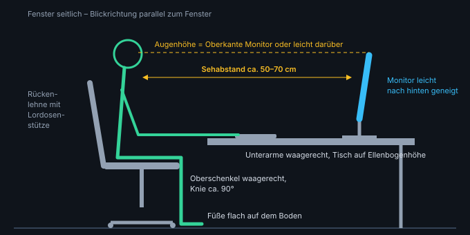

# ♿ Ergonomie & Barrierefreiheit

*Bereich: Technik · Prüfungsrelevanz: ★★☆*

> Bildschirmarbeitsplatz, Softwareergonomie, BFSG, WCAG, Hilfsmittel für Menschen mit Einschränkungen.

[⬅ Inhaltsverzeichnis](README.md)

---

Ein Arbeitsplatz ist erst dann fertig eingerichtet, wenn Menschen dort gesund und gut arbeiten können. Dazu gehören drei Ebenen: die **Hardware-Ergonomie** (Tisch, Stuhl, Monitor, Licht), die **Software-Ergonomie** (wie gut sich Programme bedienen lassen) und die **Barrierefreiheit** (auch Menschen mit Einschränkungen können den Arbeitsplatz und die Software nutzen). Barrierefreiheit ist im Prüfungskatalog 2025 ausdrücklich betont.

## Warum Ergonomie?

Wer acht Stunden am Tag schief sitzt, in einen spiegelnden Bildschirm schaut oder mit einer umständlichen Software kämpft, bekommt Rücken- und Nackenschmerzen, müde Augen und macht mehr Fehler. Das kostet die Gesundheit der Mitarbeitenden und das Unternehmen Geld durch Krankheitstage und geringere Produktivität. Deshalb gibt es gesetzliche Vorgaben – und deshalb gehört die ergonomische Einrichtung zur Übergabe eines Arbeitsplatzes dazu.

#### Rechtsgrundlagen

- **Arbeitsstättenverordnung (ArbStättV), Anhang 6:** Anforderungen an Bildschirmarbeitsplätze. Sie hat 2016 die frühere Bildschirmarbeitsverordnung ersetzt.
- **Arbeitsschutzgesetz:** Der Arbeitgeber muss eine **Gefährdungsbeurteilung** durchführen – also prüfen, welche Gefahren am Arbeitsplatz bestehen, und Maßnahmen festlegen.
- **DGUV-Informationen** der Unfallversicherung, z. B. zu Bildschirm- und Büroarbeitsplätzen, konkretisieren die Anforderungen.
- **Arbeitsmedizinische Vorsorge (ArbMedVV):** Wer am Bildschirm arbeitet, muss eine Untersuchung der Augen angeboten bekommen. Ist eine spezielle Bildschirmarbeitsbrille nötig, bezahlt sie der Arbeitgeber.

## Hardware-Ergonomie

<table><tr><th>Element</th><th>Empfehlung</th><th>warum?</th></tr>
<tr><td>Monitor</td><td>Oberkante auf oder leicht unter Augenhöhe, leicht nach hinten geneigt, Sehabstand ca. 50–70 cm (bei großen Monitoren mehr)</td><td>Der Blick geht leicht nach unten – das entlastet den Nacken und die Augen.</td></tr>
<tr><td>Aufstellung</td><td>Blickrichtung parallel zum Fenster, Fenster seitlich</td><td>Fenster vor einem blendet, Fenster hinter einem spiegelt sich im Bildschirm.</td></tr>
<tr><td>Bildschirm</td><td>entspiegelt, flimmerfrei, Helligkeit und Kontrast einstellbar, höhenverstellbar, neig- und drehbar</td><td>Spiegelungen und Flimmern ermüden die Augen.</td></tr>
<tr><td>Tisch</td><td>ausreichend Fläche (empfohlen mind. 160 × 80 cm), idealerweise höhenverstellbar (Sitz-Steh-Tisch)</td><td>Platz für Monitor, Tastatur und Unterlagen; Wechsel zwischen Sitzen und Stehen entlastet den Rücken.</td></tr>
<tr><td>Stuhl</td><td>höhenverstellbar, Rückenlehne mit Lordosenstütze, verstellbare Armlehnen, fünf Rollen</td><td>Oberschenkel waagerecht, Knie etwa 90°, Füße flach auf dem Boden – gleichmäßige Belastung, gute Durchblutung.</td></tr>
<tr><td>Tastatur, Maus</td><td>vom Bildschirm getrennt, flach; ggf. vertikale Maus</td><td>Unterarme liegen waagerecht auf Tischhöhe, Handgelenke werden nicht abgeknickt.</td></tr>
<tr><td>Beleuchtung</td><td>ca. 500 Lux am Arbeitsplatz, blendfrei</td><td>zu wenig Licht strengt die Augen an, zu viel blendet</td></tr>
<tr><td>Umgebung</td><td>angenehmes Raumklima, geringer Lärm (laute Drucker nicht am Arbeitsplatz)</td><td>Konzentration und Gesundheit</td></tr></table>

**Notebooks** erfüllen die Anforderungen allein meist nicht: Bildschirm und Tastatur sind fest verbunden, also ist entweder der Bildschirm zu tief oder die Tastatur zu hoch. Für dauerhafte Arbeit gehören deshalb Docking-Station, externer Monitor, Tastatur und Maus dazu.

**Organisatorische Ergonomie:** Bildschirmarbeit sollte durch andere Tätigkeiten oder Pausen unterbrochen werden (Mischarbeit). Mitarbeitende sollten geschult werden, wie sie Stuhl, Tisch und Monitor richtig einstellen – der beste Stuhl hilft nichts, wenn er falsch eingestellt ist.

## Software-Ergonomie (DIN EN ISO 9241-110)

Auch Software kann krank machen – durch Stress, Frust und Fehler. Die Norm DIN EN ISO 9241-110 beschreibt in der Fassung von 2020 **sieben Interaktionsprinzipien**, nach denen gute Software gestaltet ist:

<table><tr><th>Prinzip</th><th>Bedeutung</th><th>Beispiel</th></tr>
<tr><td><b>Aufgabenangemessenheit</b></td><td>Die Software unterstützt die Aufgabe ohne unnötige Schritte.</td><td>Häufig benötigte Felder sind vorausgefüllt; nur die nötigen Eingabefelder werden angezeigt.</td></tr>
<tr><td><b>Selbstbeschreibungsfähigkeit</b></td><td>Man erkennt jederzeit, wo man ist und was man tun kann.</td><td>Tooltips, verständliche Beschriftungen, Fortschrittsanzeige „Schritt 2 von 4“</td></tr>
<tr><td><b>Erwartungskonformität</b></td><td>Die Software verhält sich so, wie man es erwartet und von anderen Programmen kennt.</td><td>Strg + S speichert; das Logo oben links führt zur Startseite.</td></tr>
<tr><td><b>Erlernbarkeit</b></td><td>Die Bedienung lässt sich leicht lernen.</td><td>Einführungstour, Hilfe, einheitliche Bedienkonzepte</td></tr>
<tr><td><b>Steuerbarkeit</b></td><td>Man bestimmt selbst Ablauf und Tempo.</td><td>Vorgang jederzeit abbrechen, Zwischenspeichern, Reihenfolge der Eingaben frei wählen</td></tr>
<tr><td><b>Robustheit gegen Benutzungsfehler</b> (früher Fehlertoleranz)</td><td>Fehler werden verhindert oder lassen sich leicht beheben.</td><td>Rückgängig-Funktion, Sicherheitsabfrage vor dem Löschen, Eingabe wird sofort geprüft mit klarer Fehlermeldung</td></tr>
<tr><td><b>Benutzerbindung</b> (früher Individualisierbarkeit)</td><td>Die Software ist ansprechend gestaltet und lässt sich an eigene Bedürfnisse anpassen.</td><td>Schriftgröße, dunkles Design, eigene Symbolleisten</td></tr></table>

> [!NOTE]
> **Beispiel**
>
> **Prinzip erkennen**  
> „Beim Löschen eines Kunden erscheint die Frage: ‚Wirklich löschen? Dies kann nicht rückgängig gemacht werden.‘“ → **Robustheit gegen Benutzungsfehler**, weil ein versehentliches Löschen verhindert wird.  
> „Ein Formular zeigt beim falsch eingegebenen Datum sofort: ‚Bitte im Format TT.MM.JJJJ eingeben.‘“ → ebenfalls **Robustheit** (Fehler werden erkannt und es wird erklärt, wie man sie behebt) und **Selbstbeschreibungsfähigkeit**.  
> „Die Tastenkombination Strg + C kopiert wie in allen anderen Programmen.“ → **Erwartungskonformität**.

#### Bildschirmmasken gestalten

Formulare und Eingabemasken sollten übersichtlich und einheitlich aufgebaut sein: zusammengehörende Felder gruppieren, in der Reihenfolge der Arbeit anordnen, eindeutige Beschriftungen, Pflichtfelder kennzeichnen, sinnvolle Vorgaben. Unternehmen legen dafür oft ein **Corporate Design** als Teil ihrer **Corporate Identity** fest: Logo, Farben, Schriften und Gestaltungsregeln, die in allen Anwendungen und Dokumenten gleich verwendet werden. **Warum?** Einheitliche Oberflächen sind leichter zu bedienen (Erwartungskonformität) und machen das Unternehmen nach außen wiedererkennbar.

## Barrierefreiheit: Gesetze

Barrierefrei ist, was Menschen mit Behinderungen ohne fremde Hilfe und ohne besondere Erschwernis nutzen können. Etwa jeder zehnte Mensch in Deutschland hat eine Schwerbehinderung, viele weitere haben vorübergehende oder altersbedingte Einschränkungen. Barrierefreiheit hilft also sehr vielen – und oft allen: Untertitel nutzen auch Menschen im lauten Großraumbüro.

- **BFSG – Barrierefreiheitsstärkungsgesetz:** setzt den European Accessibility Act um und gilt seit dem **28.06.2025**. Es verpflichtet erstmals auch private Unternehmen. Erfasst sind u. a. Computer, Notebooks, Tablets und Smartphones samt Betriebssystem, Selbstbedienungsterminals (Geldautomaten, Fahrkartenautomaten), E-Book-Reader sowie Dienstleistungen wie Onlineshops, Bankdienstleistungen, Telekommunikation und E-Books. **Ausnahme:** Kleinstunternehmen (weniger als 10 Beschäftigte und höchstens 2 Mio. € Jahresumsatz), die Dienstleistungen anbieten. Für Produkte gilt diese Ausnahme nicht.
- **BGG und BITV 2.0:** verpflichten öffentliche Stellen des Bundes zu barrierefreien Websites, Apps und Dokumenten.
- **Technische Standards:** EN 301 549 und die **WCAG** (Web Content Accessibility Guidelines) in Stufe AA.

## WCAG: die vier Prinzipien

Die WCAG ordnen alle Anforderungen vier Prinzipien zu, die man sich mit **POUR** merken kann:

<table><tr><th>Prinzip</th><th>Bedeutung</th><th>Beispiele</th></tr>
<tr><td><b>Wahrnehmbar</b> (Perceivable)</td><td>Alle Informationen müssen mit mindestens einem Sinn wahrnehmbar sein.</td><td>Alternativtexte für Bilder, Untertitel für Videos, ausreichender Kontrast (mind. 4,5 : 1 für normalen Text), Information nicht nur über Farbe</td></tr>
<tr><td><b>Bedienbar</b> (Operable)</td><td>Alle Funktionen müssen bedienbar sein – nicht nur mit der Maus.</td><td>vollständige Bedienung per Tastatur, sichtbarer Fokus, ausreichend Zeit, keine schnell blinkenden Inhalte</td></tr>
<tr><td><b>Verständlich</b> (Understandable)</td><td>Inhalte und Bedienung müssen verständlich sein.</td><td>klare Sprache, gleichbleibende Navigation, verständliche Fehlermeldungen mit Hinweis zur Lösung</td></tr>
<tr><td><b>Robust</b></td><td>Inhalte müssen mit verschiedenen Programmen und Hilfsmitteln funktionieren.</td><td>sauberes, semantisch korrektes HTML, kompatibel mit Screenreadern (ARIA-Angaben)</td></tr></table>

> [!NOTE]
> **Beispiel**
>
> **Barriere erkennen und beheben**  
> Ein Formular markiert fehlerhafte Felder nur mit einem roten Rahmen.  
> **Problem:** Menschen mit Rot-Grün-Sehschwäche erkennen den Fehler nicht, ein Screenreader liest nichts vor.  
> **Lösung:** zusätzlich ein Symbol und einen Text („Bitte geben Sie eine gültige E-Mail-Adresse ein“) direkt am Feld anzeigen und das Feld technisch als fehlerhaft kennzeichnen. → Prinzipien **wahrnehmbar** (nicht nur Farbe) und **verständlich** (Fehlermeldung mit Lösung).

## Assistive Technologien am Arbeitsplatz

<table><tr><th>Einschränkung</th><th>Lösungen</th></tr>
<tr><td>Sehbehinderung</td><td>großer oder zweiter Monitor, Bildschirmlupe, Vergrößerungssoftware, Hochkontrastmodus, größere Schrift</td></tr>
<tr><td>Blindheit</td><td>Screenreader (z. B. NVDA, JAWS, Windows-Sprachausgabe), Braillezeile (zeigt Text in Blindenschrift), Sprachausgabe</td></tr>
<tr><td>Hörbehinderung</td><td>Untertitel und Live-Transkription in Besprechungen, Chat statt Telefon, optische Signale, Headset mit Verstärkung</td></tr>
<tr><td>motorische Einschränkung</td><td>Spracheingabe, Großtasten- oder Einhandtastatur, Trackball, Kopf- oder Augensteuerung, Sitz-Steh-Tisch</td></tr>
<tr><td>kognitive Einschränkung</td><td>einfache Sprache, klare Struktur, Erinnerungsfunktionen</td></tr></table>

Moderne Betriebssysteme bringen viele Funktionen schon mit (Bildschirmlupe, Sprachausgabe, Spracheingabe, Untertitel). Für spezielle Hilfsmittel kann der Arbeitgeber Förderung beim Integrations- bzw. Inklusionsamt oder bei der Agentur für Arbeit beantragen.

> [!TIP]
> Bei Aufgaben zur Barrierefreiheit immer von der **konkreten Einschränkung** in der Ausgangssituation ausgehen und passende Hilfsmittel **mit Begründung** nennen – nicht alles aufzählen, was es gibt.

> [!CAUTION]
> **Typische Fehler**
>
> - Monitor vor das Fenster stellen oder „gegenüber dem Fenster“ empfehlen.
> - Die alten Bezeichnungen „Fehlertoleranz“ und „Individualisierbarkeit“ ohne die neuen Namen verwenden – beides wird meist akzeptiert, die aktuelle Norm nennt aber Robustheit gegen Benutzungsfehler und Benutzerbindung.
> - Prinzipien nur nennen, ohne das Beispiel aus der Aufgabe zuzuordnen und zu begründen.
> - Barrierefreiheit nur als Thema für öffentliche Stellen sehen – seit dem BFSG betrifft sie auch private Unternehmen.
> - Farbe als einziges Unterscheidungsmerkmal verwenden.

**📝 Prüfungsaufgabe:** **Eine Mitarbeiterin klagt über Nackenschmerzen und Blendung. Ihr Monitor steht auf einem Stapel Bücher direkt vor dem Fenster. Nennen Sie zwei Maßnahmen und begründen Sie sie. (4 Punkte)**

Lösung anzeigen

Monitor so aufstellen, dass die Blickrichtung parallel zum Fenster verläuft, weil das Gegenlicht vom Fenster blendet (2). Monitor auf einen höhenverstellbaren Fuß stellen und so einstellen, dass die Oberkante auf oder leicht unter Augenhöhe liegt, weil der Kopf dann nicht in den Nacken gelegt werden muss (2).

**📝 Prüfungsaufgabe:** **Ordnen Sie den Beispielen je ein Prinzip der DIN EN ISO 9241-110 zu: a) Eine Löschaktion kann mit „Rückgängig“ zurückgenommen werden. b) Ein Assistent zeigt „Schritt 3 von 5“. c) Nutzer können die Schriftgröße der Oberfläche einstellen. (3 Punkte)**

Lösung anzeigen

a) Robustheit gegen Benutzungsfehler (1). b) Selbstbeschreibungsfähigkeit (1). c) Benutzerbindung (Individualisierbarkeit) (1).

**📝 Prüfungsaufgabe:** **Ein neuer Mitarbeiter ist blind. Nennen Sie zwei Hilfsmittel für seinen Arbeitsplatz und eine Anforderung an die Software, die er nutzen soll. (3 Punkte)**

Lösung anzeigen

Hilfsmittel (je 1): Screenreader, Braillezeile, Sprachausgabe. Anforderung an die Software (1): vollständig per Tastatur bedienbar und mit Screenreadern kompatibel, z. B. Bilder mit Alternativtext und eindeutig beschriftete Eingabefelder.

**📝 Prüfungsaufgabe:** **Ein Onlineshop mit 25 Beschäftigten fragt, ob er vom Barrierefreiheitsstärkungsgesetz betroffen ist. Beurteilen Sie. (2 Punkte)**

Lösung anzeigen

Ja (1). Onlineshops gehören zu den Dienstleistungen im elektronischen Geschäftsverkehr, die das BFSG seit dem 28.06.2025 erfasst; die Ausnahme gilt nur für Kleinstunternehmen mit weniger als 10 Beschäftigten und höchstens 2 Mio. € Umsatz (1).

---

## 🃏 Karteikarten (14)

| Frage | Antwort |
|---|---|
| Sehabstand zum Monitor | Etwa 50–70 cm (bei großen Monitoren entsprechend mehr). |
| Monitorhöhe | Bildschirmoberkante auf oder leicht unter Augenhöhe. |
| Aufstellung zum Fenster | Blickrichtung parallel zum Fenster – vermeidet Blendung und Spiegelungen. |
| Rechtsgrundlage Bildschirmarbeitsplatz | Arbeitsstättenverordnung (ArbStättV), Anhang 6. |
| ISO 9241-110 – Prinzipien | Aufgabenangemessenheit, Selbstbeschreibungsfähigkeit, Erwartungskonformität, Erlernbarkeit, Steuerbarkeit, Robustheit gegen Benutzungsfehler, Benutzerbindung. |
| Undo-Funktion entspricht welchem Prinzip? | Robustheit gegen Benutzungsfehler (Fehlertoleranz). |
| BFSG – seit wann? | Seit 28. Juni 2025; setzt den European Accessibility Act um. |
| BFSG – wer ist ausgenommen? | Kleinstunternehmen (< 10 Beschäftigte, ≤ 2 Mio. € Umsatz), aber nur bei Dienstleistungen. |
| WCAG – vier Prinzipien | Wahrnehmbar, Bedienbar, Verständlich, Robust (POUR). |
| Mindestkontrast Text (WCAG AA) | 4,5 : 1 für normalen Text. |
| Hilfsmittel für blinde Menschen | Screenreader und Braillezeile, Sprachausgabe. |
| Hilfsmittel bei motorischer Einschränkung | Spracheingabe, Großtasten-/Einhandtastatur, Trackball, Augen-/Kopfsteuerung. |
| Hilfsmittel bei Sehschwäche | Großer bzw. zweiter Monitor, Bildschirmlupe, Hochkontrast-Modus. |
| BITV 2.0 | Barrierefreie-Informationstechnik-Verordnung für öffentliche Stellen des Bundes. |

## ✍️ Übungsfragen (11)

**1.** Wie sollte ein Monitor zum Fenster aufgestellt werden?

Lösung

**Musterlösung (2 P):** Blickrichtung parallel zum Fenster Parallel vermeidet Blendung (Blick ins Licht) und Reflexionen (Fenster im Rücken).

**2.** Ein Programm zeigt beim Überfahren eines Buttons eine Erklärung an. Welches Prinzip der ISO 9241-110?

Lösung

**Musterlösung (2 P):** Selbstbeschreibungsfähigkeit Der Dialog erklärt sich selbst.

**3.** Seit wann gilt das Barrierefreiheitsstärkungsgesetz?

Lösung

**Musterlösung (2 P):** 28.06.2025 28.06.2025.

**4.** Welches Hilfsmittel unterstützt einen blinden Mitarbeiter am besten?

Lösung

**Musterlösung (2 P):** Braillezeile mit Screenreader Braillezeile gibt Bildschirminhalt in Blindenschrift aus, der Screenreader liest vor.

**5.** Welche Maßnahmen machen eine Website barrierefreier? Nennen Sie drei.

Lösung

**Musterlösung (3 P):** Je 1 Punkt (max. 3): Alternativtexte für Bilder; Vollständige Bedienbarkeit per Tastatur; Ausreichender Farbkontrast. Farbe allein darf keine Information tragen.

**6.** Welche Unternehmen sind vom BFSG ausgenommen?

Lösung

**Musterlösung (2 P):** Kleinstunternehmen, die Dienstleistungen erbringen < 10 Beschäftigte und ≤ 2 Mio. € Umsatz, nur für Dienstleistungen.

**7.** Strg+C kopiert wie in allen anderen Programmen. Welches Prinzip?

Lösung

**Musterlösung (2 P):** Erwartungskonformität Das Verhalten entspricht den Erwartungen/Konventionen.

**8.** Für welche Stellen gilt die BITV 2.0?

Lösung

**Musterlösung (2 P):** Öffentliche Stellen des Bundes BITV = Barrierefreiheit für öffentliche Stellen.

**9.** Eine Mitarbeiterin mit starker Sehschwäche erhält einen neuen Arbeitsplatz. Nennen Sie drei Hard- oder Softwaremaßnahmen. (3 Punkte)

Lösung

**Musterlösung (3 P):** Je 1: großer Monitor bzw. zweiter Monitor; Bildschirmlupe/Vergrößerungssoftware; Hochkontrastmodus/größere Schrift und Skalierung; Screenreader/Sprachausgabe; Tastatur mit großen, kontrastreichen Tasten; blendfreie, gute Beleuchtung.

**10.** Nennen Sie vier Anforderungen an einen ergonomischen Bildschirmarbeitsplatz. (4 Punkte)

Lösung

**Musterlösung (4 P):** Je 1: Monitor-Oberkante auf/unter Augenhöhe; Sehabstand 50–70 cm; Monitor parallel zum Fenster, entspiegelt; höhenverstellbarer Tisch und Stuhl; separate Tastatur/Maus; ausreichende, blendfreie Beleuchtung (~500 lx); Pausen/Mischarbeit.

**11.** Erläutern Sie zwei der vier WCAG-Prinzipien jeweils mit einem Beispiel. (4 Punkte)

Lösung

**Musterlösung (4 P):** Z. B.: Wahrnehmbar – Inhalte müssen über mehrere Sinne erfassbar sein, z. B. Alternativtext für Bilder (2). Bedienbar – alle Funktionen müssen ohne Maus nutzbar sein, z. B. vollständige Tastaturbedienung (2). Verständlich – klare Sprache und eindeutige Fehlermeldungen (2). Robust – sauberer HTML-Code, damit Screenreader die Seite interpretieren können (2).

[⬅ Inhaltsverzeichnis](README.md)
