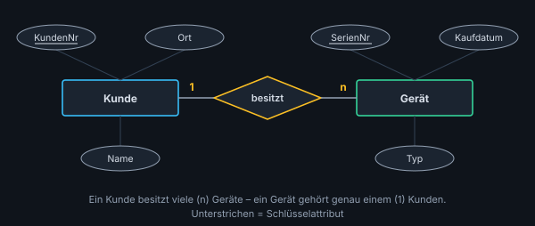
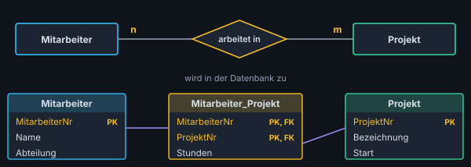

# 💿 Betriebssysteme & Software

*Bereich: Technik · Prüfungsrelevanz: ★★★*

> BIOS/UEFI, Partitionierung, Dateisysteme, OS-Installation, Softwarearten, Kommandozeile.

[⬅ Inhaltsverzeichnis](README.md)

---

Hardware allein macht noch keinen Arbeitsplatz. Damit jemand arbeiten kann, braucht der Rechner eine Firmware, ein Betriebssystem mit passendem Dateisystem, Anwendungen und eine Anbindung an zentrale Server und Datenbanken. Dieses Thema erklärt, wie das zusammenspielt, wie man einen Rechner einrichtet und was du über relationale Datenbanken für die AP1 wissen musst.

## Softwarearten und Aufgaben des Betriebssystems

<table><tr><th>Art</th><th>Aufgabe</th><th>Beispiele</th></tr>
<tr><td><b>Firmware</b></td><td>fest im Gerät gespeicherte Software, die die Hardware startet</td><td>UEFI, Firmware von Router, Drucker, SSD</td></tr>
<tr><td><b>Systemsoftware</b></td><td>verwaltet die Hardware und stellt sie den Programmen zur Verfügung</td><td>Betriebssystem, Treiber, Dienstprogramme</td></tr>
<tr><td><b>Anwendungssoftware</b></td><td>erledigt die eigentlichen Aufgaben der Nutzer</td><td>Office, ERP, Browser, CAD, Branchensoftware</td></tr></table>

Das **Betriebssystem** ist der Vermittler zwischen Hardware und Anwendungen. **Warum braucht man es?** Ohne Betriebssystem müsste jedes Programm selbst wissen, wie es mit jeder einzelnen Festplatte, Grafikkarte und Netzwerkkarte spricht. Das Betriebssystem übernimmt das und sorgt dafür, dass sich mehrere Programme und Benutzer die Hardware teilen können, ohne sich zu stören. Seine Aufgaben:

- **Prozessverwaltung:** verteilt die Rechenzeit der CPU auf die laufenden Programme.
- **Speicherverwaltung:** teilt jedem Programm Arbeitsspeicher zu und schützt die Bereiche voreinander.
- **Dateiverwaltung:** organisiert Dateien und Ordner über das Dateisystem.
- **Geräteverwaltung:** spricht die Hardware über **Treiber** an.
- **Benutzer- und Rechteverwaltung:** Anmeldung, Zugriffsrechte.
- **Benutzeroberfläche:** grafisch (GUI) oder Kommandozeile (CLI).

## Vom Einschalten zum Desktop: BIOS und UEFI

Beim Einschalten startet zuerst die Firmware. Sie prüft die Hardware (**POST**, Power-On Self-Test), sucht nach der Bootreihenfolge einen Datenträger mit Betriebssystem und startet dessen Bootloader. Dieser lädt das Betriebssystem.

<table><tr><th></th><th>BIOS (Legacy)</th><th>UEFI</th></tr>
<tr><td>Partitionsschema</td><td>MBR (Master Boot Record)</td><td>GPT (GUID-Partitionstabelle)</td></tr>
<tr><td>max. Größe des Bootlaufwerks</td><td>2 TiB</td><td>praktisch unbegrenzt</td></tr>
<tr><td>Partitionen</td><td>4 primäre (oder 3 primäre + 1 erweiterte)</td><td>128 unter Windows</td></tr>
<tr><td>Sicherheit</td><td>–</td><td><b>Secure Boot</b> (nur signierte Bootloader), TPM-Unterstützung</td></tr>
<tr><td>Bedienung</td><td>textbasiert</td><td>grafisch, mit Maus, Netzwerkfunktionen</td></tr></table>

**Warum Secure Boot?** Schadsoftware, die sich vor dem Betriebssystem in den Startvorgang einnistet (Bootkit), kann vom Virenschutz kaum entdeckt werden, weil sie schon läuft, bevor dieser startet. Secure Boot verhindert das, indem nur digital signierte Bootloader gestartet werden. **Windows 11** verlangt deshalb UEFI mit Secure Boot und ein **TPM 2.0** – einen Sicherheitschip, der Schlüssel z. B. für BitLocker und Windows Hello geschützt speichert.

## Partitionieren und Dateisysteme

**Partitionieren** heißt, einen Datenträger in logische Bereiche aufzuteilen, z. B. Systempartition und Datenpartition. **Formatieren** legt auf einer Partition ein Dateisystem an. Achtung: Eine **Schnellformatierung** löscht nur die Verwaltungsstrukturen – die Daten selbst lassen sich mit einfachen Werkzeugen wiederherstellen.

<table><tr><th>Dateisystem</th><th>Einsatz</th><th>Merkmale</th></tr>
<tr><td>FAT32</td><td>USB-Sticks, maximale Kompatibilität</td><td>Dateien höchstens <b>4 GB</b>, keine Zugriffsrechte</td></tr>
<tr><td>exFAT</td><td>große USB-Sticks, SD-Karten</td><td>große Dateien, auf Windows, macOS und Linux lesbar; keine Rechte, kein Journal</td></tr>
<tr><td>NTFS</td><td>Windows-Systempartition</td><td>Zugriffsrechte (ACL), Journaling, Verschlüsselung, Komprimierung, Kontingente</td></tr>
<tr><td>ReFS</td><td>Windows Server</td><td>Integritätsprüfung, sehr große Volumes</td></tr>
<tr><td>ext4, Btrfs, XFS</td><td>Linux</td><td>Journaling, Unix-Rechte</td></tr>
<tr><td>APFS</td><td>macOS</td><td>Snapshots, Verschlüsselung, für SSDs optimiert</td></tr></table>

**Journaling** bedeutet: Das Dateisystem protokolliert Änderungen, bevor es sie ausführt. Stürzt der Rechner mitten im Schreiben ab, kann es anhand des Protokolls schnell einen konsistenten Zustand herstellen, statt den ganzen Datenträger prüfen zu müssen.

> [!NOTE]
> **Beispiel**
>
> **Welches Dateisystem?**  
> Ein Mitarbeiter will eine 6 GB große Videodatei auf einen USB-Stick kopieren und erhält die Meldung „Die Datei ist zu groß für das Zieldateisystem“, obwohl 28 GB frei sind.  
> **Ursache:** Der Stick ist mit FAT32 formatiert, das keine Dateien über 4 GB speichern kann.  
> **Lösung:** Daten sichern und den Stick mit **exFAT** formatieren. Damit sind große Dateien möglich und der Stick bleibt an Windows- und Mac-Rechnern lesbar. NTFS ginge auch, ist an Macs aber nur lesbar.

## Einen Arbeitsplatzrechner einrichten

1. **Vorbereiten:** Hardwareanforderungen prüfen, Firmware aktualisieren, im UEFI Secure Boot, TPM und die Bootreihenfolge einstellen.
2. **Installieren:** manuell vom USB-Stick, per Image, über das Netzwerk (PXE) oder mit Windows Autopilot.
3. **Ergänzen:** Treiber, Updates, Anwendungen, Sprachpakete.
4. **Netzwerk und Anmeldung:** IP-Adresse per DHCP oder statisch, Beitritt zur Domäne bzw. zu Entra ID.
5. **Absichern (Härten):** Benutzer ohne Administratorrechte, Firewall und Virenschutz aktiv, BitLocker einschalten, unnötige Dienste und Programme entfernen.
6. **Testen und dokumentieren:** Funktionen prüfen, Inventar- und Seriennummer, Konfiguration und installierte Software festhalten.
7. **Übergeben:** Nutzer einweisen, Übergabe quittieren lassen.

<table><tr><th>Installationsart</th><th>Prinzip</th><th>sinnvoll bei</th></tr>
<tr><td>Neuinstallation (clean)</td><td>leeres System, alles neu</td><td>Einzelgeräten, nach Schadsoftwarebefall</td></tr>
<tr><td>Upgrade</td><td>neue Version über die alte, Daten und Programme bleiben</td><td>Umstieg Windows 10 → 11 auf demselben Gerät</td></tr>
<tr><td>unbeaufsichtigte Installation</td><td>Antwortdatei beantwortet alle Fragen der Installation automatisch</td><td>mehreren Geräten ohne Image</td></tr>
<tr><td>Imaging</td><td>ein fertig eingerichtetes Musterabbild wird auf viele Geräte kopiert</td><td>vielen gleichen Geräten</td></tr>
<tr><td>Autopilot (Cloud)</td><td>Gerät wird beim ersten Start mit dem Firmenkonto automatisch über Intune eingerichtet</td><td>Geräten, die direkt vom Händler zum Mitarbeitenden gehen, Homeoffice</td></tr>
<tr><td>Softwareverteilung</td><td>Programme werden zentral auf viele Rechner verteilt (z. B. Intune, Configuration Manager, winget)</td><td>laufendem Betrieb, Updates</td></tr></table>

> [!NOTE]
> **Beispiel**
>
> **Begründete Wahl**  
> „Für die 30 baugleichen Schulungsrechner empfehle ich Imaging, weil ein einmal eingerichtetes und getestetes Musterabbild in kurzer Zeit auf alle Geräte verteilt werden kann. Alle Rechner sind danach identisch konfiguriert, was Fehler vermeidet und den Support vereinfacht.“

## Standard- oder Individualsoftware?

<table><tr><th></th><th>Standardsoftware</th><th>Individualsoftware</th></tr>
<tr><td>Was?</td><td>für viele Kunden entwickelt</td><td>für einen Kunden maßgeschneidert</td></tr>
<tr><td>Vorteile</td><td>günstig, sofort verfügbar, erprobt, viele Nutzer finden Fehler, Schulungen und Support am Markt</td><td>passt genau zu den Abläufen, kann Wettbewerbsvorteil sein, eigene Anpassungen jederzeit möglich</td></tr>
<tr><td>Nachteile</td><td>passt evtl. nicht genau, Abläufe müssen angepasst werden, Abhängigkeit vom Hersteller</td><td>teuer, lange Entwicklungszeit, Fehler in der Anfangsphase, Abhängigkeit vom Entwickler</td></tr></table>

**Branchensoftware** liegt dazwischen: Standardsoftware für eine Branche, z. B. für Arztpraxen, Kanzleien oder Handwerksbetriebe. Kriterien für die Auswahl sind Funktionsumfang, Kompatibilität und Schnittstellen (API) zu vorhandenen Systemen, Anpassbarkeit, Bedienbarkeit, Kosten und Lizenzmodell, Support und Datenschutz (Serverstandort).

## Kommandozeile

Viele Aufgaben in der Administration gehen auf der Kommandozeile schneller als in der grafischen Oberfläche und lassen sich in Skripten automatisieren. In der AP1 sollst du typische Befehle kennen und ihre Ausgabe deuten können.

<table><tr><th>Zweck</th><th>Windows (CMD / PowerShell)</th><th>Linux</th></tr>
<tr><td>Verzeichnisinhalt anzeigen</td><td>dir / Get-ChildItem</td><td>ls -l</td></tr>
<tr><td>Verzeichnis wechseln / anlegen</td><td>cd / mkdir</td><td>cd / mkdir</td></tr>
<tr><td>Datei kopieren / verschieben / löschen</td><td>copy / move / del</td><td>cp / mv / rm</td></tr>
<tr><td>IP-Konfiguration anzeigen</td><td>ipconfig /all</td><td>ip a</td></tr>
<tr><td>Erreichbarkeit prüfen</td><td>ping</td><td>ping</td></tr>
<tr><td>Weg der Pakete verfolgen</td><td>tracert</td><td>traceroute</td></tr>
<tr><td>DNS abfragen</td><td>nslookup</td><td>nslookup, dig</td></tr>
<tr><td>ARP-Tabelle anzeigen</td><td>arp -a</td><td>ip neigh</td></tr>
<tr><td>offene Verbindungen und Ports</td><td>netstat -an</td><td>ss -tulpn</td></tr>
<tr><td>IP-Adresse per DHCP neu anfordern</td><td>ipconfig /release, ipconfig /renew</td><td>dhclient</td></tr>
<tr><td>DNS-Zwischenspeicher leeren</td><td>ipconfig /flushdns</td><td>resolvectl flush-caches</td></tr>
<tr><td>Zugriffsrechte ändern</td><td>icacls</td><td>chmod, chown</td></tr>
<tr><td>Gruppenrichtlinien sofort anwenden</td><td>gpupdate /force</td><td>–</td></tr></table>

#### Linux-Rechte mit chmod

Jede Datei hat Rechte für drei Gruppen: **u**ser (Besitzer), **g**roup (Gruppe) und **o**thers (alle anderen). Es gibt drei Rechte: **r** (lesen) = 4, **w** (schreiben) = 2, **x** (ausführen) = 1. Die Zahl je Gruppe ist die Summe ihrer Rechte.

> [!NOTE]
> **Beispiel**
>
> **chmod 754 skript.sh**  
> 7 = 4 + 2 + 1 = rwx → Besitzer darf lesen, schreiben, ausführen  
> 5 = 4 + 0 + 1 = r-x → Gruppe darf lesen und ausführen  
> 4 = 4 + 0 + 0 = r-- → alle anderen dürfen nur lesen  
>
> **Umgekehrt:** ls -l zeigt `-rw-r-----`. Ohne das erste Zeichen (Dateityp): rw- = 6, r-- = 4, --- = 0 → **640**.

## Client-Server-Systeme

Im **Client-Server-Modell** fordern Clients Dienste an und ein zentraler Server stellt sie bereit: Datei-, Druck-, Mail-, Web-, Datenbank- oder Anwendungsserver. **Warum zentral?** Daten liegen an einem Ort und können dort gesichert, geschützt und mit Rechten versehen werden. Software und Benutzer werden zentral verwaltet. **Nachteil:** Fällt der Server aus, sind alle betroffen (Single Point of Failure), und ohne Netzwerk geht nichts.

Im **Peer-to-Peer-Netz** (Arbeitsgruppe) sind alle Rechner gleichberechtigt und geben sich gegenseitig Ordner oder Drucker frei. Das ist günstig und für zwei, drei Rechner ausreichend, wird bei mehr Geräten aber unübersichtlich und unsicher, weil jeder Rechner eigene Benutzerkonten und Rechte hat.

**Fat Client**: Programme laufen lokal auf dem Rechner. **Thin Client**: Programme laufen auf dem Server, der Client zeigt nur an.

Größere Anwendungen werden in **Schichten** aufgebaut:

## Relationale Datenbanken

> [!WARNING]
> **Prüfungskatalog 2025:** Die **Grundlagen relationaler Datenbanken** sind AP1-Stoff und kamen in bisherigen Prüfungen häufig vor. SQL-Abfragen und NoSQL gehören dagegen in die AP2.

Ein **Datenbanksystem** besteht aus der **Datenbank** (den gespeicherten Daten) und dem **Datenbankmanagementsystem** (DBMS, z. B. MariaDB/MySQL, PostgreSQL, Microsoft SQL Server), das den Zugriff steuert.

**Warum nicht einfach eine Excel-Liste?** Sobald mehrere Personen gleichzeitig mit vielen Daten arbeiten, stößt eine Tabellenkalkulation an Grenzen: Gleichzeitiges Bearbeiten führt zu Konflikten, Daten werden mehrfach und widersprüchlich gespeichert, Rechte lassen sich nur grob vergeben. Ein DBMS bietet Mehrbenutzerbetrieb, prüft die Daten auf Korrektheit (Integrität), vermeidet Mehrfachspeicherung, vergibt feine Zugriffsrechte und führt zusammengehörende Änderungen ganz oder gar nicht aus (Transaktionen).

#### Grundbegriffe

<table><tr><th>Begriff</th><th>Bedeutung</th><th>Beispiel</th></tr>
<tr><td>Tabelle (Relation)</td><td>Sammlung gleichartiger Datensätze</td><td>Mitarbeiter</td></tr>
<tr><td>Datensatz (Tupel, Zeile)</td><td>ein Eintrag</td><td>1003, Isa Muster, Vertrieb</td></tr>
<tr><td>Attribut (Feld, Spalte)</td><td>eine Eigenschaft mit festem Datentyp</td><td>Nachname (Text), Eintrittsdatum (Datum)</td></tr>
<tr><td><b>Primärschlüssel</b> (PK)</td><td>identifiziert jeden Datensatz eindeutig, darf nie leer sein und sich nicht ändern</td><td>MitarbeiterNr</td></tr>
<tr><td><b>Fremdschlüssel</b> (FK)</td><td>Spalte, die auf den Primärschlüssel einer anderen Tabelle verweist und so eine Beziehung herstellt</td><td>Mitarbeiter.AbteilungsNr → Abteilung.AbteilungsNr</td></tr></table>

**Warum eine Nummer als Primärschlüssel und nicht der Name?** Namen sind nicht eindeutig (zwei Personen heißen „Anna Schmidt“) und können sich ändern (Heirat). Eine künstliche Nummer ist immer eindeutig und bleibt gleich.

#### Redundanz und Anomalien

Wird dieselbe Information mehrfach gespeichert (**Redundanz**), entstehen Fehler:

> [!NOTE]
> **Beispiel**
>
> | BestellNr | Kunde | Kundenort | Artikel |
> | --- | --- | --- | --- |
> | 501 | Becker GmbH | Hamburg | Monitor |
> | 502 | Becker GmbH | Hamburg | Dockingstation |
> | 503 | Becker GmbH | **Lübeck** | Headset |
>
> Die Becker GmbH ist umgezogen, die Adresse wurde aber nur in Zeile 503 geändert – jetzt widersprechen sich die Daten (**Änderungsanomalie**). Löscht man alle Bestellungen eines Kunden, sind auch seine Daten weg (**Löschanomalie**). Einen neuen Kunden ohne Bestellung kann man gar nicht anlegen (**Einfügeanomalie**).  
> **Lösung:** Kunden in eine eigene Tabelle auslagern; die Bestellung enthält nur noch die KundenNr als Fremdschlüssel. Die Adresse steht dann nur einmal in der Datenbank. Dieses Aufteilen heißt **Normalisierung** (Details in der AP2).

#### Beziehungen und ER-Modell

Bevor man Tabellen anlegt, plant man mit dem **Entity-Relationship-Modell**, welche Dinge gespeichert werden und wie sie zusammenhängen. **Entitätstypen** (Rechtecke) sind die Objekte, z. B. Kunde und Gerät. **Attribute** (Ellipsen) sind ihre Eigenschaften, das **Schlüsselattribut** ist unterstrichen. **Beziehungen** (Rauten) verbinden sie, die **Kardinalität** gibt an, wie viele auf jeder Seite beteiligt sind.

<table><tr><th>Kardinalität</th><th>Bedeutung</th><th>Beispiel</th><th>Umsetzung in Tabellen</th></tr>
<tr><td>1:1</td><td>einem Datensatz steht genau einer gegenüber</td><td>Mitarbeiter – Firmenausweis</td><td>Fremdschlüssel in einer der beiden Tabellen (oder zusammenfassen)</td></tr>
<tr><td>1:n</td><td>einem Datensatz stehen viele gegenüber</td><td>Kunde – Gerät, Abteilung – Mitarbeiter</td><td>Fremdschlüssel in die Tabelle auf der <b>n-Seite</b></td></tr>
<tr><td>n:m</td><td>viele auf beiden Seiten</td><td>Mitarbeiter – Projekt</td><td><b>Zwischentabelle</b> mit den Primärschlüsseln beider Seiten als Fremdschlüssel</td></tr></table>

> [!NOTE]
> **Beispiel**
>
> **Vom ER-Modell zur Tabelle (1:n)**  
> Kunde (KundenNr, Name, Ort)  
> Gerät (SerienNr, Typ, Kaufdatum, ↑KundenNr)  
> Die KundenNr kommt in die Tabelle Gerät, weil jedes Gerät genau einem Kunden gehört. Umgekehrt ginge es nicht: In der Tabelle Kunde müsste man sonst für jedes Gerät eine eigene Spalte anlegen.

Bei **n:m** funktioniert das auf keiner Seite: Ein Mitarbeiter arbeitet in mehreren Projekten, ein Projekt hat mehrere Mitarbeiter. Deshalb entsteht eine Zwischentabelle. Ihr Primärschlüssel besteht aus beiden Fremdschlüsseln zusammen. Sie kann zusätzliche Attribute der Beziehung aufnehmen, z. B. die Stunden, die jemand in einem Projekt arbeitet.

**Datentypen** der Spalten: Ganzzahl für Nummern und Mengen, Text für Namen, Datum für Termine, Dezimalzahl für Geldbeträge, Wahrheitswert für Ja/Nein. **Warum?** Das DBMS kann dann prüfen, ob die Eingabe sinnvoll ist (kein „morgen“ im Datumsfeld), und Werte korrekt sortieren und berechnen. Postleitzahlen und Telefonnummern sind übrigens **Text**, weil führende Nullen erhalten bleiben müssen und man mit ihnen nicht rechnet.

> [!CAUTION]
> **Typische Fehler**
>
> - MBR und GPT bzw. BIOS und UEFI verwechseln.
> - FAT32 für große Dateien empfehlen oder die 4-GB-Grenze nicht als Ursache erkennen.
> - Schnellformatierung für sicheres Löschen halten.
> - Bei chmod die Reihenfolge (Besitzer – Gruppe – Andere) oder die Werte (r = 4, w = 2, x = 1) verwechseln.
> - Bei 1:n den Fremdschlüssel auf die 1-Seite setzen.
> - n:m ohne Zwischentabelle umsetzen.
> - Den Namen als Primärschlüssel wählen.
> - Postleitzahlen als Zahl speichern.

**📝 Prüfungsaufgabe:** **Erläutern Sie zwei Vorteile von UEFI gegenüber dem klassischen BIOS. (4 Punkte)**

Lösung anzeigen

Je 2 Punkte, z. B.: UEFI unterstützt Secure Boot – es werden nur signierte Bootloader gestartet, sodass sich keine Schadsoftware vor dem Betriebssystem einnisten kann. UEFI nutzt GPT, wodurch Bootlaufwerke größer als 2 TiB und mehr als vier Partitionen möglich sind. UEFI unterstützt TPM, das z. B. für BitLocker und als Voraussetzung für Windows 11 nötig ist.

**📝 Prüfungsaufgabe:** **Ein Skript soll für den Besitzer lesbar, schreibbar und ausführbar sein, für die Gruppe lesbar und ausführbar, für alle anderen gar nicht zugänglich. Geben Sie den chmod-Befehl an. (2 Punkte)**

Lösung anzeigen

Besitzer rwx = 7, Gruppe r-x = 5, Andere --- = 0 (1) → **chmod 750 skript.sh** (1).

**📝 Prüfungsaufgabe:** **Ein Unternehmen verwaltet Kurse und Teilnehmende. Jede Person kann mehrere Kurse besuchen, jeder Kurs hat mehrere Teilnehmende. Geben Sie die Kardinalität an und beschreiben Sie, wie die Beziehung in Tabellen umgesetzt wird. (4 Punkte)**

Lösung anzeigen

Kardinalität n:m (1). Es werden drei Tabellen angelegt: Teilnehmer (PK TeilnehmerNr), Kurs (PK KursNr) (1) und eine Zwischentabelle, z. B. Teilnahme, mit den Fremdschlüsseln TeilnehmerNr und KursNr (1), die zusammen den Primärschlüssel bilden (1).

**📝 Prüfungsaufgabe:** **Eine Firma speichert Kundenbestellungen in einer einzigen Tabelle, in der zu jeder Bestellung Name und Adresse des Kunden stehen. Erläutern Sie das Problem und einen Lösungsansatz. (4 Punkte)**

Lösung anzeigen

Die Kundendaten werden bei jeder Bestellung erneut gespeichert (Redundanz) (1). Ändert sich eine Adresse und wird nicht in allen Zeilen angepasst, sind die Daten widersprüchlich (Änderungsanomalie) (1). Lösung: eine eigene Tabelle Kunde mit Primärschlüssel KundenNr anlegen (1); die Tabelle Bestellung erhält nur noch die KundenNr als Fremdschlüssel (1).

**📝 Prüfungsaufgabe:** **Begründen Sie, ob für 25 neue, baugleiche Notebooks, die direkt an Mitarbeitende im Homeoffice geliefert werden, Imaging oder Windows Autopilot besser geeignet ist. (2 Punkte)**

Lösung anzeigen

Autopilot (1), weil die Notebooks nicht erst in der IT-Abteilung ausgepackt und mit einem Image bespielt werden müssen: Sie richten sich beim ersten Start mit dem Firmenkonto automatisch über Intune ein, auch im Homeoffice (1).

---

## 🃏 Karteikarten (36)

| Frage | Antwort |
|---|---|
| UEFI – Vorteile gegenüber BIOS | GPT (große Platten, viele Partitionen), Secure Boot, grafische Oberfläche, schnellerer Start. |
| Secure Boot | UEFI-Funktion, die nur signierte Bootloader/Betriebssysteme startet – schützt vor Bootkits. |
| TPM 2.0 | Sicherheitschip zur geschützten Speicherung von Schlüsseln; Voraussetzung für Windows 11, genutzt von BitLocker und Windows Hello. |
| MBR – Grenzen | Max. 2 TiB Bootlaufwerk, max. 4 primäre Partitionen. |
| FAT32 – Einschränkung | Maximale Dateigröße 4 GiB, keine Zugriffsrechte. |
| NTFS – Merkmale | Zugriffsrechte (ACL), Journaling, EFS-Verschlüsselung, Kompression, Quotas. |
| exFAT – Einsatz | Große USB-Sticks/SD-Karten, Dateien > 4 GiB, Windows/macOS-kompatibel. |
| Journaling | Änderungen werden vor Ausführung protokolliert → schnelle Wiederherstellung der Konsistenz nach Absturz. |
| Partitionieren vs. Formatieren | Partitionieren: Bereiche anlegen. Formatieren: Dateisystem einrichten. |
| Imaging | Verteilung eines vorkonfigurierten Systemabbilds auf viele gleiche Rechner. |
| Windows Autopilot | Cloudbasierte Bereitstellung neuer Geräte über Microsoft Intune/Entra ID – ohne Imaging. |
| Standard- vs. Individualsoftware | Standard: günstig, sofort verfügbar, getestet, aber nicht passgenau. Individual: passgenau, aber teuer und zeitaufwendig. |
| Interoperabilität | Fähigkeit unterschiedlicher Systeme, über Schnittstellen zusammenzuarbeiten und Daten auszutauschen. |
| chmod 640 | Besitzer rw-, Gruppe r--, Andere ---. |
| Linux-Rechtewerte | r = 4, w = 2, x = 1; Reihenfolge Besitzer, Gruppe, Andere. |
| ipconfig /all | Zeigt komplette IP-Konfiguration inkl. MAC, DHCP-Server, DNS-Server, Lease. |
| tracert / traceroute | Zeigt alle Router (Hops) auf dem Weg zum Ziel. |
| nslookup | Fragt einen DNS-Server nach der Auflösung von Namen/IP ab. |
| gpupdate /force | Erzwingt sofortige Aktualisierung der Gruppenrichtlinien auf einem Windows-Client. |
| Linux: aktuelle IP-Adressen anzeigen | ip a (Paket iproute2), veraltet ifconfig. |
| Client-Server-Prinzip | Clients fordern Dienste an, ein zentraler Server stellt sie bereit. |
| Peer-to-Peer | Alle Rechner gleichberechtigt, keine zentrale Verwaltung. |
| Fat Client vs. Thin Client | Fat: Programme lokal. Thin: Programme laufen auf dem Server. |
| DBMS | Datenbankmanagementsystem – Software, die die Datenbank verwaltet (z. B. MariaDB, SQL Server). |
| Primärschlüssel | Attribut, das jeden Datensatz eindeutig identifiziert. |
| Fremdschlüssel | Attribut, das auf den Primärschlüssel einer anderen Tabelle verweist. |
| Kardinalitäten | 1:1, 1:n, n:m. |
| n:m-Beziehung in Tabellen | Wird über eine Zwischentabelle mit zwei Fremdschlüsseln aufgelöst. |
| Redundanz – Problem | Doppelt gespeicherte Daten führen zu Anomalien/Inkonsistenzen. |
| Datensatz / Attribut | Datensatz = Zeile, Attribut = Spalte. |
| ER-Modell | Entity-Relationship-Modell: beschreibt Entitätstypen, ihre Attribute und Beziehungen – Planung vor dem Anlegen der Tabellen. |
| Entitätstyp | Art von Objekten, über die Daten gespeichert werden, z. B. Kunde. Wird zur Tabelle. |
| Attribut im ER-Modell | Eigenschaft eines Entitätstyps, z. B. Name. Wird zur Spalte. |
| Wo steht der Fremdschlüssel bei 1:n? | In der Tabelle auf der n-Seite. |
| Datentypen für Tabellenspalten | Ganzzahl, Dezimalzahl, Text, Datum, Wahrheitswert. |
| ER-Diagramm: Symbole | Entitätstyp = Rechteck, Beziehung = Raute bzw. Linie, Attribut = Oval; Schlüsselattribut unterstrichen. |

## ✍️ Übungsfragen (26)

**1.** Ein 4-TB-Laufwerk soll als Bootlaufwerk komplett nutzbar sein. Welches Partitionsschema?

Lösung

**Musterlösung (2 P):** GPT MBR ist auf 2 TiB begrenzt; GPT (mit UEFI) nicht.

**2.** Eine 6-GB-Videodatei lässt sich nicht auf einen USB-Stick kopieren, obwohl 30 GB frei sind. Wahrscheinlichste Ursache?

Lösung

**Musterlösung (2 P):** Stick ist mit FAT32 formatiert FAT32 erlaubt max. 4 GiB pro Datei → exFAT/NTFS verwenden.

**3.** Welche Voraussetzung gilt für Windows 11?

Lösung

**Musterlösung (2 P):** TPM 2.0 und Secure Boot Windows 11 verlangt UEFI, Secure Boot und TPM 2.0.

**4.** Welcher Befehl zeigt unter Windows die vollständige IP-Konfiguration inkl. DNS-Server an?

Lösung

**Musterlösung (2 P):** ipconfig /all

**5.** Welche Rechte ergeben sich aus chmod 750?

Lösung

**Musterlösung (2 P):** rwxr-x--- 7 = rwx, 5 = r-x, 0 = ---.

**6.** Welcher Zahlenwert in chmod entspricht rw-r--r--? (dreistellig)

Lösung

**644** rw- = 6, r-- = 4, r-- = 4.

**7.** Welcher Linux-Befehl ersetzt das veraltete ifconfig?

Lösung

**Musterlösung (2 P):** ip a ip aus dem Paket iproute2.

**8.** Welches Dateisystem bietet unter Windows Zugriffsrechte und Journaling?

Lösung

**Musterlösung (2 P):** NTFS

**9.** Welche Nachteile hat Individualsoftware gegenüber Standardsoftware? Nennen Sie drei.

Lösung

**Musterlösung (3 P):** Je 1 Punkt (max. 3): Hohe Entwicklungskosten; Lange Entwicklungszeit; Abhängigkeit vom Entwickler. Passgenauigkeit ist ein Vorteil.

**10.** Mit welchem Verfahren werden 50 identische PCs am schnellsten mit vorkonfiguriertem System versehen?

Lösung

**Musterlösung (2 P):** Imaging/Softwareverteilung Ein Image wird einmal erstellt und verteilt.

**11.** Welcher Befehl leert unter Windows den DNS-Cache?

Lösung

**Musterlösung (2 P):** ipconfig /flushdns

**12.** Was bewirkt eine Schnellformatierung?

Lösung

**Musterlösung (2 P):** Nur Verwaltungsstrukturen werden neu angelegt – Daten sind wiederherstellbar Für sichere Löschung reicht Formatieren nicht.

**13.** Erläutern Sie zwei Vorteile von UEFI gegenüber dem klassischen BIOS. (4 Punkte)

Lösung

**Musterlösung (4 P):** Z. B.: UEFI unterstützt GPT, dadurch Bootlaufwerke > 2 TiB und bis zu 128 Partitionen (2); Secure Boot startet nur signierte Bootloader und schützt so vor Bootkits/Rootkits (2); grafische Oberfläche mit Mausbedienung und Netzwerkfunktionen (2); schnellerer Systemstart (2).

**14.** Nennen Sie vier Arbeitsschritte bei der Einrichtung eines neuen Windows-Arbeitsplatzes nach der OS-Installation. (4 Punkte)

Lösung

**Musterlösung (4 P):** Je 1: Treiber und Updates installieren; Anwendungssoftware installieren; Netzwerk konfigurieren und in Domäne/Entra ID einbinden; Benutzerkonto und Rechte einrichten (keine Adminrechte); Sicherheit: Virenschutz, Firewall, BitLocker; Drucker/Netzlaufwerke verbinden; Funktionstest und Dokumentation/Inventarisierung; Einweisung des Nutzers.

**15.** Welches Attribut eignet sich als Primärschlüssel einer Tabelle „Mitarbeiter“?

Lösung

**Musterlösung (2 P):** Personalnummer Eindeutig und nie leer – Namen und Geburtsdaten können doppelt vorkommen.

**16.** Eine Abteilung hat viele Mitarbeitende, jede Person gehört zu genau einer Abteilung. Welche Kardinalität?

Lösung

**Musterlösung (2 P):** 1:n

**17.** Mitarbeitende arbeiten in mehreren Projekten, Projekte haben mehrere Mitarbeitende. Wie wird das in Tabellen umgesetzt?

Lösung

**Musterlösung (2 P):** Zwischentabelle mit den Fremdschlüsseln MitarbeiterNr und ProjektNr n:m wird über eine Zwischentabelle aufgelöst.

**18.** Was ist ein Fremdschlüssel?

Lösung

**Musterlösung (2 P):** Ein Attribut, das auf den Primärschlüssel einer anderen Tabelle verweist

**19.** Welche Vorteile bietet eine relationale Datenbank gegenüber mehreren Excel-Listen? Nennen Sie drei.

Lösung

**Musterlösung (3 P):** Je 1 Punkt (max. 3): Mehrbenutzerbetrieb; Weniger Redundanz; Zugriffsrechte und Datensicherung.

**20.** Beschreiben Sie das Client-Server-Modell und nennen Sie einen Nachteil.

Lösung

**Musterlösung (3 P):** Ein Server stellt zentral Dienste oder Ressourcen bereit, z. B. Dateien, Anmeldung, Datenbank (1). Die Clients fordern diese über das Netz an und nutzen sie (1). Nachteil (1): Der Server ist ein Single Point of Failure; höhere Kosten und mehr Administrationsaufwand als bei Peer-to-Peer.

**21.** In einer Excel-Liste sind zu jeder Bestellung Name und Adresse des Kunden gespeichert. Erläutern Sie das Problem und eine Lösung mit einer relationalen Datenbank. (4 Punkte)

Lösung

**Musterlösung (4 P):** Problem: Kundendaten sind redundant mehrfach gespeichert (1); bei Änderungen (z. B. neue Adresse) entstehen Inkonsistenzen/Änderungsanomalien (1). Lösung: zwei Tabellen Kunde (Primärschlüssel KundenNr) und Bestellung (1), Bestellung erhält den Fremdschlüssel KundenNr → 1:n-Beziehung, Kundendaten nur einmal gespeichert (1).

**22.** Ein Systemhaus will Kunden und deren Geräte speichern. Ein Kunde kann mehrere Geräte haben, jedes Gerät gehört genau einem Kunden. Geben Sie die beiden Tabellen mit sinnvollen Spalten an und kennzeichnen Sie Primär- und Fremdschlüssel.

Lösung

**Musterlösung (4 P):** Kunde (KundenNr als Primärschlüssel, Name, Ort …) (1,5). Gerät (SerienNr oder GeräteNr als Primärschlüssel, Typ, Kaufdatum …) (1,5), dazu KundenNr als Fremdschlüssel in der Tabelle Gerät (1) – denn bei 1:n steht der Fremdschlüssel auf der n-Seite.

**23.** Eine Abteilung hat viele Mitarbeitende, jede Person gehört zu genau einer Abteilung. In welcher Tabelle steht der Fremdschlüssel?

Lösung

**Musterlösung (2 P):** In der Tabelle Mitarbeiter (n-Seite) – sie erhält die AbteilungsNr

**24.** Mit welchem Symbol wird ein Entitätstyp im ER-Diagramm dargestellt?

Lösung

**Musterlösung (2 P):** Rechteck

**25.** Nennen Sie für die Spalten Name, Geburtsdatum und Monatsgehalt jeweils einen geeigneten Datentyp.

Lösung

**Musterlösung (3 P):** Name: Text/Zeichenkette (1). Geburtsdatum: Datum (1). Monatsgehalt: Dezimalzahl (1).

**26.** Mitarbeitende besuchen mehrere Schulungen, an einer Schulung nehmen mehrere Mitarbeitende teil. Beschreiben Sie, wie diese Beziehung in Tabellen umgesetzt wird.

Lösung

**Musterlösung (4 P):** Es ist eine n:m-Beziehung (1). Sie wird über eine Zwischentabelle aufgelöst, z. B. Teilnahme (1). Diese enthält die Primärschlüssel beider Tabellen als Fremdschlüssel: MitarbeiterNr und SchulungsNr (1); zusammen bilden sie den Primärschlüssel, weitere Spalten wie das Datum sind möglich (1).

[⬅ Inhaltsverzeichnis](README.md)
