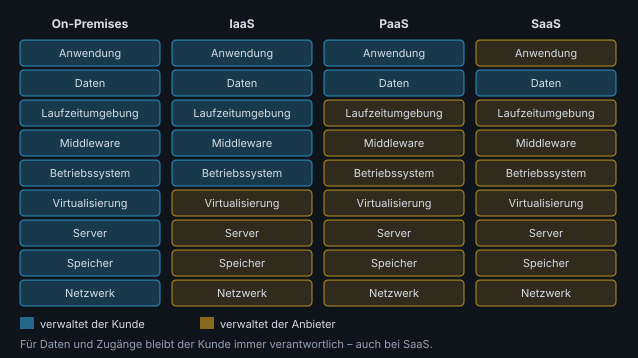
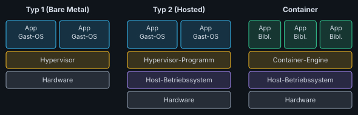

# ☁️ Cloud, Virtualisierung, ERP & KI

*Bereich: Technik · Prüfungsrelevanz: ★★★*

> IaaS/PaaS/SaaS, Bereitstellungsmodelle, Hypervisor, Container, ERP/CRM/SCM, KI am Arbeitsplatz.

[⬅ Inhaltsverzeichnis](README.md)

---

Immer weniger Software läuft nur auf dem eigenen Rechner. E-Mail, Office, Telefonie, ganze Desktops und Server kommen heute aus Rechenzentren – ob aus dem eigenen oder aus der Cloud. Für die AP1 musst du die Cloud-Modelle unterscheiden, Vor- und Nachteile für ein Unternehmen abwägen, Virtualisierung erklären und wissen, worauf beim Einsatz von KI am Arbeitsplatz zu achten ist.

## Was ist Cloud Computing?

Beim Cloud Computing werden IT-Ressourcen – Rechenleistung, Speicher, Plattformen, fertige Anwendungen – über das Internet bereitgestellt und nach Nutzung abgerechnet. Das US-Standardisierungsinstitut NIST beschreibt fünf Merkmale:

- **Selbstbedienung nach Bedarf:** Der Kunde bucht Ressourcen selbst im Webportal, ohne mit dem Anbieter sprechen zu müssen.
- **Breiter Netzwerkzugriff:** Zugriff von überall und von verschiedenen Geräten.
- **Ressourcen-Pooling:** Viele Kunden teilen sich die Infrastruktur des Anbieters.
- **Schnelle Elastizität:** Ressourcen lassen sich in Minuten erweitern oder verringern.
- **Messbare Nutzung:** Abgerechnet wird, was tatsächlich verbraucht wird.

## Servicemodelle: IaaS, PaaS, SaaS

Die Modelle unterscheiden sich darin, **wie viel** der Anbieter übernimmt und wie viel der Kunde selbst verwalten muss.

<table><tr><th>Modell</th><th>Anbieter stellt bereit</th><th>Kunde verwaltet</th><th>Beispiele</th></tr>
<tr><td><b>IaaS</b> – Infrastructure as a Service</td><td>virtuelle Server, Speicher, Netzwerk</td><td>Betriebssystem, Updates, Programme, Daten</td><td>virtuelle Maschinen bei Azure, AWS, IONOS</td></tr>
<tr><td><b>PaaS</b> – Platform as a Service</td><td>zusätzlich Betriebssystem, Laufzeitumgebung, Datenbank</td><td>eigene Anwendung und Daten</td><td>Webhosting für eigene Apps, verwaltete Datenbanken</td></tr>
<tr><td><b>SaaS</b> – Software as a Service</td><td>die komplette, fertige Anwendung</td><td>nur Nutzung, Einstellungen, Benutzer und Daten</td><td>Microsoft 365, Online-Buchhaltung, CRM im Browser</td></tr></table>

**Warum ist die Unterscheidung wichtig?** Sie bestimmt, wer sich um Updates und Sicherheit kümmern muss. Bei IaaS muss der Kunde das Betriebssystem seiner virtuellen Server selbst patchen – vergisst er es, ist der Server angreifbar, obwohl er „in der Cloud“ steht. Bei SaaS übernimmt das der Anbieter. Für die eigenen **Daten**, die **Benutzerkonten** und die **Zugriffsrechte** bleibt der Kunde aber immer verantwortlich (Modell der geteilten Verantwortung, Shared Responsibility).

> [!NOTE]
> **Beispiel**
>
> **Welches Modell?**  
> Ein Steuerbüro ohne eigene IT will E-Mail, Kalender und Office nutzen → **SaaS**, weil es sich um nichts Technisches kümmern will.  
> Ein Softwarehaus will seine selbst entwickelte Web-App betreiben, ohne Server zu pflegen → **PaaS**.  
> Ein Unternehmen will eine Branchensoftware, die einen Windows Server braucht, aus dem eigenen Keller auslagern → **IaaS**, weil es ein vollständiges Betriebssystem selbst einrichten muss.

**Desktop as a Service (DaaS)**: Ein kompletter Windows-Desktop läuft in der Cloud und wird pro Benutzer und Monat bezahlt (z. B. Windows 365, Azure Virtual Desktop). Zugriff ist von jedem Gerät möglich, auch vom Thin Client oder privaten Tablet; die Daten bleiben im Rechenzentrum. Ideal, um befristete Mitarbeitende schnell auszustatten. Nachteile: Ohne Internet geht nichts, und es fallen laufende Kosten an.

## Bereitstellungsmodelle

<table><tr><th>Modell</th><th>Beschreibung</th><th>passt, wenn …</th></tr>
<tr><td><b>Public Cloud</b></td><td>Infrastruktur eines Anbieters, von vielen Kunden geteilt</td><td>Kosten und Flexibilität im Vordergrund stehen</td></tr>
<tr><td><b>Private Cloud</b></td><td>nur für eine Organisation, im eigenen oder einem gemieteten Rechenzentrum</td><td>hohe Anforderungen an Kontrolle und Datenschutz bestehen</td></tr>
<tr><td><b>Hybrid Cloud</b></td><td>Kombination aus beidem</td><td>sensible Daten intern bleiben sollen, Standarddienste oder Lastspitzen aber in die Public Cloud gehen</td></tr>
<tr><td><b>Community Cloud</b></td><td>gemeinsam genutzt von Organisationen mit gleichen Anforderungen</td><td>z. B. Behörden oder Krankenhäuser</td></tr></table>

## Cloud oder eigener Server? Vor- und Nachteile

<table><tr><th>Vorteile der Cloud</th><th>Nachteile und Risiken</th></tr>
<tr><td>keine hohe Anfangsinvestition – laufende statt einmaliger Kosten schnell nach oben und unten skalierbar Zugriff von überall hohe Verfügbarkeit durch professionelle Rechenzentren Updates und Hardwarepflege übernimmt der Anbieter wenig eigenes IT-Personal nötig</td><td>ohne Internetverbindung kein Zugriff Datenschutz: Wo stehen die Server? Werden Daten in Drittländer übermittelt? Abhängigkeit vom Anbieter (Vendor Lock-in): Wechsel ist aufwendig laufende Kosten, auf Dauer evtl. teurer weniger Kontrolle über Technik und Sicherheit</td></tr></table>

> [!WARNING]
> **Datenschutz:** Verarbeitet ein Cloud-Anbieter personenbezogene Daten im Auftrag, muss ein **Auftragsverarbeitungsvertrag** (Art. 28 DSGVO) geschlossen werden. Rechenzentren in der EU vereinfachen die Rechtslage. Bei Übermittlung in Drittländer wie die USA braucht es eine zusätzliche Rechtsgrundlage, z. B. die Zertifizierung des Anbieters nach dem EU-US Data Privacy Framework oder Standardvertragsklauseln.

> [!NOTE]
> **Beispiel**
>
> **Kostenvergleich über 3 Jahre**  
> **Eigener Server:** Anschaffung 6.000 €, Einrichtung 1.200 €, Wartung und Strom 150 € pro Monat.  
> 3 Jahre: 6.000 + 1.200 + 36 × 150 = **12.600 €**  
> **Cloud-Server (IaaS):** 320 € pro Monat, Einrichtung 400 €.  
> 3 Jahre: 400 + 36 × 320 = **11.920 €**  
> Die Cloud ist hier etwas günstiger und erfordert keine Investition am Anfang. Bei einer längeren Nutzungsdauer oder wenn die Cloud-Gebühren steigen, kann sich das Bild umkehren – deshalb immer den gesamten Zeitraum rechnen.

## Virtualisierung

Bei der Virtualisierung laufen mehrere **virtuelle Maschinen** (VMs) mit eigenem Betriebssystem gleichzeitig auf einem physischen Rechner. Ein **Hypervisor** verteilt Prozessor, RAM, Speicher und Netzwerk auf die VMs und schottet sie voneinander ab.

<table><tr><th></th><th>Hypervisor Typ 1 (Bare Metal)</th><th>Hypervisor Typ 2 (Hosted)</th></tr>
<tr><td>läuft</td><td>direkt auf der Hardware</td><td>als Programm auf einem normalen Betriebssystem</td></tr>
<tr><td>Beispiele</td><td>Hyper-V, VMware ESXi, Proxmox (KVM)</td><td>VirtualBox, VMware Workstation</td></tr>
<tr><td>Einsatz</td><td>Server im Rechenzentrum – leistungsfähig, stabil</td><td>Test und Entwicklung am Arbeitsplatz</td></tr></table>

**Warum virtualisiert man?** Ein physischer Server ist oft nur zu 10–20 % ausgelastet. Laufen fünf Server als VMs auf einem Host, braucht man weniger Hardware, Strom, Kühlung und Platz (Green IT). Dazu kommen: **Snapshots** (Zustand vor einem Update sichern und bei Problemen zurückspringen), schnelle Bereitstellung neuer Server in Minuten, Isolation (ein Absturz betrifft nur eine VM), Verschieben laufender VMs auf einen anderen Host (Live-Migration) und einfache Testumgebungen.

**Nachteile:** Fällt der Host aus, fallen alle VMs aus (Single Point of Failure – deshalb oft mehrere Hosts im Cluster). Der Hypervisor kostet etwas Leistung, Lizenzen und Know-how sind nötig.

**Container** (z. B. Docker) gehen noch einen Schritt weiter: Sie enthalten nur die Anwendung mit ihren Bibliotheken und teilen sich den Kern des Host-Betriebssystems. Dadurch sind sie sehr klein, starten in Sekunden und laufen überall gleich. VMs bieten dafür eine stärkere Abschottung, weil jede ein eigenes Betriebssystem hat.

**Desktop-Virtualisierung (VDI):** Die Desktops der Mitarbeitenden laufen als VMs zentral im Rechenzentrum; am Arbeitsplatz genügt ein Thin Client. Als Cloud-Dienst heißt das DaaS (siehe oben).

> [!NOTE]
> **Beispiel**
>
> **Snapshot im Einsatz**  
> Vor dem Update der Warenwirtschaft legt die Administratorin einen Snapshot der VM an. Nach dem Update startet die Anwendung nicht mehr. Statt stundenlang den Fehler zu suchen, kehrt sie in wenigen Minuten zum Snapshot zurück, die Mitarbeitenden können weiterarbeiten, und das Update wird später in Ruhe getestet.  
> **Achtung:** Ein Snapshot ist **kein Backup**. Er liegt auf demselben Speicher wie die VM – fällt dieser aus, sind beide weg.

## Unternehmenssoftware

<table><tr><th>System</th><th>Zweck</th><th>typische Funktionen</th></tr>
<tr><td><b>ERP</b> – Enterprise Resource Planning</td><td>alle Unternehmensbereiche mit einer gemeinsamen Datenbank steuern</td><td>Buchhaltung, Einkauf, Lager, Produktion, Vertrieb, Personal</td></tr>
<tr><td><b>CRM</b> – Customer Relationship Management</td><td>Kundenbeziehungen pflegen</td><td>Kontakthistorie, Angebote, Verkaufschancen, Kampagnen, Service-Anfragen</td></tr>
<tr><td><b>SCM</b> – Supply Chain Management</td><td>Lieferkette steuern</td><td>Beschaffung, Lieferanten, Logistik, Bestände</td></tr>
<tr><td>DMS – Dokumentenmanagement</td><td>Dokumente zentral ablegen, versionieren, finden</td><td>Volltextsuche, Freigaben, revisionssichere Archivierung</td></tr>
<tr><td>Groupware, Kollaboration</td><td>Zusammenarbeit</td><td>Mail, Kalender, Chat, gemeinsame Dateien</td></tr></table>

**Warum ein ERP-System?** Ohne gemeinsame Datenbank pflegt jede Abteilung ihre eigenen Listen: Der Vertrieb verkauft Ware, von der das Lager weiß, dass sie nicht mehr da ist. Im ERP-System sehen alle denselben aktuellen Stand – eine Bestellung verändert automatisch Lagerbestand, Rechnung und Buchhaltung.

## KI-Software am Arbeitsplatz

KI-Assistenten auf Basis großer Sprachmodelle (LLM) entwerfen und fassen Texte zusammen, übersetzen, schreiben Protokolle, analysieren Daten und helfen beim Programmieren. Beispiele sind Microsoft 365 Copilot, ChatGPT, Claude oder GitHub Copilot. Ein solches Modell erzeugt Texte auf Basis statistischer Muster aus seinen Trainingsdaten; die Eingabe heißt **Prompt**.

<table><tr><th>Risiko</th><th>Maßnahme</th></tr>
<tr><td><b>Halluzinationen:</b> Die KI formuliert falsche Aussagen überzeugend.</td><td>Ergebnisse immer fachlich prüfen; ein Mensch entscheidet („Human in the Loop“).</td></tr>
<tr><td><b>Datenschutz und Geschäftsgeheimnisse:</b> Eingaben könnten gespeichert oder zum Training genutzt werden.</td><td>Nur freigegebene Dienste mit Unternehmensvertrag nutzen (keine Nutzung zum Training, Speicherort EU); keine personenbezogenen oder vertraulichen Daten in öffentliche Dienste.</td></tr>
<tr><td><b>Zu weite Zugriffsrechte:</b> Ein KI-Assistent sieht alles, was der Nutzer sehen darf.</td><td>Vor der Einführung Freigaben und Berechtigungen aufräumen.</td></tr>
<tr><td><b>Urheberrecht, Verzerrungen (Bias), Abhängigkeit</b></td><td>KI-Richtlinie im Unternehmen, Kennzeichnung KI-erzeugter Inhalte, Schulung</td></tr></table>

**EU-KI-Verordnung (AI Act):** Sie teilt KI-Systeme nach Risiko ein – unannehmbar (verboten, z. B. Social Scoring), hoch (strenge Pflichten, z. B. KI bei der Bewerberauswahl), begrenzt (Transparenzpflichten, z. B. Chatbots müssen sich als KI zu erkennen geben) und minimal. Seit dem **02.02.2025** gelten die Verbote und die Pflicht zur **KI-Kompetenz** (Art. 4): Unternehmen müssen dafür sorgen, dass Beschäftigte, die KI einsetzen, ausreichend geschult sind.

**KI einrichten:** Lizenzen zuweisen, Datenschutz- und Speicherorteinstellungen prüfen, Berechtigungen bereinigen, Richtlinie und Schulung bereitstellen, für besonders sensible Daten ggf. ein lokal betriebenes Modell nutzen. Am Arbeitsplatz helfen neuere Prozessoren mit **NPU**, KI-Funktionen stromsparend lokal auszuführen.

## Social Media im Unternehmen

Unternehmen nutzen externe Plattformen (LinkedIn, Instagram, YouTube) für Marketing, Personalgewinnung und Kundenservice, und interne soziale Netzwerke bzw. das Intranet für den Austausch der Mitarbeitenden. Dafür braucht es eine **Social-Media-Richtlinie** (wer darf was im Namen des Unternehmens posten?), Datenschutz (keine Kundendaten, Einwilligung bei Fotos von Personen), Beachtung des Urheberrechts bei Bildern und eine Impressumspflicht für Unternehmensseiten. **Sicherheitsrisiko:** Was Mitarbeitende öffentlich über Projekte, Kollegen und Abläufe teilen, nutzen Angreifer für Social Engineering.

*Hintergrund (gestrichen):* **Stammdaten** ändern sich selten (Kunden, Artikel), **Bewegungsdaten** entstehen laufend (Bestellungen, Rechnungen).

> [!CAUTION]
> **Typische Fehler**
>
> - IaaS, PaaS und SaaS nur ausschreiben, ohne zu sagen, wer was verwaltet.
> - Glauben, bei Cloud-Diensten sei der Anbieter für alles verantwortlich – für Daten und Zugänge bleibt es der Kunde.
> - Den Auftragsverarbeitungsvertrag vergessen.
> - Hypervisor Typ 1 und Typ 2 vertauschen.
> - Snapshot und Backup gleichsetzen.
> - Container und VM gleichsetzen.
> - KI-Ergebnisse ungeprüft übernehmen oder vertrauliche Daten in öffentliche KI-Dienste eingeben.

**📝 Prüfungsaufgabe:** **Ein Handwerksbetrieb mit 12 Mitarbeitenden und ohne eigene IT-Abteilung möchte seinen alten Mailserver ablösen. Empfehlen Sie ein Cloud-Servicemodell und begründen Sie. Nennen Sie außerdem einen Punkt, der vertraglich geregelt werden muss. (4 Punkte)**

Lösung anzeigen

SaaS, z. B. ein Microsoft-365-Plan (1), weil der Anbieter Betrieb, Updates und Sicherheit der Anwendung übernimmt und der Betrieb ohne eigene IT-Fachleute auskommt (2). Vertraglich zu regeln: Auftragsverarbeitungsvertrag nach Art. 28 DSGVO bzw. Speicherort der Daten in der EU oder ein SLA mit Verfügbarkeit (1).

**📝 Prüfungsaufgabe:** **Unterscheiden Sie Hypervisor Typ 1 und Typ 2 und nennen Sie je einen Einsatzzweck. (4 Punkte)**

Lösung anzeigen

Typ 1 läuft direkt auf der Hardware ohne darunterliegendes Betriebssystem (1) und wird für Server im Rechenzentrum eingesetzt, weil er leistungsfähig und stabil ist (1). Typ 2 läuft als Programm auf einem vorhandenen Betriebssystem (1) und eignet sich für Test- und Entwicklungsumgebungen am Arbeitsplatz (1).

**📝 Prüfungsaufgabe:** **Nennen Sie drei Vorteile, wenn ein Unternehmen vier physische Server auf einem leistungsstarken Host virtualisiert, und ein Risiko. (4 Punkte)**

Lösung anzeigen

Vorteile (je 1): weniger Hardware, Strom, Kühlung und Platz; bessere Auslastung; Snapshots vor Änderungen; schnelle Bereitstellung neuer Server; einfache Verschiebung auf andere Hardware. Risiko (1): Fällt der Host aus, fallen alle vier Server gleichzeitig aus (Single Point of Failure).

**📝 Prüfungsaufgabe:** **Eine Mitarbeiterin möchte Kundenbeschwerden mit Namen und Adressen in einen kostenlosen öffentlichen KI-Chatbot kopieren, um Antworten formulieren zu lassen. Beurteilen Sie das Vorhaben. (3 Punkte)**

Lösung anzeigen

Das ist nicht zulässig bzw. sehr riskant (1): Es werden personenbezogene Daten an einen Dienst ohne Auftragsverarbeitungsvertrag übermittelt, der die Eingaben möglicherweise speichert oder zum Training nutzt – ein Verstoß gegen die DSGVO (1). Sie sollte nur einen vom Unternehmen freigegebenen KI-Dienst nutzen oder die Daten vorher anonymisieren und die Antworten vor dem Versand prüfen (1).

---

## 🃏 Karteikarten (22)

| Frage | Antwort |
|---|---|
| IaaS | Infrastructure as a Service: virtuelle Server/Speicher/Netz; Kunde verwaltet OS, Apps, Daten. |
| PaaS | Platform as a Service: Laufzeitumgebung/Entwicklungsplattform; Kunde verwaltet nur Anwendung und Daten. |
| SaaS | Software as a Service: fertige Anwendung über das Internet, z. B. Microsoft 365. |
| Public vs. Private Cloud | Public: geteilte Infrastruktur eines Anbieters, günstig/skalierbar. Private: exklusiv für eine Organisation, mehr Kontrolle. |
| Hybrid Cloud | Kombination aus Private und Public Cloud. |
| Cloud-Risiken | Internetabhängigkeit, Datenschutz/Serverstandort, Vendor-Lock-in, laufende Kosten, Kontrollverlust. |
| Hypervisor Typ 1 | Bare Metal, direkt auf Hardware: Hyper-V, ESXi, Proxmox. |
| Hypervisor Typ 2 | Läuft auf einem Host-Betriebssystem: VirtualBox, VMware Workstation. |
| Container vs. VM | Container teilen den Host-Kernel (leicht, schnell); VMs haben ein eigenes Gast-OS (stärkere Isolation). |
| Vorteile Virtualisierung | Bessere Auslastung, weniger Hardware & Strom, Snapshots, schnelle Bereitstellung, Isolation. |
| ERP | Enterprise Resource Planning: integrierte Software für Finanzen, Einkauf, Lager, Produktion, Vertrieb, Personal. |
| CRM | Customer Relationship Management: Verwaltung von Kundenkontakten, Vertrieb, Service. |
| SCM | Supply Chain Management: Planung und Steuerung der Lieferkette. |
| Stamm- vs. Bewegungsdaten | Stammdaten: langfristig, selten geändert (Kunde). Bewegungsdaten: laufend neu (Auftrag, Rechnung). |
| KI-Halluzination | Plausibel klingende, aber falsche Ausgabe eines KI-Modells. |
| KI am Arbeitsplatz – Regeln | Keine personenbezogenen/vertraulichen Daten in öffentliche Tools, Ergebnisse prüfen, freigegebene Tools, Richtlinie & Schulung. |
| EU AI Act – Art. 4 | Pflicht zur Förderung von KI-Kompetenz bei Beschäftigten, die KI nutzen (seit 02.02.2025). |
| VDI | Virtual Desktop Infrastructure: Desktops laufen zentral, Zugriff von Thin Clients/beliebigen Geräten. |
| DaaS | Desktop as a Service – virtueller Desktop aus der Cloud pro Benutzer/Monat (z. B. Windows 365). |
| Social-Media-Richtlinie | Regelt, wer was im Namen des Unternehmens veröffentlichen darf (Datenschutz, Urheberrecht, Ton). |
| KI-Software einrichten – Punkte | Lizenzen, Datenschutzeinstellungen, Berechtigungen prüfen, Richtlinie, Schulung. |
| KI-Codeassistent | Werkzeug, das beim Programmieren Code vorschlägt (z. B. GitHub Copilot) – Ergebnis prüfen. |

## ✍️ Übungsfragen (15)

**1.** Ein Unternehmen nutzt Microsoft 365 im Browser. Welches Cloud-Modell?

Lösung

**Musterlösung (2 P):** SaaS Fertige Anwendung = SaaS.

**2.** Ein Entwicklerteam mietet virtuelle Maschinen und installiert eigenes Linux darauf. Welches Modell?

Lösung

**Musterlösung (2 P):** IaaS Infrastruktur gemietet, OS selbst verwaltet.

**3.** Nennen Sie einen Typ-2-Hypervisor.

Lösung

**Musterlösung (2 P):** Z. B. Oracle VirtualBox oder VMware Workstation VirtualBox läuft als Anwendung auf einem Host-OS.

**4.** Welche Software verwaltet Kundenkontakte, Angebote und Verkaufschancen?

Lösung

**Musterlösung (2 P):** CRM CRM = Customer Relationship Management.

**5.** Welches System integriert Buchhaltung, Lager, Einkauf und Personal in einer zentralen Datenbank?

Lösung

**Musterlösung (2 P):** ERP ERP.

**6.** Welche Risiken bestehen beim Einsatz öffentlicher KI-Chatbots im Unternehmen? Nennen Sie drei.

Lösung

**Musterlösung (3 P):** Je 1 Punkt (max. 3): Halluzinationen; Abfluss vertraulicher Daten; Datenschutzverstöße. KI-Ergebnisse sind nicht garantiert korrekt.

**7.** Was ist ein wesentlicher Unterschied zwischen Container und virtueller Maschine?

Lösung

**Musterlösung (2 P):** Container teilen sich den Kernel des Hosts Darum sind Container leichtgewichtig.

**8.** Welches Bereitstellungsmodell kombiniert eigene Infrastruktur mit Ressourcen eines öffentlichen Anbieters?

Lösung

**Musterlösung (2 P):** Hybrid Cloud

**9.** Eine Rechnung im ERP-System ist ein Beispiel für …

Lösung

**Musterlösung (2 P):** Bewegungsdaten Rechnungen entstehen laufend = Bewegungsdaten.

**10.** Welche Pflicht aus dem EU AI Act gilt seit Februar 2025 für Unternehmen, die KI einsetzen?

Lösung

**Musterlösung (2 P):** Förderung der KI-Kompetenz der Beschäftigten Art. 4 – KI-Kompetenz.

**11.** Ihre Geschäftsführung möchte einen generativen KI-Assistenten für alle Mitarbeitenden einführen. Nennen Sie zwei Risiken und je eine Gegenmaßnahme. (4 Punkte)

Lösung

**Musterlösung (4 P):** Z. B.: Halluzinationen/falsche Ergebnisse (1) → Ergebnisse prüfen, Human in the Loop, Schulung (1). Abfluss vertraulicher oder personenbezogener Daten (1) → nur freigegebene Enterprise-Tools ohne Trainingsnutzung, KI-Richtlinie, AV-Vertrag (1). Urheberrechtsverletzungen (1) → Quellen prüfen, Kennzeichnung (1).

**12.** Erläutern Sie zwei Vorteile der Servervirtualisierung. (4 Punkte)

Lösung

**Musterlösung (4 P):** Z. B.: Mehrere virtuelle Server teilen sich eine physische Hardware → bessere Auslastung, weniger Anschaffungs-, Strom- und Platzkosten (2). Snapshots/Backups ganzer VMs und schnelle Wiederherstellung (2). Neue Server lassen sich in Minuten bereitstellen (2). Isolation: Fehler in einer VM betreffen andere nicht (2).

**13.** Nennen Sie je ein Beispiel für IaaS, PaaS und SaaS und erklären Sie, wer jeweils das Betriebssystem verwaltet. (3 Punkte)

Lösung

**Musterlösung (3 P):** IaaS: z. B. Azure VM – Kunde verwaltet das Betriebssystem (1). PaaS: z. B. Azure App Service – Anbieter verwaltet das OS, Kunde nur die Anwendung (1). SaaS: z. B. Microsoft 365 – Anbieter verwaltet alles bis zur Anwendung (1).

**14.** Ein Unternehmen stellt 10 befristete Projektmitarbeitende ein, die von eigenen Geräten auf einen Firmen-Windows-Desktop zugreifen sollen. Was passt?

Lösung

**Musterlösung (2 P):** Desktop as a Service Schnell bereitgestellt, Daten bleiben zentral, monatlich kündbar.

**15.** Warum sollten vor der Einführung eines KI-Assistenten mit Zugriff auf Unternehmensdaten die Berechtigungen geprüft werden?

Lösung

**Musterlösung (2 P):** Weil die KI alles findet, was der Nutzer sehen darf – zu weit gefasste Rechte werden sonst sichtbar

[⬅ Inhaltsverzeichnis](README.md)
