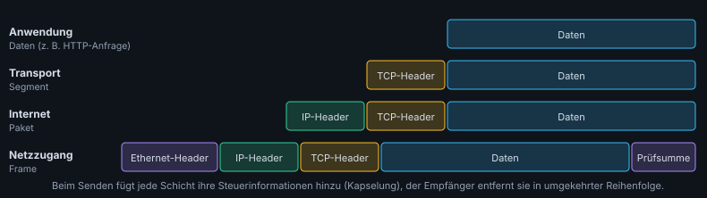
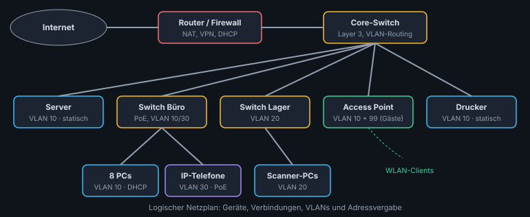

# 🌐 Netzwerk-Grundlagen

*Bereich: Netzwerk · Prüfungsrelevanz: ★★★*

> OSI & TCP/IP, Geräte, Topologien, Kabel & LWL, Ethernet, WLAN-Standards & -Sicherheit, PoE, VLAN.

[⬅ Inhaltsverzeichnis](README.md)

---

Kein Arbeitsplatz funktioniert ohne Netzwerk: Anmeldung, Dateien, Drucker, E-Mail, Internet und Telefonie laufen darüber. In der AP1 sollst du Netzwerkgeräte und Kabel passend auswählen, ein WLAN sicher planen, Netzpläne lesen und Fehler darin finden. Die Adressierung mit IPv4, IPv6 und Subnetting steht im nächsten Thema, die Ports und Dienste ebenfalls.

## Schichtenmodelle: OSI und TCP/IP

Netzwerkkommunikation ist kompliziert: Strom muss über Kabel, die Daten müssen den richtigen Rechner finden, vollständig ankommen und vom richtigen Programm verstanden werden. Deshalb teilt man die Aufgaben in **Schichten** auf. Jede Schicht erledigt nur ihre Aufgabe und nutzt die Dienste der Schicht darunter. **Warum?** So kann man eine Schicht austauschen, ohne die anderen zu ändern – dieselbe Webseite kommt per Kabel, WLAN oder Glasfaser an, weil nur die untersten Schichten verschieden sind. Und bei der Fehlersuche kann man Schicht für Schicht vorgehen.

<table><tr><th>Nr.</th><th>OSI-Schicht</th><th>TCP/IP</th><th>Einheit</th><th>Adresse</th><th>Beispiele, Geräte</th></tr>
<tr><td>7</td><td>Anwendung</td><td rowspan="3">Anwendung</td><td rowspan="3">Daten</td><td rowspan="3">–</td><td>HTTP(S), DNS, SMTP, SSH, DHCP</td></tr>
<tr><td>6</td><td>Darstellung</td><td>Kodierung, Verschlüsselung, Kompression</td></tr>
<tr><td>5</td><td>Sitzung</td><td>Sitzungssteuerung</td></tr>
<tr><td>4</td><td>Transport</td><td>Transport</td><td>Segment</td><td>Port</td><td>TCP, UDP</td></tr>
<tr><td>3</td><td>Vermittlung</td><td>Internet</td><td>Paket</td><td>IP-Adresse</td><td>IPv4, IPv6, ICMP – <b>Router</b>, Layer-3-Switch</td></tr>
<tr><td>2</td><td>Sicherung</td><td rowspan="2">Netzzugang</td><td>Frame</td><td>MAC-Adresse</td><td>Ethernet, WLAN, ARP – <b>Switch</b>, Access Point</td></tr>
<tr><td>1</td><td>Bitübertragung</td><td>Bit</td><td>–</td><td>Kabel, Stecker, Funk – Hub, Repeater, Medienkonverter</td></tr></table>

Eselsbrücke von 7 nach 1: „**A**lle **D**eutschen **S**chüler **T**rinken **V**erschiedene **S**orten **B**ier“.

## Netzwerkgeräte

<table><tr><th>Gerät</th><th>Schicht</th><th>Funktion</th></tr>
<tr><td>Hub</td><td>1</td><td>sendet alles an alle Anschlüsse – veraltet, erzeugt Kollisionen</td></tr>
<tr><td><b>Switch</b></td><td>2</td><td>verbindet Geräte <b>im selben Netz</b> und leitet Frames anhand der MAC-Adresse gezielt an den richtigen Anschluss</td></tr>
<tr><td><b>Router</b></td><td>3</td><td>verbindet <b>verschiedene Netze</b> (z. B. Firmennetz und Internet) und wählt den Weg anhand der IP-Adresse; oft mit NAT, Firewall und DHCP</td></tr>
<tr><td>Layer-3-Switch</td><td>2 + 3</td><td>Switch, der zusätzlich zwischen VLANs routen kann</td></tr>
<tr><td>Access Point</td><td>2</td><td>bindet WLAN-Geräte ans kabelgebundene Netz an</td></tr>
<tr><td>Firewall</td><td>3–7</td><td>filtert Datenverkehr nach Regeln</td></tr>
<tr><td>Modem / ONT</td><td>1</td><td>wandelt die Signale des Anschlusses (DSL, Kabel, Glasfaser) um</td></tr></table>

#### Wie ein Switch lernt

Ein Switch merkt sich in seiner **MAC-Adresstabelle**, welches Gerät an welchem Anschluss hängt. Er lernt das selbst, indem er bei jedem eingehenden Frame die **Absender**-MAC-Adresse notiert.

> [!NOTE]
> **Beispiel**
>
> PC A (an Port 1) schickt einen Frame an PC C. Die Tabelle ist noch leer.  
> 1. Der Switch notiert: **MAC A → Port 1**.  
> 2. Wo C hängt, weiß er noch nicht – also schickt er den Frame an alle anderen Ports (Flooding).  
> 3. C (an Port 3) antwortet. Der Switch notiert: **MAC C → Port 3**.  
> 4. Die Antwort geht gezielt nur an Port 1, weil A jetzt bekannt ist.  
> Ab jetzt laufen alle Frames zwischen A und C nur noch über Port 1 und 3. Die anderen Geräte werden nicht gestört, und mehrere Paare können gleichzeitig kommunizieren – das ist der Vorteil gegenüber dem Hub.

**Managed Switches** bieten zusätzlich VLANs, Überwachung, Portsicherheit und PoE. Für Firmennetze sind sie Standard; unmanaged Switches eignen sich nur für ganz kleine, einfache Netze.

## Topologien

<table><tr><th>Topologie</th><th>Vorteil</th><th>Nachteil</th></tr>
<tr><td><b>Stern</b> (heute Standard)</td><td>Fällt ein Kabel oder Endgerät aus, ist nur dieses betroffen; leicht erweiterbar</td><td>zentraler Switch ist Single Point of Failure; viel Kabel</td></tr>
<tr><td>Baum (erweiterter Stern)</td><td>hierarchisch, gut gliederbar (Gebäude → Etage → Raum)</td><td>Ausfall eines Verteilers trennt einen ganzen Teilbaum</td></tr>
<tr><td>Bus</td><td>wenig Kabel</td><td>ein Kabelbruch legt alles lahm, Kollisionen</td></tr>
<tr><td>Ring</td><td>gleichberechtigter Zugriff</td><td>Ausfall eines Knotens unterbricht den Ring (außer Doppelring)</td></tr>
<tr><td>Vermascht</td><td>hohe Ausfallsicherheit durch mehrere Wege</td><td>teuer, viel Kabel</td></tr></table>

> [!IMPORTANT]
> Vollvermaschung: **Anzahl Verbindungen = n × (n − 1) ÷ 2**  
> Beispiel: 6 Standorte → 6 × 5 ÷ 2 = **15 Verbindungen**.

## Kabel und Glasfaser

**Twisted-Pair-Kupferkabel** mit RJ45-Steckern verbinden die Arbeitsplätze. Ein Segment darf höchstens **100 m** lang sein (90 m fest verlegt + Patchkabel). Die Kategorie bestimmt, welche Geschwindigkeit möglich ist:

<table><tr><th>Kategorie</th><th>Geschwindigkeit</th></tr>
<tr><td>Cat 5e</td><td>1 Gbit/s</td></tr>
<tr><td>Cat 6</td><td>1 Gbit/s, 10 Gbit/s bis 55 m</td></tr>
<tr><td>Cat 6A</td><td>10 Gbit/s bis 100 m – Empfehlung für neue Verkabelung</td></tr>
<tr><td>Cat 7 / 7A</td><td>10 Gbit/s, stärker geschirmt</td></tr>
<tr><td>Cat 8</td><td>25/40 Gbit/s bis 30 m, im Rechenzentrum</td></tr></table>

Die Schirmung schützt vor elektromagnetischen Störungen: U/UTP ist ungeschirmt, S/FTP hat einen Gesamtschirm und zusätzlich geschirmte Adernpaare.

**Lichtwellenleiter (Glasfaser)** übertragen Licht statt Strom. **Multimode** (OM3, OM4) für kürzere Strecken im Gebäude, **Singlemode** (OS2) für Kilometer. **Warum Glasfaser zwischen Gebäuden?** Sie überbrückt große Entfernungen mit hoher Bandbreite, ist unempfindlich gegen elektromagnetische Störungen, schwer abzuhören und leitet keinen Strom – Blitz oder unterschiedliche Erdpotenziale zwischen Gebäuden können keine Geräte beschädigen. Nachteile: teurer, empfindlich beim Verlegen (Biegeradius), aufwendiges Spleißen.

**Strukturierte Verkabelung:** Primärbereich (zwischen Gebäuden, Glasfaser) – Sekundärbereich (im Gebäude zwischen den Etagen, Glasfaser) – Tertiärbereich (auf der Etage bis zur Netzwerkdose, Kupfer). Im **Netzwerkschrank** (19-Zoll-Rack, Höhe in Höheneinheiten HE) enden die fest verlegten Kabel an einem **Patchpanel**; kurze Patchkabel verbinden jeden Port flexibel mit dem Switch. Beschriftung und Patchplan machen die Fehlersuche schnell.

## PoE – Power over Ethernet

PoE überträgt Daten **und** Strom über dasselbe Netzwerkkabel. **Warum?** Access Points hängen an der Decke, Kameras an der Fassade – dort gibt es oft keine Steckdose. Mit PoE braucht man nur ein Kabel, und hängt der PoE-Switch an einer USV, laufen Telefone und WLAN auch bei Stromausfall weiter.

<table><tr><th>Standard</th><th>Leistung je Port am Switch</th><th>typische Geräte</th></tr>
<tr><td>802.3af (PoE)</td><td>15,4 W</td><td>IP-Telefone, einfache Kameras</td></tr>
<tr><td>802.3at (PoE+)</td><td>30 W</td><td>Access Points, Kameras mit Schwenkfunktion</td></tr>
<tr><td>802.3bt (PoE++)</td><td>60 W (Typ 3), 90–100 W (Typ 4)</td><td>leistungsstarke Access Points, Thin Clients, Displays</td></tr></table>

> [!NOTE]
> **Beispiel**
>
> **Reicht das PoE-Budget?**  
> Ein Switch hat 24 PoE+-Ports, aber ein Gesamtbudget von 370 W. Angeschlossen werden sollen 6 Access Points (je 25 W), 14 IP-Telefone (je 7 W) und 2 Kameras (je 13 W).  
> 6 × 25 W = 150 W · 14 × 7 W = 98 W · 2 × 13 W = 26 W → zusammen **274 W**.  
> 274 W < 370 W – das Budget reicht, es bleiben 96 W Reserve. Wichtig: Nicht nur die Leistung je Port, sondern auch das **Gesamtbudget** des Switches prüfen.

## WLAN

<table><tr><th>Bezeichnung</th><th>Standard</th><th>Frequenzen</th><th>max. brutto</th></tr>
<tr><td>Wi-Fi 4</td><td>802.11n</td><td>2,4 / 5 GHz</td><td>600 Mbit/s</td></tr>
<tr><td>Wi-Fi 5</td><td>802.11ac</td><td>5 GHz</td><td>6,9 Gbit/s</td></tr>
<tr><td>Wi-Fi 6 / 6E</td><td>802.11ax</td><td>2,4 / 5 (/ 6) GHz</td><td>9,6 Gbit/s</td></tr>
<tr><td>Wi-Fi 7</td><td>802.11be</td><td>2,4 / 5 / 6 GHz</td><td>ca. 46 Gbit/s</td></tr></table>

**2,4 GHz** hat eine größere Reichweite und durchdringt Wände besser, bietet aber nur drei überlappungsfreie Kanäle (z. B. 1, 6, 11) und viele Störquellen (Bluetooth, Mikrowelle, Nachbar-WLANs). **5 und 6 GHz** bieten mehr Kanäle und höhere Datenraten bei geringerer Reichweite.

**Warum ist WLAN langsamer als angegeben?** Die Angaben sind theoretische Bruttowerte unter Idealbedingungen. Alle Geräte einer Funkzelle teilen sich das Medium und senden abwechselnd (Halbduplex), dazu kommen Verwaltungsdaten, Wände und Störungen. Netto bleibt oft nur die Hälfte oder weniger. Für feste Arbeitsplätze mit großen Datenmengen ist ein Kabel daher besser.

**WLAN planen:** Mehrere Access Points mit überlappenden Funkzellen auf unterschiedlichen Kanälen, damit Geräte beim Gehen unterbrechungsfrei zum stärkeren AP wechseln (Roaming). Vor der Installation misst man die Funkabdeckung (Ausleuchtung, Site Survey). **Mesh-WLAN**: APs verbinden sich untereinander per Funk – einfach nachzurüsten, aber langsamer als per Kabel angebundene APs.

#### WLAN-Sicherheit

<table><tr><th>Verfahren</th><th>Bewertung</th></tr>
<tr><td>WEP, WPA (TKIP)</td><td>unsicher – nicht mehr verwenden</td></tr>
<tr><td>WPA2 (AES)</td><td>Mindeststandard</td></tr>
<tr><td>WPA3</td><td>empfohlen: sichere Anmeldung (SAE) schützt das Passwort gegen Offline-Rateangriffe</td></tr></table>

<table><tr><th></th><th>Personal (PSK)</th><th>Enterprise (802.1X)</th></tr>
<tr><td>Anmeldung</td><td>ein gemeinsames Passwort für alle</td><td>jede Person meldet sich einzeln an (Benutzerkonto oder Zertifikat), geprüft durch einen RADIUS-Server</td></tr>
<tr><td>Vorteil</td><td>einfach einzurichten</td><td>einzelne Zugänge sperrbar, nachvollziehbar, wer sich angemeldet hat</td></tr>
<tr><td>Nachteil</td><td>verlässt jemand die Firma, muss das Passwort auf allen Geräten geändert werden</td><td>aufwendiger, braucht RADIUS-Server</td></tr>
<tr><td>Einsatz</td><td>Privathaushalt, sehr kleine Büros</td><td>Unternehmen</td></tr></table>

Weitere Maßnahmen: Gäste in ein eigenes WLAN und VLAN, starke Passphrase, Firmware aktuell halten, WPS abschalten. Eine versteckte SSID oder ein MAC-Filter sind **keine** echten Schutzmaßnahmen – beides lässt sich leicht umgehen.

## VLANs

Ein **VLAN** (Virtual LAN) teilt einen physischen Switch logisch in mehrere getrennte Netze. Geräte in verschiedenen VLANs können sich nicht direkt erreichen, obwohl sie am selben Switch hängen – nur über einen Router bzw. Layer-3-Switch, wo Regeln festlegen, was erlaubt ist.

**Warum VLANs?**

- **Sicherheit:** Gäste, Produktionsmaschinen oder IoT-Geräte kommen nicht an die Server der Verwaltung.
- **Weniger Broadcast-Last:** Broadcasts bleiben im eigenen VLAN.
- **Flexibilität:** Die Zuordnung hängt nicht vom Standort ab – ein Buchhaltungs-PC im 3. Stock kann im Buchhaltungs-VLAN sein.
- **Qualität:** Telefonie in einem eigenen VLAN kann bevorzugt behandelt werden (QoS).

Zwischen Switches werden mehrere VLANs über eine Verbindung übertragen (**Trunk**). Dabei bekommt jeder Frame eine Markierung, zu welchem VLAN er gehört (**Tagging** nach IEEE 802.1Q).

## Netzwerkdokumentation und Netzpläne

- **Physischer Netzplan:** Wo stehen Geräte, Schränke und Dosen, wie laufen die Kabel? Dazu der Patchplan (welche Dose an welchem Switchport).
- **Logischer Netzplan:** Netze, VLANs, Adressbereiche, Router und Firewalls – unabhängig vom Standort.
- **IP-Adresskonzept:** Tabelle mit Netzen, Gateways, DHCP-Bereichen und festen Adressen.
- **Geräteinventar:** Hersteller, Modell, Seriennummer, Standort, IP- und MAC-Adresse, Firmwarestand.
- Konfigurationssicherungen, Zugangsdaten (im Passwortmanager) und ein Änderungsprotokoll.

<table><tr><th>Netz</th><th>VLAN</th><th>Netzadresse</th><th>Gateway</th><th>DHCP-Bereich</th><th>feste Adressen</th></tr>
<tr><td>Verwaltung</td><td>10</td><td>192.168.10.0/24</td><td>192.168.10.1</td><td>.100 – .200</td><td>.2 – .20 (Server, Drucker)</td></tr>
<tr><td>Lager</td><td>20</td><td>192.168.20.0/24</td><td>192.168.20.1</td><td>.100 – .200</td><td>.2 – .20</td></tr>
<tr><td>Telefonie</td><td>30</td><td>192.168.30.0/24</td><td>192.168.30.1</td><td>.100 – .200</td><td>–</td></tr>
<tr><td>Gäste</td><td>99</td><td>10.99.0.0/24</td><td>10.99.0.1</td><td>.10 – .250</td><td>–</td></tr></table>

> [!TIP]
> **Fehler in Netzplänen finden** – darauf prüfen: Liegt jeder Host im selben Netz wie sein Gateway? Stimmt die Subnetzmaske? Ist eine Adresse doppelt vergeben? Liegt eine feste Adresse im DHCP-Bereich? Wurde die Netz- oder Broadcastadresse an ein Gerät vergeben? Zeigt der DNS-Eintrag bei Domänen-PCs auf den Domänencontroller? Ist eine Kabelstrecke länger als 100 m?

Typische Symbole: Router = Kreis mit Pfeilen, Switch = flacher Quader mit Pfeilen, Firewall = Mauer, Access Point = Antenne mit Funkwellen, Wolke = Internet.

## Internetanschluss und Standortvernetzung

<table><tr><th>Anschluss</th><th>Technik</th><th>typisch</th><th>Bewertung</th></tr>
<tr><td>DSL / VDSL</td><td>Kupfer-Telefonleitung</td><td>bis ca. 250 Mbit/s down, asymmetrisch</td><td>weit verbreitet; Rate sinkt mit der Entfernung zum Verteiler</td></tr>
<tr><td>Kabel</td><td>Fernseh-Koaxialnetz</td><td>bis 1 Gbit/s down, Upload deutlich geringer</td><td>hohe Raten, aber geteiltes Medium – abends schwankend</td></tr>
<tr><td>Glasfaser (FTTH/FTTB)</td><td>Glasfaser bis ins Haus bzw. Gebäude</td><td>1–10 Gbit/s, oft symmetrisch</td><td>schnellste, zukunftssicherste Lösung, geringe Latenz</td></tr>
<tr><td>Mobilfunk (LTE/5G)</td><td>Funk</td><td>stark standortabhängig</td><td>schnell verfügbar, gut als Ersatzleitung oder für Baustellen</td></tr>
<tr><td>Satellit</td><td>Satellitenschüssel</td><td>bis einige 100 Mbit/s</td><td>für abgelegene Standorte, wetterabhängig</td></tr>
<tr><td>Business-Anschluss, Standleitung</td><td>meist Glasfaser</td><td>garantierte, symmetrische Bandbreite</td><td>SLA mit Entstörzeit, feste IP-Adressen – teurer</td></tr></table>

**Asymmetrisch** heißt: Download viel schneller als Upload. **Symmetrisch**: beides gleich schnell. Für ein Unternehmen ist der Upload oft wichtig: Cloud-Backups, Videokonferenzen, eigene Server und viele VPN-Verbindungen von Mitarbeitenden im Homeoffice laufen über ihn. Weitere Kenngrößen: **Latenz** (Verzögerung in ms, wichtig für Telefonie), **Jitter** (Schwankung der Latenz), Paketverlust, Verfügbarkeit.

Für eigene, von außen erreichbare Dienste (VPN-Zugang, Mailserver) braucht man eine **feste öffentliche IP-Adresse**. Mehr Ausfallsicherheit bringt eine **zweite Leitung** anderer Technik (z. B. Glasfaser + 5G) mit einem Router, der bei Ausfall automatisch umschaltet (Failover).

**Standorte verbinden:** Am günstigsten mit einem **Site-to-Site-VPN** über das Internet – die Firewalls beider Standorte bauen einen verschlüsselten Tunnel auf. Alternativen sind gemietete Standleitungen bzw. Providernetze (garantierte Qualität, teuer) oder SD-WAN (mehrere Leitungen werden zentral gesteuert genutzt). Einzelne Mitarbeitende verbinden sich per **Client-to-Site-VPN**.

> [!NOTE]
> **Beispiel**
>
> **Empfehlung mit Begründung**  
> Zentrale mit eigenem Server, 20 Mitarbeitenden im Homeoffice per VPN und täglichem Cloud-Backup:  
> „Ich empfehle einen symmetrischen Glasfaser-Business-Anschluss mit fester IP-Adresse und SLA, weil die VPN-Verbindungen und das Cloud-Backup eine hohe Upload-Rate brauchen und die Mitarbeitenden im Homeoffice ohne funktionierende Leitung nicht arbeiten können. Zusätzlich einen 5G-Router als Ersatzleitung.“

## Netzarten, Übertragungsarten, Monitoring

<table><tr><th>Netz</th><th>Ausdehnung</th><th>Beispiele</th></tr>
<tr><td>PAN – Personal Area Network</td><td>wenige Meter</td><td>Bluetooth-Headset, NFC</td></tr>
<tr><td>LAN – Local Area Network</td><td>Gebäude, Gelände</td><td>Ethernet und WLAN im Unternehmen</td></tr>
<tr><td>MAN – Metropolitan Area Network</td><td>Stadt, Region</td><td>Glasfasernetz eines Stadtnetzbetreibers</td></tr>
<tr><td>WAN – Wide Area Network</td><td>Länder, weltweit</td><td>Internet, Netze der Provider</td></tr></table>

**Übertragungsrichtung:** Simplex (nur eine Richtung), Halbduplex (abwechselnd, z. B. WLAN), Vollduplex (gleichzeitig in beide Richtungen, z. B. Switch-Port). **Empfänger:** Unicast (an einen), Multicast (an eine Gruppe), Broadcast (an alle im Netz).

**Proxy-Server:** Stellvertreter für die Webzugriffe der Clients – filtert Inhalte, speichert häufig abgerufene Seiten zwischen und verbirgt interne Adressen. Ein **Reverse Proxy** steht dagegen vor internen Webservern und verteilt Last, übernimmt die Verschlüsselung und schützt die Server.

**Monitoring:** Mit **SNMP** fragt ein Überwachungsprogramm den Zustand von Netzwerkgeräten ab (Auslastung, Fehler) und empfängt Warnmeldungen. **Syslog** sammelt Protokollmeldungen zentral. Monitoring-Werkzeuge alarmieren bei Ausfällen, bevor Nutzer anrufen.

> [!CAUTION]
> **Typische Fehler**
>
> - Switch und Router verwechseln: Switch = im selben Netz (MAC), Router = zwischen Netzen (IP).
> - Kabelstrecken über 100 m mit Kupfer planen.
> - Beim PoE nur die Leistung je Port prüfen, nicht das Gesamtbudget.
> - WLAN-Bruttodaten als tatsächliche Geschwindigkeit annehmen.
> - WPA2-Personal für ein Unternehmen mit vielen Mitarbeitenden empfehlen, ohne das Problem beim Ausscheiden zu nennen.
> - Versteckte SSID oder MAC-Filter als Sicherheitsmaßnahme empfehlen.
> - Bei der Anschlusswahl nur auf den Download achten.

**📝 Prüfungsaufgabe:** **Erläutern Sie den Unterschied zwischen einem Switch und einem Router. (4 Punkte)**

Lösung anzeigen

Ein Switch arbeitet auf Schicht 2 und verbindet Geräte innerhalb desselben Netzes (1); er leitet Frames anhand der MAC-Adresse gezielt an den Port des Empfängers weiter (1). Ein Router arbeitet auf Schicht 3 und verbindet unterschiedliche Netze, z. B. das Firmennetz mit dem Internet (1); er entscheidet anhand der IP-Adresse und seiner Routingtabelle, wohin ein Paket weitergeleitet wird (1).

**📝 Prüfungsaufgabe:** **Zwei Gebäude eines Unternehmens liegen 300 m auseinander und sollen vernetzt werden. Empfehlen Sie ein Übertragungsmedium und nennen Sie zwei Gründe. (3 Punkte)**

Lösung anzeigen

Glasfaser (Lichtwellenleiter, z. B. Multimode OM4 oder Singlemode) (1). Gründe (je 1): Twisted Pair ist auf 100 m begrenzt; Glasfaser ist unempfindlich gegen elektromagnetische Störungen; sie leitet keinen Strom und schützt so vor Überspannung zwischen den Gebäuden; hohe Bandbreite.

**📝 Prüfungsaufgabe:** **Ein Unternehmen mit 60 Mitarbeitenden nutzt ein WLAN mit WPA2-Personal. Beurteilen Sie diese Lösung und schlagen Sie eine Verbesserung vor. (4 Punkte)**

Lösung anzeigen

Alle nutzen dasselbe Passwort (1). Verlässt jemand das Unternehmen oder wird das Passwort weitergegeben, muss es auf allen Geräten geändert werden; außerdem ist nicht nachvollziehbar, wer im Netz ist (1). Verbesserung: WPA3- bzw. WPA2-Enterprise mit IEEE 802.1X und RADIUS-Server (1) – jede Person meldet sich mit eigenem Konto oder Zertifikat an und kann einzeln gesperrt werden (1).

**📝 Prüfungsaufgabe:** **An einen PoE+-Switch mit einem Gesamtbudget von 240 W sollen 8 Access Points mit je 22 W und 10 IP-Telefone mit je 6 W angeschlossen werden. Prüfen Sie, ob das Budget reicht. (3 Punkte)**

Lösung anzeigen

8 × 22 W = 176 W; 10 × 6 W = 60 W (1). Summe 236 W (1). 236 W < 240 W – das Budget reicht knapp, es bleiben aber nur 4 W Reserve; für Erweiterungen sollte ein Switch mit größerem Budget gewählt werden (1).

**📝 Prüfungsaufgabe:** **Nennen Sie zwei Gründe, ein Gäste-WLAN in einem eigenen VLAN zu betreiben. (2 Punkte)**

Lösung anzeigen

Gäste können nicht auf interne Server, Drucker und PCs zugreifen, weil das VLAN vom Firmennetz getrennt ist (1). Schadsoftware auf Gastgeräten kann sich nicht im Firmennetz ausbreiten; zudem lässt sich die Bandbreite für Gäste getrennt begrenzen (1).

---

## 🃏 Karteikarten (45)

| Frage | Antwort |
|---|---|
| OSI-Schichten 1–7 | Bitübertragung, Sicherung, Vermittlung, Transport, Sitzung, Darstellung, Anwendung. |
| Auf welcher Schicht arbeitet ein Switch? | Schicht 2 – leitet Frames anhand von MAC-Adressen weiter. |
| Auf welcher Schicht arbeitet ein Router? | Schicht 3 – verbindet Netze, entscheidet anhand von IP-Adressen. |
| Switch vs. Router | Switch: verbindet Geräte innerhalb eines Netzes (MAC). Router: verbindet verschiedene Netze (IP). |
| Sterntopologie – Vor-/Nachteil | + Ausfall eines Endgeräts betrifft nur dieses, erweiterbar. − Zentraler Switch ist Single Point of Failure. |
| Max. Länge Twisted-Pair-Segment | 100 Meter. |
| Kabel für 10 Gbit/s auf 100 m | Cat 6A (10GBASE-T). |
| Vorteile Lichtwellenleiter | Große Reichweite, hohe Bandbreite, unempfindlich gegen EMV, abhörsicherer, galvanische Trennung. |
| Singlemode vs. Multimode | Singlemode: sehr dünner Kern, große Distanzen (km). Multimode: dickerer Kern, kurze Strecken. |
| PoE – Nutzen | Strom und Daten über ein Kabel (APs, IP-Telefone, Kameras) – keine Steckdose nötig, zentrale USV. |
| PoE / PoE+ / PoE++ | 802.3af 15,4 W / 802.3at 30 W / 802.3bt 60–100 W. |
| Wi-Fi 6 | IEEE 802.11ax, 2,4 und 5 GHz (6E: zusätzlich 6 GHz). |
| 2,4 GHz vs. 5 GHz | 2,4: mehr Reichweite, weniger Kanäle, mehr Störungen. 5: höhere Datenrate, mehr Kanäle, weniger Reichweite. |
| WPA2-Personal vs. WPA2-Enterprise | Personal: gemeinsamer Schlüssel (PSK). Enterprise: individuelle Anmeldung über 802.1X/RADIUS. |
| WPA3 – Verbesserung | SAE ersetzt PSK-Handshake → Schutz vor Offline-Wörterbuchangriffen, Forward Secrecy. |
| VLAN | Logische Trennung eines physischen Netzes in mehrere Broadcast-Domänen (IEEE 802.1Q). |
| Vollduplex | Gleichzeitiges Senden und Empfangen in beide Richtungen. |
| Halbduplex – Beispiel | WLAN: Senden und Empfangen abwechselnd über ein geteiltes Medium. |
| Anzahl Verbindungen vollvermascht | n · (n − 1) / 2. |
| Broadcast | Nachricht an alle Teilnehmer eines Netzes (z. B. ARP-Request, DHCP-Discover). |
| Physischer vs. logischer Netzplan | Physisch: Standorte, Kabelwege, Dosen, Racks. Logisch: Subnetze, VLANs, IP-Bereiche, Router. |
| Inhalt IP-Adresskonzept | Netze/VLANs, Netzadresse/Präfix, Gateway, DHCP-Bereich, statische Adressen, DNS. |
| Typischer Konfigurationsfehler im Netzplan | Host und Gateway liegen nicht im selben Subnetz; doppelte IP; falsche Maske; statische IP im DHCP-Pool. |
| Patchplan | Dokumentiert, welche Netzwerkdose mit welchem Switchport verbunden ist. |
| PAN / LAN / MAN / WAN | Persönlich (Bluetooth) / lokal (Gebäude) / Stadt / weltweit (Internet). |
| NFC | Near Field Communication – Funk über wenige Zentimeter (kontaktloses Bezahlen, Zutrittskarten). |
| FTTH vs. FTTC | FTTH: Glasfaser bis in die Wohnung/das Haus. FTTC: Glasfaser bis zum Verteilerkasten, Rest Kupfer (VDSL). |
| Upstream vs. Downstream | Upload (Firma → Internet) vs. Download (Internet → Firma). |
| Symmetrischer Anschluss – wann wichtig? | Cloud-Backups, Videokonferenzen, eigene Server, viele VPN-Nutzer im Homeoffice. |
| Latenz / Jitter | Latenz: Verzögerung in ms. Jitter: Schwankung der Latenz – beides kritisch für VoIP/Video. |
| Feste öffentliche IP – wofür? | Für von außen erreichbare Dienste wie VPN-Gateway oder Mailserver. |
| Business-Anschluss – Merkmale | Garantierte Bandbreite, SLA mit Entstörzeit, feste IP-Adressen, oft symmetrisch. |
| WAN-Ausfallsicherheit | Zweite Leitung (anderer Provider/andere Technik, z. B. 5G) mit Failover. |
| Site-to-Site-VPN | Verschlüsselter Tunnel zwischen zwei Standort-Firewalls über das Internet. |
| Kabelinternet – Nachteil | Geteiltes Medium: Bandbreite schwankt mit der Auslastung im Segment. |
| Patchpanel | Anschlussfeld im Rack, an dem die fest verlegten Kabel enden; Verbindung zum Switch über Patchkabel. |
| Roaming (WLAN) | Unterbrechungsfreier Wechsel eines Clients zum Access Point mit dem besseren Signal. |
| Mesh-WLAN | Access Points verbinden sich per Funk untereinander – flexibel, aber weniger Durchsatz als per Kabel. |
| Proxy-Server | Stellvertreter für Webzugriffe: Filter, Cache, Protokollierung, verbirgt interne Clients. |
| SNMP | Protokoll zur Überwachung/Verwaltung von Netzwerkgeräten (UDP 161/162). |
| Syslog | Standard zum zentralen Sammeln von Protokollmeldungen (UDP 514). |
| Schichten des TCP/IP-Modells | Netzzugang, Internet, Transport, Anwendung (4 Schichten). |
| Welche OSI-Schichten fasst die TCP/IP-Anwendungsschicht zusammen? | Die Schichten 5 bis 7 (Sitzung, Darstellung, Anwendung). |
| Adressen je Schicht | Netzzugang: MAC-Adresse. Internet: IP-Adresse. Transport: Portnummer. |
| Auf welcher TCP/IP-Schicht arbeitet IP? | Auf der Internetschicht (entspricht OSI-Schicht 3). |

## ✍️ Übungsfragen (34)

**1.** Auf welcher OSI-Schicht arbeitet ein klassischer Switch?

Lösung

**Musterlösung (2 P):** 2 Sicherungsschicht, MAC-Adressen.

**2.** Welches Gerät verbindet das Firmen-LAN mit dem Internet?

Lösung

**Musterlösung (2 P):** Router Verschiedene Netze → Router.

**3.** Auf welcher OSI-Schicht ist TCP angesiedelt?

Lösung

**Musterlösung (2 P):** 4 Transportschicht.

**4.** Wie viele Verbindungen benötigt ein vollvermaschtes Netz mit 6 Knoten?

Lösung

**15** 6 × 5 / 2 = 15.

**5.** Welche Kategorie benötigen Sie mindestens für 10 Gbit/s über 90 m Kupferkabel?

Lösung

**Musterlösung (2 P):** Cat 6A Cat 6 schafft 10G nur bis ca. 55 m.

**6.** Warum wird zwischen zwei Gebäuden (300 m) häufig LWL verlegt?

Lösung

**Musterlösung (2 P):** Kupfer ist auf 100 m begrenzt und LWL ist unempfindlich gegen Störungen/Potenzialunterschiede Reichweite + EMV + galvanische Trennung.

**7.** Ein WLAN-AP benötigt 25 W. Welcher PoE-Standard reicht mindestens?

Lösung

**Musterlösung (2 P):** 802.3at (PoE+) 802.3af liefert nur 15,4 W, PoE+ 30 W.

**8.** Welches WLAN-Verfahren erlaubt individuelle Anmeldung jedes Mitarbeiters über einen RADIUS-Server?

Lösung

**Musterlösung (2 P):** WPA2/WPA3-Enterprise (802.1X)

**9.** Welcher IEEE-Standard heißt Wi-Fi 6?

Lösung

**Musterlösung (2 P):** 802.11ax n = Wi-Fi 4, ac = Wi-Fi 5, be = Wi-Fi 7.

**10.** Welche Vorteile bieten VLANs? Nennen Sie drei.

Lösung

**Musterlösung (3 P):** Je 1 Punkt (max. 3): Trennung von Abteilungen/Gästen; Reduzierung der Broadcast-Last; Flexible Zuordnung unabhängig vom Standort. Die Bandbreite eines Kabels ändert sich nicht.

**11.** Was ist ein Nachteil der Sterntopologie?

Lösung

**Musterlösung (2 P):** Der zentrale Switch ist ein Single Point of Failure

**12.** Welche drei Kanäle im 2,4-GHz-Band werden klassisch überlappungsfrei genutzt?

Lösung

**Musterlösung (2 P):** 1, 6, 11 Klassisch 1, 6 und 11; in Europa sind bei 20 MHz Kanalbreite auch 1, 5, 9 und 13 möglich.

**13.** Welche Übertragungsart nutzt WLAN?

Lösung

**Musterlösung (2 P):** Halbduplex Geteiltes Medium, abwechselnd.

**14.** Ein Unternehmen nutzt WPA2-Personal mit einem gemeinsamen Passwort. Empfehlen Sie eine bessere Lösung und begründen Sie diese. (4 Punkte)

Lösung

**Musterlösung (4 P):** Empfehlung: WPA2/WPA3-Enterprise mit IEEE 802.1X und RADIUS-Server (2). Begründung: Jeder Mitarbeiter meldet sich individuell (Benutzer/Zertifikat) an, Zugänge ausgeschiedener Mitarbeiter können einzeln gesperrt werden, kein gemeinsames Passwort muss verteilt/geändert werden, Anmeldungen sind nachvollziehbar (2).

**15.** Erläutern Sie den Unterschied zwischen Switch und Router. (4 Punkte)

Lösung

**Musterlösung (4 P):** Ein Switch arbeitet auf OSI-Schicht 2 und verbindet Endgeräte innerhalb desselben Netzes (2); er leitet Frames anhand der MAC-Adresstabelle gezielt an den Zielport. Ein Router arbeitet auf Schicht 3, verbindet unterschiedliche (Sub-)Netze, z. B. LAN und Internet, und leitet Pakete anhand der IP-Adresse und seiner Routingtabelle weiter (2).

**16.** Nennen Sie drei Vorteile von Power over Ethernet beim Einsatz von Access Points an der Decke. (3 Punkte)

Lösung

**Musterlösung (3 P):** Je 1: keine separate Steckdose/Stromleitung an der Decke nötig; nur ein Kabel für Strom und Daten; zentrale Absicherung über USV am Switch; APs können per Switch-Port neu gestartet werden; geringere Installationskosten, flexible Platzierung.

**17.** Ein PC hat 192.168.10.57/24 und Gateway 192.168.1.1. Was ist falsch?

Lösung

**Musterlösung (2 P):** Das Gateway liegt nicht im Subnetz des PCs Das Gateway muss im eigenen Subnetz liegen (z. B. 192.168.10.1).

**18.** Der DHCP-Bereich ist .100–.200, der Drucker hat statisch .150. Welches Problem droht?

Lösung

**Musterlösung (2 P):** IP-Adresskonflikt, wenn DHCP .150 vergibt Statische Adressen außerhalb des Pools vergeben oder reservieren.

**19.** Welche Dokumentation zeigt, an welchem Switchport die Dose 2.14 angeschlossen ist?

Lösung

**Musterlösung (2 P):** Patchplan

**20.** Nennen Sie vier Angaben, die in ein IP-Adresskonzept gehören. (2 Punkte)

Lösung

**Musterlösung (2 P):** Je 0,5: Netz-/VLAN-Bezeichnung; Netzadresse und Präfix/Maske; Standardgateway; DHCP-Bereich; statische Adressen (Server, Drucker, Netzwerkgeräte); DNS-Server; Broadcastadresse; Verantwortlicher.

**21.** Ein Bluetooth-Headset ist mit dem Notebook verbunden. Welche Netzart liegt vor?

Lösung

**Musterlösung (2 P):** PAN

**22.** Welche Anschlussart bietet in der Regel die höchsten und zukunftssichersten Datenraten?

Lösung

**Musterlösung (2 P):** Glasfaser FTTH

**23.** Eine Firma sichert jede Nacht 500 GB in die Cloud. Worauf ist beim Internetanschluss besonders zu achten?

Lösung

**Musterlösung (2 P):** Hoher Upload – möglichst symmetrischer Anschluss Backups gehen von der Firma ins Internet = Upstream.

**24.** Wie viele Stunden dauert der Upload von 500 GB bei 100 Mbit/s Upstream (dezimal, ohne Overhead)? (1 Nachkommastelle)

Lösung

**11.1 h** 500 × 8 = 4.000 Gbit = 4.000.000 Mbit ÷ 100 = 40.000 s ≈ 11,1 h.

**25.** Welche Maßnahme erhöht die Verfügbarkeit der Internetanbindung?

Lösung

**Musterlösung (2 P):** Zweite Leitung über anderen Provider oder 5G mit automatischem Failover

**26.** Wofür braucht ein Unternehmen eine feste öffentliche IP-Adresse?

Lösung

**Musterlösung (2 P):** Damit eigene Dienste wie das VPN-Gateway zuverlässig von außen erreichbar sind

**27.** Wie werden Zentrale und Filiale kostengünstig und sicher über das Internet verbunden?

Lösung

**Musterlösung (2 P):** Site-to-Site-VPN zwischen den Firewalls

**28.** Eine neue Filiale (6 Mitarbeitende, Kasse und Warenwirtschaft in der Cloud) soll ans Internet angebunden werden. Empfehlen Sie eine Anbindung und begründen Sie zwei Aspekte. (4 Punkte)

Lösung

**Musterlösung (4 P):** Empfehlung (2): Business-Glasfaser- (oder VDSL-)Anschluss mit SLA plus LTE/5G-Backup-Router mit Failover, Anbindung an die Zentrale per Site-to-Site-VPN. Begründungen (je 1): Kasse/Warenwirtschaft laufen in der Cloud – ohne Internet kein Verkauf, daher Ausfallsicherheit durch Zweitleitung; SLA sichert schnelle Entstörung; VPN verschlüsselt den Datenverkehr zur Zentrale; ausreichende Bandbreite/geringe Latenz für Cloud-Anwendungen.

**29.** Wo enden in einem strukturiert verkabelten Gebäude die fest verlegten Kabel aus den Büros?

Lösung

**Musterlösung (2 P):** Auf dem Patchpanel im Netzwerkschrank

**30.** Mit welchem Protokoll überwacht ein Monitoring-System die Portauslastung eines Switches?

Lösung

**Musterlösung (2 P):** SNMP

**31.** Ein Lager wird mit WLAN ausgeleuchtet. Mitarbeitende laufen mit Scannern durch die Halle. Was muss das WLAN unterstützen?

Lösung

**Musterlösung (2 P):** Mehrere APs mit überlappenden Zellen und Roaming

**32.** Wie viele Schichten hat das TCP/IP-Modell?

Lösung

**Musterlösung (2 P):** 4

**33.** Ordnen Sie Ethernet, IP, TCP und HTTPS jeweils der passenden Schicht des TCP/IP-Modells zu.

Lösung

**Musterlösung (4 P):** Ethernet – Netzzugangsschicht (1). IP – Internetschicht (1). TCP – Transportschicht (1). HTTPS – Anwendungsschicht (1).

**34.** Welche Adresse wird auf der Netzzugangs-, der Internet- und der Transportschicht jeweils verwendet?

Lösung

**Musterlösung (3 P):** Netzzugang: MAC-Adresse (1). Internet: IP-Adresse (1). Transport: Portnummer (1).

[⬅ Inhaltsverzeichnis](README.md)
