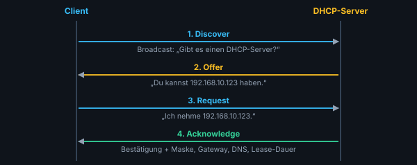
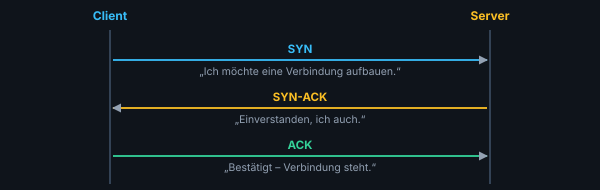

# 🔢 IP-Adressierung & Netzdienste

*Bereich: Netzwerk · Prüfungsrelevanz: ★★★*

> IPv4, Subnetting, private Adressen, NAT, IPv6, DHCP, DNS, ARP, Ports & Protokolle.

[⬅ Inhaltsverzeichnis](README.md)

---

Jedes Gerät im Netz braucht eine Adresse, und jedes Netz muss so geplant sein, dass alle Geräte darin Platz haben. Subnetting ist eine der Rechenaufgaben, die in der AP1 regelmäßig drankommen – mit einem festen Rezept bringt sie sichere Punkte. Dazu kommen IPv6, die wichtigsten Dienste wie DHCP und DNS sowie TCP, UDP und Ports.

## IPv4-Adressen und Subnetzmaske

Eine IPv4-Adresse ist **32 Bit** lang und wird als vier Dezimalzahlen von 0 bis 255 geschrieben (je 8 Bit = ein **Oktett**), z. B. 192.168.10.25. Jede Adresse besteht aus zwei Teilen:

- dem **Netzanteil** – er sagt, in welchem Netz das Gerät ist (wie die Straße),
- dem **Hostanteil** – er bezeichnet das Gerät in diesem Netz (wie die Hausnummer).

Wo die Grenze liegt, legt die **Subnetzmaske** fest: Wo sie eine 1 hat, gehört das Bit zum Netz, wo sie eine 0 hat, zum Host. Die **CIDR-Schreibweise** gibt einfach die Anzahl der Einsen an: /24 = 24 Netzbits = 255.255.255.0.

**Warum ist das wichtig?** Ein Gerät entscheidet anhand von Adresse und Maske, ob ein Ziel im **eigenen Netz** liegt (dann schickt es die Daten direkt) oder in einem **fremden Netz** (dann schickt es sie an das **Standardgateway**, den Router). Ist die Maske falsch, schickt es Daten an den falschen Ort – und nichts funktioniert.

<table><tr><th>CIDR</th><th>Maske</th><th>Adressen</th><th>nutzbare Hosts</th></tr>
<tr><td>/16</td><td>255.255.0.0</td><td>65.536</td><td>65.534</td></tr>
<tr><td>/22</td><td>255.255.252.0</td><td>1.024</td><td>1.022</td></tr>
<tr><td>/23</td><td>255.255.254.0</td><td>512</td><td>510</td></tr>
<tr><td>/24</td><td>255.255.255.0</td><td>256</td><td>254</td></tr>
<tr><td>/25</td><td>255.255.255.128</td><td>128</td><td>126</td></tr>
<tr><td>/26</td><td>255.255.255.192</td><td>64</td><td>62</td></tr>
<tr><td>/27</td><td>255.255.255.224</td><td>32</td><td>30</td></tr>
<tr><td>/28</td><td>255.255.255.240</td><td>16</td><td>14</td></tr>
<tr><td>/29</td><td>255.255.255.248</td><td>8</td><td>6</td></tr>
<tr><td>/30</td><td>255.255.255.252</td><td>4</td><td>2</td></tr></table>

> [!IMPORTANT]
> **Hostbits = 32 − Präfix** · **Adressen = 2Hostbits** · **nutzbare Hosts = 2Hostbits − 2**  
> Zwei Adressen fallen weg: die **Netzadresse** (alle Hostbits 0) bezeichnet das Netz selbst, die **Broadcastadresse** (alle Hostbits 1) erreicht alle Geräte im Netz.

Die Maskenwerte im „angebrochenen“ Oktett musst du kennen: 128, 192, 224, 240, 248, 252, 254, 255 – also 1, 2, 3 … 8 Einsen von links.

## Was die Maske technisch macht

Das Gerät verknüpft Adresse und Maske Bit für Bit mit **UND**: Nur wo beide eine 1 haben, bleibt eine 1. Das Ergebnis ist die Netzadresse.

> [!NOTE]
> **Beispiel**
>
> **192.168.10.77 / 26** – nur das letzte Oktett ist interessant, die ersten drei bleiben (Maske 255).  
> `77  = 0100 1101`  
> `192 = 1100 0000` (Maske /26: 24 + 2 Einsen)  
> `UND = 0100 0000` = 64  
> → Netzadresse **192.168.10.64**. Die 6 Hostbits auf 1 gesetzt ergeben die Broadcastadresse: 0111 1111 = 127 → **192.168.10.127**. Nutzbar: .65 bis .126 = 62 Hosts.

In der Prüfung musst du nicht binär rechnen – das folgende Rezept liefert dasselbe Ergebnis schneller.

## Subnetting: das Rezept

1. **Interessantes Oktett finden:** das Oktett, in dem die Maske weder 255 noch 0 ist.
2. **Blockgröße** = 256 − Maskenwert in diesem Oktett.
3. **Netzadresse** = größtes Vielfaches der Blockgröße, das ≤ dem Wert der IP-Adresse im interessanten Oktett ist. Alle Oktette dahinter werden 0.
4. **Broadcast** = nächste Netzadresse − 1 (Oktette dahinter 255).
5. **Hosts**: erster = Netzadresse + 1, letzter = Broadcast − 1.

> [!NOTE]
> **Beispiel**
>
> **172.16.5.77 / 27**  
> 1. /27 → Maske 255.255.255.224, interessant ist das 4. Oktett.  
> 2. Blockgröße 256 − 224 = 32.  
> 3. Netze beginnen bei 0, 32, 64, 96 … → 77 liegt zwischen 64 und 95 → Netzadresse **172.16.5.64**.  
> 4. Nächstes Netz 96 → Broadcast **172.16.5.95**.  
> 5. Hosts **172.16.5.65 – 172.16.5.94** = 30 Hosts.

> [!NOTE]
> **Beispiel**
>
> **10.0.13.200 / 23** – hier liegt das interessante Oktett im 3. Oktett!  
> 1. /23 → Maske 255.255.**254**.0, interessant ist das 3. Oktett.  
> 2. Blockgröße 256 − 254 = 2.  
> 3. Vielfache von 2: … 10, 12, 14 … → 13 liegt im Block, der bei 12 beginnt → Netzadresse **10.0.12.0**.  
> 4. Nächstes Netz 10.0.14.0 → Broadcast **10.0.13.255**.  
> 5. Hosts **10.0.12.1 – 10.0.13.254** = 29 − 2 = 510 Hosts.  
> Achtung: 10.0.12.255 und 10.0.13.0 sind hier ganz normale Hostadressen.

## Netze aufteilen

#### In gleich große Subnetze

Leiht man sich Bits vom Hostanteil, entstehen 2geliehene Bits Subnetze.

> [!NOTE]
> **Beispiel**
>
> **192.168.50.0/24 in 4 gleich große Subnetze**  
> 4 = 2² → 2 Bits leihen → /24 + 2 = **/26** (Blockgröße 64, je 62 Hosts)  
>
> | Subnetz | Netzadresse | Hostbereich | Broadcast |
> | --- | --- | --- | --- |
> | 1 | 192.168.50.0/26 | .1 – .62 | .63 |
> | 2 | 192.168.50.64/26 | .65 – .126 | .127 |
> | 3 | 192.168.50.128/26 | .129 – .190 | .191 |
> | 4 | 192.168.50.192/26 | .193 – .254 | .255 |

#### Nach benötigter Hostanzahl

Suche die kleinste Zahl n, für die 2n − 2 ≥ benötigte Hosts ist. Dann ist das Präfix 32 − n. Denk an Reserve für Wachstum und daran, dass auch Gateway, Drucker und Access Points Adressen brauchen.

> [!NOTE]
> **Beispiel**
>
> **Abteilungen unterschiedlicher Größe aus 192.168.50.0/24**  
> Verwaltung 100 Hosts: 2⁷ − 2 = 126 ≥ 100 → /25  
> Lager 50 Hosts: 2⁶ − 2 = 62 ≥ 50 → /26  
> Technik 20 Hosts: 2⁵ − 2 = 30 ≥ 20 → /27  
> Verbindung zwischen zwei Routern, 2 Hosts: 2² − 2 = 2 → /30  
> Vergabe von groß nach klein, damit keine Lücken entstehen:  
>
> | Netz | Netzadresse | Hostbereich | Broadcast |
> | --- | --- | --- | --- |
> | Verwaltung | 192.168.50.0/25 | .1 – .126 | .127 |
> | Lager | 192.168.50.128/26 | .129 – .190 | .191 |
> | Technik | 192.168.50.192/27 | .193 – .222 | .223 |
> | Router-Verbindung | 192.168.50.224/30 | .225 – .226 | .227 |

#### Liegen zwei Geräte im selben Netz?

> [!NOTE]
> **Beispiel**
>
> PC: 192.168.1.130/25 · Netzwerkdrucker: 192.168.1.100/25  
> Blockgröße 256 − 128 = 128 → Netze .0 und .128.  
> PC: 130 liegt im Netz **.128**. Drucker: 100 liegt im Netz **.0**.  
> → **Verschiedene Netze.** Der PC kann den Drucker nicht direkt erreichen, sondern nur über einen Router. Fehlt dieser, druckt er nicht. Lösung: Drucker eine Adresse aus .129 – .254 geben oder die Maske auf /24 ändern.

## Besondere Adressen und NAT

<table><tr><th>Bereich</th><th>Bedeutung</th></tr>
<tr><td>10.0.0.0/8 · 172.16.0.0/12 (172.16.0.0 – 172.31.255.255) · 192.168.0.0/16</td><td><b>private Adressen</b> – frei in jedem Firmennetz verwendbar, werden im Internet nicht weitergeleitet</td></tr>
<tr><td>127.0.0.0/8 (127.0.0.1)</td><td><b>Loopback</b> – der eigene Rechner („localhost“)</td></tr>
<tr><td>169.254.0.0/16</td><td><b>APIPA</b> – vergibt sich ein Windows-Rechner selbst, wenn kein DHCP-Server antwortet</td></tr></table>

> [!TIP]
> Zeigt ipconfig eine Adresse 169.254.x.x, hat der Rechner **keine Antwort vom DHCP-Server** bekommen. Typische Ursachen: Kabel nicht gesteckt, falsches VLAN am Switchport, DHCP-Server ausgefallen oder sein Adressbereich erschöpft.

**NAT** (Network Address Translation): Der Router übersetzt die privaten Adressen aller Geräte im Firmennetz in seine eine öffentliche Adresse und merkt sich anhand von Portnummern, welche Antwort zu welchem Gerät gehört. **Warum?** Es gibt nur etwa 4,3 Milliarden IPv4-Adressen – viel zu wenige für alle Geräte der Welt. NAT spart öffentliche Adressen und verbirgt nebenbei die interne Struktur.

## IPv6

IPv6-Adressen sind **128 Bit** lang – das ergibt etwa 3,4 × 1038 Adressen, genug für jedes Gerät, ohne NAT. Geschrieben werden sie als 8 Blöcke zu je 16 Bit in Hexadezimal, getrennt durch Doppelpunkte.

#### Kürzen

1. **Führende Nullen** in jedem Block dürfen wegfallen: 0db8 → db8, 0042 → 42, 0000 → 0.
2. **Eine** zusammenhängende Folge von Null-Blöcken darf durch **::** ersetzt werden – aber nur **einmal** pro Adresse, sonst wüsste man nicht, wie viele Blöcke wo fehlen. Gibt es mehrere Folgen, kürzt man die längste.

> [!NOTE]
> **Beispiel**
>
> `2001:0db8:0000:0000:0000:ff00:0042:8329`  
> Schritt 1: `2001:db8:0:0:0:ff00:42:8329`  
> Schritt 2: `2001:db8::ff00:42:8329`  
>
> `fe80:0000:0000:0000:0204:61ff:fe9d:f156` → `fe80::204:61ff:fe9d:f156`  
>
> **Rückwärts** (ausschreiben): `2001:db8:0:1::1` hat 5 Blöcke, es fehlen 3 → `2001:0db8:0000:0001:0000:0000:0000:0001`  
>
> **Falsch:** `2001:db8::1::2` – zweimal :: ist nicht erlaubt.

<table><tr><th>Präfix</th><th>Typ</th><th>Bedeutung</th></tr>
<tr><td>2000::/3</td><td>Global Unicast</td><td>öffentliche, weltweit erreichbare Adressen</td></tr>
<tr><td>fe80::/10</td><td>Link-Local</td><td>jede Schnittstelle hat automatisch eine; gilt nur im lokalen Netzsegment</td></tr>
<tr><td>fc00::/7 (praktisch fd00::/8)</td><td>Unique Local</td><td>ähnlich wie private IPv4-Adressen</td></tr>
<tr><td>ff00::/8</td><td>Multicast</td><td>an eine Gruppe – IPv6 kennt <b>keinen Broadcast</b></td></tr>
<tr><td>::1</td><td>Loopback</td><td>der eigene Rechner</td></tr></table>

Eine Global-Unicast-Adresse besteht meist aus **64 Bit Präfix** (Netz) und **64 Bit Interface Identifier** (Gerät). Ein Subnetz ist praktisch immer ein **/64**. Unternehmen bekommen vom Provider meist ein /48 oder /56.

> [!NOTE]
> **Beispiel**
>
> **Wie viele /64-Subnetze?**  
> Zuteilung /48 → bis /64 sind 64 − 48 = 16 Bits frei → 216 = **65.536 Subnetze**.  
> Zuteilung /56 → 8 Bits → 28 = **256 Subnetze**.

**Adressvergabe:** automatisch über die Router-Ankündigungen (**SLAAC**), über DHCPv6 oder statisch. **Dual Stack** heißt: IPv4 und IPv6 laufen parallel – heute der Normalfall.

## Wichtige Dienste: DHCP, DNS, ARP, ICMP

#### DHCP – automatische Adressvergabe

Ohne DHCP müsste man jedem Gerät Adresse, Maske, Gateway und DNS-Server von Hand eintragen – fehleranfällig und bei Hunderten Geräten nicht machbar. Der DHCP-Server vergibt diese Daten automatisch für eine bestimmte Zeit (**Lease**).

Server, Drucker und Netzwerkgeräte brauchen eine gleichbleibende Adresse. Dafür gibt es zwei Wege: **statisch** am Gerät eintragen (außerhalb des DHCP-Bereichs!) oder eine **DHCP-Reservierung** anhand der MAC-Adresse – dann bekommt das Gerät per DHCP immer dieselbe Adresse und alles bleibt zentral verwaltet.

#### DNS – Namen in Adressen übersetzen

Menschen merken sich Namen, Computer brauchen Adressen. DNS übersetzt z. B. www.beispiel.de in eine IP-Adresse. Ein Rechner sucht zuerst in seinem Zwischenspeicher, dann in der hosts-Datei, dann fragt er den DNS-Server. Kennt dieser die Antwort nicht, fragt er sich von den Root-Servern über die Top-Level-Domain (.de) bis zum zuständigen (autoritativen) Server durch.

<table><tr><th>Eintrag</th><th>Bedeutung</th></tr>
<tr><td>A / AAAA</td><td>Name → IPv4- / IPv6-Adresse</td></tr>
<tr><td>CNAME</td><td>Alias – ein Name verweist auf einen anderen</td></tr>
<tr><td>MX</td><td>zuständiger Mailserver einer Domain</td></tr>
<tr><td>PTR</td><td>umgekehrt: IP-Adresse → Name</td></tr>
<tr><td>NS</td><td>zuständiger Nameserver</td></tr>
<tr><td>SRV</td><td>Dienst, z. B. wo der Domänencontroller zu finden ist</td></tr>
<tr><td>TXT</td><td>Textinformationen, z. B. für E-Mail-Sicherheit (SPF)</td></tr></table>

**ARP** findet zu einer bekannten IPv4-Adresse im lokalen Netz die MAC-Adresse („Wer hat 192.168.10.1?“ als Broadcast). Ohne MAC-Adresse kann der Switch den Frame nicht zustellen. IPv6 nutzt dafür NDP. **ICMP** transportiert Steuer- und Fehlermeldungen; ping und traceroute nutzen es.

## TCP, UDP und Ports

<table><tr><th></th><th>TCP</th><th>UDP</th></tr>
<tr><td>Verbindung</td><td>verbindungsorientiert: vor dem Senden Verbindungsaufbau</td><td>verbindungslos: einfach losschicken</td></tr>
<tr><td>Zuverlässigkeit</td><td>Empfang wird bestätigt, Reihenfolge stimmt, Verlorenes wird neu gesendet</td><td>keine Garantie</td></tr>
<tr><td>Geschwindigkeit</td><td>mehr Aufwand</td><td>schnell, wenig Overhead</td></tr>
<tr><td>Einsatz</td><td>Webseiten, E-Mail, Dateiübertragung, SSH – alles, wo kein Byte fehlen darf</td><td>DNS-Abfragen, DHCP, Telefonie, Videostreams, Spiele – wo Schnelligkeit wichtiger ist als einzelne verlorene Pakete</td></tr></table>

**Warum UDP für Telefonie?** Ein verlorenes Sprachpaket neu zu senden, wäre sinnlos – bis es ankommt, ist das Gespräch schon weiter. Lieber eine winzige Lücke als eine Verzögerung.

**Ports** geben an, für welches Programm auf einem Rechner die Daten bestimmt sind. Die IP-Adresse ist das Haus, der Port die Wohnungstür. Server lauschen auf festen, bekannten Ports:

<table><tr><th>Port</th><th>Dienst</th><th>Port</th><th>Dienst</th></tr>
<tr><td>20/21</td><td>FTP</td><td>110 / 995</td><td>POP3 / POP3S</td></tr>
<tr><td>22</td><td>SSH, SFTP</td><td>123</td><td>NTP (Zeit)</td></tr>
<tr><td>23</td><td>Telnet (unverschlüsselt!)</td><td>143 / 993</td><td>IMAP / IMAPS</td></tr>
<tr><td>25 / 587 / 465</td><td>SMTP / Einlieferung / SMTPS</td><td>389 / 636</td><td>LDAP / LDAPS</td></tr>
<tr><td>53</td><td>DNS</td><td>445</td><td>SMB (Windows-Dateifreigaben)</td></tr>
<tr><td>67/68</td><td>DHCP</td><td>3389</td><td>RDP (Remotedesktop)</td></tr>
<tr><td>80 / 443</td><td>HTTP / HTTPS</td><td>88</td><td>Kerberos</td></tr></table>

**E-Mail-Protokolle:** SMTP sendet Mails. IMAP verwaltet sie auf dem Server – alle Geräte sehen denselben Stand. POP3 lädt sie herunter und löscht sie meist auf dem Server – für mehrere Geräte ungeeignet.

> [!CAUTION]
> **Typische Fehler**
>
> - Netz- und Broadcastadresse als nutzbare Hosts mitzählen (immer − 2).
> - Die Blockgröße im falschen Oktett anwenden, besonders bei /23 oder /22.
> - Beim Aufteilen nach Hosts das Gateway und die Reserve vergessen.
> - Bei IPv6 :: zweimal verwenden oder Nullen am Ende eines Blocks weglassen (0db8 → db8 ist richtig, 2001 → 21 ist falsch).
> - Annehmen, IPv6 habe Broadcast.
> - Eine feste IP-Adresse in den DHCP-Bereich legen.
> - TCP und UDP vertauschen oder Ports raten – die Tabelle oben auswendig lernen.

**📝 Prüfungsaufgabe:** **Ermitteln Sie für 192.168.40.150/28 Netzadresse, Broadcastadresse, ersten und letzten Host sowie die Anzahl nutzbarer Hosts. (5 Punkte)**

Lösung anzeigen

/28 → Maske 255.255.255.240, Blockgröße 16. Vielfache: … 144, 160 → 150 liegt im Block ab 144. Netzadresse **192.168.40.144** (1), Broadcast **192.168.40.159** (1), erster Host **.145** (1), letzter Host **.158** (1), **14** nutzbare Hosts (1).

**📝 Prüfungsaufgabe:** **Eine Abteilung braucht 40 IP-Adressen für Endgeräte, dazu Gateway und zwei Drucker. Welches Präfix ist mindestens nötig? (2 Punkte)**

Lösung anzeigen

40 + 1 + 2 = 43 Adressen (1). 2⁶ − 2 = 62 ≥ 43, 2⁵ − 2 = 30 reicht nicht → **/26** (1).

**📝 Prüfungsaufgabe:** **Kürzen Sie die IPv6-Adresse 2001:0db8:0000:00a0:0000:0000:0000:0001 so weit wie möglich. (2 Punkte)**

Lösung anzeigen

Führende Nullen weglassen: 2001:db8:0:a0:0:0:0:1 (1). Die längste Null-Folge (drei Blöcke) durch :: ersetzen: **2001:db8:0:a0::1** (1).

**📝 Prüfungsaufgabe:** **Ein Mitarbeiter kann nicht ins Internet. ipconfig zeigt die Adresse 169.254.23.17. Erläutern Sie die Ursache und nennen Sie zwei mögliche Gründe. (3 Punkte)**

Lösung anzeigen

Es ist eine APIPA-Adresse: Der Rechner hat keine Antwort von einem DHCP-Server erhalten und sich selbst eine Adresse gegeben (1). Gründe (je 1): Netzwerkkabel nicht verbunden oder defekt; Switchport im falschen VLAN; DHCP-Server ausgefallen; DHCP-Adressbereich erschöpft.

**📝 Prüfungsaufgabe:** **Begründen Sie, warum für Videotelefonie UDP und für den Download einer Datei TCP verwendet wird. (2 Punkte)**

Lösung anzeigen

Bei Videotelefonie ist eine geringe Verzögerung wichtiger als jedes einzelne Paket; verlorene Pakete neu zu senden, käme zu spät – deshalb das schnelle, verbindungslose UDP (1). Bei einem Download darf kein Byte fehlen, sonst ist die Datei beschädigt – TCP bestätigt den Empfang und sendet Verlorenes erneut (1).

---

## 🃏 Karteikarten (25)

| Frage | Antwort |
|---|---|
| Nutzbare Hosts in /26 | 62 (2⁶ − 2). |
| Nutzbare Hosts in /27 | 30. |
| Nutzbare Hosts in /28 | 14. |
| Maske zu /27 | 255.255.255.224. |
| Maske zu /22 | 255.255.252.0. |
| Private IPv4-Bereiche (RFC 1918) | 10.0.0.0/8, 172.16.0.0/12, 192.168.0.0/16. |
| APIPA-Adresse 169.254.x.x bedeutet … | Der Client hat keinen DHCP-Server erreicht und sich selbst eine Link-Local-Adresse gegeben. |
| NAT | Router übersetzt private in öffentliche IP-Adressen – spart IPv4-Adressen, verbirgt interne Struktur. |
| IPv6 – Länge und Darstellung | 128 Bit, 8 Blöcke à 4 Hex-Ziffern, getrennt durch Doppelpunkte. |
| IPv6-Kürzungsregeln | Führende Nullen pro Block weglassen; eine zusammenhängende Nullfolge einmal durch :: ersetzen. |
| fe80::/10 | IPv6 Link-Local-Adresse – nur im lokalen Segment gültig. |
| ff00::/8 | IPv6-Multicast (IPv6 hat keinen Broadcast). |
| ::1 | IPv6-Loopback (entspricht 127.0.0.1). |
| SLAAC | Stateless Address Autoconfiguration: IPv6-Host bildet Adresse aus Router-Präfix + Interface-ID. |
| DHCP-Ablauf (DORA) | Discover, Offer, Request, Acknowledge. |
| DNS-Eintrag A / AAAA | A: Name → IPv4. AAAA: Name → IPv6. |
| DNS-Eintrag MX | Verweist auf den Mailserver einer Domain. |
| DNS-Eintrag PTR | Reverse Lookup: IP-Adresse → Name. |
| ARP | Ermittelt zur IPv4-Adresse die MAC-Adresse im lokalen Netz. |
| TCP vs. UDP | TCP: verbindungsorientiert, zuverlässig. UDP: verbindungslos, schnell, ohne Garantie. |
| Port 22 / 23 | SSH (verschlüsselt) / Telnet (unverschlüsselt). |
| Port 443 / 3389 | HTTPS / RDP. |
| Port 445 | SMB – Windows-Dateifreigaben. |
| Port 53 | DNS. |
| IMAP vs. POP3 | IMAP: Mails bleiben auf dem Server, geräteübergreifend synchron. POP3: Mails werden heruntergeladen (meist gelöscht). |

## ✍️ Übungsfragen (21)

**1.** Wie viele Hosts sind in einem /25-Netz nutzbar?

Lösung

**126** 2⁷ − 2 = 126.

**2.** Wie lautet die Netzadresse von 192.168.1.130/26?

Lösung

**Musterlösung (2 P):** 192.168.1.128 Block 64: 0, 64, 128, 192 → 130 liegt in 128–191.

**3.** Wie lautet die Broadcastadresse von 10.0.0.37/28?

Lösung

**Musterlösung (2 P):** 10.0.0.47 Block 16: 32–47 → Broadcast .47.

**4.** Nennen Sie die drei privaten IPv4-Adressbereiche nach RFC 1918.

Lösung

**Musterlösung (3 P):** Je 1 Punkt: 10.0.0.0/8 (10.0.0.0–10.255.255.255); 172.16.0.0/12 (172.16.0.0–172.31.255.255); 192.168.0.0/16 (192.168.0.0–192.168.255.255). 172.16.0.0–172.31.255.255.

**5.** Ein Client hat die IP 169.254.12.4. Was ist die wahrscheinlichste Ursache?

Lösung

**Musterlösung (2 P):** DHCP-Server nicht erreichbar APIPA wird vergeben, wenn kein DHCP antwortet.

**6.** Kürzen Sie die IPv6-Adresse 2001:0db8:0000:0000:0001:0000:0000:0001 so weit wie möglich.

Lösung

**Musterlösung (2 P):** 2001:db8::1:0:0:1 Führende Nullen je Block weglassen; :: darf nur einmal vorkommen. Hier gibt es zwei gleich lange Nullfolgen – nach RFC 5952 wird die erste ersetzt. 2001:db8:0:0:1::1 ist ebenfalls eine gültige Adresse, 2001:db8::1::1 nicht.

**7.** Womit beginnt eine IPv6-Link-Local-Adresse?

Lösung

**Musterlösung (2 P):** fe80: fe80::/10.

**8.** Was kennt IPv6 im Gegensatz zu IPv4 NICHT?

Lösung

**Musterlösung (2 P):** Broadcast Broadcast wird durch Multicast ersetzt.

**9.** Ein Netz benötigt 50 Hosts. Welches Präfix (Zahl hinter /) ist das kleinstmögliche Netz?

Lösung

**26** 2⁶ − 2 = 62 ≥ 50 → 6 Hostbits → /26.

**10.** Ein /24-Netz soll in 8 gleich große Subnetze geteilt werden. Welches Präfix ergibt sich?

Lösung

**27** 8 = 2³ → 3 Bits leihen → /27.

**11.** Welcher DNS-Eintrag verweist auf den Mailserver einer Domain?

Lösung

**Musterlösung (2 P):** MX

**12.** Welche Nachricht sendet ein Client zuerst, um eine IP per DHCP zu erhalten?

Lösung

**Musterlösung (2 P):** DHCP Discover DORA beginnt mit Discover (Broadcast).

**13.** Welches Protokoll ermittelt zu einer IPv4-Adresse die MAC-Adresse?

Lösung

**Musterlösung (2 P):** ARP

**14.** Welcher Port wird für RDP genutzt?

Lösung

**Musterlösung (2 P):** 3389

**15.** Welches Transportprotokoll nutzt VoIP typischerweise für die Sprachdaten?

Lösung

**Musterlösung (2 P):** UDP Geringe Latenz wichtiger als Neuübertragung.

**16.** Prüfen Sie, ob die Hosts 192.168.10.70/26 und 192.168.10.120/26 im selben Subnetz liegen. Geben Sie Netz- und Broadcastadresse an und sagen Sie, ob für die Kommunikation ein Router nötig ist.

Lösung

**Musterlösung (3 P):** /26 → Blockgröße 64, also Netz 192.168.10.64 (1) mit Broadcast 192.168.10.127 (1). Beide Hosts (.70 und .120) liegen darin – sie kommunizieren direkt, ein Router ist nicht nötig (1). Block 64: 64–127 → beide im selben Netz, kein Router nötig.

**17.** Was ist ein Vorteil von IPv6?

Lösung

**Musterlösung (2 P):** Riesiger Adressraum, NAT nicht mehr nötig

**18.** Welches Protokoll ersetzt Telnet für die sichere Fernwartung?

Lösung

**Musterlösung (2 P):** SSH SSH verschlüsselt, Port 22.

**19.** Ein Rechner erhält die Adresse 169.254.33.7 und kann nicht ins Internet. Erklären Sie die Ursache und nennen Sie zwei Prüfschritte. (4 Punkte)

Lösung

**Musterlösung (4 P):** Ursache: Der Client hat keine Antwort von einem DHCP-Server erhalten und sich per APIPA selbst eine Link-Local-Adresse zugewiesen; damit fehlen Gateway und DNS (2). Prüfschritte (je 1): Netzwerkkabel/WLAN-Verbindung und Link-LED prüfen; ipconfig /release und /renew; Erreichbarkeit/Status des DHCP-Servers bzw. freie Adressen im Pool prüfen; VLAN-Zuordnung des Switchports prüfen.

**20.** Kürzen Sie die IPv6-Adresse 2001:0db8:00a0:0000:0000:0000:0000:0c01 maximal und erläutern Sie die angewandten Regeln. (3 Punkte)

Lösung

**Musterlösung (3 P):** Ergebnis: 2001:db8:a0::c01 (1). Regel 1: Führende Nullen in jedem Block entfallen (0db8 → db8, 00a0 → a0, 0c01 → c01) (1). Regel 2: Die zusammenhängende Folge von Null-Blöcken wird einmalig durch :: ersetzt (1).

**21.** Erläutern Sie den Ablauf einer DHCP-Adressvergabe. (4 Punkte)

Lösung

**Musterlösung (4 P):** 1. DHCP Discover: Der Client sucht per Broadcast einen DHCP-Server (1). 2. DHCP Offer: Ein Server bietet eine IP-Konfiguration an (1). 3. DHCP Request: Der Client fordert die angebotene Adresse an (Broadcast, damit andere Server Bescheid wissen) (1). 4. DHCP Acknowledge: Der Server bestätigt und vergibt die Adresse inkl. Lease-Zeit, Gateway, DNS (1).

[⬅ Inhaltsverzeichnis](README.md)
