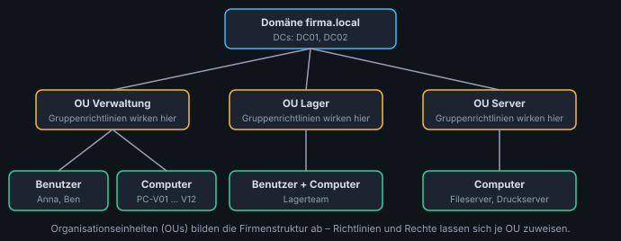
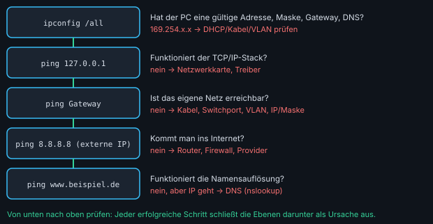

# 🏢 Domäne, Benutzer & Administration

*Bereich: Netzwerk · Prüfungsrelevanz: ★★★*

> Arbeitsgruppe vs. Domäne, AD DS, Entra ID, Domänenbeitritt, GPO, Rechte, Freigaben, Remote, Troubleshooting.

[⬅ Inhaltsverzeichnis](README.md)

---

Ein Arbeitsplatz im Unternehmen steht nicht allein: Er wird in eine zentrale Verwaltung eingebunden, damit sich Mitarbeitende überall mit demselben Konto anmelden, Richtlinien automatisch greifen und Rechte zentral vergeben werden. „Clients in Domänen einbinden“ ist im Prüfungskatalog 2025 neu betont. Dazu gehören auch Fernzugriff und eine strukturierte Fehlersuche.

## Arbeitsgruppe oder Domäne?

<table><tr><th></th><th>Arbeitsgruppe</th><th>Domäne</th></tr>
<tr><td>Verwaltung</td><td>dezentral – jeder PC hat eigene lokale Benutzerkonten</td><td>zentral über einen <b>Domänencontroller</b> (DC)</td></tr>
<tr><td>Anmeldung</td><td>an jedem Gerät mit einem eigenen lokalen Konto</td><td>ein Konto für alle Geräte und Dienste (Single Sign-On)</td></tr>
<tr><td>Einstellungen</td><td>an jedem Gerät von Hand</td><td>zentral per Gruppenrichtlinie</td></tr>
<tr><td>geeignet für</td><td>sehr kleine Umgebungen mit wenigen PCs</td><td>Unternehmen</td></tr></table>

**Warum lohnt sich eine Domäne?** Stell dir 40 PCs in einer Arbeitsgruppe vor: Eine neue Mitarbeiterin braucht auf jedem Rechner, den sie benutzen soll, ein eigenes Konto. Verlässt jemand die Firma, muss man an allen Geräten sein Konto löschen – vergisst man eines, bleibt ein Zugang offen. Soll überall die Bildschirmsperre nach 10 Minuten aktiv sein, muss man jeden PC einzeln einstellen. In der Domäne erledigt man all das einmal zentral.

## Active Directory

**Active Directory Domain Services** (AD DS) ist der Verzeichnisdienst von Microsoft. Er speichert alle **Objekte** des Unternehmens – Benutzer, Gruppen, Computer, Drucker, Freigaben – mit ihren Eigenschaften und Rechten.

- Die **Domäne** ist die Verwaltungseinheit (z. B. firma.local). Mehrere Domänen können zu Strukturen (Trees) und einer Gesamtstruktur (Forest) gehören.
- **Organisationseinheiten** (OUs) sind Ordner innerhalb der Domäne, meist nach Abteilungen oder Standorten. An sie werden Gruppenrichtlinien geknüpft.
- Der **Domänencontroller** ist der Server, auf dem AD DS läuft. Er prüft Anmeldungen und gleicht das Verzeichnis mit weiteren DCs ab. **Warum mindestens zwei DCs?** Fällt der einzige DC aus, kann sich niemand mehr anmelden.
- Wichtige Protokolle: **DNS** (Clients finden den DC), **Kerberos** (Anmeldung mit Tickets, Port 88), **LDAP** (Zugriff aufs Verzeichnis, Port 389).

#### Gruppenrichtlinien (GPO)

Mit Gruppenrichtlinien werden Einstellungen zentral erzwungen: Passwortregeln, Bildschirmsperre, Netzlaufwerke, Drucker, Softwareverteilung, Sperre von USB-Speichern, Firewallregeln, Desktop-Hintergrund. Sie wirken in der Reihenfolge **lokal → Standort → Domäne → OU** (Merkwort LSDOU); bei Widersprüchen gewinnt die zuletzt angewendete, also meist die der OU. Mit `gpupdate /force` werden Richtlinien sofort angewendet, mit `gpresult /r` sieht man, welche wirken.

> [!NOTE]
> **Beispiel**
>
> **GPO im Einsatz**  
> Die Geschäftsleitung möchte, dass in der Buchhaltung keine USB-Sticks benutzt werden können. Statt an 12 PCs einzeln Einstellungen zu ändern, legt die Administratorin eine Gruppenrichtlinie „USB-Speicher sperren“ an und verknüpft sie mit der OU Buchhaltung. Beim nächsten Neustart oder Richtlinienabgleich gilt die Sperre auf allen Rechnern dieser OU – auch auf jedem neuen PC, der später in diese OU kommt.

## Einen Client in die Domäne aufnehmen

1. **Netzwerk:** Der Client hat eine gültige IP-Adresse im richtigen Netz und erreicht den Domänencontroller.
2. **DNS:** Als DNS-Server muss der **DNS-Server der Domäne** (meist der DC) eingetragen sein – nicht der Router und kein öffentlicher DNS wie 8.8.8.8. **Warum?** Der Client findet den Domänencontroller über spezielle DNS-Einträge (SRV-Einträge), die nur der interne DNS-Server kennt. Falscher DNS ist der häufigste Grund, warum ein Domänenbeitritt scheitert.
3. **Uhrzeit:** Client und DC müssen nahezu die gleiche Zeit haben – Kerberos lässt standardmäßig höchstens 5 Minuten Abweichung zu, damit abgefangene Anmeldetickets nicht später wiederverwendet werden können.
4. **Edition:** Windows Pro, Enterprise oder Education – Home kann keiner Domäne beitreten.
5. **Berechtigung:** lokale Administratorrechte am Client und ein Domänenkonto, das Computer hinzufügen darf.
6. **Beitreten:** in den Systemeinstellungen „Domäne oder Arbeitsgruppe“ bzw. per PowerShell `Add-Computer -DomainName firma.local`, danach Neustart.
7. **Nacharbeiten:** Computerobjekt in die richtige OU verschieben, Gruppenrichtlinien prüfen, Anmeldung mit einem Domänenkonto testen.

> [!NOTE]
> **Beispiel**
>
> **Fehlerfall**  
> Beim Beitritt erscheint: „Ein Active Directory-Domänencontroller für die Domäne firma.local konnte nicht kontaktiert werden.“ ipconfig zeigt als DNS-Server 192.168.10.1 (den Router).  
> **Ursache:** Der Router kennt die internen SRV-Einträge der Domäne nicht.  
> **Lösung:** Als DNS-Server die Adresse des Domänencontrollers eintragen – am besten zentral im DHCP-Server, damit alle Clients sie automatisch bekommen.

## Microsoft Entra ID und Intune

**Microsoft Entra ID** (früher Azure AD) ist ein Identitätsdienst in der Cloud. Er verwaltet die Konten für Microsoft 365, Azure und viele weitere Cloud-Anwendungen und bietet Single Sign-On, Mehr-Faktor-Authentifizierung und **bedingten Zugriff** (z. B. „Anmeldung nur von verwalteten Geräten aus der EU“).

<table><tr><th>Gerätestatus</th><th>für</th><th>Anmeldung</th></tr>
<tr><td>Entra registered</td><td>private Geräte (BYOD), Smartphones</td><td>privates Konto, zusätzlich Arbeitskonto hinzugefügt</td></tr>
<tr><td>Entra joined</td><td>firmeneigene Geräte ohne lokales AD, auch im Homeoffice</td><td>mit dem Entra-Konto; Einrichtung oft per Autopilot, Verwaltung mit Intune</td></tr>
<tr><td>Entra hybrid joined</td><td>Unternehmen mit bestehendem lokalem AD</td><td>Gerät ist im lokalen AD und in Entra ID bekannt (Abgleich per Entra Connect)</td></tr></table>

**Intune** ist Microsofts Geräteverwaltung aus der Cloud (MDM): Richtlinien verteilen, Apps installieren, prüfen, ob Geräte die Sicherheitsvorgaben erfüllen, und verlorene Geräte aus der Ferne sperren oder löschen. **Warum Cloud statt Domäne?** Notebooks im Homeoffice haben oft keine Verbindung zum Domänencontroller im Firmennetz. Entra ID und Intune erreichen sie über das Internet überall.

## Benutzer, Gruppen und Rechte

**Prinzip der minimalen Rechte** (Least Privilege): Jede Person bekommt nur die Rechte, die sie für ihre Aufgabe braucht. Normale Benutzer arbeiten ohne Administratorrechte; Administratoren haben für die Verwaltung ein **getrenntes Admin-Konto**. **Warum?** Klickt jemand mit Administratorrechten auf einen schädlichen Anhang, kann die Schadsoftware das ganze System übernehmen. Ohne Adminrechte bleibt der Schaden begrenzt.

**Rechte über Gruppen vergeben**, nicht an einzelne Personen: Wechselt jemand die Abteilung, nimmt man ihn aus der einen Gruppe und fügt ihn der anderen hinzu – fertig. Bei Microsoft heißt die bewährte Struktur **AGDLP**: **A**ccounts kommen in **G**lobale Gruppen (nach Rolle, z. B. „Buchhaltung“), diese in **D**omänen-**l**okale Gruppen (nach Ressource, z. B. „Rechnungen-Ändern“), und nur diese bekommen die **P**ermissions (Rechte) auf den Ordner.

#### NTFS- und Freigaberechte

Auf einen Ordner auf einem Server wirken zwei Arten von Rechten:

- **Freigaberechte** gelten nur beim Zugriff über das Netzwerk: Lesen, Ändern, Vollzugriff.
- **NTFS-Rechte** gelten immer, auch lokal: Vollzugriff, Ändern, Lesen und Ausführen, Lesen, Schreiben. Sie werden standardmäßig an Unterordner vererbt.

> [!IMPORTANT]
> Beim Zugriff über das Netzwerk gilt die **restriktivere** Kombination aus Freigabe- und NTFS-Rechten. Ein ausdrückliches **Verweigern** schlägt ein Zulassen.

> [!NOTE]
> **Beispiel**
>
> **Effektive Rechte bestimmen**  
> Freigabe „Projekte“: Gruppe Mitarbeiter = **Ändern**  
> NTFS-Rechte auf dem Ordner: Gruppe Mitarbeiter = **Lesen**  
> → Über das Netzwerk darf ein Mitarbeiter nur **lesen** (das Restriktivere von Ändern und Lesen).  
>
> Freigabe: Jeder = Vollzugriff · NTFS: Vertrieb = Ändern  
> → Vertriebsmitarbeitende dürfen über das Netz **ändern**. Viele Administratoren geben die Freigabe deshalb großzügig frei und steuern die Rechte nur über NTFS – dann gibt es nur eine Stelle, an der man nachsehen muss.

Netzlaufwerke werden über einen **UNC-Pfad** angesprochen (`\\Server\Freigabe`) und per Gruppenrichtlinie oder `net use H: \\server\freigabe` verbunden. Damit Benutzer an jedem PC ihre Dateien vorfinden, werden Ordner wie „Dokumente“ auf den Server umgeleitet (Ordnerumleitung) oder mit OneDrive synchronisiert.

## Fernzugriff

<table><tr><th>Werkzeug</th><th>Einsatz</th><th>Sicherheit</th></tr>
<tr><td>RDP (Remotedesktop, Port 3389)</td><td>an einem entfernten Windows-Rechner oder Server arbeiten</td><td>nie direkt aus dem Internet erreichbar machen – nur über VPN oder ein Gateway</td></tr>
<tr><td>Remoteunterstützung (z. B. Quick Assist)</td><td>Support schaut auf den Bildschirm eines Nutzers</td><td>nur mit Zustimmung des Nutzers</td></tr>
<tr><td>Fernwartungsprogramme</td><td>Support bei Kunden</td><td>Zustimmung, Protokollierung, MFA für Supportkonten</td></tr>
<tr><td>SSH (Port 22)</td><td>Linux-Server, Netzwerkgeräte</td><td>Anmeldung mit Schlüsseln statt Passwort</td></tr>
<tr><td>VPN</td><td>Homeoffice: sicherer Tunnel ins Firmennetz</td><td>mit MFA absichern</td></tr></table>

**Warum kein RDP direkt ins Internet?** Angreifer durchsuchen das Internet automatisch nach offenen RDP-Ports und probieren Passwörter durch. Ein erfolgreicher Zugriff ist ein häufiger Einstieg für Ransomware.

## Strukturierte Fehlersuche

„Das Internet geht nicht“ kann hundert Ursachen haben. Wer planlos an Einstellungen dreht, verschlimmert es oft. Professionell geht man in festen Schritten vor:

1. **Problem aufnehmen:** Was genau geht nicht? Seit wann? Wer ist betroffen – eine Person oder alle? Was wurde zuletzt geändert?
2. **Ursache eingrenzen:** systematisch, z. B. entlang des Schichtenmodells von unten nach oben.
3. **Hypothese testen**, Lösung umsetzen und erneut testen.
4. **Dokumentieren:** im Ticket und in der Wissensdatenbank, damit es beim nächsten Mal schneller geht.

> [!TIP]
> Die zwei wichtigsten Rückschlüsse: **ping 8.8.8.8 klappt, aber ping auf einen Namen nicht → DNS-Problem.** **Geräte im LAN sind erreichbar, das Internet nicht → Gateway, Router oder Firewall prüfen.** Sind alle Mitarbeitenden betroffen, liegt die Ursache zentral (Server, Router, Provider) – ist es nur einer, eher an seinem Gerät oder Anschluss.

> [!CAUTION]
> **Typische Fehler**
>
> - Beim Domänenbeitritt den Router oder einen öffentlichen DNS-Server eintragen.
> - Die Zeitabweichung als Ursache für Anmeldefehler übersehen.
> - Windows Home in eine Domäne aufnehmen wollen.
> - Rechte an einzelne Benutzer statt an Gruppen vergeben.
> - Bei Freigabe- und NTFS-Rechten das großzügigere Recht als wirksam annehmen.
> - Normale Benutzer mit Administratorrechten arbeiten lassen.
> - Bei der Fehlersuche mit der Anwendung anfangen, bevor Adresse, Gateway und DNS geprüft sind.

**📝 Prüfungsaufgabe:** **Ein neuer PC soll der Domäne firma.local beitreten. Nennen Sie vier Voraussetzungen. (4 Punkte)**

Lösung anzeigen

Je 1 Punkt: gültige IP-Adresse und Netzwerkverbindung zum Domänencontroller; DNS-Server des Clients zeigt auf den DNS der Domäne; Uhrzeit synchron (max. 5 Minuten Abweichung); Windows-Edition Pro, Enterprise oder Education; Konto mit Berechtigung zum Hinzufügen von Computern und lokale Adminrechte.

**📝 Prüfungsaufgabe:** **Die Freigabe „Buchhaltung“ erlaubt der Gruppe Buchhaltung Vollzugriff, die NTFS-Rechte erlauben ihr „Lesen und Ausführen“. Welche Rechte hat ein Mitglied über das Netzwerk? Begründen Sie. (2 Punkte)**

Lösung anzeigen

Nur **Lesen und Ausführen** (1), weil beim Netzwerkzugriff die restriktivere Kombination aus Freigabe- und NTFS-Rechten gilt (1).

**📝 Prüfungsaufgabe:** **Ein Benutzer meldet, dass keine Webseiten laden. ping 8.8.8.8 ist erfolgreich, ping www.ihk.de nicht. Ermitteln Sie die wahrscheinliche Ursache und einen Prüfschritt. (3 Punkte)**

Lösung anzeigen

Die Verbindung ins Internet funktioniert, weil die IP-Adresse erreichbar ist (1). Die Namensauflösung schlägt fehl – es liegt ein DNS-Problem vor (1). Prüfschritt: mit ipconfig /all den eingetragenen DNS-Server prüfen und mit nslookup www.ihk.de testen, ob er antwortet (1).

**📝 Prüfungsaufgabe:** **Begründen Sie, warum Administratoren für Verwaltungsaufgaben ein separates Admin-Konto verwenden sollten. (2 Punkte)**

Lösung anzeigen

Bei alltäglicher Arbeit wie E-Mail und Internet besteht die Gefahr, Schadsoftware auszuführen (1). Arbeitet der Administrator dabei mit einem normalen Konto ohne Adminrechte, kann die Schadsoftware das System nicht übernehmen; das Admin-Konto wird nur gezielt für Verwaltungsaufgaben genutzt (1).

---

## 🃏 Karteikarten (19)

| Frage | Antwort |
|---|---|
| Arbeitsgruppe vs. Domäne | Arbeitsgruppe: dezentral, lokale Konten pro PC. Domäne: zentrale Verwaltung über Domänencontroller, ein Konto für alle Geräte. |
| Häufigster Fehler beim Domänenbeitritt | Falscher DNS-Server – der Client muss den DNS des Domänencontrollers nutzen. |
| Warum Zeitsynchronisation in der Domäne? | Kerberos-Tickets sind zeitbasiert; mehr als 5 Minuten Abweichung → Anmeldung scheitert. |
| Welche Windows-Edition kann keiner Domäne beitreten? | Windows Home. |
| Organisationseinheit (OU) | Container im AD zur Strukturierung von Objekten und zum Verknüpfen von GPOs. |
| Gruppenrichtlinie (GPO) | Zentral definierte Einstellungen für Benutzer/Computer, z. B. Passwortrichtlinie, Laufwerke, USB-Sperre. |
| AGDLP | Accounts → Globale Gruppen → Domänenlokale Gruppen → Permissions. |
| Kerberos | Ticketbasiertes Authentifizierungsprotokoll im AD (Port 88). |
| LDAP | Protokoll für den Zugriff auf Verzeichnisdienste (Port 389, LDAPS 636). |
| Entra registered | Private Geräte (BYOD) mit hinzugefügtem Arbeitskonto. |
| Entra joined | Firmengeräte, direkt an Entra ID angemeldet, cloudverwaltet (Intune/Autopilot). |
| Entra hybrid joined | Gerät ist im lokalen AD Mitglied und zusätzlich in Entra ID registriert. |
| Intune | Cloudbasiertes Endpoint-/Mobile-Device-Management von Microsoft. |
| Least Privilege | Jeder erhält nur die Rechte, die er für seine Aufgabe braucht. |
| Freigabe- + NTFS-Rechte | Übers Netzwerk gilt die restriktivere Kombination; Verweigern schlägt Zulassen. |
| UNC-Pfad | \\Server\Freigabe – Pfad zu einer Netzwerkfreigabe. |
| ping 8.8.8.8 ok, Name nicht auflösbar | DNS-Problem. |
| gpresult /r | Zeigt, welche Gruppenrichtlinien auf Benutzer/Computer angewendet wurden. |
| Warum RDP nie direkt ins Internet? | Port 3389 wird massiv angegriffen (Brute Force, Exploits) – nur über VPN/RD-Gateway mit MFA. |

## ✍️ Übungsfragen (15)

**1.** Ein Client kann der Domäne firma.local nicht beitreten. Als DNS ist 8.8.8.8 eingetragen. Was ist zu tun?

Lösung

**Musterlösung (2 P):** DNS-Server des Domänencontrollers eintragen Öffentliche DNS-Server kennen die interne Domäne nicht; der Client findet den DC über DNS.

**2.** Warum muss die Uhrzeit zwischen Client und DC synchron sein?

Lösung

**Musterlösung (2 P):** Weil Kerberos zeitbasierte Tickets nutzt Standardtoleranz 5 Minuten.

**3.** Welches Tool wendet Gruppenrichtlinien sofort an?

Lösung

**Musterlösung (2 P):** gpupdate /force

**4.** Welche Windows-Edition kann einer AD-Domäne NICHT beitreten?

Lösung

**Musterlösung (2 P):** Home

**5.** Ein privates Smartphone soll auf Firmenmails zugreifen. Welcher Entra-Status passt?

Lösung

**Musterlösung (2 P):** Entra registered BYOD → registered.

**6.** Ein Unternehmen hat ein lokales AD und möchte Geräte zusätzlich für Cloud-Dienste in Entra ID bekannt machen. Welches Szenario?

Lösung

**Musterlösung (2 P):** Entra hybrid joined

**7.** Freigaberecht „Lesen“, NTFS-Recht „Ändern“. Welches Recht hat ein Benutzer beim Zugriff übers Netzwerk?

Lösung

**Musterlösung (2 P):** Lesen Die restriktivere Kombination gilt.

**8.** Ping auf 8.8.8.8 funktioniert, ping www.ihk.de liefert „Host nicht gefunden“. Wo liegt der Fehler?

Lösung

**Musterlösung (2 P):** DNS IP-Konnektivität ist da, Namensauflösung fehlt.

**9.** Wofür steht das „D“ und „L“ in AGDLP?

Lösung

**Musterlösung (2 P):** Domänenlokale Gruppe

**10.** Welche Voraussetzungen braucht ein Windows-Client für den Domänenbeitritt? Nennen Sie drei.

Lösung

**Musterlösung (3 P):** Je 1 Punkt (max. 3): DNS zeigt auf Domänencontroller; Synchronisierte Uhrzeit; Konto mit Berechtigung zum Hinzufügen von Computern. Home kann nicht beitreten.

**11.** Welches Protokoll nutzt AD zur Authentifizierung per Tickets?

Lösung

**Musterlösung (2 P):** Kerberos

**12.** In welcher Reihenfolge testen Sie bei „kein Internet“ sinnvoll?

Lösung

**Musterlösung (2 P):** Kabel/Link → eigene IP → Gateway → externe IP → DNS Bottom-up nach OSI.

**13.** Beschreiben Sie vier Schritte bzw. Voraussetzungen, um einen neuen Windows-11-Client in die Domäne firma.local aufzunehmen. (4 Punkte)

Lösung

**Musterlösung (4 P):** Je 1: Windows Pro/Enterprise verwenden; Netzwerkverbindung und IP-Konfiguration im richtigen Netz; DNS-Server des Domänencontrollers eintragen (Namensauflösung firma.local testen); Uhrzeit synchronisieren; mit berechtigtem Domänenkonto beitreten (Systemeinstellungen bzw. Add-Computer) und neu starten; Computerobjekt in passende OU verschieben und Anmeldung mit Domänenkonto testen.

**14.** Nennen Sie drei Vorteile einer Domäne gegenüber einer Arbeitsgruppe. (3 Punkte)

Lösung

**Musterlösung (3 P):** Je 1: zentrale Benutzerverwaltung (ein Konto für alle Geräte/SSO); zentrale Richtlinien per GPO; zentrale Rechtevergabe auf Ressourcen; einfache Sperrung ausgeschiedener Mitarbeiter; Softwareverteilung; bessere Skalierbarkeit und Sicherheit.

**15.** Ein Benutzer meldet: „Ich komme nicht ins Internet.“ Beschreiben Sie ein systematisches Vorgehen mit drei konkreten Befehlen. (4 Punkte)

Lösung

**Musterlösung (4 P):** Vorgehen bottom-up nach OSI (1). Befehle mit Zweck (je 1): ipconfig /all – IP, Gateway, DNS prüfen (APIPA?); ping Gateway bzw. ping 8.8.8.8 – Erreichbarkeit lokal/Internet; nslookup www.beispiel.de – DNS-Auflösung prüfen; tracert – Route verfolgen. Abschließend Lösung testen und dokumentieren.

[⬅ Inhaltsverzeichnis](README.md)
