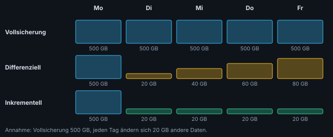

# 🛡️ IT-Sicherheit

*Bereich: Sicherheit · Prüfungsrelevanz: ★★★*

> Schutzziele, BSI-Grundschutz, Schutzbedarf, Bedrohungen, Maßnahmen, Härtung, 2FA, Firewall, VPN, Backup.

[⬅ Inhaltsverzeichnis](README.md)

---

Ein Arbeitsplatz ist erst fertig, wenn er sicher ist. „Umsetzung des arbeitsplatzbezogenen Sicherheitskonzepts“ gehört zu den Themen, die in fast jeder AP1 vorkommen. Du sollst Schutzziele zuordnen, den Schutzbedarf begründen, Bedrohungen erkennen, passende Maßnahmen auswählen, Passwortregeln bewerten und ein Backupkonzept erklären.

> [!WARNING]
> **Prüfungskatalog 2025:** Gestrichen sind Details zu ISO 2700x, die Risikomatrix, Anti-Spam als eigener Punkt und der Vergleich „SSH vs. Telnet“. **Neu bzw. betont:** Schutzziele, Hashverfahren, Zwei-Faktor-Authentifizierung, Härtung, Personal Firewall anpassen, Passwortrichtlinien bewerten, Schutzbedarf ableiten und begründen, ISMS, NAS für Verfügbarkeit und Auszüge aus dem IT-Grundschutz-Kompendium.

## Schutzziele

Informationssicherheit bedeutet, drei Grundwerte zu schützen. Jede Bedrohung und jede Maßnahme lässt sich mindestens einem davon zuordnen:

<table><tr><th>Schutzziel</th><th>Bedeutung</th><th>verletzt, wenn …</th><th>Maßnahmen</th></tr>
<tr><td><b>Vertraulichkeit</b></td><td>Nur Befugte können Daten lesen.</td><td>Gehaltsliste liegt offen auf dem Drucker; gestohlenes Notebook ohne Verschlüsselung</td><td>Verschlüsselung, Zugriffsrechte, Authentifizierung</td></tr>
<tr><td><b>Integrität</b></td><td>Daten sind korrekt und vollständig; Änderungen sind erkennbar.</td><td>Angreifer ändert die Kontonummer in einer Rechnung; Übertragungsfehler</td><td>Hashwerte, digitale Signaturen, Rechte, Protokollierung</td></tr>
<tr><td><b>Verfügbarkeit</b></td><td>Systeme und Daten sind nutzbar, wenn sie gebraucht werden.</td><td>Server fällt aus; Ransomware verschlüsselt alle Dateien; Stromausfall</td><td>Backup, USV, Redundanz, Wartung, Schutz vor Überlastangriffen</td></tr></table>

Erweitert werden oft genannt: **Authentizität** (Echtheit – die Mail kommt wirklich vom Absender), **Verbindlichkeit** bzw. Nichtabstreitbarkeit (jemand kann eine Handlung nicht leugnen) und **Zurechenbarkeit** (eine Handlung lässt sich einer Person zuordnen).

> [!NOTE]
> **Beispiel**
>
> **Schutzziel zuordnen**  
> „Ein Mitarbeiter verschickt versehentlich die Kundendatei an eine falsche Adresse.“ → **Vertraulichkeit**.  
> „Nach einem Stromausfall ist die Datenbank des Webshops beschädigt, Bestellungen fehlen.“ → **Integrität** (Daten falsch/unvollständig) und **Verfügbarkeit** (Shop nicht nutzbar).  
> „Ein Angreifer legt den Webserver mit massenhaft Anfragen lahm.“ → **Verfügbarkeit**.

## Schutzbedarf feststellen (BSI IT-Grundschutz)

Nicht alles muss gleich stark geschützt werden – ein Infobildschirm in der Kantine braucht weniger Schutz als der Server mit den Patientendaten. Das **BSI** (Bundesamt für Sicherheit in der Informationstechnik) beschreibt mit dem **IT-Grundschutz** ein bewährtes Vorgehen. Es besteht aus den BSI-Standards 200-1 bis 200-4 und dem **IT-Grundschutz-Kompendium** mit Bausteinen für typische Systeme (z. B. „Clients unter Windows“, „WLAN-Nutzung“, „Datensicherungskonzept“), die konkrete Anforderungen enthalten.

**Vorgehen:** Strukturanalyse (Was haben wir? Anwendungen, Systeme, Räume, Verbindungen) → **Schutzbedarfsfeststellung** → Modellierung (passende Bausteine zuordnen) → IT-Grundschutz-Check (Soll-Ist-Vergleich) → bei hohem Schutzbedarf zusätzliche Risikoanalyse → Umsetzung.

<table><tr><th>Schutzbedarf</th><th>Schadensauswirkung</th></tr>
<tr><td>normal</td><td>begrenzt und überschaubar</td></tr>
<tr><td>hoch</td><td>beträchtlich</td></tr>
<tr><td>sehr hoch</td><td>existenziell bedrohlich, katastrophal</td></tr></table>

Der Schutzbedarf wird **je Schutzziel** getrennt bestimmt und anhand möglicher Schäden begründet: Verstoß gegen Gesetze, Beeinträchtigung von Personen, Gefahr für Leib und Leben, Beeinträchtigung der Aufgabenerfüllung, Ansehensverlust, finanzielle Folgen.

> [!IMPORTANT]
> **Maximumprinzip:** Ein System erbt den höchsten Schutzbedarf der Anwendungen, die darauf laufen.  
> **Kumulationseffekt:** Viele kleine Schäden zusammen können einen höheren Schutzbedarf ergeben.  
> **Verteilungseffekt:** Ist eine Anwendung auf mehrere Systeme verteilt (Redundanz), kann der Bedarf für das einzelne System sinken.

> [!NOTE]
> **Beispiel**
>
> **Schutzbedarf eines Servers in einer Arztpraxis**  
> Auf dem Server laufen die Praxissoftware mit Patientenakten und das Intranet mit dem Speiseplan.  
> Praxissoftware – **Vertraulichkeit: sehr hoch**, weil Gesundheitsdaten besonders geschützt sind (Art. 9 DSGVO, ärztliche Schweigepflicht). **Integrität: sehr hoch**, weil falsche Medikationsdaten Patienten gefährden können. **Verfügbarkeit: hoch**, weil ohne Akten kaum Behandlungen möglich sind, Notfälle aber auf Papier überbrückt werden können.  
> Intranet – überall **normal**.  
> Nach dem Maximumprinzip hat der **Server** den Schutzbedarf: Vertraulichkeit sehr hoch, Integrität sehr hoch, Verfügbarkeit hoch.

## Bedrohungen

<table><tr><th>Schadsoftware</th><th>Merkmal</th></tr>
<tr><td>Virus</td><td>hängt sich an Dateien oder Programme und verbreitet sich, wenn diese ausgeführt werden</td></tr>
<tr><td>Wurm</td><td>verbreitet sich selbstständig über das Netzwerk, ohne Zutun des Nutzers</td></tr>
<tr><td>Trojaner</td><td>tarnt sich als nützliches Programm und führt im Hintergrund Schadfunktionen aus</td></tr>
<tr><td>Ransomware</td><td>verschlüsselt Daten und erpresst Lösegeld, droht oft zusätzlich mit Veröffentlichung</td></tr>
<tr><td>Spyware, Keylogger</td><td>spioniert Eingaben und Daten aus</td></tr>
<tr><td>Rootkit</td><td>versteckt sich tief im System und verbirgt andere Schadsoftware</td></tr>
<tr><td>Bot</td><td>macht den Rechner fernsteuerbar, Teil eines Botnetzes (z. B. für Überlastangriffe)</td></tr></table>

**Social Engineering** greift nicht die Technik an, sondern den Menschen: **Phishing** (gefälschte Mails und Webseiten), **Spear-Phishing** (gezielt auf eine Person zugeschnitten), Vishing (Telefon), Smishing (SMS), Quishing (QR-Code), **CEO-Fraud** (angebliche Anweisung der Geschäftsleitung zu einer dringenden Überweisung) und Tailgating (unbefugt hinter jemandem durch eine Tür gehen). **Warum so erfolgreich?** Angreifer nutzen Zeitdruck, Autorität, Hilfsbereitschaft und Neugier aus – technische Schutzmaßnahmen helfen nicht, wenn jemand sein Passwort freiwillig eingibt.

**Weitere Angriffe:** Brute Force (alle Passwörter durchprobieren), Wörterbuchangriff, Credential Stuffing (gestohlene Zugangsdaten bei anderen Diensten ausprobieren), Man-in-the-Middle (Kommunikation abfangen), DoS/DDoS (Überlastung), Ausnutzen unbekannter Sicherheitslücken (Zero-Day). Dazu kommen **höhere Gewalt und Technik**: Brand, Wasser, Stromausfall, Hardwaredefekt und menschliche Fehler.

## Maßnahmen: technisch, organisatorisch, personell, infrastrukturell

<table><tr><th>Art</th><th>Beispiele</th></tr>
<tr><td>technisch</td><td>Firewall, Virenschutz, Updates, Verschlüsselung, MFA, Backup, Spamfilter, VPN</td></tr>
<tr><td>organisatorisch</td><td>Sicherheitsrichtlinie, Passwortrichtlinie, Berechtigungskonzept, Notfallplan, Vier-Augen-Prinzip bei Überweisungen, Clean-Desk-Regel</td></tr>
<tr><td>personell</td><td>Schulungen zur Sensibilisierung, Verpflichtung auf Vertraulichkeit, geregelter Ein- und Austritt (Konten sperren!)</td></tr>
<tr><td>infrastrukturell</td><td>Zutrittskontrolle, abgeschlossener Serverraum, Brandmelder, Klimatisierung, USV</td></tr></table>

**Security by Design:** Sicherheit wird von Anfang an mitgeplant, nicht nachträglich angebaut. **Security by Default:** Geräte und Programme sind ab Werk sicher eingestellt – kein Standardpasswort, unnötige Dienste aus.

## Arbeitsplatz härten

**Härten** heißt: die Angriffsfläche verkleinern. Alles, was nicht gebraucht wird, ist ein möglicher Einstieg für Angreifer.

- aktuelles, vom Hersteller unterstütztes Betriebssystem; automatische Updates; Firmware aktuell, Secure Boot an, UEFI-Passwort
- Benutzer ohne lokale Administratorrechte; Standardkonten deaktivieren
- nicht benötigte Programme, Dienste und Ports entfernen bzw. abschalten; USB-Speicher per Gruppenrichtlinie sperren
- Festplatte mit BitLocker verschlüsseln (Schlüssel im TPM), Virenschutz und Host-Firewall aktiv
- Bildschirmsperre nach kurzer Inaktivität, Anmeldung mit Windows Hello oder MFA
- Makros in Dokumenten aus dem Internet blockieren, nur freigegebene Programme zulassen
- Protokollierung aktivieren und die Konfiguration als Sicherheitsbasis dokumentieren (z. B. nach den Empfehlungen des Herstellers oder des CIS)

## Anmeldung: Faktoren, MFA und Passwörter

<table><tr><th>Schritt</th><th>Frage</th><th>Beispiel</th></tr>
<tr><td>Identifikation</td><td>Wer behauptest du zu sein?</td><td>Benutzername</td></tr>
<tr><td>Authentifizierung</td><td>Bist du es wirklich?</td><td>Passwort, Smartcard, Fingerabdruck prüfen</td></tr>
<tr><td>Autorisierung</td><td>Was darfst du?</td><td>Rechte auf Ordner und Programme</td></tr></table>

Für die Authentifizierung gibt es drei **Faktoren**: **Wissen** (Passwort, PIN), **Besitz** (Smartphone mit Authenticator-App, Hardware-Token, Smartcard) und **Inhärenz** (biometrische Merkmale wie Fingerabdruck oder Gesicht). **Zwei-Faktor-Authentifizierung** (2FA, allgemein MFA) kombiniert mindestens **zwei verschiedene** Faktoren.

**Warum ist 2FA so wirksam?** Ein gestohlenes oder erratenes Passwort allein reicht dem Angreifer nicht mehr – er bräuchte zusätzlich das Smartphone oder den Finger. Achtung: **Passwort + PIN ist keine 2FA**, weil beides Wissen ist.

Einmalcodes aus Authenticator-Apps (TOTP) wechseln alle 30 Sekunden. Besonders sicher gegen Phishing sind **Passkeys bzw. FIDO2-Schlüssel**: Sie funktionieren nur auf der echten Webseite, eine gefälschte Seite bekommt nichts Verwertbares.

#### Passwortrichtlinie bewerten

Heute empfehlen BSI und NIST: **Länge vor Komplexität**. Lange Passphrasen (ab ca. 12–14 Zeichen, z. B. aus mehreren Wörtern), kein Zwangswechsel in festen Abständen, sondern nur bei Verdacht auf Kompromittierung, keine Wiederverwendung, Passwortmanager nutzen, Konto nach mehreren Fehlversuchen sperren oder verzögern, neue Passwörter gegen Listen bekannter geleakter Passwörter prüfen.

> [!NOTE]
> **Beispiel**
>
> **Warum Länge mehr bringt als Sonderzeichen**  
> Ein Angreifer probiert 10 Milliarden (1010) Passwörter pro Sekunde.  
> 8 Zeichen aus Groß-, Kleinbuchstaben und Ziffern (62 Zeichen): 628 ≈ 2,2 × 1014 Möglichkeiten → ca. 22.000 Sekunden ≈ **6 Stunden**.  
> 14 Zeichen nur aus Kleinbuchstaben (26 Zeichen): 2614 ≈ 6,5 × 1019 Möglichkeiten → ca. 6,5 × 109 Sekunden ≈ **200 Jahre**.  
> Jedes zusätzliche Zeichen vervielfacht die Zahl der Möglichkeiten. Und eine lange Passphrase kann man sich leichter merken als „X7#k!pQ2“.

> [!CAUTION]
> **Typische Fehler**
>
> Eine Richtlinie „mindestens 8 Zeichen, Sonderzeichen, Wechsel alle 30 Tage“ klingt streng, führt aber zu schwachen Mustern („Sommer2026!“ → „Herbst2026!“) und zu Passwörtern auf Zetteln. Bei der Bewertung genau das ansprechen.

## Firewall, VPN und sichere Protokolle

<table><tr><th>Firewall-Art</th><th>prüft</th></tr>
<tr><td>Paketfilter</td><td>IP-Adressen, Ports, Protokoll (Schicht 3/4)</td></tr>
<tr><td>Stateful Inspection</td><td>zusätzlich den Verbindungszustand – nur Antworten auf eigene Anfragen kommen herein</td></tr>
<tr><td>Application-Level-Gateway (Proxy)</td><td>den Inhalt auf Anwendungsebene</td></tr>
<tr><td>Next-Generation-Firewall</td><td>zusätzlich Anwendungserkennung und Angriffserkennung (IPS)</td></tr>
<tr><td>Personal Firewall (Host-Firewall)</td><td>Verkehr direkt auf dem Endgerät</td></tr></table>

Grundregel: **Default Deny** – alles ist verboten, was nicht ausdrücklich erlaubt ist. Öffentlich erreichbare Server (Webserver, Mail-Gateway) stehen in einer **DMZ**, einem eigenen Netzsegment zwischen Internet und internem Netz. Wird dort ein Server übernommen, ist das interne Netz noch durch eine weitere Firewall geschützt.

> [!NOTE]
> **Beispiel**
>
> **Firewallregeln lesen**  
>
> | Nr. | Quelle | Ziel | Port | Aktion |
> | --- | --- | --- | --- | --- |
> | 1 | internes Netz | beliebig | TCP 443 | erlauben |
> | 2 | VPN-Clients | Fileserver | TCP 445 | erlauben |
> | 3 | beliebig | beliebig | beliebig | verweigern |
>
> Regeln werden von oben nach unten geprüft, die erste passende gilt. Mitarbeitende im Büro dürfen Webseiten per HTTPS aufrufen, VPN-Nutzer auf Dateifreigaben zugreifen – alles andere blockiert Regel 3. Ein Versuch, per RDP (3389) von außen zuzugreifen, wird also abgewiesen.

**Personal Firewall anpassen:** Windows unterscheidet Netzwerkprofile – **Domäne** (Firmennetz), **Privat** und **Öffentlich** (Hotel, Bahn; am strengsten). Regeln lassen sich nach Programm, Port und Quell-IP-Bereich festlegen, z. B. „Remotedesktop (TCP 3389) nur aus dem Firmennetz erlauben“. Standard: eingehend blockieren, ausgehend erlauben. In Firmen werden die Regeln zentral per Gruppenrichtlinie oder Intune verteilt; Nutzer dürfen sie nicht selbst ändern.

**VPN:** ein verschlüsselter Tunnel durch ein unsicheres Netz wie das Internet – Site-to-Site zwischen Standorten, Client-to-Site für Mitarbeitende im Homeoffice (Protokolle z. B. IPsec, WireGuard, OpenVPN).

<table><tr><th>unsicher (Klartext)</th><th>sicher</th></tr>
<tr><td>Telnet (23)</td><td>SSH (22)</td></tr>
<tr><td>FTP (20/21)</td><td>SFTP (über SSH) oder FTPS (FTP mit TLS)</td></tr>
<tr><td>HTTP (80)</td><td>HTTPS (443)</td></tr>
<tr><td>POP3, IMAP, SMTP ohne Verschlüsselung</td><td>POP3S (995), IMAPS (993), SMTP mit TLS (587/465)</td></tr>
<tr><td>LDAP (389)</td><td>LDAPS (636)</td></tr>
<tr><td>SNMP v1/v2c</td><td>SNMPv3</td></tr></table>

## Datensicherung

Ein Backup ist die letzte Verteidigungslinie: gegen Hardwaredefekte, versehentliches Löschen, Ransomware, Brand und Diebstahl. **Ohne funktionierendes Backup kann ein einziger Vorfall ein Unternehmen ruinieren.**

<table><tr><th>Art</th><th>sichert</th><th>Wiederherstellung</th><th>Bewertung</th></tr>
<tr><td><b>Vollsicherung</b></td><td>alle Daten</td><td>nur die letzte Vollsicherung</td><td>einfachste Wiederherstellung, aber viel Speicher und Zeit</td></tr>
<tr><td><b>differenziell</b></td><td>alle Änderungen seit der letzten <b>Vollsicherung</b></td><td>Vollsicherung + <b>letzte</b> differenzielle</td><td>Mittelweg; die Sicherungen wachsen von Tag zu Tag</td></tr>
<tr><td><b>inkrementell</b></td><td>alle Änderungen seit der letzten Sicherung <b>jeglicher Art</b></td><td>Vollsicherung + <b>alle</b> Inkremente in der richtigen Reihenfolge</td><td>schnellste Sicherung, wenig Speicher; aufwendigste Wiederherstellung – fehlt ein Inkrement, fehlen Daten</td></tr></table>

> [!NOTE]
> **Beispiel**
>
> **Wiederherstellung am Freitagabend** (Daten aus dem Bild oben)  
> Differenziell: Vollsicherung Mo (500 GB) + Differenz Fr (80 GB) = 2 Sicherungen.  
> Inkrementell: Vollsicherung Mo + Di + Mi + Do + Fr = 5 Sicherungen.  
> Speicherbedarf der Woche: Voll täglich 2.500 GB · differenziell 500 + 20 + 40 + 60 + 80 = 700 GB · inkrementell 500 + 4 × 20 = 580 GB.

> [!IMPORTANT]
> **3-2-1-Regel:** mindestens **3** Kopien der Daten, auf **2** verschiedenen Medien, davon **1** außer Haus. Erweitert **3-2-1-1-0**: zusätzlich **1** Kopie offline bzw. unveränderbar (Schutz vor Ransomware, die erreichbare Backups mitverschlüsselt) und **0** Fehler bei regelmäßigen Wiederherstellungstests.

- **Generationenprinzip** (Großvater-Vater-Sohn): tägliche, wöchentliche und monatliche Sicherungen werden aufbewahrt. So kann man auch zu einem Stand von vor Wochen zurück – wichtig, wenn ein Fehler oder Schadsoftware erst spät bemerkt wird.
- **RPO** (Recovery Point Objective): Wie viel Datenverlust ist höchstens tragbar? Bei RPO 24 h reicht eine tägliche Sicherung. **RTO** (Recovery Time Objective): Wie lange darf die Wiederherstellung höchstens dauern?
- **Wiederherstellung regelmäßig testen** – ein Backup, das sich nicht zurückspielen lässt, ist wertlos.
- **Redundanz ist kein Backup:** Gespiegelte Festplatten schützen vor einem Plattendefekt, aber gelöschte oder verschlüsselte Dateien werden sofort mitgespiegelt.
- **NAS** (Netzwerkspeicher): mit gespiegelten Platten für Verfügbarkeit und mit Snapshots gegen versehentliches Löschen gut geeignet – ersetzt aber keine Kopie außer Haus bzw. offline.

<table><tr><th></th><th>Backup</th><th>Archivierung</th></tr>
<tr><td>Zweck</td><td>Wiederherstellung nach Verlust</td><td>langfristige, unveränderbare Aufbewahrung</td></tr>
<tr><td>Daten</td><td>Kopie der aktuellen Arbeitsdaten</td><td>abgeschlossene Vorgänge</td></tr>
<tr><td>Dauer</td><td>Tage bis Monate, wird überschrieben</td><td>Jahre, nach gesetzlichen Aufbewahrungsfristen</td></tr></table>

## ISMS und rechtlicher Rahmen

Ein **ISMS** (Informationssicherheits-Managementsystem) sorgt dafür, dass Sicherheit nicht einmalig eingerichtet, sondern dauerhaft geplant, umgesetzt, überprüft und verbessert wird (PDCA-Zyklus: Plan – Do – Check – Act). Als Fachkraft unterstützt du es, indem du Richtlinien einhältst, Sicherheitsvorfälle meldest und deine Maßnahmen dokumentierst.

Das **BSI-Gesetz** und die EU-Richtlinie **NIS-2** verpflichten Betreiber kritischer Infrastrukturen und viele mittlere und große Unternehmen zu Risikomanagement, Mindestmaßnahmen und zur Meldung erheblicher Sicherheitsvorfälle.

> [!CAUTION]
> **Typische Fehler**
>
> - Schutzziele nur nennen, ohne sie dem Fall zuzuordnen und zu begründen.
> - Den Schutzbedarf ohne Begründung über mögliche Schäden angeben.
> - Das Maximumprinzip vergessen, wenn mehrere Anwendungen auf einem Server laufen.
> - Passwort + PIN als Zwei-Faktor-Authentifizierung bezeichnen.
> - Regelmäßigen Passwortwechsel als moderne Empfehlung nennen.
> - Differenzielle und inkrementelle Sicherung vertauschen.
> - RAID, Spiegelung oder Snapshots als Backup bezeichnen.
> - Die Wiederherstellungstests vergessen.

**📝 Prüfungsaufgabe:** **Ordnen Sie den Maßnahmen je ein Schutzziel zu: a) Festplattenverschlüsselung b) USV c) Hashwert einer heruntergeladenen Datei prüfen (3 Punkte)**

Lösung anzeigen

a) Vertraulichkeit (1) b) Verfügbarkeit (1) c) Integrität (1)

**📝 Prüfungsaufgabe:** **Die Passwortrichtlinie eines Unternehmens lautet: „Mindestens 8 Zeichen mit Sonderzeichen, Wechsel alle 30 Tage.“ Beurteilen Sie die Richtlinie und schlagen Sie zwei Verbesserungen vor. (4 Punkte)**

Lösung anzeigen

8 Zeichen sind zu kurz, um Angriffen durch Ausprobieren standzuhalten; der häufige Zwangswechsel führt zu vorhersehbaren Mustern und notierten Passwörtern (2). Verbesserungen (je 1): Mindestlänge von 12–14 Zeichen bzw. Passphrasen; Wechsel nur bei Verdacht auf Kompromittierung; Zwei-Faktor-Authentifizierung; Passwortmanager; Abgleich mit Listen geleakter Passwörter.

**📝 Prüfungsaufgabe:** **Ein Unternehmen sichert sonntags voll und montags bis samstags inkrementell. Am Donnerstagmorgen fällt der Server aus. Welche Sicherungen werden für die Wiederherstellung benötigt? (2 Punkte)**

Lösung anzeigen

Die Vollsicherung von Sonntag (1) und die inkrementellen Sicherungen von Montag, Dienstag und Mittwoch in dieser Reihenfolge (1).

**📝 Prüfungsaufgabe:** **Erläutern Sie, warum ein NAS mit gespiegelten Festplatten im selben Büro kein ausreichendes Backup-Konzept ist, und nennen Sie eine Ergänzung. (3 Punkte)**

Lösung anzeigen

Die Spiegelung schützt nur gegen den Ausfall einer Festplatte; gelöschte oder von Ransomware verschlüsselte Dateien werden sofort auf beide Platten übernommen (1). Bei Brand, Wasserschaden oder Diebstahl im Büro sind Original und Kopie gleichzeitig verloren (1). Ergänzung: zusätzliche Sicherung außer Haus bzw. in der Cloud und eine offline oder unveränderbar gespeicherte Kopie nach der 3-2-1-Regel (1).

**📝 Prüfungsaufgabe:** **Ein Mitarbeiter erhält eine Mail der „Geschäftsführerin“, er solle sofort 18.000 € an einen neuen Lieferanten überweisen und niemandem davon erzählen. Benennen Sie den Angriff und zwei Gegenmaßnahmen. (3 Punkte)**

Lösung anzeigen

CEO-Fraud, eine Form des Social Engineering bzw. Spear-Phishing (1). Gegenmaßnahmen (je 1): Rückruf bei der Geschäftsführerin über eine bekannte Telefonnummer; Vier-Augen-Prinzip für Überweisungen; Schulung der Mitarbeitenden; Kennzeichnung externer Mails.

---

## 🃏 Karteikarten (38)

| Frage | Antwort |
|---|---|
| Drei Schutzziele | Vertraulichkeit, Integrität, Verfügbarkeit. |
| Integrität – Maßnahmen | Hashwerte, digitale Signaturen, Zugriffsrechte, Protokollierung. |
| Verfügbarkeit – Maßnahmen | Backup, USV, Redundanz, Wartung, DDoS-Schutz. |
| BSI-Schutzbedarfskategorien | normal (begrenzt), hoch (beträchtlich), sehr hoch (existenzbedrohend). |
| Maximumprinzip | Ein IT-System übernimmt den höchsten Schutzbedarf der darauf laufenden Anwendungen. |
| BSI-Standard 200-2 | IT-Grundschutz-Methodik: Strukturanalyse, Schutzbedarf, Modellierung, Grundschutz-Check. |
| Virus vs. Wurm | Virus braucht Wirtsdatei und Nutzeraktion; Wurm verbreitet sich selbstständig übers Netz. |
| Trojaner | Schadprogramm, das sich als nützliche Software tarnt. |
| Ransomware | Verschlüsselt Daten und fordert Lösegeld. |
| Phishing | Gefälschte Mails/Webseiten, um Zugangsdaten oder Zahlungen zu erschleichen. |
| Social Engineering | Manipulation von Menschen, um an Informationen/Zugang zu gelangen. |
| Technische vs. organisatorische Maßnahme | Technisch: Firewall, Verschlüsselung. Organisatorisch: Richtlinien, Berechtigungskonzept, Notfallplan. |
| Security by Default | Produkte werden mit sicheren Voreinstellungen ausgeliefert. |
| Härtung – vier Maßnahmen | Updates, keine Adminrechte, unnötige Dienste aus, BitLocker, Firewall, USB sperren, Bildschirmsperre. |
| Drei Authentifizierungsfaktoren | Wissen, Besitz, Inhärenz (biometrisch). |
| Ist Passwort + PIN eine 2FA? | Nein – beides ist Wissen. 2FA braucht zwei verschiedene Faktorkategorien. |
| Default Deny | Firewall-Grundregel: Alles ist verboten, was nicht ausdrücklich erlaubt ist. |
| DMZ | Demilitarisierte Zone: eigenes Netzsegment für öffentlich erreichbare Server. |
| VPN | Verschlüsselter Tunnel über ein unsicheres Netz (z. B. Homeoffice ↔ Firma). |
| Differenzielle Sicherung | Alle Änderungen seit der letzten Vollsicherung. |
| Inkrementelle Sicherung | Änderungen seit der letzten Sicherung (egal welcher Art). |
| Restore bei inkrementeller Sicherung | Letzte Vollsicherung + alle folgenden Inkremente in Reihenfolge. |
| 3-2-1-Regel | 3 Kopien, 2 verschiedene Medien, 1 Kopie außer Haus. |
| RPO / RTO | RPO: maximal tolerierter Datenverlust (Zeit). RTO: maximal tolerierte Wiederherstellungsdauer. |
| Warum ersetzt Spiegelung kein Backup? | Löschung, Verschlüsselung (Ransomware) oder Fehler werden sofort mitgespiegelt. |
| SFTP vs. FTPS | SFTP: Dateiübertragung über SSH (Port 22). FTPS: klassisches FTP mit TLS-Verschlüsselung. |
| Sichere Alternative zu SNMPv1/v2c | SNMPv3 mit Authentifizierung und Verschlüsselung. |
| Firewall-Profile Windows | Domäne, Privat, Öffentlich (am restriktivsten). |
| Personal Firewall – Standardregel | Eingehend blockieren, ausgehend erlauben; Ausnahmen gezielt nach Programm/Port/IP. |
| ISMS | Managementsystem, um Informationssicherheit dauerhaft zu planen, umzusetzen, zu prüfen und zu verbessern. |
| NAS – Einsatz | Netzwerkspeicher für Freigaben/Backups, mit Spiegelung und Snapshots – ersetzt kein Offline-Backup. |
| NIS-2 | EU-Richtlinie: Pflichten zu Risikomanagement und Meldung von Sicherheitsvorfällen für viele Unternehmen. |
| Authentifizierung vs. Autorisierung | Authentifizierung: Identität wird geprüft (Wer bist du?). Autorisierung: Rechte werden zugewiesen (Was darfst du?). |
| Reihenfolge beim Zugriff | Identifikation → Authentifizierung → Autorisierung. |
| Biometrie – Vor- und Nachteil | + bequem, nicht vergessbar oder weitergebbar. − nicht änderbar, wenn kompromittiert; besonders schützenswerte Daten. |
| Generationenprinzip | Großvater-Vater-Sohn: tägliche, wöchentliche und monatliche Sicherungen werden parallel aufbewahrt. |
| Wozu mehrere Backup-Generationen? | Um auf ältere Stände zurückgehen zu können, wenn ein Fehler oder Schadsoftware erst spät bemerkt wird. |
| Backup vs. Archivierung | Backup: Kopie zur Wiederherstellung, wird überschrieben. Archivierung: langfristige, unveränderbare Aufbewahrung abgeschlossener Daten. |

## ✍️ Übungsfragen (27)

**1.** Ein Angreifer verändert unbemerkt Überweisungsdaten. Welches Schutzziel ist verletzt?

Lösung

**Musterlösung (2 P):** Integrität Unerlaubte Veränderung = Integrität.

**2.** Ein Server fällt durch einen Stromausfall aus. Welches Schutzziel ist betroffen?

Lösung

**Musterlösung (2 P):** Verfügbarkeit

**3.** Welche Schutzbedarfskategorie nach BSI gilt bei „existenzbedrohenden“ Schäden?

Lösung

**Musterlösung (2 P):** sehr hoch

**4.** Auf einem Server laufen drei Anwendungen mit Schutzbedarf normal, hoch, normal. Welcher Schutzbedarf gilt für den Server (ohne Sondereffekte)?

Lösung

**Musterlösung (2 P):** hoch Maximumprinzip.

**5.** Welche Schadsoftware verbreitet sich selbstständig über das Netzwerk?

Lösung

**Musterlösung (2 P):** Wurm

**6.** Ein Dienst verlangt ein Passwort und zusätzlich eine PIN. Beurteilen Sie, ob das eine echte Zwei-Faktor-Authentifizierung ist, und nennen Sie eine echte Kombination.

Lösung

**Musterlösung (3 P):** Nein – Passwort und PIN gehören beide zum Faktor Wissen (1). Eine echte 2FA kombiniert zwei verschiedene Faktorkategorien: Wissen, Besitz, Inhärenz/Biometrie (1). Beispiel: Passwort + TOTP-Code aus einer Authenticator-App, Passwort + FIDO2-Stick oder Smartcard + PIN (1). Wissen + Besitz.

**7.** Montag Vollsicherung, Di–Fr inkrementell. Am Freitag nach der Sicherung fällt die Platte aus. Welche Sicherungen braucht man?

Lösung

**Musterlösung (2 P):** Montag + Di + Mi + Do + Fr Vollsicherung + alle Inkremente.

**8.** Montag Vollsicherung, Di–Fr differenziell. Wiederherstellung am Freitagabend?

Lösung

**Musterlösung (2 P):** Montag + Freitag Vollsicherung + letzte differenzielle.

**9.** Was besagt die 3-2-1-Regel?

Lösung

**Musterlösung (2 P):** 3 Kopien, 2 Medien, 1 außer Haus

**10.** Nennen Sie je zwei technische und zwei organisatorische Maßnahmen der IT-Sicherheit.

Lösung

**Musterlösung (4 P):** Technisch (je 1): Firewall; Festplattenverschlüsselung (BitLocker); Virenschutz; automatische Updates; Backup; MFA. Organisatorisch (je 1): Passwortrichtlinie; Berechtigungskonzept; Schulungen/Awareness; Notfallplan; Vier-Augen-Prinzip; Besucherregelung.

**11.** Welche Maßnahmen gehören zur Härtung eines Windows-Clients? Nennen Sie drei.

Lösung

**Musterlösung (3 P):** Je 1 Punkt (max. 3): Lokale Adminrechte entziehen; Unnötige Dienste deaktivieren; BitLocker aktivieren. Updates gehören zur Härtung dazu.

**12.** Eine Firewall erlaubt nur ausdrücklich freigegebene Verbindungen. Wie heißt das Prinzip?

Lösung

**Musterlösung (2 P):** Default Deny

**13.** Wo werden öffentlich erreichbare Webserver idealerweise platziert?

Lösung

**Musterlösung (2 P):** In der DMZ

**14.** Eine E-Mail fordert scheinbar vom Chef eine dringende Überweisung. Wie heißt der Angriff?

Lösung

**Musterlösung (2 P):** CEO-Fraud Form von Social Engineering/Spear-Phishing.

**15.** Welche Aussage zu Passwortrichtlinien entspricht der aktuellen BSI-Empfehlung?

Lösung

**Musterlösung (2 P):** Lange Passphrasen statt kurzer komplexer Passwörter; Wechsel bei Verdacht

**16.** Nennen Sie je eine technische, organisatorische und personelle Maßnahme gegen Phishing. (3 Punkte)

Lösung

**Musterlösung (3 P):** Technisch (1): Spamfilter/Mail-Gateway, MFA/FIDO2, Linkprüfung, Makros blockieren. Organisatorisch (1): Meldeprozess für verdächtige Mails, Richtlinie (z. B. Rückruf bei Zahlungsanweisungen, Vier-Augen-Prinzip). Personell (1): Awareness-Schulungen, Phishing-Simulationen.

**17.** Erläutern Sie den Unterschied zwischen inkrementeller und differenzieller Datensicherung, auch im Hinblick auf die Wiederherstellung. (4 Punkte)

Lösung

**Musterlösung (4 P):** Inkrementell: sichert nur Änderungen seit der letzten Sicherung jeglicher Art → schnell und platzsparend (1); Wiederherstellung braucht die Vollsicherung und alle Inkremente in Reihenfolge → aufwendig/fehleranfällig (1). Differenziell: sichert alle Änderungen seit der letzten Vollsicherung → wächst täglich (1); Wiederherstellung nur mit Vollsicherung + letzter differenzieller → schneller (1).

**18.** Beschreiben Sie vier Maßnahmen zur Härtung eines neuen Notebooks für den Außendienst. (4 Punkte)

Lösung

**Musterlösung (4 P):** Je 1: BitLocker-Festplattenverschlüsselung mit TPM (Diebstahlschutz); keine lokalen Adminrechte; aktuelle Updates und Virenschutz; Host-Firewall aktiv; VPN-Pflicht für Firmenzugriff; MFA/Windows Hello; USB-Massenspeicher sperren; Bildschirmsperre und UEFI-Passwort; unnötige Dienste/Software entfernen.

**19.** Erläutern Sie die drei Schutzziele der Informationssicherheit mit je einer Maßnahme. (6 Punkte)

Lösung

**Musterlösung (6 P):** Vertraulichkeit: Nur Berechtigte dürfen Informationen einsehen (1) – z. B. Verschlüsselung, Zugriffsrechte (1). Integrität: Daten müssen vollständig und unverfälscht sein bzw. Änderungen erkennbar (1) – z. B. Hashwerte, digitale Signatur (1). Verfügbarkeit: Systeme und Daten müssen bei Bedarf nutzbar sein (1) – z. B. Backup, USV, Redundanz (1).

**20.** Ein Dienstleister soll Dateien sicher auf einen Linux-Server übertragen. Welches Protokoll?

Lösung

**Musterlösung (2 P):** SFTP SFTP nutzt SSH-Verschlüsselung.

**21.** Ein Notebook verbindet sich mit dem WLAN eines Hotels. Welches Firewall-Profil sollte aktiv sein?

Lösung

**Musterlösung (2 P):** Öffentlich Das restriktivste Profil für fremde Netze.

**22.** Remotedesktop soll nur aus dem Firmennetz 10.0.0.0/16 möglich sein. Wie wird die Personal Firewall angepasst?

Lösung

**Musterlösung (2 P):** Eingehende Regel für TCP 3389 nur mit Remote-IP-Bereich 10.0.0.0/16

**23.** Was ist ein ISMS?

Lösung

**Musterlösung (2 P):** Ein Managementsystem, das Informationssicherheit dauerhaft steuert und verbessert

**24.** Eine Mitarbeiterin meldet sich mit Benutzername und Passwort an und darf danach den Ordner „Personal“ nur lesen. Ordnen Sie die Begriffe Authentifizierung und Autorisierung zu und erläutern Sie den Unterschied.

Lösung

**Musterlösung (3 P):** Authentifizierung: die Prüfung von Benutzername und Passwort – die Identität wird nachgewiesen (1). Autorisierung: die Zuweisung des Leserechts auf den Ordner – es wird festgelegt, was die Person darf (1). Die Authentifizierung kommt immer zuerst; ohne geprüfte Identität können keine Rechte vergeben werden (1).

**25.** Wie heißt der Vorgang, bei dem einem angemeldeten Benutzer Rechte auf Ressourcen zugewiesen werden?

Lösung

**Musterlösung (2 P):** Autorisierung

**26.** Ein Unternehmen sichert täglich und überschreibt dabei immer die Sicherung vom Vortag. Nach zehn Tagen wird bemerkt, dass eine Datei seit einer Woche beschädigt ist. Erläutern Sie das Problem und schlagen Sie eine Lösung vor.

Lösung

**Musterlösung (3 P):** Es gibt nur einen einzigen Sicherungsstand – und der enthält die beschädigte Datei bereits (1). Ein unversehrter älterer Stand existiert nicht mehr (1). Lösung: Generationenprinzip (Großvater-Vater-Sohn) mit täglichen, wöchentlichen und monatlichen Sicherungen, die getrennt aufbewahrt werden (1).

**27.** Erläutern Sie den Unterschied zwischen Backup und Archivierung.

Lösung

**Musterlösung (2 P):** Ein Backup ist eine Kopie der aktuellen Daten für die Wiederherstellung nach Verlust; es wird regelmäßig überschrieben (1). Die Archivierung bewahrt abgeschlossene Daten langfristig und unveränderbar auf, z. B. Rechnungen für die gesetzliche Aufbewahrungsfrist (1).

[⬅ Inhaltsverzeichnis](README.md)
