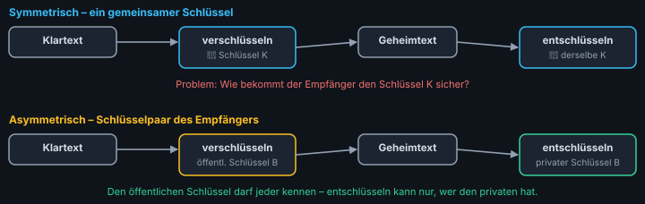
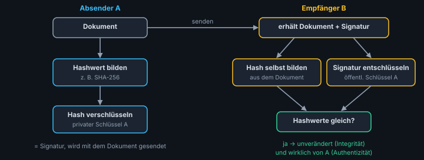

# 🔐 Kryptografie & Hashverfahren

*Bereich: Sicherheit · Prüfungsrelevanz: ★★★*

> Symmetrisch, asymmetrisch, hybrid, Hash, Salt, digitale Signatur, Zertifikate/PKI, TLS/HTTPS.

[⬅ Inhaltsverzeichnis](README.md)

---

Verschlüsselung schützt Daten auf gestohlenen Notebooks, im WLAN und auf dem Weg durchs Internet. Hashwerte zeigen, ob eine Datei verändert wurde, und schützen gespeicherte Passwörter. Signaturen und Zertifikate beweisen, wer etwas geschickt hat. In der AP1 sollst du die Verfahren unterscheiden, ihren Zweck erklären und sie richtig einsetzen – Mathematik brauchst du dafür nicht. Hashverfahren sind im Prüfungskatalog 2025 ausdrücklich betont.

## Grundbegriffe

Bei der **Verschlüsselung** wird ein lesbarer **Klartext** mit einem Verfahren (Algorithmus) und einem **Schlüssel** in einen unlesbaren **Geheimtext** umgewandelt. Mit dem passenden Schlüssel lässt er sich wieder **entschlüsseln**.

> [!NOTE]
> **Beispiel**
>
> **Das Prinzip an einem uralten Beispiel**  
> Bei der Caesar-Verschiebung wird jeder Buchstabe um eine feste Zahl im Alphabet verschoben. Der **Algorithmus** ist „verschieben“, der **Schlüssel** ist die Zahl, z. B. 3: aus HALLO wird KDOOR.  
> Das Verfahren ist heute natürlich unsicher – es gibt nur 25 mögliche Schlüssel. Es zeigt aber das Grundprinzip: Der Algorithmus darf bekannt sein, die Sicherheit liegt im **geheimen Schlüssel**. Moderne Verfahren wie AES haben so viele mögliche Schlüssel, dass Ausprobieren praktisch unmöglich ist.

## Symmetrisch, asymmetrisch, hybrid

<table><tr><th></th><th>symmetrisch</th><th>asymmetrisch</th></tr>
<tr><td>Schlüssel</td><td>ein gemeinsamer geheimer Schlüssel zum Ver- und Entschlüsseln</td><td>Schlüsselpaar je Teilnehmer: <b>öffentlicher</b> Schlüssel (darf jeder kennen) und <b>privater</b> Schlüssel (bleibt geheim)</td></tr>
<tr><td>Verfahren</td><td><b>AES</b> (128/192/256 Bit, Standard), ChaCha20; veraltet: DES, 3DES, RC4</td><td><b>RSA</b>, ECC (elliptische Kurven); Diffie-Hellman für den Schlüsselaustausch</td></tr>
<tr><td>Geschwindigkeit</td><td>sehr schnell – auch für große Datenmengen</td><td>deutlich langsamer</td></tr>
<tr><td>Problem</td><td><b>Schlüsselaustausch:</b> Wie kommt der Schlüssel sicher zum Partner? Viele Schlüssel bei vielen Partnern</td><td>Ist der öffentliche Schlüssel wirklich der des Partners? → Zertifikate</td></tr>
<tr><td>Anzahl Schlüssel bei n Teilnehmern</td><td>n × (n − 1) ÷ 2</td><td>2 × n</td></tr></table>

> [!NOTE]
> **Beispiel**
>
> **Schlüsselanzahl bei 10 Teilnehmern**, die jeweils paarweise geheim kommunizieren wollen:  
> symmetrisch: 10 × 9 ÷ 2 = **45 Schlüssel**, die alle sicher verteilt werden müssen  
> asymmetrisch: 2 × 10 = **20 Schlüssel**, davon 10 öffentlich  
> Bei 100 Teilnehmern: 4.950 gegenüber 200.

**Verschlüsseln vs. signieren** – hier wird oft verwechselt, welcher Schlüssel benutzt wird:

- **Verschlüsseln** (Vertraulichkeit): mit dem **öffentlichen Schlüssel des Empfängers**. Nur der Empfänger kann mit seinem privaten Schlüssel entschlüsseln.
- **Signieren** (Echtheit): mit dem **privaten Schlüssel des Absenders**. Jeder kann mit dessen öffentlichem Schlüssel prüfen, dass die Signatur echt ist.

**Hybride Verschlüsselung** kombiniert die Vorteile: Die eigentlichen Daten werden mit einem zufällig erzeugten **symmetrischen Sitzungsschlüssel** verschlüsselt (schnell). Nur dieser kurze Sitzungsschlüssel wird asymmetrisch an den Empfänger übertragen bzw. per Schlüsselaustausch vereinbart (löst das Austauschproblem). So arbeiten TLS/HTTPS, VPNs, S/MIME und PGP.

## Hashfunktionen

Eine Hashfunktion berechnet aus beliebig langen Daten einen **Hashwert fester Länge** – eine Art digitaler Fingerabdruck.

- **Einwegfunktion:** Aus dem Hashwert lassen sich die Daten nicht zurückrechnen.
- **Deterministisch:** Dieselben Daten ergeben immer denselben Hash.
- **Lawineneffekt:** Die kleinste Änderung ergibt einen völlig anderen Hash.
- **Kollisionsresistent:** Es ist praktisch unmöglich, zwei verschiedene Eingaben mit gleichem Hash zu finden.

> [!NOTE]
> **Beispiel**
>
> **Lawineneffekt mit SHA-256**  
> „Rechnung: 1.500 EUR“ → `2bc08679116353fba1faa9f9…6da95531`  
> „Rechnung: 1.600 EUR“ → `6c848504c9e73062501548729…e8ea3aa7`  
> Eine einzige geänderte Ziffer – ein komplett anderer Hashwert. Deshalb fällt jede Manipulation sofort auf.

<table><tr><th>Verfahren</th><th>Länge</th><th>Status</th></tr>
<tr><td>MD5</td><td>128 Bit</td><td>gebrochen – nicht mehr für Sicherheitszwecke</td></tr>
<tr><td>SHA-1</td><td>160 Bit</td><td>gebrochen (Kollisionen gefunden)</td></tr>
<tr><td><b>SHA-256 / SHA-512</b> (SHA-2)</td><td>256 / 512 Bit</td><td>sicher, Standard</td></tr>
<tr><td>SHA-3</td><td>variabel</td><td>sicher</td></tr>
<tr><td>bcrypt, scrypt, Argon2, PBKDF2</td><td>–</td><td>speziell für Passwörter, absichtlich langsam</td></tr></table>

#### Wofür Hashes eingesetzt werden

**1. Integrität von Downloads prüfen:** Der Hersteller veröffentlicht auf seiner Webseite den SHA-256-Wert einer Installationsdatei. Nach dem Download berechnest du selbst den Hash (Windows: `Get-FileHash datei.iso`, Linux: `sha256sum datei.iso`) und vergleichst. Stimmen sie überein, wurde die Datei nicht verändert oder beschädigt.

**2. Passwörter speichern:** Ein System speichert Passwörter **nie im Klartext** und auch **nicht verschlüsselt** (wer den Schlüssel erbeutet, hätte alle Passwörter), sondern als Hash. Bei der Anmeldung wird das eingegebene Passwort gehasht und mit dem gespeicherten Hash verglichen.

**Warum ein Salt?** Benutzen zwei Personen dasselbe Passwort, hätten sie denselben Hash – und Angreifer haben riesige vorberechnete Tabellen mit den Hashes häufiger Passwörter (Rainbow Tables). Deshalb wird vor dem Hashen ein **zufälliger Wert pro Benutzer** (Salt) angehängt und mit gespeichert.

> [!NOTE]
> **Beispiel**
>
> „Passwort123“ ohne Salt → `1a5c947c…6093971b` (bei jedem Benutzer gleich, in Rainbow Tables zu finden)  
> „Passwort123“ + Salt „x7Kq“ → `8432540c…fff2a128`  
> „Passwort123“ + Salt „P9aZ“ → `e2e3c584…5091fcd4`  
> Gleiches Passwort, unterschiedliche Hashes – vorberechnete Tabellen sind nutzlos. Zusätzlich verwendet man langsame Verfahren wie Argon2 oder bcrypt, damit das Durchprobieren für Angreifer extrem lange dauert.

**3. Digitale Signaturen** (siehe unten) und Blockchain.

> [!IMPORTANT]
> **Hashing ist keine Verschlüsselung.** Verschlüsselung lässt sich mit dem Schlüssel umkehren, ein Hash nicht – es gibt keinen Schlüssel.

## Digitale Signatur

1. Der Absender bildet den **Hashwert** des Dokuments.
2. Er verschlüsselt diesen Hash mit seinem **privaten Schlüssel** – das ist die Signatur.
3. Der Empfänger entschlüsselt die Signatur mit dem **öffentlichen Schlüssel des Absenders** und erhält den ursprünglichen Hash.
4. Er berechnet selbst den Hash des empfangenen Dokuments und vergleicht. Sind beide gleich, ist das Dokument **unverändert** (Integrität) und stammt **wirklich vom Absender** (Authentizität) – denn nur dieser besitzt den privaten Schlüssel. Er kann es auch nicht abstreiten (Verbindlichkeit).

**Warum wird nur der Hash signiert und nicht das ganze Dokument?** Asymmetrische Verfahren sind langsam. Der Hash ist kurz, egal wie groß das Dokument ist.

> [!WARNING]
> Eine Signatur sorgt **nicht** für Vertraulichkeit – das Dokument bleibt lesbar. Soll es geheim bleiben, muss es zusätzlich verschlüsselt werden.

Nach der EU-Verordnung **eIDAS** gibt es einfache, fortgeschrittene und **qualifizierte** elektronische Signaturen. Nur die qualifizierte ersetzt die gesetzliche Schriftform (die eigenhändige Unterschrift).

## Zertifikate und PKI

Asymmetrische Verfahren haben eine Schwachstelle: Woher weiß ich, dass der öffentliche Schlüssel wirklich meiner Bank gehört und nicht einem Angreifer, der sich dazwischengeschaltet hat? Die Antwort ist ein **digitales Zertifikat** (Standard X.509) – wie ein Personalausweis für den öffentlichen Schlüssel.

**Inhalt:** Inhaber (Person oder Domain), öffentlicher Schlüssel, Aussteller, Gültigkeitszeitraum, Seriennummer, Verwendungszweck und die **Signatur der Zertifizierungsstelle**.

- Eine **CA** (Certificate Authority, Zertifizierungsstelle) prüft die Identität und signiert das Zertifikat. Die Prüfung übernimmt oft eine **RA** (Registrierungsstelle).
- **Vertrauenskette:** Root-CA → Zwischen-CA → Endzertifikat. Die Root-Zertifikate vertrauenswürdiger CAs sind im Betriebssystem bzw. Browser hinterlegt. Der Browser prüft die Kette bis zu einer bekannten Root.
- **Sperrung** vor Ablauf, z. B. wenn ein privater Schlüssel gestohlen wurde: über Sperrlisten (CRL) oder eine Online-Abfrage (OCSP).
- Die **PKI** (Public Key Infrastructure) ist das Gesamtsystem aus CAs, Registrierung, Verzeichnissen, Sperrdiensten und Regeln.
- **Selbstsignierte Zertifikate** hat niemand Vertrauenswürdiges bestätigt – der Browser warnt. Nur für Tests oder intern mit eigener CA geeignet.

## TLS und HTTPS

1. Der Browser baut eine Verbindung auf, der Server schickt sein **Zertifikat**.
2. Der Browser prüft: gültig, von einer vertrauenswürdigen CA, passt der Name zur aufgerufenen Domain?
3. Beide handeln per **asymmetrischem Schlüsselaustausch** einen gemeinsamen **symmetrischen Sitzungsschlüssel** aus.
4. Alle Daten werden mit diesem Schlüssel **symmetrisch** verschlüsselt und gegen Veränderung geschützt.

TLS schützt Vertraulichkeit, Integrität und die Echtheit des Servers. Aktuell ist **TLS 1.3**, TLS 1.2 ist noch akzeptabel; SSL und TLS 1.0/1.1 gelten als unsicher. TLS sichert auch E-Mail (IMAPS, SMTPS), LDAPS und SSL-VPNs.

## Verschlüsselung am Arbeitsplatz

<table><tr><th>Was?</th><th>Womit?</th><th>schützt vor …</th></tr>
<tr><td>gesamte Festplatte</td><td><b>BitLocker</b> (Windows, Schlüssel im TPM), FileVault (macOS), LUKS (Linux)</td><td>Datenzugriff bei Diebstahl oder Verlust des Geräts</td></tr>
<tr><td>USB-Sticks</td><td>BitLocker To Go, verschlüsselte Sticks</td><td>Datenverlust beim Verlieren des Sticks</td></tr>
<tr><td>E-Mails</td><td>S/MIME (mit Zertifikaten) oder PGP</td><td>Mitlesen auf dem gesamten Weg und auf den Servern</td></tr>
<tr><td>Webzugriffe, Mailabruf</td><td>TLS</td><td>Mitlesen auf dem Übertragungsweg</td></tr>
<tr><td>WLAN</td><td>WPA2/WPA3 (AES)</td><td>Mitlesen im Funknetz</td></tr></table>

**Transportverschlüsselung vs. Ende-zu-Ende-Verschlüsselung:** Bei TLS sind die Daten nur auf dem Weg zwischen zwei Stationen verschlüsselt – auf dem Mailserver liegen sie im Klartext. Bei Ende-zu-Ende-Verschlüsselung (S/MIME, PGP, viele Messenger) können nur Absender und Empfänger die Nachricht lesen, auch der Anbieter nicht.

> [!TIP]
> BitLocker-Wiederherstellungsschlüssel immer zentral sichern (z. B. im Active Directory oder in Entra ID). Ohne ihn sind die Daten nach einem Hardwaretausch oder einer vergessenen PIN für immer verloren.

> [!CAUTION]
> **Typische Fehler**
>
> - Beim Verschlüsseln den eigenen statt den öffentlichen Schlüssel des Empfängers verwenden – oder beim Signieren den öffentlichen statt den privaten.
> - Hashing als Verschlüsselung bezeichnen.
> - Behaupten, eine Signatur mache ein Dokument vertraulich.
> - MD5 oder SHA-1 für Sicherheitszwecke empfehlen.
> - Passwörter „verschlüsselt“ speichern wollen statt gesalzen gehasht.
> - Die hybride Verschlüsselung nicht begründen können (symmetrisch = schnell, asymmetrisch = Schlüsselaustausch).

**📝 Prüfungsaufgabe:** **Erläutern Sie, warum bei HTTPS sowohl asymmetrische als auch symmetrische Verfahren eingesetzt werden. (4 Punkte)**

Lösung anzeigen

Symmetrische Verfahren sind schnell und eignen sich für große Datenmengen, haben aber das Problem, dass der gemeinsame Schlüssel sicher ausgetauscht werden muss (2). Asymmetrische Verfahren lösen dieses Problem, sind aber langsam; deshalb wird mit ihnen nur ein Sitzungsschlüssel ausgehandelt, mit dem anschließend alle Daten symmetrisch verschlüsselt werden (hybride Verschlüsselung) (2).

**📝 Prüfungsaufgabe:** **Ein Administrator lädt ein ISO-Abbild herunter. Beschreiben Sie, wie er prüft, ob die Datei unverändert ist. (3 Punkte)**

Lösung anzeigen

Er berechnet den Hashwert der heruntergeladenen Datei, z. B. mit Get-FileHash bzw. sha256sum (1), und vergleicht ihn mit dem vom Hersteller auf seiner Webseite veröffentlichten Hashwert (1). Stimmen beide überein, wurde die Datei nicht verändert oder beschädigt; weichen sie ab, darf sie nicht verwendet werden (1).

**📝 Prüfungsaufgabe:** **Anna will Ben eine vertrauliche Datei schicken, die nur Ben lesen kann. Welchen Schlüssel verwendet sie? Und welchen, wenn Ben sicher sein soll, dass die Datei von ihr stammt? (2 Punkte)**

Lösung anzeigen

Zum Verschlüsseln Bens öffentlichen Schlüssel (1). Zum Signieren ihren eigenen privaten Schlüssel (1).

**📝 Prüfungsaufgabe:** **Erklären Sie, warum Passwörter mit einem Salt gehasht gespeichert werden. (3 Punkte)**

Lösung anzeigen

Ein Hash ist nicht umkehrbar; selbst wer die Datenbank erbeutet, erhält keine Klartextpasswörter (1). Ohne Salt hätten gleiche Passwörter den gleichen Hash, und Angreifer könnten vorberechnete Tabellen (Rainbow Tables) nutzen (1). Der zufällige Salt pro Benutzer sorgt dafür, dass gleiche Passwörter unterschiedliche Hashes ergeben, und macht vorberechnete Tabellen wertlos (1).

---

## 🃏 Karteikarten (21)

| Frage | Antwort |
|---|---|
| Symmetrische Verschlüsselung | Ein gemeinsamer Schlüssel; schnell; Problem: sicherer Schlüsselaustausch. Beispiel AES. |
| Asymmetrische Verschlüsselung | Schlüsselpaar (öffentlich/privat); kein geheimer Austausch nötig; langsam. Beispiel RSA, ECC. |
| Mit welchem Schlüssel verschlüsselt man eine Nachricht an Bob? | Mit Bobs öffentlichem Schlüssel. |
| Mit welchem Schlüssel wird signiert? | Mit dem eigenen privaten Schlüssel; geprüft wird mit dem öffentlichen. |
| Hybride Verschlüsselung | Daten symmetrisch (schnell), Sitzungsschlüssel asymmetrisch übertragen (sicherer Austausch). Z. B. TLS. |
| Anzahl Schlüssel symmetrisch bei n Teilnehmern | n · (n − 1) / 2. |
| Anzahl Schlüssel asymmetrisch bei n Teilnehmern | 2n (je ein Schlüsselpaar). |
| Eigenschaften einer Hashfunktion | Feste Ausgabelänge, Einwegfunktion, deterministisch, Lawineneffekt, kollisionsresistent. |
| Unsichere Hashverfahren | MD5 und SHA-1. |
| Salt | Zufallswert pro Passwort vor dem Hashen → gleiche Passwörter, verschiedene Hashes; macht Rainbow Tables nutzlos. |
| Rainbow Table | Vorberechnete Tabelle von Hashwerten zum schnellen Knacken ungesalzener Passwort-Hashes. |
| Wie werden Passwörter sicher gespeichert? | Als gesalzener Hash mit langsamem Verfahren (bcrypt, Argon2, PBKDF2). |
| Ablauf digitale Signatur | Hash bilden → mit privatem Schlüssel signieren → Empfänger prüft mit öffentlichem Schlüssel und vergleicht Hashes. |
| Was garantiert eine digitale Signatur? | Integrität, Authentizität, Nichtabstreitbarkeit – aber keine Vertraulichkeit. |
| Inhalt eines X.509-Zertifikats | Inhaber, öffentlicher Schlüssel, Aussteller, Gültigkeit, Seriennummer, Signatur der CA. |
| CA | Certificate Authority – vertrauenswürdige Stelle, die Zertifikate ausstellt und signiert. |
| CRL / OCSP | Sperrliste / Online-Abfrage des Zertifikatsstatus. |
| PKI | Public Key Infrastructure: CA, RA, Verzeichnisse, Sperrdienste, Richtlinien. |
| Aktuelle TLS-Version | TLS 1.3 (1.2 noch zulässig). |
| Transport- vs. Ende-zu-Ende-Verschlüsselung | Transport: nur zwischen Servern/Hops verschlüsselt. E2E: nur Sender und Empfänger können lesen. |
| BitLocker | Windows-Festplattenverschlüsselung, Schlüssel im TPM; schützt bei Diebstahl. |

## ✍️ Übungsfragen (16)

**1.** Alice möchte Bob eine vertrauliche Datei asymmetrisch verschlüsselt senden. Welchen Schlüssel verwendet sie?

Lösung

**Musterlösung (2 P):** Bobs öffentlichen Nur Bob kann dann mit seinem privaten Schlüssel entschlüsseln.

**2.** Mit welchem Schlüssel prüft Bob die digitale Signatur von Alice?

Lösung

**Musterlösung (2 P):** Alices öffentlichem Schlüssel

**3.** Nennen Sie ein symmetrisches Verschlüsselungsverfahren.

Lösung

**Musterlösung (2 P):** AES (Advanced Encryption Standard)

**4.** Wie viele Schlüssel braucht man, wenn 10 Personen paarweise symmetrisch verschlüsselt kommunizieren wollen?

Lösung

**45** 10 × 9 / 2 = 45.

**5.** Wie viele Schlüssel braucht man bei 10 Personen mit asymmetrischer Verschlüsselung?

Lösung

**20** 2 × 10 = 20 (10 Schlüsselpaare).

**6.** Warum nutzt TLS ein hybrides Verfahren?

Lösung

**Musterlösung (2 P):** Um die Geschwindigkeit symmetrischer und den sicheren Schlüsselaustausch asymmetrischer Verfahren zu kombinieren

**7.** Nennen Sie eine Hashfunktion, die heute als sicher gilt.

Lösung

**Musterlösung (2 P):** SHA-256 (SHA-2-Familie) oder SHA-3 MD5/SHA-1 sind gebrochen, CRC ist nur eine Prüfsumme.

**8.** Wozu dient ein Salt bei der Passwortspeicherung?

Lösung

**Musterlösung (2 P):** Gleiche Passwörter ergeben unterschiedliche Hashes, Rainbow Tables werden nutzlos

**9.** Nennen Sie drei Eigenschaften einer kryptografischen Hashfunktion.

Lösung

**Musterlösung (3 P):** Je 1: feste Ausgabelänge unabhängig von der Eingabe; Einwegfunktion (nicht umkehrbar); deterministisch (gleiche Eingabe → gleicher Hash); Lawineneffekt (kleine Änderung → völlig anderer Hash); kollisionsresistent. Hashes sind Einwegfunktionen.

**10.** Welche Schutzziele erfüllt eine digitale Signatur? Nennen Sie drei.

Lösung

**Musterlösung (3 P):** Je 1 Punkt (max. 3): Integrität; Authentizität; Nichtabstreitbarkeit. Der Inhalt bleibt lesbar – keine Vertraulichkeit.

**11.** Wer bestätigt in einer PKI, dass ein öffentlicher Schlüssel zu einer Domain gehört?

Lösung

**Musterlösung (2 P):** Die Certificate Authority (CA)

**12.** Ein Download wird mit einer veröffentlichten SHA-256-Prüfsumme verglichen. Welches Schutzziel wird geprüft?

Lösung

**Musterlösung (2 P):** Integrität

**13.** Welche TLS-Version sollte heute bevorzugt eingesetzt werden?

Lösung

**Musterlösung (2 P):** TLS 1.3

**14.** Erläutern Sie das Prinzip der hybriden Verschlüsselung und nennen Sie ein Einsatzbeispiel. (4 Punkte)

Lösung

**Musterlösung (4 P):** Die Nutzdaten werden mit einem zufällig erzeugten symmetrischen Sitzungsschlüssel verschlüsselt, weil dies schnell ist (1). Der Sitzungsschlüssel wird mit dem öffentlichen Schlüssel des Empfängers asymmetrisch verschlüsselt übertragen; nur der Empfänger kann ihn mit seinem privaten Schlüssel entschlüsseln (1). So werden Geschwindigkeit und sicherer Schlüsselaustausch kombiniert (1). Beispiel: TLS/HTTPS, S/MIME, PGP (1).

**15.** Beschreiben Sie, wie eine digitale Signatur erstellt und geprüft wird. (4 Punkte)

Lösung

**Musterlösung (4 P):** Erstellen: Der Absender bildet den Hashwert des Dokuments (1) und verschlüsselt diesen mit seinem privaten Schlüssel → Signatur (1). Prüfen: Der Empfänger entschlüsselt die Signatur mit dem öffentlichen Schlüssel des Absenders (1), bildet selbst den Hash des empfangenen Dokuments und vergleicht beide Werte – Gleichheit bestätigt Integrität und Authentizität (1).

**16.** Ein Entwickler speichert Benutzerpasswörter mit MD5 ohne Salt. Bewerten Sie dies und schlagen Sie eine bessere Lösung vor. (4 Punkte)

Lösung

**Musterlösung (4 P):** MD5 ist veraltet/gebrochen und sehr schnell berechenbar → Brute-Force möglich (1). Ohne Salt erzeugen gleiche Passwörter gleiche Hashes und Rainbow Tables können eingesetzt werden (1). Besser: Passwort-Hashverfahren wie Argon2, bcrypt oder PBKDF2 (1) mit individuellem zufälligem Salt pro Benutzer (ggf. Pepper) (1).

[⬅ Inhaltsverzeichnis](README.md)
