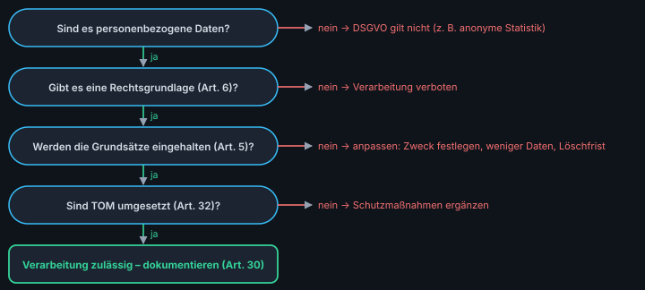

# 📜 Datenschutz & Entsorgung

*Bereich: Sicherheit · Prüfungsrelevanz: ★★★*

> DSGVO-Grundsätze, Rechtsgrundlagen, Betroffenenrechte, TOM, AV-Vertrag, Meldepflicht, DIN 66399, ElektroG.

[⬅ Inhaltsverzeichnis](README.md)

---

Fast jedes IT-System verarbeitet Daten über Menschen: Kunden, Mitarbeitende, Patienten. Die Datenschutz-Grundverordnung (DSGVO) legt fest, wann das erlaubt ist, welche Rechte die Betroffenen haben und welche Pflichten das Unternehmen trifft. In der AP1 sollst du erkennen, ob personenbezogene Daten vorliegen, eine Rechtsgrundlage zuordnen, Betroffenenrechte erklären und passende technische und organisatorische Maßnahmen vorschlagen. Betroffenenrechte, Pseudonymisierung und Anonymisierung sowie die Folgen der Einwilligung sind im Katalog 2025 betont.

## Grundbegriffe

**Personenbezogene Daten** (Art. 4 DSGVO) sind alle Informationen über eine **identifizierte oder identifizierbare** natürliche Person: Name, Anschrift, E-Mail-Adresse, Telefonnummer, Personalnummer, Kfz-Kennzeichen, Standortdaten, Fotos – und auch die **IP-Adresse**, weil sich darüber mit Zusatzwissen eine Person ermitteln lässt.

**Besondere Kategorien** (Art. 9) sind besonders geschützt: Gesundheitsdaten, ethnische Herkunft, politische Meinung, religiöse Überzeugung, Gewerkschaftszugehörigkeit, genetische und biometrische Daten, Sexualleben. Ihre Verarbeitung ist grundsätzlich verboten, außer es gibt eine ausdrückliche Ausnahme.

**Verarbeitung** ist jeder Umgang mit Daten: erheben, speichern, ändern, abfragen, übermitteln, löschen. Der **Verantwortliche** entscheidet über Zweck und Mittel. Ein **Auftragsverarbeiter** verarbeitet die Daten nur in seinem Auftrag, z. B. ein Cloud-Anbieter oder ein Fernwartungsdienstleister.

> [!IMPORTANT]
> **Datenschutz ≠ Datensicherheit.** Datenschutz schützt die **Person** und ihr Recht, selbst über ihre Daten zu bestimmen. Datensicherheit schützt **alle** Daten vor Verlust, Manipulation und unbefugtem Zugriff – sie ist ein Mittel, um Datenschutz umzusetzen.

#### Pseudonymisierung und Anonymisierung

<table><tr><th></th><th>Pseudonymisierung</th><th>Anonymisierung</th></tr>
<tr><td>Prinzip</td><td>Namen werden durch Kennzeichen ersetzt; mit einer getrennt aufbewahrten Zuordnungstabelle kann man den Bezug wiederherstellen</td><td>Der Personenbezug wird dauerhaft entfernt; niemand kann ihn wiederherstellen</td></tr>
<tr><td>Beispiel</td><td>„Patient P-4711, 54 Jahre, Diagnose …“ – die Liste P-4711 = Max Meier liegt verschlossen beim Arzt</td><td>„In Hamburg wurden 2026 1.234 Fälle behandelt, Durchschnittsalter 54“</td></tr>
<tr><td>DSGVO gilt?</td><td><b>ja</b> – die Daten bleiben personenbezogen, das Risiko ist aber geringer</td><td><b>nein</b> – es sind keine personenbezogenen Daten mehr</td></tr></table>

**Warum pseudonymisiert man?** Entwickler, Tester oder Statistiker können mit den Daten arbeiten, ohne zu wissen, um wen es geht. Gelangen die Daten in falsche Hände, ist der Schaden geringer.

## Darf ich diese Daten verarbeiten?

#### Grundsätze (Art. 5)

<table><tr><th>Grundsatz</th><th>Bedeutung</th><th>Beispiel</th></tr>
<tr><td>Rechtmäßigkeit, Treu und Glauben, Transparenz</td><td>nur mit Rechtsgrundlage, fair und für Betroffene nachvollziehbar</td><td>Datenschutzhinweis am Formular</td></tr>
<tr><td><b>Zweckbindung</b></td><td>nur für vorher festgelegte, eindeutige Zwecke</td><td>Adressen für den Versand dürfen nicht einfach für Werbung genutzt werden</td></tr>
<tr><td><b>Datenminimierung</b></td><td>nur so viele Daten wie nötig</td><td>Kontaktformular fragt nicht nach Geburtsdatum</td></tr>
<tr><td>Richtigkeit</td><td>sachlich richtig und aktuell</td><td>Adressänderungen einpflegen</td></tr>
<tr><td><b>Speicherbegrenzung</b></td><td>nur so lange wie nötig</td><td>Bewerbungsunterlagen nach Absage nach einigen Monaten löschen</td></tr>
<tr><td>Integrität und Vertraulichkeit</td><td>angemessene Sicherheit</td><td>Verschlüsselung, Zugriffsrechte</td></tr>
<tr><td>Rechenschaftspflicht</td><td>der Verantwortliche muss die Einhaltung nachweisen können</td><td>Dokumentation im Verarbeitungsverzeichnis</td></tr></table>

#### Rechtsgrundlagen (Art. 6) – Verbot mit Erlaubnisvorbehalt

Grundsätzlich ist jede Verarbeitung personenbezogener Daten **verboten** – außer, eine der folgenden Rechtsgrundlagen erlaubt sie:

<table><tr><th>Rechtsgrundlage</th><th>Beispiel</th></tr>
<tr><td>a) <b>Einwilligung</b></td><td>Newsletter-Anmeldung</td></tr>
<tr><td>b) <b>Vertragserfüllung</b></td><td>Lieferadresse für eine Bestellung, Bankverbindung für das Gehalt</td></tr>
<tr><td>c) <b>rechtliche Verpflichtung</b></td><td>Rechnungen aufbewahren (Steuerrecht), Meldung an die Sozialversicherung</td></tr>
<tr><td>d) lebenswichtige Interessen</td><td>Notarzt erhält Vorerkrankungen eines bewusstlosen Patienten</td></tr>
<tr><td>e) öffentliche Aufgabe</td><td>Behörden</td></tr>
<tr><td>f) <b>berechtigtes Interesse</b> (mit Abwägung gegen die Interessen der Betroffenen)</td><td>Protokollierung von Zugriffen zur IT-Sicherheit, Videoüberwachung eines Lagers</td></tr></table>

> [!TIP]
> Für Daten, die für einen Vertrag nötig sind, braucht man **keine** Einwilligung – die Rechtsgrundlage ist die Vertragserfüllung. Eine unnötige Einwilligung ist sogar riskant: Wird sie widerrufen, entsteht Unsicherheit, ob man die Daten noch verwenden darf.

## Einwilligung

Eine wirksame Einwilligung muss **freiwillig**, **informiert**, für einen **bestimmten Zweck** und **eindeutig** erteilt werden – durch eine aktive Handlung, z. B. ein selbst gesetztes Häkchen. Ein vorangekreuztes Kästchen oder Schweigen genügt nicht. Der Verantwortliche muss sie **nachweisen** können.

**Konsequenzen der Einwilligung:**

- Sie kann **jederzeit widerrufen** werden, und zwar so einfach, wie sie erteilt wurde. Ab dem Widerruf dürfen die Daten auf dieser Grundlage nicht mehr verarbeitet werden; die bisherige Verarbeitung bleibt rechtmäßig. In der Regel sind die Daten dann zu löschen.
- **Kopplungsverbot:** Ein Vertrag darf nicht von einer Einwilligung abhängig gemacht werden, die für ihn nicht nötig ist („Den Handyvertrag gibt es nur, wenn Sie Werbe-Anrufen zustimmen“).
- Im Arbeitsverhältnis ist Freiwilligkeit wegen der Abhängigkeit nur eingeschränkt gegeben.
- Bei Online-Diensten brauchen Kinder unter 16 Jahren die Zustimmung der Eltern.

## Betroffenenrechte

<table><tr><th>Artikel</th><th>Recht</th><th>bedeutet</th></tr>
<tr><td>13/14</td><td>Information</td><td>bei der Erhebung erfahren, wer welche Daten wofür wie lange verarbeitet</td></tr>
<tr><td>15</td><td><b>Auskunft</b></td><td>welche Daten gespeichert sind, Zweck, Empfänger, Speicherdauer, Herkunft – mit Kopie der Daten</td></tr>
<tr><td>16</td><td>Berichtigung</td><td>falsche Daten korrigieren lassen</td></tr>
<tr><td>17</td><td><b>Löschung</b></td><td>„Recht auf Vergessenwerden“, z. B. wenn der Zweck entfallen ist oder die Einwilligung widerrufen wurde</td></tr>
<tr><td>18</td><td>Einschränkung</td><td>Daten werden gesperrt statt gelöscht, z. B. solange die Richtigkeit geklärt wird</td></tr>
<tr><td>20</td><td>Datenübertragbarkeit</td><td>Daten in einem gängigen, maschinenlesbaren Format erhalten, um den Anbieter zu wechseln</td></tr>
<tr><td>21</td><td>Widerspruch</td><td>z. B. gegen Werbung oder eine Verarbeitung aus berechtigtem Interesse</td></tr>
<tr><td>22</td><td>keine rein automatisierte Entscheidung</td><td>wichtige Entscheidungen nicht allein durch einen Algorithmus</td></tr>
<tr><td>7 Abs. 3</td><td>Widerruf der Einwilligung</td><td>jederzeit</td></tr>
<tr><td>77</td><td>Beschwerde</td><td>bei der Datenschutz-Aufsichtsbehörde</td></tr></table>

Anfragen sind **unverzüglich, spätestens innerhalb eines Monats** zu beantworten (in komplexen Fällen um zwei Monate verlängerbar); die Auskunft ist in der Regel kostenlos. Das Recht auf Löschung gilt nicht unbegrenzt: Verlangen **gesetzliche Aufbewahrungsfristen** eine längere Speicherung (z. B. Rechnungen 8 Jahre), werden die Daten **gesperrt** und erst nach Fristende gelöscht.

> [!NOTE]
> **Beispiel**
>
> **Auskunftsanfrage bearbeiten**  
> Ein ehemaliger Kunde fordert per E-Mail Auskunft über seine Daten.  
> 1. **Identität prüfen** – sonst könnte ein Fremder die Daten erschleichen.  
> 2. Frist notieren: spätestens **ein Monat** nach Eingang.  
> 3. Alle Systeme durchsuchen (CRM, Warenwirtschaft, E-Mail, Backups beachten).  
> 4. Auskunft erteilen: welche Daten, Zweck, Empfänger (z. B. Versanddienstleister), Speicherdauer, Herkunft, Hinweis auf weitere Rechte – mit Kopie der Daten.  
> 5. Bearbeitung dokumentieren.  
> Verlangt er zusätzlich die Löschung: Kundendaten löschen, die Rechnungen aber wegen der Aufbewahrungspflicht nur sperren.

## Technische und organisatorische Maßnahmen (TOM)

Nach Art. 32 muss der Verantwortliche ein dem Risiko angemessenes Schutzniveau sicherstellen – unter Berücksichtigung des **Stands der Technik**, der Kosten, der Art der Daten und des Risikos. Ausdrücklich genannt werden: Pseudonymisierung und Verschlüsselung, Vertraulichkeit, Integrität, Verfügbarkeit und Belastbarkeit der Systeme, rasche Wiederherstellung nach Zwischenfällen und regelmäßige Überprüfung der Maßnahmen.

In Prüfungen werden die Maßnahmen oft nach den klassischen **Kontrollarten** geordnet:

<table><tr><th>Kontrolle</th><th>Ziel</th><th>Beispiele</th></tr>
<tr><td><b>Zutritts</b>kontrolle</td><td>Unbefugte kommen nicht in die <b>Räume</b></td><td>Schließanlage, Chipkarte, abgeschlossener Serverraum, Besucherregelung</td></tr>
<tr><td><b>Zugangs</b>kontrolle</td><td>Unbefugte können die <b>Systeme</b> nicht benutzen</td><td>Passwort, MFA, Bildschirmsperre</td></tr>
<tr><td><b>Zugriffs</b>kontrolle</td><td>jeder sieht nur die <b>Daten</b>, die er braucht</td><td>Berechtigungskonzept, Rollen, Need-to-know</td></tr>
<tr><td>Weitergabekontrolle</td><td>Daten sind bei Übertragung und Transport geschützt</td><td>VPN, TLS, verschlüsselte USB-Sticks</td></tr>
<tr><td>Eingabekontrolle</td><td>nachvollziehbar, wer wann was geändert hat</td><td>Protokollierung, persönliche Konten statt Sammelkonten</td></tr>
<tr><td>Auftragskontrolle</td><td>Dienstleister arbeiten nur nach Weisung</td><td>Auftragsverarbeitungsvertrag, Kontrolle des Dienstleisters</td></tr>
<tr><td>Verfügbarkeitskontrolle</td><td>Daten gehen nicht verloren</td><td>Backup, USV, Virenschutz, Brandschutz</td></tr>
<tr><td>Trennungsgebot</td><td>Daten für verschiedene Zwecke getrennt verarbeiten</td><td>getrennte Datenbanken, Mandantentrennung, Test- und Echtsystem</td></tr></table>

> [!IMPORTANT]
> Eselsbrücke: Zu**tritt** = mit den Füßen in den Raum · Zu**gang** = ans Gerät · Zu**griff** = auf die Daten.

**Privacy by Design und by Default** (Art. 25): Datenschutz wird schon bei der Entwicklung eingeplant, und die Voreinstellungen sind datenschutzfreundlich – z. B. ist ein Profil standardmäßig nicht öffentlich.

## Pflichten des Unternehmens

- **Verzeichnis von Verarbeitungstätigkeiten** (Art. 30): Liste aller Verarbeitungen mit Zweck, Datenkategorien, Empfängern, Löschfristen und Schutzmaßnahmen.
- **Auftragsverarbeitungsvertrag** (Art. 28) mit allen Dienstleistern, die personenbezogene Daten im Auftrag verarbeiten: Cloud-Anbieter, Fernwartung, Lohnabrechnung, Aktenvernichtung.
- **Datenschutz-Folgenabschätzung** (Art. 35): vorab, wenn eine Verarbeitung voraussichtlich ein hohes Risiko bringt, z. B. umfangreiche Videoüberwachung oder viele Gesundheitsdaten.
- **Löschkonzept:** welche Daten wann und wie gelöscht werden.
- **Datenschutzbeauftragte(r)** (§ 38 BDSG): Pflicht, wenn in der Regel mindestens **20 Personen** ständig mit der automatisierten Verarbeitung personenbezogener Daten beschäftigt sind – oder unabhängig von der Zahl, wenn sensible Daten den Kern der Tätigkeit bilden. Er berät, überwacht und schult, ist weisungsfrei und hat Kündigungsschutz; er kann auch extern sein.
- **Drittlandübermittlung** (außerhalb EU/EWR) nur mit Angemessenheitsbeschluss (z. B. EU-US Data Privacy Framework für zertifizierte US-Anbieter), Standardvertragsklauseln oder ähnlichen Garantien.

#### Datenpanne

Gehen personenbezogene Daten verloren oder gelangen an Unbefugte, muss der Verantwortliche die **Aufsichtsbehörde innerhalb von 72 Stunden** nach Bekanntwerden informieren (Art. 33) – außer, es besteht voraussichtlich kein Risiko für die Betroffenen. Bei **hohem Risiko** müssen auch die **Betroffenen** selbst benachrichtigt werden (Art. 34).

> [!NOTE]
> **Beispiel**
>
> **Notebook im Zug vergessen**  
> Auf dem Notebook eines Vertriebsmitarbeiters liegen Kundendaten. **Fall A:** Die Festplatte ist mit BitLocker verschlüsselt, die Anmeldung mit PIN und TPM gesichert. → Ein Zugriff ist praktisch ausgeschlossen; voraussichtlich kein Risiko, der Vorfall wird intern dokumentiert. **Fall B:** Keine Verschlüsselung. → Meldung an die Aufsichtsbehörde binnen 72 Stunden; bei sensiblen Daten zusätzlich Information der Betroffenen.  
> Das zeigt, warum Verschlüsselung eine so wichtige TOM ist.

**Bußgelder** können bis zu 20 Mio. € oder 4 % des weltweiten Jahresumsatzes betragen – je nachdem, was höher ist.

<table><tr><th></th><th>Datenschutzbeauftragte(r)</th><th>IT-Sicherheitsbeauftragte(r)</th></tr>
<tr><td>schützt</td><td>Personen und ihre Daten</td><td>alle Informationen und IT-Systeme</td></tr>
<tr><td>Grundlage</td><td>DSGVO, BDSG – gesetzlich vorgeschrieben ab i. d. R. 20 Personen</td><td>BSI-Grundschutz, ISMS – meist freiwillig, Pflicht z. B. bei kritischen Infrastrukturen</td></tr>
<tr><td>Aufgaben</td><td>beraten, überwachen, schulen, Ansprechpartner für Betroffene und Behörde</td><td>Sicherheitskonzept, Richtlinien, Vorfallbearbeitung, Sensibilisierung</td></tr></table>

Beide Rollen sollten nicht von der IT-Leitung selbst übernommen werden – sie müsste sich sonst selbst kontrollieren.

## Webseiten und Formulare

- **Kontaktformular:** nur die nötigen Pflichtfelder (Datenminimierung), Übertragung per HTTPS, Hinweis auf die Datenschutzerklärung, Daten nur zur Beantwortung verwenden, Löschfrist festlegen.
- **Impressum** nach dem Digitale-Dienste-Gesetz (DDG, seit 2024): Name, Anschrift, Kontakt, Registereintrag, USt-IdNr.
- **Cookies** (TDDDG): technisch notwendige Cookies sind erlaubt; Tracking- und Marketing-Cookies nur nach Einwilligung – mit einer gleichwertigen Möglichkeit zum Ablehnen im Cookie-Banner.

## Datenträger sicher entsorgen

Formatieren oder „auf Werkseinstellungen zurücksetzen“ reicht nicht – die Daten lassen sich oft wiederherstellen. Sichere Verfahren: geprüfte Löschsoftware zum Überschreiben (HDD), Secure Erase bzw. Löschen des Schlüssels einer verschlüsselten SSD, Entmagnetisieren (nur magnetische Medien) oder physische Zerstörung. Beauftragt man einen Dienstleister, braucht man einen **Auftragsverarbeitungsvertrag** und ein **Vernichtungsprotokoll**.

Die Norm **DIN 66399** legt fest, wie klein die Teile nach der Vernichtung sein müssen:

<table><tr><th>Schutzklasse</th><th>Schutzbedarf</th><th>Beispiel</th></tr>
<tr><td>1</td><td>normal (interne Daten)</td><td>Rundschreiben</td></tr>
<tr><td>2</td><td>hoch (vertrauliche Daten)</td><td>personenbezogene Daten, Kundendaten, Personalakten</td></tr>
<tr><td>3</td><td>sehr hoch (geheime Daten)</td><td>Patientendaten, Berufsgeheimnisse, Forschung</td></tr></table>

Dazu gibt es **7 Sicherheitsstufen** (je höher, desto kleiner die Partikel) und Materialklassen: P (Papier), F (Film), O (optisch, CD/DVD), T (magnetische Datenträger wie Bänder), H (Festplatten), E (elektronische Datenträger wie SSD, USB-Stick, Speicherkarte). Für personenbezogene Daten ist mindestens Stufe 3 üblich, für besonders schützenswerte Stufe 4 oder höher – z. B. **H-4** für eine Festplatte mit Personaldaten oder **E-4** für eine SSD.

**Elektroschrott:** Nach dem Elektro- und Elektronikgerätegesetz (ElektroG) gehören Altgeräte nicht in den Hausmüll (durchgestrichene Mülltonne). Hersteller und größere Händler müssen sie zurücknehmen. So werden Schadstoffe fachgerecht entsorgt und Rohstoffe wie Kupfer, Gold und seltene Erden zurückgewonnen. Für Akkus und Batterien gilt das Batteriegesetz.

> [!CAUTION]
> **Typische Fehler**
>
> - Datenschutz und Datensicherheit gleichsetzen.
> - Pseudonymisierte Daten als nicht mehr personenbezogen bezeichnen.
> - Für jede Verarbeitung eine Einwilligung verlangen, obwohl Vertrag oder Gesetz die Rechtsgrundlage ist.
> - Zutritt, Zugang und Zugriff verwechseln.
> - Die 72-Stunden-Frist auf die Betroffenen statt auf die Aufsichtsbehörde beziehen.
> - Das Recht auf Löschung über gesetzliche Aufbewahrungspflichten stellen.
> - Formatieren als sichere Löschung ansehen.

**📝 Prüfungsaufgabe:** **Ordnen Sie zu: a) Ein Webshop speichert die Lieferadresse. b) Ein Unternehmen bewahrt Rechnungen 8 Jahre auf. c) Ein Kunde meldet sich für einen Newsletter an. Nennen Sie jeweils die Rechtsgrundlage nach Art. 6 DSGVO. (3 Punkte)**

Lösung anzeigen

a) Vertragserfüllung (1) b) rechtliche Verpflichtung (1) c) Einwilligung (1)

**📝 Prüfungsaufgabe:** **Ordnen Sie den Maßnahmen die Kontrollart zu: a) Der Serverraum hat ein Zahlenschloss. b) Nach 5 Minuten sperrt sich der Bildschirm. c) Auszubildende sehen im ERP keine Gehaltsdaten. d) Änderungen an Kundendaten werden mit Benutzer und Uhrzeit protokolliert. (4 Punkte)**

Lösung anzeigen

a) Zutrittskontrolle (1) b) Zugangskontrolle (1) c) Zugriffskontrolle (1) d) Eingabekontrolle (1)

**📝 Prüfungsaufgabe:** **Erläutern Sie den Unterschied zwischen Pseudonymisierung und Anonymisierung und welche Folge er für die Anwendung der DSGVO hat. (4 Punkte)**

Lösung anzeigen

Bei der Pseudonymisierung werden identifizierende Merkmale durch ein Kennzeichen ersetzt; mit einer getrennt aufbewahrten Zuordnung kann der Personenbezug wiederhergestellt werden (1). Die Daten bleiben personenbezogen, die DSGVO gilt weiter (1). Bei der Anonymisierung wird der Personenbezug dauerhaft entfernt, sodass niemand ihn wiederherstellen kann (1). Anonyme Daten fallen nicht mehr unter die DSGVO (1).

**📝 Prüfungsaufgabe:** **Ein Unternehmen stellt fest, dass durch einen Konfigurationsfehler die Kundendatenbank zwei Tage öffentlich im Internet erreichbar war. Beschreiben Sie die Pflichten nach der DSGVO. (3 Punkte)**

Lösung anzeigen

Es liegt eine Datenpanne vor; sie ist innerhalb von 72 Stunden nach Bekanntwerden der Aufsichtsbehörde zu melden (1). Besteht ein hohes Risiko für die Betroffenen, müssen auch diese benachrichtigt werden (1). Der Vorfall, seine Auswirkungen und die ergriffenen Maßnahmen (Fehler beheben, Zugriffe prüfen) sind zu dokumentieren (1).

**📝 Prüfungsaufgabe:** **Eine Kundin widerruft ihre Einwilligung zum Newsletter und verlangt die Löschung ihrer Daten. Sie hat im Shop auch zwei Bestellungen aufgegeben. Wie gehen Sie vor? (3 Punkte)**

Lösung anzeigen

Ab dem Widerruf darf sie keinen Newsletter mehr erhalten; die Newsletter-Daten werden gelöscht (1). Die Bestell- und Rechnungsdaten unterliegen gesetzlichen Aufbewahrungsfristen und dürfen nicht gelöscht, sondern müssen gesperrt werden; nach Fristablauf werden sie gelöscht (1). Die Kundin wird innerhalb eines Monats über die Umsetzung informiert (1).

---

## 🃏 Karteikarten (38)

| Frage | Antwort |
|---|---|
| Personenbezogene Daten | Alle Infos über eine identifizierte oder identifizierbare natürliche Person (Name, E-Mail, IP, Foto …). |
| Datenschutz vs. Datensicherheit | Datenschutz schützt Personen/Persönlichkeitsrechte. Datensicherheit schützt Daten technisch vor Verlust/Manipulation. |
| Grundsätze Art. 5 DSGVO | Rechtmäßigkeit/Transparenz, Zweckbindung, Datenminimierung, Richtigkeit, Speicherbegrenzung, Integrität & Vertraulichkeit, Rechenschaftspflicht. |
| Datenminimierung | Nur die Daten verarbeiten, die für den Zweck wirklich nötig sind. |
| Verbot mit Erlaubnisvorbehalt | Verarbeitung ist verboten, außer eine Rechtsgrundlage (Art. 6) erlaubt sie. |
| Rechtsgrundlagen Art. 6 | Einwilligung, Vertrag, rechtliche Pflicht, lebenswichtige Interessen, öffentliche Aufgabe, berechtigtes Interesse. |
| Art. 15 DSGVO | Recht auf Auskunft. |
| Art. 16 DSGVO | Recht auf Berichtigung. |
| Art. 17 DSGVO | Recht auf Löschung („Vergessenwerden“). |
| Art. 20 DSGVO | Recht auf Datenübertragbarkeit. |
| Frist für Antwort auf Betroffenenanfragen | Unverzüglich, spätestens 1 Monat (Verlängerung um 2 Monate möglich). |
| Art. 32 DSGVO | Sicherheit der Verarbeitung: geeignete technische und organisatorische Maßnahmen (TOM). |
| Zutritts- vs. Zugangs- vs. Zugriffskontrolle | Zutritt: Räume. Zugang: Systeme/Anmeldung. Zugriff: Daten/Berechtigungen. |
| Meldefrist Datenpanne | 72 Stunden an die Aufsichtsbehörde (Art. 33). |
| Pflicht zum Datenschutzbeauftragten | Ab i. d. R. 20 Personen, die ständig automatisiert personenbezogene Daten verarbeiten (§ 38 BDSG). |
| AV-Vertrag | Vertrag mit Auftragsverarbeitern (z. B. Cloud) nach Art. 28 DSGVO. |
| Pseudonymisierung vs. Anonymisierung | Pseudonym: Personenbezug mit Zusatzwissen wiederherstellbar. Anonym: Personenbezug dauerhaft entfernt. |
| Bußgeldrahmen DSGVO | Bis 20 Mio. € oder 4 % des weltweiten Jahresumsatzes. |
| DIN 66399 – Schutzklassen | 1 normal, 2 hoch, 3 sehr hoch. |
| DIN 66399 – Materialklasse H und E | H: magnetische Festplatten. E: elektronische Datenträger (SSD, USB-Stick). |
| Mindest-Sicherheitsstufe personenbezogene Daten | Stufe 3 (sensible personenbezogene Daten: 4). |
| Warum reicht Formatieren nicht? | Daten bleiben physisch erhalten und lassen sich mit Tools wiederherstellen. |
| ElektroG | Regelt Rücknahme und umweltgerechte Entsorgung von Elektroaltgeräten (WEEE); nicht in den Hausmüll. |
| Privacy by Default | Datenschutzfreundliche Voreinstellungen – standardmäßig nur nötige Daten. |
| Anforderungen an eine Einwilligung | Freiwillig, informiert, zweckgebunden, eindeutig (aktive Handlung), nachweisbar. |
| Widerruf der Einwilligung | Jederzeit möglich, so einfach wie die Erteilung; wirkt für die Zukunft. |
| Kopplungsverbot | Vertrag darf nicht von einer dafür unnötigen Einwilligung abhängig gemacht werden. |
| DSB vs. ISB | DSB: schützt personenbezogene Daten, gesetzlich (DSGVO/BDSG). ISB: schützt alle Informationen/Systeme (Grundschutz/ISMS). |
| DDG | Digitale-Dienste-Gesetz (seit 2024) – u. a. Impressumspflicht, ersetzt das TMG. |
| Cookies – Regel | Notwendige Cookies erlaubt, Tracking nur mit Einwilligung (TDDDG). |
| Kontaktformular datenschutzkonform | Wenige Pflichtfelder, HTTPS, Datenschutzhinweis, Zweckbindung, Löschfrist. |
| Weitergabekontrolle | Schutz personenbezogener Daten bei Übertragung und Transport, z. B. durch VPN, TLS oder verschlüsselte Datenträger. |
| Eingabekontrolle | Es muss nachvollziehbar sein, wer wann welche Daten eingegeben oder geändert hat – durch Protokollierung. |
| Auftragskontrolle | Dienstleister verarbeiten Daten nur nach Weisung des Auftraggebers – geregelt im AV-Vertrag. |
| Trennungsgebot | Daten, die zu unterschiedlichen Zwecken erhoben wurden, werden getrennt verarbeitet. |
| Verzeichnis von Verarbeitungstätigkeiten | Art. 30 DSGVO: Übersicht aller Verarbeitungen mit Zweck, Datenkategorien, Empfängern, Löschfristen und Maßnahmen. |
| Datenschutz-Folgenabschätzung | Art. 35 DSGVO: Risikoprüfung vor einer Verarbeitung, die voraussichtlich ein hohes Risiko für Betroffene bringt. |
| Löschkonzept | Regelt, welche Daten wann und wie gelöscht werden; Aufbewahrungsfristen gehen vor, bis dahin Sperrung. |

## ✍️ Übungsfragen (26)

**1.** Nennen Sie drei Beispiele für personenbezogene Daten und ein Beispiel für Daten ohne Personenbezug.

Lösung

**Musterlösung (4 P):** Personenbezogen (je 1): Name; private oder dienstliche E-Mail-Adresse; IP-Adresse eines Kunden; Personalnummer; Geburtsdatum; Foto; Standortdaten. Ohne Personenbezug (1): aggregierte bzw. anonymisierte Werte, z. B. der Durchschnittsumsatz aller Filialen. Aggregierte Unternehmenszahl ohne Personenbezug.

**2.** Ein Onlineshop fragt bei der Bestellung nach dem Geburtsdatum, obwohl es nicht benötigt wird. Welcher Grundsatz ist verletzt?

Lösung

**Musterlösung (2 P):** Datenminimierung

**3.** Ein Kunde will wissen, welche Daten über ihn gespeichert sind. Welcher Artikel?

Lösung

**Musterlösung (2 P):** Art. 15 Auskunftsrecht.

**4.** Ein ehemaliger Kunde verlangt, dass seine Daten gelöscht werden. Welches Recht?

Lösung

**Musterlösung (2 P):** Art. 17 Löschung

**5.** Innerhalb welcher Frist muss eine Datenpanne der Aufsichtsbehörde gemeldet werden?

Lösung

**Musterlösung (2 P):** 72 Stunden Art. 33.

**6.** Ein Unternehmen nutzt einen externen Cloud-Dienst für Personaldaten. Was ist zwingend abzuschließen?

Lösung

**Musterlösung (2 P):** Auftragsverarbeitungsvertrag Art. 28 DSGVO.

**7.** Eine Chipkarte für die Tür zum Serverraum ist eine Maßnahme der …

Lösung

**Musterlösung (2 P):** Zutrittskontrolle Räume = Zutritt.

**8.** Ein Berechtigungskonzept, das nur der Personalabteilung Lesezugriff auf Gehaltsdaten gibt, ist …

Lösung

**Musterlösung (2 P):** Zugriffskontrolle

**9.** Welche Materialklasse nach DIN 66399 gilt für SSDs und USB-Sticks?

Lösung

**Musterlösung (2 P):** E E = elektronische Datenträger.

**10.** Festplatten mit Personaldaten sollen vernichtet werden. Welche Schutzklasse ist angemessen?

Lösung

**Musterlösung (2 P):** Schutzklasse 2 Personenbezogene/vertrauliche Daten = hoher Schutzbedarf.

**11.** Wie müssen alte Monitore entsorgt werden?

Lösung

**Musterlösung (2 P):** Über zertifizierte Rücknahme/Wertstoffhof nach ElektroG

**12.** Welche Maßnahmen nennt Art. 32 DSGVO ausdrücklich? Nennen Sie drei.

Lösung

**Musterlösung (3 P):** Je 1 Punkt (max. 3): Pseudonymisierung und Verschlüsselung; Rasche Wiederherstellbarkeit nach Zwischenfällen; Regelmäßige Überprüfung der Wirksamkeit.

**13.** Ab wie vielen Personen, die ständig automatisiert personenbezogene Daten verarbeiten, ist in Deutschland i. d. R. ein Datenschutzbeauftragter Pflicht?

Lösung

**Musterlösung (2 P):** 20 § 38 BDSG.

**14.** Was unterscheidet Anonymisierung von Pseudonymisierung?

Lösung

**Musterlösung (2 P):** Bei Anonymisierung ist der Personenbezug dauerhaft entfernt

**15.** Ein Mitarbeiter fragt, warum das bloße Formatieren alter Festplatten vor dem Verkauf nicht ausreicht. Erklären Sie und nennen Sie zwei geeignete Verfahren. (4 Punkte)

Lösung

**Musterlösung (4 P):** Beim Formatieren werden nur die Verwaltungsstrukturen des Dateisystems neu angelegt, die Daten bleiben physisch erhalten und können mit Wiederherstellungssoftware rekonstruiert werden (2). Verfahren (je 1): mehrfaches Überschreiben mit zertifizierter Löschsoftware (HDD); Secure Erase/Crypto-Erase (SSD); Degaussing (magnetisch); physische Vernichtung nach DIN 66399 (z. B. H-4/E-4) durch zertifizierten Dienstleister mit Protokoll.

**16.** Nennen Sie vier Grundsätze der Datenverarbeitung nach Art. 5 DSGVO. (4 Punkte)

Lösung

**Musterlösung (4 P):** Je 1: Rechtmäßigkeit, Treu und Glauben, Transparenz; Zweckbindung; Datenminimierung; Richtigkeit; Speicherbegrenzung; Integrität und Vertraulichkeit; Rechenschaftspflicht.

**17.** Ordnen Sie folgende Maßnahmen den Kategorien technisch bzw. organisatorisch zu: Festplattenverschlüsselung, Datenschutzschulung, Berechtigungskonzept, automatische Bildschirmsperre. (4 Punkte)

Lösung

**Musterlösung (4 P):** Festplattenverschlüsselung – technisch (1); Datenschutzschulung – organisatorisch (1); Berechtigungskonzept – organisatorisch (als Regelwerk; die Umsetzung über Rechte ist technisch) (1); automatische Bildschirmsperre – technisch (1).

**18.** Ein Newsletter-Formular hat ein bereits angekreuztes Kästchen „Ich willige ein“. Ist das zulässig?

Lösung

**Musterlösung (2 P):** Nein – eine Einwilligung erfordert eine aktive, eindeutige Handlung

**19.** Eine Kundin widerruft ihre Einwilligung zum Newsletter. Was gilt?

Lösung

**Musterlösung (2 P):** Ab sofort keine Verarbeitung mehr auf dieser Grundlage; bisherige Verarbeitung bleibt rechtmäßig

**20.** Wer berät und überwacht im Unternehmen die Einhaltung der DSGVO?

Lösung

**Musterlösung (2 P):** Datenschutzbeauftragte(r)

**21.** Welches Gesetz regelt seit 2024 die Impressumspflicht für Webseiten?

Lösung

**Musterlösung (2 P):** DDG Das Digitale-Dienste-Gesetz hat das Telemediengesetz abgelöst.

**22.** Erläutern Sie zwei Unterschiede zwischen Datenschutzbeauftragtem und IT-Sicherheitsbeauftragtem. (4 Punkte)

Lösung

**Musterlösung (4 P):** Je Unterschied 2: Schutzobjekt – DSB schützt Personen bzw. personenbezogene Daten, ISB alle Informationen und IT-Systeme (Vertraulichkeit, Integrität, Verfügbarkeit). Rechtsgrundlage – DSB ist nach DSGVO/BDSG (ab 20 Personen) gesetzlich vorgeschrieben, ISB meist freiwillig im Rahmen eines ISMS/BSI-Grundschutz. Stellung – DSB weisungsfrei mit Kündigungsschutz, auch extern möglich.

**23.** Ordnen Sie die Maßnahmen den Kontrollarten zu: (1) VPN für den Außendienst, (2) Protokoll, wer Kundendaten ändert, (3) AV-Vertrag mit dem Cloud-Anbieter, (4) getrennte Datenbanken für Test und Echtbetrieb.

Lösung

**Musterlösung (4 P):** (1) Weitergabekontrolle (1). (2) Eingabekontrolle (1). (3) Auftragskontrolle (1). (4) Trennungsgebot (1).

**24.** Wie heißt das Dokument nach Art. 30 DSGVO, das alle Verarbeitungen personenbezogener Daten eines Unternehmens auflistet?

Lösung

**Musterlösung (2 P):** Verzeichnis von Verarbeitungstätigkeiten

**25.** Wann muss ein Unternehmen eine Datenschutz-Folgenabschätzung durchführen? Nennen Sie auch ein Beispiel.

Lösung

**Musterlösung (2 P):** Vor einer Verarbeitung, die voraussichtlich ein hohes Risiko für die Rechte und Freiheiten der Betroffenen mit sich bringt (1). Beispiel (1): umfangreiche Videoüberwachung, Verarbeitung vieler Gesundheitsdaten, systematische Auswertung des Verhaltens von Beschäftigten.

**26.** Ein ehemaliger Kunde verlangt die Löschung seiner Daten. Im System liegen noch Rechnungen aus dem Vorjahr. Erläutern Sie, wie das Unternehmen vorgehen muss.

Lösung

**Musterlösung (3 P):** Daten, für die kein Zweck mehr besteht, müssen gelöscht werden, z. B. Newsletter-Anmeldung oder Kundenprofil (1). Rechnungen unterliegen gesetzlichen Aufbewahrungsfristen und dürfen noch nicht gelöscht werden (1). Sie werden bis zum Fristende gesperrt, also nur noch für diesen Zweck aufbewahrt, und danach gelöscht; der Kunde wird darüber informiert (1).

[⬅ Inhaltsverzeichnis](README.md)
