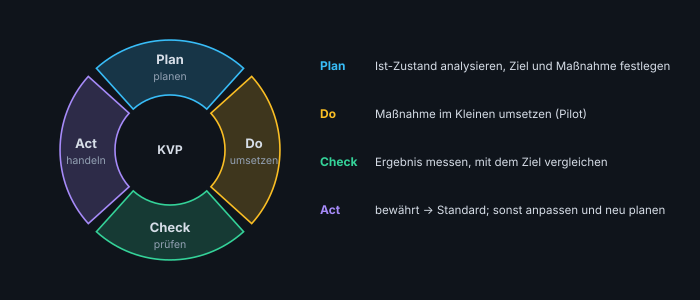

# ✅ Qualitätssicherung & Test

*Bereich: Planung · Prüfungsrelevanz: ★☆☆*

> QM nach ISO 9000/9001, PDCA, Softwarequalität ISO 25010, Testarten, Testprotokoll, Dokumentation.

[⬅ Inhaltsverzeichnis](README.md)

---

Ein Arbeitsplatz, ein Projekt oder eine Dienstleistung ist dann „gut“, wenn sie die Anforderungen der Kunden erfüllt – zuverlässig und immer wieder. Qualitätsmanagement sorgt dafür, dass das nicht vom Zufall abhängt. Für die AP1 brauchst du vor allem die Grundidee und den PDCA-Zyklus; Tests und Qualitätsmerkmale von Software werden in der AP2 wichtig, helfen aber auch beim Übergeben eines Arbeitsplatzes.

> [!WARNING]
> **Prüfungskatalog 2025:** Gestrichen sind der Qualitätsbegriff nach ISO 9000 im Detail, Audits, Kriterien der Softwarequalität, das Testprotokoll für den Arbeitsplatz und Maßnahmen zur Prozess- und Produktqualität. Das Thema hat in der AP1 deshalb **geringe Priorität** – PDCA und die Grundidee des Qualitätsmanagements reichen. Alles Weitere unten ist Hintergrund für Praxis und AP2.

## Was bedeutet Qualität?

Qualität heißt nicht „das Beste und Teuerste“, sondern: **Die Anforderungen werden erfüllt.** Ein einfacher Büro-PC, der zuverlässig läuft, rechtzeitig geliefert wurde und genau das kann, was vereinbart war, hat eine hohe Qualität. Eine High-End-Workstation, die drei Wochen zu spät kommt und mit der Fachsoftware nicht funktioniert, nicht.

**Qualitätsmanagement** (QM) bedeutet, die Abläufe im Unternehmen so zu planen, zu steuern und zu verbessern, dass Qualität zuverlässig entsteht – nicht durch Glück oder einzelne besonders gewissenhafte Mitarbeitende. **Warum lohnt sich das?** Fehler, die früh vermieden werden, kosten wenig. Fehler, die erst beim Kunden auffallen, kosten Nacharbeit, Gewährleistung, Ärger und im schlimmsten Fall den Kunden selbst.

Die bekannteste Normenreihe ist **ISO 9000** ff.: ISO 9000 erklärt Grundlagen und Begriffe, **ISO 9001** beschreibt die Anforderungen an ein QM-System, nach denen sich ein Unternehmen **zertifizieren** lassen kann. Wichtige Grundsätze sind Kundenorientierung, Einbeziehung der Mitarbeitenden, Denken in Prozessen, ständige Verbesserung und Entscheidungen auf Basis von Fakten.

## PDCA-Zyklus

Der PDCA-Zyklus (nach Deming) ist das Grundmuster jeder Verbesserung. Man durchläuft ihn immer wieder – daher **kontinuierlicher Verbesserungsprozess** (KVP, japanisch Kaizen).

**Warum nicht gleich alles umstellen?** Eine Maßnahme kann unerwartete Nebenwirkungen haben. Wer sie erst im Kleinen ausprobiert (Do) und das Ergebnis misst (Check), entscheidet auf Basis von Fakten, ob sie zum Standard wird (Act) – statt einen Fehler gleich im ganzen Unternehmen zu verbreiten.

> [!NOTE]
> **Beispiel**
>
> **PDCA im IT-Support**  
> **Plan:** Auswertung des Ticketsystems: Nur 55 % der Tickets werden innerhalb von 4 Stunden gelöst; viele betreffen dieselben Druckerprobleme. Ziel: 80 % in 4 Stunden. Maßnahme: Wissensdatenbank mit Lösungen für häufige Probleme.  
> **Do:** Der 1st-Level-Support einer Abteilung nutzt die Wissensdatenbank vier Wochen lang als Pilot.  
> **Check:** In der Pilotabteilung werden jetzt 78 % der Tickets in 4 Stunden gelöst – fast am Ziel. Druckerprobleme werden deutlich schneller erledigt, Netzwerkprobleme kaum.  
> **Act:** Die Wissensdatenbank wird für alle verbindlich eingeführt. Im nächsten Zyklus werden Lösungen für Netzwerkprobleme ergänzt.

Den PDCA-Zyklus findest du auch an anderen Stellen wieder: im Informationssicherheits-Managementsystem (ISMS), in der Sprint-Retrospektive bei Scrum und in den Lessons Learned am Projektende.

## Qualität beim Arbeitsplatz-Rollout

Auch ohne formales QM-System lässt sich die Qualität bei der Einrichtung vieler Arbeitsplätze sichern:

- **Standardisieren:** einheitliche Images, Checklisten, feste Abläufe – so ist jeder Arbeitsplatz gleich gut eingerichtet, egal wer ihn einrichtet.
- **Pilotgruppe:** erst wenige Arbeitsplätze umstellen, Rückmeldungen sammeln, dann alle anderen.
- **Funktionsprüfung vor der Übergabe:** Anmeldung an der Domäne, Netzwerk und Internet, Drucker, Netzlaufwerke, Fachanwendungen, E-Mail, Peripherie, aktive Verschlüsselung, aktueller Updatestand.
- **Dokumentation:** Inventar (Hersteller, Modell, Seriennummer, Inventarnummer, Standort, Nutzer), Konfiguration, Lizenzen, Übergabeprotokoll.
- **Nachher:** Soll-Ist-Vergleich, Zufriedenheit der Nutzer abfragen, Lessons Learned.

## Hintergrund: Qualitätsmerkmale von Software

Die Norm ISO/IEC 25010 beschreibt, woran man gute Software erkennt. Für die AP1 nicht mehr gefordert, beim Vergleich von Softwareangeboten aber hilfreich:

<table><tr><th>Merkmal</th><th>Frage</th></tr>
<tr><td>funktionale Eignung</td><td>Kann sie alles, was gebraucht wird, und rechnet sie richtig?</td></tr>
<tr><td>Zuverlässigkeit</td><td>Läuft sie stabil, verkraftet sie Fehler, lässt sie sich wiederherstellen?</td></tr>
<tr><td>Benutzbarkeit</td><td>Ist sie leicht zu lernen und zu bedienen, auch barrierefrei?</td></tr>
<tr><td>Leistungseffizienz</td><td>Wie schnell antwortet sie, wie viele Ressourcen braucht sie?</td></tr>
<tr><td>Wartbarkeit</td><td>Lässt sie sich leicht ändern, erweitern und testen?</td></tr>
<tr><td>Übertragbarkeit</td><td>Läuft sie auf anderen Systemen, lässt sie sich einfach installieren?</td></tr>
<tr><td>Kompatibilität</td><td>Arbeitet sie mit anderen Systemen zusammen?</td></tr>
<tr><td>Sicherheit</td><td>Schützt sie Daten vor unbefugtem Zugriff?</td></tr></table>

## Hintergrund: Testen

**Black-Box-Test:** Die Funktion wird anhand der Anforderungen geprüft, ohne den Programmcode zu kennen – Eingabe rein, erwartete Ausgabe vergleichen. **White-Box-Test:** mit Kenntnis des Codes; man prüft, ob alle Anweisungen und Verzweigungen durchlaufen werden. Ein **Schreibtischtest**, den du im Thema Programmierung übst, ist eine Form der Prüfung ohne Computer.

<table><tr><th>Teststufe</th><th>was wird getestet?</th></tr>
<tr><td>Komponententest</td><td>einzelne Funktionen und Module</td></tr>
<tr><td>Integrationstest</td><td>Zusammenspiel der Komponenten</td></tr>
<tr><td>Systemtest</td><td>das Gesamtsystem gegen das Pflichtenheft</td></tr>
<tr><td>Abnahmetest</td><td>durch den Kunden gegen seine Anforderungen – Grundlage der Abnahme</td></tr></table>

Weitere Testarten: **Regressionstest** (funktioniert nach einer Änderung noch alles, was vorher ging?), Last- und Performancetest, Usability-Test, Sicherheitstest.

> [!NOTE]
> **Beispiel**
>
> **Grenzwertanalyse und Äquivalenzklassen**  
> Ein Eingabefeld für die Bestellmenge erlaubt Werte von 1 bis 100.  
> **Äquivalenzklassen:** gültig (1–100), ungültig zu klein (unter 1), ungültig zu groß (über 100), ungültiger Typ (Text). Aus jeder Klasse genügt ein Vertreter, weil sich alle Werte einer Klasse gleich verhalten sollten.  
> **Grenzwerte:** 0, 1, 100, 101 – denn an den Grenzen passieren die meisten Programmierfehler (z. B. „<“ statt „≤“).

Ein **Testfall** wird dokumentiert mit Nummer, Beschreibung, Vorbedingung, Eingabe, **erwartetem** und **tatsächlichem** Ergebnis, Status (bestanden/nicht bestanden), Datum und Tester.

> [!CAUTION]
> **Typische Fehler**
>
> - Qualität mit „hochwertig“ oder „teuer“ gleichsetzen statt mit „Anforderungen erfüllt“.
> - Die PDCA-Phasen in falscher Reihenfolge nennen oder Check und Act verwechseln.
> - Bei PDCA nur die Begriffe aufzählen, ohne sie auf das Beispiel der Aufgabe anzuwenden.
> - Zu viel Zeit in gestrichene Inhalte (Audits, Normdetails) stecken.

**📝 Prüfungsaufgabe:** **Ein IT-Dienstleister erhält viele Beschwerden, weil neue Arbeitsplätze oft unvollständig eingerichtet übergeben werden. Beschreiben Sie, wie er das Problem mit dem PDCA-Zyklus angehen kann. (4 Punkte)**

Lösung anzeigen

Plan: Beschwerden auswerten, häufigste Fehler ermitteln, Ziel festlegen und eine Maßnahme planen, z. B. eine Checkliste für die Übergabe (1). Do: Checkliste zunächst bei einem Team einsetzen (1). Check: Anzahl der Beschwerden und Nacharbeiten mit dem Zeitraum davor vergleichen (1). Act: Bei Erfolg die Checkliste für alle verbindlich machen, sonst anpassen und neu planen (1).

**📝 Prüfungsaufgabe:** **Erläutern Sie, warum eine Maßnahme im PDCA-Zyklus zunächst im Kleinen erprobt wird. (2 Punkte)**

Lösung anzeigen

So lässt sich vor der breiten Einführung messen, ob die Maßnahme wirkt (1), und Fehler oder Nebenwirkungen betreffen nur einen kleinen Bereich statt das ganze Unternehmen (1).

---

## 🃏 Karteikarten (15)

| Frage | Antwort |
|---|---|
| Qualität nach ISO 9000 | [Hintergrund – nicht mehr AP1-Stoff] Grad, in dem Merkmale eines Produkts/einer Leistung die Anforderungen erfüllen. |
| ISO 9001 | [Hintergrund – nicht mehr AP1-Stoff] Norm mit Anforderungen an ein Qualitätsmanagementsystem – zertifizierbar. |
| Audit | [Hintergrund – nicht mehr AP1-Stoff] Systematische, unabhängige Prüfung, ob Anforderungen/Prozesse eingehalten werden. |
| PDCA | Plan – Do – Check – Act: Zyklus der kontinuierlichen Verbesserung. |
| Check-Phase im PDCA | Ergebnisse messen und mit den Zielen vergleichen (Soll-Ist). |
| Merkmale Softwarequalität (ISO 25010) | [Hintergrund – nicht mehr AP1-Stoff] Funktionale Eignung, Zuverlässigkeit, Benutzbarkeit, Effizienz, Wartbarkeit, Übertragbarkeit, Kompatibilität, Sicherheit. |
| Black-Box-Test | [Hintergrund – nicht mehr AP1-Stoff] Test ohne Codekenntnis, nur Ein-/Ausgabe gegen Spezifikation. |
| White-Box-Test | [Hintergrund – nicht mehr AP1-Stoff] Test mit Codekenntnis, z. B. Zweigabdeckung. |
| Regressionstest | [Hintergrund – nicht mehr AP1-Stoff] Erneuter Test nach Änderungen, um unbeabsichtigte Fehler in bestehenden Funktionen zu finden. |
| Grenzwertanalyse | [Hintergrund – nicht mehr AP1-Stoff] Testfälle an und direkt neben den Grenzen gültiger Bereiche. |
| Teststufen | [Hintergrund – nicht mehr AP1-Stoff] Komponententest, Integrationstest, Systemtest, Abnahmetest. |
| Abnahmetest | [Hintergrund – nicht mehr AP1-Stoff] Test durch den Kunden gegen dessen Anforderungen (Lastenheft). |
| Statischer vs. dynamischer Test | [Hintergrund – nicht mehr AP1-Stoff] Statisch: ohne Ausführung (Review). Dynamisch: Programm wird ausgeführt. |
| Inhalte eines Testprotokolls | [Hintergrund – nicht mehr AP1-Stoff] ID, Beschreibung, Vorbedingung, Eingabe, erwartetes & tatsächliches Ergebnis, Status, Datum, Tester. |
| TQM | [Hintergrund – nicht mehr AP1-Stoff] Total Quality Management: ganzheitliches QM unter Einbeziehung aller Mitarbeitenden. |

## ✍️ Übungsfragen (9)

**1.** In welcher PDCA-Phase werden die Ergebnisse gemessen und bewertet?

Lösung

**Musterlösung (2 P):** Check

**2.** Hintergrund (AP2): Ein Tester prüft eine Eingabemaske nur anhand der Spezifikation, ohne den Code zu kennen. Testart?

Lösung

**Musterlösung (2 P):** Black-Box

**3.** Hintergrund (AP2): Nach einem Update wird geprüft, ob bestehende Funktionen weiterhin korrekt laufen. Testart?

Lösung

**Musterlösung (2 P):** Regressionstest

**4.** Hintergrund (AP2): Ein Feld akzeptiert ganze Zahlen von 18 bis 67. Welche Werte gehören zu einer Grenzwertanalyse? Nennen Sie vier.

Lösung

**Musterlösung (4 P):** Je 1 Punkt (max. 4): 17; 18; 67; 68. An und direkt neben den Grenzen; 40 ist ein Repräsentant der Äquivalenzklasse, kein Grenzwert.

**5.** Hintergrund (AP2): Welche Teststufe führt der Kunde gegen seine Anforderungen durch?

Lösung

**Musterlösung (2 P):** Abnahmetest

**6.** Erläutern Sie den PDCA-Zyklus am Beispiel der Verbesserung des IT-Supports. (4 Punkte)

Lösung

**Musterlösung (4 P):** Plan: Ist-Zustand analysieren (z. B. lange Lösungszeiten), Ziel und Maßnahme festlegen (Wissensdatenbank) (1). Do: Maßnahme testweise umsetzen (1). Check: Ergebnisse messen, z. B. durchschnittliche Lösungszeit vor/nach (1). Act: Bei Erfolg standardisieren, sonst anpassen; neuer Zyklus beginnt (1).

**7.** Nennen Sie vier Funktionstests, die Sie nach der Einrichtung eines neuen Arbeitsplatzes durchführen. (4 Punkte)

Lösung

**Musterlösung (4 P):** Je 1: Anmeldung mit Domänenkonto; Netzwerk-/Internetzugang; Zugriff auf Netzlaufwerke/Freigaben; Drucken; Fachanwendungen und Office starten; E-Mail senden/empfangen; Monitor/Docking/Peripherie; BitLocker/Virenschutz aktiv; Updates installiert.

**8.** Wofür stehen die vier Buchstaben des PDCA-Zyklus?

Lösung

**Musterlösung (2 P):** Plan, Do, Check, Act (je 0,5) – planen, umsetzen, prüfen, handeln. Planen – Umsetzen – Prüfen – Handeln (standardisieren oder anpassen).

**9.** Erläutern Sie, warum eine Maßnahme im PDCA-Zyklus zunächst im Kleinen erprobt wird.

Lösung

**Musterlösung (2 P):** So lässt sich messen, ob die Maßnahme wirkt, bevor sie überall eingeführt wird (1). Fehler oder Nebenwirkungen betreffen dann nur einen kleinen Bereich statt das ganze Unternehmen (1).

[⬅ Inhaltsverzeichnis](README.md)
