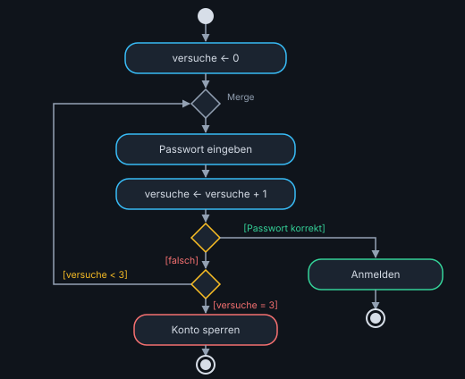
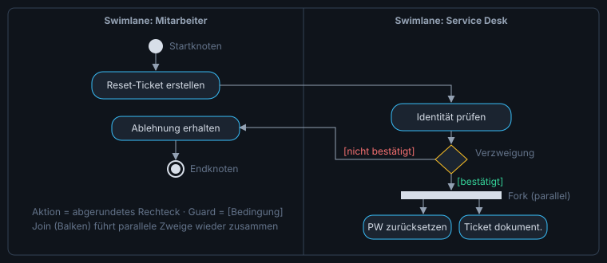
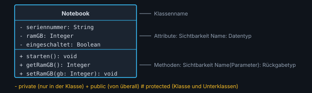

# 💻 Programmierung & Algorithmen

*Bereich: Software · Prüfungsrelevanz: ★★★*

> Compiler/Interpreter, Datentypen, Kontrollstrukturen, Pseudocode, Schreibtischtest, UML-Aktivitätsdiagramm.

[⬅ Inhaltsverzeichnis](README.md)

---

„Programmierwerkzeuge kennen und anwenden“ kam in 7 von 8 bisherigen AP1-Prüfungen vor – damit ist es das häufigste Thema überhaupt. Du musst in der AP1 keine großen Programme schreiben. Gefragt ist, einen Algorithmus in Pseudocode **zu lesen**, ihn per **Schreibtischtest** nachzuvollziehen, **Lücken zu ergänzen**, **Fehler zu finden** und Abläufe als **UML-Aktivitätsdiagramm** darzustellen. Dazu kommen Grundbegriffe wie Datentypen, Operatoren, Klassen und Objekte.

> [!WARNING]
> **Prüfungskatalog 2025:** Struktogramm und Programmablaufplan sind gestrichen – das **UML-Aktivitätsdiagramm** ist die Ablaufdarstellung der AP1. Vererbung und Polymorphie kommen erst in der AP2. Neu betont: Klassen, Objekte, Attribute und Sichtbarkeit sowie der Schreibtischtest.

## Vom Quellcode zum Programm

Programme werden in einer Programmiersprache geschrieben, die Menschen lesen können (**Quellcode**). Der Prozessor versteht aber nur Maschinencode. Die Übersetzung übernimmt ein Compiler oder ein Interpreter:

<table><tr><th></th><th>Compiler</th><th>Interpreter</th></tr>
<tr><td>Arbeitsweise</td><td>übersetzt den gesamten Quellcode <b>vorab</b> in Maschinencode</td><td>führt den Code zur Laufzeit <b>Zeile für Zeile</b> aus</td></tr>
<tr><td>Vorteile</td><td>schnelle Ausführung, viele Fehler schon vor dem Start erkannt, Quellcode muss nicht weitergegeben werden</td><td>sofort ausführbar ohne Übersetzungsschritt, läuft überall, wo der Interpreter installiert ist</td></tr>
<tr><td>Nachteile</td><td>für jede Plattform neu übersetzen, Wartezeit beim Kompilieren</td><td>langsamer, Interpreter muss installiert sein, Fehler zeigen sich erst bei der Ausführung</td></tr>
<tr><td>Beispiele</td><td>C, C++, Go, Rust</td><td>Python, PHP, JavaScript, PowerShell, Bash</td></tr></table>

**Mischform:** Java und C# werden in einen Zwischencode (Bytecode) übersetzt, den eine virtuelle Maschine auf jeder Plattform ausführt. Ein **Linker** fügt übersetzte Teile und Bibliotheken zu einem lauffähigen Programm zusammen. Eine **Bibliothek** ist eine Sammlung fertiger Funktionen, die man aufruft; ein **Framework** ist ein Grundgerüst, das den Ablauf vorgibt und den eigenen Code aufruft (z. B. Laravel, Spring, Angular).

**Paradigmen:** Beim **prozeduralen** Programmieren besteht ein Programm aus einer Folge von Anweisungen und Funktionen. Beim **objektorientierten** Programmieren werden Daten und die Funktionen, die mit ihnen arbeiten, zu Objekten zusammengefasst (siehe unten).

## Variablen, Konstanten, Datentypen

Eine **Variable** ist ein benannter Speicherplatz, dessen Wert sich ändern kann. Eine **Konstante** bekommt einmal einen Wert und behält ihn (z. B. UST ← 19). Der **Datentyp** legt fest, welche Werte erlaubt sind und was man damit tun kann. **Warum Datentypen?** Damit das Programm weiß, wie viel Speicher es braucht, und damit Fehler auffallen – „Hamburg“ × 3 ergibt keinen Sinn.

<table><tr><th>Datentyp</th><th>Inhalt</th><th>Beispiel</th><th>typisch für</th></tr>
<tr><td>Ganzzahl (Integer)</td><td>Zahlen ohne Komma</td><td>42, −7</td><td>Anzahl, Alter, Zähler</td></tr>
<tr><td>Gleitkommazahl (Float, Double)</td><td>Zahlen mit Komma</td><td>19.99</td><td>Preis, Messwert, Durchschnitt</td></tr>
<tr><td>Zeichenkette (String)</td><td>Text</td><td>"Hamburg"</td><td>Name, PLZ, Telefonnummer, IP-Adresse</td></tr>
<tr><td>Wahrheitswert (Boolean)</td><td>wahr oder falsch</td><td>wahr</td><td>„ist aktiv?“, „Newsletter?“</td></tr>
<tr><td>Zeichen (Char)</td><td>ein einzelnes Zeichen</td><td>'A'</td><td>Kennbuchstabe</td></tr>
<tr><td>Array, Liste</td><td>mehrere Werte desselben Typs</td><td>[4, 9, 2]</td><td>Messreihe, Namensliste</td></tr></table>

> [!IMPORTANT]
> Postleitzahl und Telefonnummer sind **Zeichenketten**: Man rechnet nicht mit ihnen, und führende Nullen (01067) würden als Zahl verloren gehen. Bei Arrays beginnt der **Index meist bei 0** – das erste Element ist zahlen[0], das letzte zahlen[länge − 1].

## Operatoren

<table><tr><th>Art</th><th>Operatoren</th><th>Ergebnis</th></tr>
<tr><td>arithmetisch</td><td>+ − * / DIV MOD</td><td>Zahl</td></tr>
<tr><td>Vergleich</td><td>= ≠ (&lt;&gt;) &lt; &gt; ≤ ≥</td><td>Wahrheitswert</td></tr>
<tr><td>logisch</td><td>UND, ODER, NICHT</td><td>Wahrheitswert</td></tr></table>

**DIV** ist die ganzzahlige Division, **MOD** der Rest: 17 DIV 5 = 3, 17 MOD 5 = 2. MOD ist nützlicher, als es aussieht: `x MOD 2 = 0` prüft, ob x gerade ist; `jahr MOD 4 = 0` ist ein Teil der Schaltjahrregel.

<table><tr><th>A</th><th>B</th><th>A UND B</th><th>A ODER B</th><th>NICHT A</th></tr>
<tr><td>falsch</td><td>falsch</td><td>falsch</td><td>falsch</td><td>wahr</td></tr>
<tr><td>falsch</td><td>wahr</td><td>falsch</td><td>wahr</td><td>wahr</td></tr>
<tr><td>wahr</td><td>falsch</td><td>falsch</td><td>wahr</td><td>falsch</td></tr>
<tr><td>wahr</td><td>wahr</td><td>wahr</td><td>wahr</td><td>falsch</td></tr></table>

**UND** ist nur wahr, wenn beide Seiten wahr sind. **ODER** ist wahr, sobald mindestens eine Seite wahr ist. Rangfolge: erst NICHT, dann UND, dann ODER – im Zweifel Klammern setzen.

> [!NOTE]
> **Beispiel**
>
> **Ausdruck auswerten**  
> alter = 17, mitglied = wahr, gutschein = falsch  
> `alter ≥ 18 UND (mitglied ODER gutschein)`  
> alter ≥ 18 → falsch · (wahr ODER falsch) → wahr · falsch UND wahr → **falsch**  
> Ohne Klammern – `alter ≥ 18 UND mitglied ODER gutschein` – würde zuerst UND ausgewertet: (falsch UND wahr) ODER falsch → falsch. Hier zufällig gleich, aber mit gutschein = wahr wäre es ohne Klammern wahr, mit Klammern falsch. Klammern verhindern Missverständnisse.

## Kontrollstrukturen und Pseudocode

Jeder Algorithmus lässt sich aus drei Grundbausteinen zusammensetzen:

- **Sequenz:** Anweisungen werden nacheinander ausgeführt.
- **Verzweigung** (Selektion): WENN eine Bedingung gilt, DANN dies, SONST das. Mehrfachauswahl mit mehreren Fällen.
- **Schleife** (Iteration): Anweisungen wiederholen.

<table><tr><th>Schleife</th><th>Prinzip</th><th>Durchläufe</th><th>passt, wenn …</th></tr>
<tr><td>kopfgesteuert (SOLANGE)</td><td>Bedingung wird <b>vor</b> jedem Durchlauf geprüft</td><td>0 oder mehr</td><td>unklar ist, ob überhaupt etwas zu tun ist</td></tr>
<tr><td>fußgesteuert (WIEDERHOLE … BIS)</td><td>Bedingung wird <b>nach</b> jedem Durchlauf geprüft</td><td>mindestens 1</td><td>etwas mindestens einmal passieren muss, z. B. eine Eingabe</td></tr>
<tr><td>Zählschleife (FÜR)</td><td>Zähler läuft von Start bis Ende</td><td>feste Anzahl</td><td>die Anzahl vorher bekannt ist, z. B. alle Elemente eines Arrays</td></tr></table>

> [!WARNING]
> **WIEDERHOLE … BIS** läuft, **bis** die Bedingung wahr ist – also genau umgekehrt zu SOLANGE. „SOLANGE x < 10“ entspricht „BIS x ≥ 10“.

Für Pseudocode gibt es keine verbindliche Norm. In IHK-Aufgaben siehst du deutsche oder englische Schlüsselwörter; maßgeblich ist die Schreibweise im Belegsatz. Wichtig ist: eindeutig, eingerückt, jede Struktur sauber beendet.

<table><tr><th>Deutsch</th><th>Englisch</th><th>Bedeutung</th></tr>
<tr><td>x ← 5</td><td>x = 5, x := 5</td><td>Zuweisung</td></tr>
<tr><td>WENN … DANN … SONST … ENDE WENN</td><td>IF … THEN … ELSE … END IF</td><td>Verzweigung</td></tr>
<tr><td>SOLANGE … ENDE SOLANGE</td><td>WHILE … END WHILE</td><td>kopfgesteuerte Schleife</td></tr>
<tr><td>WIEDERHOLE … BIS …</td><td>REPEAT … UNTIL …</td><td>fußgesteuerte Schleife</td></tr>
<tr><td>FÜR i ← 1 BIS n … ENDE FÜR</td><td>FOR i = 1 TO n … NEXT</td><td>Zählschleife</td></tr>
<tr><td>FUNKTION name(p): Typ … RÜCKGABE …</td><td>FUNCTION … RETURN …</td><td>Funktion</td></tr>
<tr><td>AUSGABE, EINGABE</td><td>OUTPUT, INPUT</td><td>Ein- und Ausgabe</td></tr></table>

> [!NOTE]
> **Beispiel**
>
> **Mehrfachverzweigung: Rabattstaffel**  
>
> ```
> WENN menge ≥ 100 DANN
>     rabatt ← 15
> SONST WENN menge ≥ 50 DANN
>     rabatt ← 10
> SONST WENN menge ≥ 10 DANN
>     rabatt ← 5
> SONST
>     rabatt ← 0
> ENDE WENN
> ```
>
> **Warum die Reihenfolge wichtig ist:** Würde man zuerst „menge ≥ 10“ prüfen, bekäme jemand mit 120 Stück nur 5 % – denn die erste zutreffende Bedingung gewinnt. Deshalb von der strengsten Bedingung zur schwächsten prüfen.

## Funktionen

Eine **Funktion** ist ein benannter Programmteil, der eine Aufgabe erledigt. Sie erhält Werte über **Parameter** und liefert ein Ergebnis über den **Rückgabewert**. Eine Prozedur gibt nichts zurück.

```
FUNKTION brutto(netto: Kommazahl, ust: Ganzzahl): Kommazahl
    RÜCKGABE netto * (1 + ust / 100)
ENDE FUNKTION

preis ← brutto(200, 19)     // preis = 238
```

**Warum Funktionen?** Der Code wird wiederverwendbar (einmal schreiben, überall aufrufen), übersichtlicher, leichter zu testen, und eine Änderung (z. B. neuer Steuersatz) ist nur an einer Stelle nötig.

## Schreibtischtest

Beim Schreibtischtest führst du einen Algorithmus von Hand aus und trägst nach jedem Schritt die Werte aller Variablen in eine Tabelle ein. So sagst du das Ergebnis vorher und findest logische Fehler.

> [!TIP]
> **So gehst du vor:** Eine Spalte pro Variable, eine für die Bedingung, eine Zeile pro Schritt bzw. Schleifendurchlauf. Schreib jeden neuen Wert hin, auch wenn er dir klar erscheint – die meisten Fehler passieren beim Kopfrechnen über mehrere Durchläufe. Prüfe die Schleifenbedingung jedes Mal ausdrücklich, besonders beim letzten Durchlauf.

> [!NOTE]
> **Beispiel**
>
> **Beispiel 1**
>
> ```
> x ← 1
> s ← 0
> SOLANGE x ≤ 4
>     s ← s + x * 2
>     x ← x + 1
> ENDE SOLANGE
> AUSGABE s
> ```
>
> | Durchlauf | Bedingung x ≤ 4 | s | x danach |
> | --- | --- | --- | --- |
> | Start | – | 0 | 1 |
> | 1 | 1 ≤ 4 wahr | 0 + 1 · 2 = 2 | 2 |
> | 2 | 2 ≤ 4 wahr | 2 + 2 · 2 = 6 | 3 |
> | 3 | 3 ≤ 4 wahr | 6 + 3 · 2 = 12 | 4 |
> | 4 | 4 ≤ 4 wahr | 12 + 4 · 2 = 20 | 5 |
> | – | 5 ≤ 4 **falsch** → Ende | 20 | 5 |
>
> Ausgabe: **20**

> [!NOTE]
> **Beispiel**
>
> **Beispiel 2 – was berechnet der Algorithmus?**
>
> ```
> a ← 10
> b ← 3
> z ← 0
> SOLANGE a ≥ b
>     a ← a − b
>     z ← z + 1
> ENDE SOLANGE
> AUSGABE z, a
> ```
>
> | Durchlauf | Bedingung a ≥ b | a | z |
> | --- | --- | --- | --- |
> | Start | – | 10 | 0 |
> | 1 | 10 ≥ 3 wahr | 7 | 1 |
> | 2 | 7 ≥ 3 wahr | 4 | 2 |
> | 3 | 4 ≥ 3 wahr | 1 | 3 |
> | – | 1 ≥ 3 **falsch** → Ende | 1 | 3 |
>
> Ausgabe: **3, 1**. Der Algorithmus zieht so oft 3 ab, wie es geht: z ist das Ergebnis von **10 DIV 3**, a der Rest **10 MOD 3**.

> [!NOTE]
> **Beispiel**
>
> **Beispiel 3 – Maximum in einem Array**
>
> ```
> zahlen ← [4, 9, 2, 7]
> max ← zahlen[0]
> FÜR i ← 1 BIS 3
>     WENN zahlen[i] > max DANN
>         max ← zahlen[i]
>     ENDE WENN
> ENDE FÜR
> AUSGABE max
> ```
>
> | i | zahlen[i] | zahlen[i] > max? | max |
> | --- | --- | --- | --- |
> | – | – | – | 4 |
> | 1 | 9 | 9 > 4 wahr | 9 |
> | 2 | 2 | 2 > 9 falsch | 9 |
> | 3 | 7 | 7 > 9 falsch | 9 |
>
> Ausgabe: **9**. Warum startet max mit zahlen[0] und nicht mit 0? Wären alle Zahlen negativ, würde 0 fälschlich als Maximum ausgegeben.

## Fehler finden und Lücken ergänzen

<table><tr><th>Fehlerart</th><th>Merkmal</th><th>Beispiel</th></tr>
<tr><td><b>Syntaxfehler</b></td><td>Verstoß gegen die Schreibregeln; der Compiler meldet ihn, das Programm startet nicht</td><td>fehlende Klammer, Tippfehler im Befehl</td></tr>
<tr><td><b>Laufzeitfehler</b></td><td>Programm startet, bricht aber bei der Ausführung ab</td><td>Division durch 0, Zugriff auf einen Index, den es nicht gibt, Datei fehlt</td></tr>
<tr><td><b>logischer Fehler</b></td><td>Programm läuft, liefert aber ein falsches Ergebnis – nur durch Tests zu finden</td><td>&lt; statt ≤, falscher Startwert, falsche Reihenfolge</td></tr></table>

**Typische logische Fehler:** Grenzfehler um eins (*off by one*: < statt ≤, Index bis länge statt länge − 1), Endlosschleife (die Variable der Bedingung wird in der Schleife nie verändert), falsche Startwerte, falscher Vergleichsoperator.

> [!NOTE]
> **Beispiel**
>
> **Fehler finden**
>
> ```
> FUNKTION durchschnitt(werte: Array von Kommazahl): Kommazahl
>     summe ← 0
>     FÜR i ← 0 BIS länge(werte)
>         summe ← summe + werte[i]
>     ENDE FÜR
>     RÜCKGABE summe / länge(werte)
> ENDE FUNKTION
> ```
>
> **Fehler 1:** Bei 4 Werten läuft i von 0 bis 4 – werte[4] gibt es nicht (Index 0 bis 3). Laufzeitfehler. Korrektur: `FÜR i ← 0 BIS länge(werte) − 1`.  
> **Fehler 2:** Ist das Array leer, wird durch 0 geteilt. Korrektur: vorher prüfen:
>
> ```
> WENN länge(werte) = 0 DANN
>     RÜCKGABE 0
> ENDE WENN
> ```

> [!NOTE]
> **Beispiel**
>
> **Lücken ergänzen**  
> Ein Onlineshop berechnet die Versandkosten: ab 50 € Bestellwert versandkostenfrei, sonst 4,90 €. Expressversand kostet immer 5 € zusätzlich.
>
> ```
> versand ← 0
> WENN bestellwert < 50 DANN
>     versand ← 4.90
> ENDE WENN
> WENN express = wahr DANN
>     versand ← versand + 5
> ENDE WENN
> AUSGABE versand
> ```
>
> Probe mit Grenzwerten: Bestellwert 49,99 ohne Express → 4,90 · Bestellwert 50,00 mit Express → 5,00 ✓

## UML-Aktivitätsdiagramm

Das Aktivitätsdiagramm stellt Abläufe grafisch dar – Algorithmen genauso wie Geschäftsprozesse. **Warum grafisch?** Fachabteilungen, die keinen Code lesen, verstehen einen Ablauf als Bild sofort und können prüfen, ob er stimmt.

<table><tr><th>Element</th><th>Symbol</th><th>Bedeutung</th></tr>
<tr><td>Startknoten</td><td>● ausgefüllter Kreis</td><td>Beginn</td></tr>
<tr><td>Endknoten</td><td>◉ Kreis mit Punkt</td><td>Ende der gesamten Aktivität</td></tr>
<tr><td>Ablaufende</td><td>⊗ Kreis mit Kreuz</td><td>Ende nur eines Zweigs, der Rest läuft weiter</td></tr>
<tr><td>Aktion</td><td>abgerundetes Rechteck</td><td>eine Tätigkeit, z. B. „Passwort eingeben“</td></tr>
<tr><td>Kontrollfluss</td><td>Pfeil</td><td>Reihenfolge</td></tr>
<tr><td>Verzweigung</td><td>Raute, ein Eingang, mehrere Ausgänge</td><td>Bedingungen als Guards in eckigen Klammern, z. B. [Passwort korrekt]</td></tr>
<tr><td>Zusammenführung</td><td>Raute, mehrere Eingänge, ein Ausgang</td><td>Zweige laufen wieder zusammen</td></tr>
<tr><td>Gabelung (Fork)</td><td>Balken, ein Eingang, mehrere Ausgänge</td><td>parallele Abläufe starten</td></tr>
<tr><td>Vereinigung (Join)</td><td>Balken, mehrere Eingänge, ein Ausgang</td><td>wartet, bis alle parallelen Zweige fertig sind</td></tr>
<tr><td>Partition (Swimlane)</td><td>Bahnen</td><td>wer ist verantwortlich?</td></tr></table>

Eine **Schleife** entsteht, indem ein Pfeil von einer Verzweigung zurück zu einer Zusammenführung weiter oben läuft. Die Guards an einer Verzweigung müssen sich **gegenseitig ausschließen** und **alle Fälle abdecken**.



Im Bild: Nach jeder Eingabe wird der Zähler erhöht. Ist das Passwort korrekt, folgt die Anmeldung. Ist es falsch und es gab weniger als drei Versuche, führt der Rückpfeil zur Zusammenführung vor der Eingabe – das ist die Schleife. Nach dem dritten Fehlversuch wird das Konto gesperrt.



Das zweite Beispiel zeigt Swimlanes (wer macht was) und einen parallelen Ablauf (Fork): Nach der bestätigten Identität werden Passwort-Reset und Dokumentation gleichzeitig erledigt.

**Weitere UML-Diagramme im Überblick:** Das **Anwendungsfalldiagramm** (Use Case) zeigt Akteure (Strichmännchen) und Anwendungsfälle (Ellipsen) innerhalb der Systemgrenze – also *was* ein System für wen leistet, nicht *wie*. Das **Sequenzdiagramm** zeigt den Nachrichtenaustausch zwischen Objekten über die Zeit. **BPMN** ist eine weitere Notation für Geschäftsprozesse: Kreis = Ereignis, abgerundetes Rechteck = Aufgabe, Raute mit X = genau ein Weg, Raute mit + = parallele Wege, Pools und Lanes = Beteiligte. Für die AP1 reicht es, BPMN wiederzuerkennen.

## Klassen und Objekte

In der objektorientierten Programmierung beschreibt eine **Klasse** einen Bauplan: welche Eigenschaften (**Attribute**) und welche Fähigkeiten (**Methoden**) Objekte dieser Art haben. Ein **Objekt** ist ein konkretes Exemplar (Instanz) dieser Klasse mit eigenen Werten.



> [!NOTE]
> **Beispiel**
>
> Die Klasse **Notebook** ist der Bauplan. Die Objekte sind die einzelnen Geräte:  
> nb1: seriennummer = "4711", ramGB = 16, eingeschaltet = falsch  
> nb2: seriennummer = "4712", ramGB = 32, eingeschaltet = wahr  
> Ruft man `nb1.starten()` auf, ändert sich nur der Zustand von nb1.

**Kapselung:** Attribute sind **privat** (−) und nur über öffentliche Methoden (+) erreichbar, sogenannte Getter und Setter. **Warum?** Die Klasse kann so Eingaben prüfen: setRamGB(−8) lässt sich abweisen. Würde jeder direkt auf ramGB zugreifen, könnte er Unsinn eintragen. Außerdem lässt sich das Innere der Klasse später ändern, ohne dass anderer Code angepasst werden muss.

## Datenformate: HTML, XML, JSON

<table><tr><th>Format</th><th>Zweck</th><th>Beispiel</th></tr>
<tr><td>HTML</td><td>Struktur von Webseiten</td><td><code>&lt;h1&gt;Titel&lt;/h1&gt;</code>, <code>&lt;img src="logo.png" alt="Firmenlogo"&gt;</code> – der Alternativtext ist für Barrierefreiheit nötig</td></tr>
<tr><td>XML</td><td>strukturierte Daten mit eigenen Tags; muss wohlgeformt sein (jedes Tag geschlossen, korrekt verschachtelt)</td><td><code>&lt;geraet&gt;&lt;typ&gt;Notebook&lt;/typ&gt;&lt;ram&gt;16&lt;/ram&gt;&lt;/geraet&gt;</code></td></tr>
<tr><td>JSON</td><td>schlankes Datenformat, z. B. für Schnittstellen (APIs)</td><td><code>{"typ": "Notebook", "ram": 16, "aktiv": true}</code></td></tr>
<tr><td>CSV</td><td>Tabellendaten als Text, Werte durch Trennzeichen getrennt</td><td><code>typ;ram</code> / <code>Notebook;16</code></td></tr></table>

<table><tr><th>Dateiformat</th><th>Einsatz</th></tr>
<tr><td>PDF, PDF/A</td><td>Dokumente plattformunabhängig; PDF/A für die Langzeitarchivierung</td></tr>
<tr><td>DOCX, XLSX, ODT</td><td>Office-Dokumente (ODT = offenes Format)</td></tr>
<tr><td>JPEG, PNG, SVG</td><td>Fotos (verlustbehaftet), Grafiken mit Transparenz (verlustfrei), Vektorgrafik (beliebig skalierbar)</td></tr>
<tr><td>MP4, MP3</td><td>Video, Audio (komprimiert)</td></tr>
<tr><td>ZIP, 7z</td><td>Archive, verlustfrei komprimiert</td></tr></table>

> [!CAUTION]
> **Typische Fehler**
>
> - Beim Schreibtischtest die Schleifenbedingung nach dem letzten Durchlauf nicht mehr prüfen – oder einen Durchlauf zu viel machen.
> - WIEDERHOLE … BIS wie SOLANGE lesen (die Bedingung ist umgekehrt).
> - Den Array-Index bei 1 statt bei 0 beginnen bzw. bis länge statt länge − 1 laufen lassen.
> - Bei Mehrfachverzweigungen die Bedingungen in der falschen Reihenfolge prüfen.
> - Im Aktivitätsdiagramm Guards vergessen oder Bedingungen, die sich überschneiden.
> - Verzweigung (Raute) und Gabelung (Balken) verwechseln.
> - Klasse und Objekt gleichsetzen.
> - Postleitzahlen als Ganzzahl deklarieren.

**📝 Prüfungsaufgabe:** **Führen Sie einen Schreibtischtest durch und geben Sie die Ausgabe an. (4 Punkte)**

```
summe ← 0
i ← 1
WIEDERHOLE
    WENN i MOD 2 = 1 DANN
        summe ← summe + i
    ENDE WENN
    i ← i + 1
BIS i > 6
AUSGABE summe
```

<details><summary>Lösung anzeigen</summary>

i = 1: ungerade → summe 1, i 2 · i = 2: gerade → summe 1, i 3 · i = 3: ungerade → summe 4, i 4 · i = 4: gerade → summe 4, i 5 · i = 5: ungerade → summe 9, i 6 · i = 6: gerade → summe 9, i 7 → 7 > 6 wahr, Ende (3). Ausgabe: **9** – die Summe der ungeraden Zahlen 1 + 3 + 5 (1).

</details>

**📝 Prüfungsaufgabe:** **Der folgende Algorithmus soll die Zahlen 1 bis 5 ausgeben, endet aber nie. Finden und korrigieren Sie den Fehler. (2 Punkte)**

```
i ← 1
SOLANGE i ≤ 5
    AUSGABE i
ENDE SOLANGE
```

<details><summary>Lösung anzeigen</summary>

i wird in der Schleife nie verändert, die Bedingung bleibt immer wahr – Endlosschleife (1). Korrektur: nach AUSGABE i die Zeile `i ← i + 1` einfügen (1).

</details>

**📝 Prüfungsaufgabe:** **Erstellen Sie ein UML-Aktivitätsdiagramm: Ein Mitarbeiter stellt einen Urlaubsantrag. Die Teamleitung prüft ihn. Bei Genehmigung wird der Urlaub im Kalender eingetragen, bei Ablehnung erhält der Mitarbeiter eine Begründung. (5 Punkte)**

<details><summary>Lösung anzeigen</summary>

Startknoten → Aktion „Urlaubsantrag stellen“ → Aktion „Antrag prüfen“ → Verzweigung mit den Guards [genehmigt] und [abgelehnt] (2) → [genehmigt]: Aktion „Urlaub im Kalender eintragen“; [abgelehnt]: Aktion „Begründung senden“ (1) → beide Zweige in einer Zusammenführung vereinen (1) → Endknoten (1). Optional mit Swimlanes „Mitarbeiter“ und „Teamleitung“.

</details>

**📝 Prüfungsaufgabe:** **Erläutern Sie den Unterschied zwischen einer Klasse und einem Objekt an einem Beispiel. (3 Punkte)**

<details><summary>Lösung anzeigen</summary>

Eine Klasse ist ein Bauplan, der Attribute und Methoden festlegt (1), z. B. die Klasse Drucker mit den Attributen modell und standort sowie der Methode drucken() (1). Ein Objekt ist ein konkretes Exemplar dieser Klasse mit eigenen Attributwerten, z. B. der Drucker „LaserJet“ im Raum 2.14 (1).

</details>

**📝 Prüfungsaufgabe:** **Unterscheiden Sie Syntaxfehler und logische Fehler. (2 Punkte)**

<details><summary>Lösung anzeigen</summary>

Ein Syntaxfehler verletzt die Schreibregeln der Sprache und wird vom Compiler bzw. Interpreter gemeldet; das Programm läuft nicht (1). Bei einem logischen Fehler läuft das Programm, liefert aber falsche Ergebnisse; er wird nur durch Tests wie den Schreibtischtest gefunden (1).

</details>

---

## 🃏 Karteikarten (53)

| Frage | Antwort |
|---|---|
| Compiler vs. Interpreter | Compiler: übersetzt vorab komplett, schnelle Ausführung. Interpreter: führt zur Laufzeit zeilenweise aus, plattformunabhängig. |
| Linker | Verbindet Objektdateien und Bibliotheken zu einem ausführbaren Programm. |
| Bytecode | Plattformunabhängiger Zwischencode (Java, C#), ausgeführt von einer virtuellen Maschine. |
| Bibliothek vs. Framework | Bibliothek: eigener Code ruft Funktionen auf. Framework: gibt Struktur vor und ruft eigenen Code auf. |
| Kopf- vs. fußgesteuerte Schleife | Kopf (while): Prüfung vorher, evtl. 0 Durchläufe. Fuß (do-while): mindestens 1 Durchlauf. |
| Zählschleife | for-Schleife mit fester Anzahl Durchläufe. |
| Modulo | Rest der ganzzahligen Division: 17 % 5 = 2. |
| Gerade Zahl prüfen | x % 2 == 0. |
| Array-Index | Beginnt in den meisten Sprachen bei 0; letzter Index = Länge − 1. |
| Schreibtischtest | Manuelles Durchlaufen eines Algorithmus mit Notieren aller Variablenwerte in einer Tabelle. |
| Off-by-one-Fehler | Schleife läuft einmal zu oft oder zu wenig (z. B. <= statt <). |
| Syntax- vs. Logikfehler | Syntax: formaler Fehler, Compiler meldet ihn. Logik: Programm läuft, liefert aber falsches Ergebnis. |
| UML-Aktivitätsdiagramm: Startknoten | Ausgefüllter schwarzer Kreis. |
| UML-Aktivitätsdiagramm: Endknoten | Kreis mit ausgefülltem Punkt (Bullseye). |
| UML: Raute | Verzweigung (Decision) oder Zusammenführung (Merge); Bedingungen als Guards in [ ]. |
| UML: Balken (Fork/Join) | Fork: startet parallele Abläufe. Join: wartet auf alle parallelen Zweige. |
| Guard | Bedingung in eckigen Klammern an einem Kontrollfluss nach einer Verzweigung, z. B. [x > 10]. |
| Swimlane | Partition im Aktivitätsdiagramm, zeigt Verantwortlichkeit (Akteur/System). |
| Aktion im Aktivitätsdiagramm | Rechteck mit abgerundeten Ecken. |
| Debugging-Werkzeuge | Breakpoints, Einzelschrittausführung, Variablenüberwachung. |
| WIEDERHOLE … BIS | Fußgesteuerte Schleife, läuft mindestens einmal und so lange, BIS die Bedingung wahr ist. |
| DIV | Ganzzahlige Division: 17 DIV 5 = 3. |
| Typische AP1-Pseudocode-Aufgaben | Schreibtischtest, Lücken ergänzen, Fehler finden, als Aktivitätsdiagramm darstellen. |
| Klasse | Bauplan mit Attributen und Methoden. |
| Objekt / Instanz | Konkretes Exemplar einer Klasse. |
| Attribut vs. Methode | Attribut: Eigenschaft/Datenfeld. Methode: Funktion des Objekts. |
| Kapselung | Daten werden geschützt (private) und nur über Methoden verändert. |
| UML-Sichtbarkeit + / − / # | public / private / protected. |
| private | Zugriff nur innerhalb der eigenen Klasse. |
| Getter/Setter | Methoden für kontrollierten Lese-/Schreibzugriff auf private Attribute. |
| Use-Case-Diagramm | Akteure + Anwendungsfälle innerhalb der Systemgrenze – zeigt WAS das System leistet. |
| Corporate Identity / Corporate Design | Einheitliches Erscheinungsbild (Logo, Farben, Schrift) – auch in Bildschirmmasken. |
| Gute Bildschirmmaske | Logische Gruppierung, Tab-Reihenfolge, Pflichtfelder markiert, Eingabeprüfung, Kontrast, CD. |
| XML wohlgeformt | Jedes Tag geschlossen, korrekt verschachtelt, ein Wurzelelement. |
| JSON | Leichtgewichtiges Datenformat {"schlüssel": wert}, typisch für APIs. |
| PDF/A | PDF-Variante für die Langzeitarchivierung. |
| PNG vs. JPEG vs. SVG | PNG: verlustfrei, Transparenz. JPEG: Fotos, verlustbehaftet. SVG: Vektor, beliebig skalierbar. |
| Variable vs. Konstante | Variable: Wert kann sich ändern. Konstante: Wert wird einmal festgelegt und bleibt gleich. |
| Datentyp für eine Postleitzahl | Zeichenkette (String) – es wird nicht gerechnet, führende Nullen müssen erhalten bleiben. |
| Datentyp für einen Preis (19,99 €) | Gleitkommazahl (Float/Double) bzw. Dezimalzahl. |
| Datentyp für „Benutzer ist aktiv“ | Wahrheitswert (Boolean): wahr oder falsch. |
| Datentyp für die Anzahl der Arbeitsplätze | Ganzzahl (Integer). |
| Vergleichsoperatoren | = gleich, <> ungleich, < kleiner, > größer, <= kleiner gleich, >= größer gleich. Ergebnis ist immer wahr oder falsch. |
| Wann ist A UND B wahr? | Nur wenn A und B beide wahr sind. |
| Wann ist A ODER B wahr? | Sobald mindestens eines von beiden wahr ist (auch wenn beide wahr sind). |
| Rangfolge der logischen Operatoren | NICHT vor UND vor ODER – Klammern machen es eindeutig. |
| Parameter | Wert, der einer Funktion beim Aufruf übergeben wird. |
| Rückgabewert | Ergebnis, das eine Funktion an die aufrufende Stelle zurückliefert. |
| Funktion vs. Prozedur | Funktion liefert einen Rückgabewert, Prozedur führt nur Anweisungen aus. |
| Zwei Vorteile von Funktionen | Wiederverwendbarkeit und Übersichtlichkeit; außerdem leichter testbar und Änderungen nur an einer Stelle. |
| Vorgehen beim Schreibtischtest | Tabelle mit einer Spalte je Variable, Zeile für Zeile den Code durchgehen und jeden neuen Wert notieren. |
| BPMN | Business Process Model and Notation – grafische Sprache zur Darstellung von Geschäftsprozessen. |
| BPMN: Raute mit X bzw. mit + | X = exklusives Gateway (genau ein Weg). + = paralleles Gateway (alle Wege gleichzeitig). |

## ✍️ Übungsfragen (44)

**1.** Schreibtischtest: x ← 10; y ← 0; SOLANGE x > 0: y ← y + x; x ← x − 3. Welchen Wert hat y am Ende?

<details><summary>Lösung</summary>

**22**<br>x: 10,7,4,1 → y = 10+7+4+1 = 22; danach x = −2.

</details>

**2.** a ← 5; b ← 3; WENN a > b DANN a ← a \* 2 SONST b ← b \* 2; c ← a − b. Wert von c?

<details><summary>Lösung</summary>

**7**<br>a = 10, c = 10 − 3 = 7.

</details>

**3.** FÜR i ← 1 BIS 5: s ← s + i (s startet bei 0). Wert von s am Ende?

<details><summary>Lösung</summary>

**15**<br>1+2+3+4+5 = 15.

</details>

**4.** Wie lautet das Ergebnis von 23 MOD 4?

<details><summary>Lösung</summary>

**3**<br>23 = 5·4 + 3.

</details>

**5.** Welche Schleife wird mindestens einmal durchlaufen?

<details><summary>Lösung</summary>

**Musterlösung (2 P):** do-while (fußgesteuert)

</details>

**6.** Welches Element stellt im UML-Aktivitätsdiagramm eine Verzweigung dar?

<details><summary>Lösung</summary>

**Musterlösung (2 P):** Raute

</details>

**7.** Wie werden Bedingungen an den Ausgängen einer Verzweigung notiert?

<details><summary>Lösung</summary>

**Musterlösung (2 P):** Als Guards in eckigen Klammern<br>z. B. [Betrag > 1000].

</details>

**8.** Welches Symbol modelliert parallele Abläufe?

<details><summary>Lösung</summary>

**Musterlösung (2 P):** Gabelung (Fork) als dicker Balken

</details>

**9.** Nennen Sie eine Programmiersprache, die typischerweise interpretiert wird.

<details><summary>Lösung</summary>

**Musterlösung (2 P):** Z. B. Python, JavaScript oder PHP

</details>

**10.** Ein Array hat 8 Elemente. Welcher ist der letzte gültige Index (bei Start 0)?

<details><summary>Lösung</summary>

**Musterlösung (2 P):** 7

</details>

**11.** Eine Schleife soll 10-mal laufen: FÜR i ← 0 SOLANGE i <= 10. Welcher Fehler liegt vor?

<details><summary>Lösung</summary>

**Musterlösung (2 P):** Off-by-one – 11 Durchläufe<br>0 bis 10 = 11 Durchläufe; richtig: i < 10.

</details>

**12.** Ein Programm stürzt bei Division durch 0 ab. Welche Fehlerart?

<details><summary>Lösung</summary>

**Musterlösung (2 P):** Laufzeitfehler

</details>

**13.** Was bedeutet der Knoten „Kreis mit Kreuz“ im Aktivitätsdiagramm?

<details><summary>Lösung</summary>

**Musterlösung (2 P):** Ende eines einzelnen Ablaufzweigs<br>Ablaufende (Flow Final).

</details>

**14.** Nennen Sie drei Merkmale eines Compilers.

<details><summary>Lösung</summary>

**Musterlösung (3 P):** Je 1: übersetzt den gesamten Quellcode vor der Ausführung in Maschinencode; das Programm läuft danach meist schneller als interpretiert; Syntaxfehler werden schon beim Übersetzen erkannt; zum Ausführen ist der Compiler nicht mehr nötig; nach jeder Änderung muss neu übersetzt werden.

</details>

**15.** Erstellen Sie eine Trace-Tabelle für: n ← 4; f ← 1; SOLANGE n > 1: f ← f \* n; n ← n − 1. Geben Sie das Ergebnis f an. (4 Punkte)

<details><summary>Lösung</summary>

**Musterlösung (4 P):** Start: n=4, f=1. 1. Durchlauf: f=4, n=3. 2.: f=12, n=2. 3.: f=24, n=1. Bedingung n>1 falsch → Ende. Ergebnis f = 24 (Fakultät 4!). (je Zeile 1 Punkt, Ergebnis 1 – max. 4)

</details>

**16.** Beschreiben Sie, wie ein Login-Vorgang mit maximal drei Versuchen im UML-Aktivitätsdiagramm modelliert wird (Elemente nennen). (4 Punkte)

<details><summary>Lösung</summary>

**Musterlösung (4 P):** Startknoten → Aktion „Zugangsdaten eingeben“ (1) → Verzweigung (Raute) mit Guards [korrekt] → Aktion „Anmelden“ → Endknoten (1); [falsch und Versuche < 3] → Aktion „Fehlversuch zählen“ → Rückführung über Merge-Knoten zur Eingabe (Schleife) (1); [falsch und Versuche = 3] → Aktion „Konto sperren“ → Endknoten (1).

</details>

**17.** Erläutern Sie den Unterschied zwischen Compiler und Interpreter und nennen Sie je eine Sprache. (4 Punkte)

<details><summary>Lösung</summary>

**Musterlösung (4 P):** Ein Compiler übersetzt den gesamten Quellcode vor der Ausführung in Maschinencode; das Programm läuft danach schnell und ohne Compiler (1), z. B. C/C++ (1). Ein Interpreter liest und führt den Quellcode zur Laufzeit Anweisung für Anweisung aus; langsamer, aber plattformunabhängig und ohne Übersetzungsschritt (1), z. B. Python/PHP (1).

</details>

**18.** Wie lautet 17 DIV 5?

<details><summary>Lösung</summary>

**3**<br>Ganzzahlige Division ohne Rest.

</details>

**19.** Welche Bedingung entspricht „SOLANGE zahl < 100“ in einer WIEDERHOLE-BIS-Schleife?

<details><summary>Lösung</summary>

**Musterlösung (2 P):** BIS zahl >= 100<br>BIS = Abbruchbedingung = Negation der SOLANGE-Bedingung.

</details>

**20.** Was ist ein Objekt in der objektorientierten Programmierung?

<details><summary>Lösung</summary>

**Musterlösung (2 P):** Eine konkrete Instanz einer Klasse

</details>

**21.** Was bedeutet das „−“ vor einem Attribut im UML-Klassendiagramm?

<details><summary>Lösung</summary>

**Musterlösung (2 P):** private

</details>

**22.** Warum werden Attribute meist private deklariert?

<details><summary>Lösung</summary>

**Musterlösung (2 P):** Kapselung – Zugriff nur kontrolliert über Methoden

</details>

**23.** Welches Diagramm zeigt Akteure und Anwendungsfälle eines Systems?

<details><summary>Lösung</summary>

**Musterlösung (2 P):** Use-Case-Diagramm

</details>

**24.** Welche Punkte gehören zu einer guten, CI-konformen Eingabemaske? Nennen Sie drei.

<details><summary>Lösung</summary>

**Musterlösung (3 P):** Je 1 Punkt (max. 3): Firmenfarben und -logo; Pflichtfelder kennzeichnen; Verständliche Fehlermeldungen.

</details>

**25.** Welches Format eignet sich für ein Logo, das auf Visitenkarte und Plakat gleich scharf sein soll?

<details><summary>Lösung</summary>

**Musterlösung (2 P):** SVG<br>Vektorgrafik, verlustfrei skalierbar.

</details>

**26.** Welches Dateiformat ist für die Langzeitarchivierung von Rechnungen vorgesehen?

<details><summary>Lösung</summary>

**Musterlösung (2 P):** PDF/A

</details>

**27.** Welchen Datentyp wählen Sie für eine Postleitzahl?

<details><summary>Lösung</summary>

**Musterlösung (2 P):** Zeichenkette (String)<br>Mit einer PLZ wird nicht gerechnet, und führende Nullen (z. B. 01067) gingen als Zahl verloren.

</details>

**28.** Welchen Datentyp wählen Sie für das Merkmal „Newsletter abonniert (ja/nein)“?

<details><summary>Lösung</summary>

**Musterlösung (2 P):** Wahrheitswert (Boolean)<br>Es gibt nur zwei Zustände: wahr oder falsch.

</details>

**29.** Welchen Datentyp wählen Sie für einen Preis wie 19,99 €?

<details><summary>Lösung</summary>

**Musterlösung (2 P):** Gleitkommazahl (Float/Double) bzw. Dezimalzahl<br>Der Wert hat Nachkommastellen.

</details>

**30.** a ← 7; b ← 2; c ← a DIV b + a MOD b. Welchen Wert hat c?

<details><summary>Lösung</summary>

**4**<br>7 DIV 2 = 3, 7 MOD 2 = 1, 3 + 1 = 4.

</details>

**31.** Welchen Wahrheitswert hat der Ausdruck (5 > 3) UND NICHT (2 = 2)?

<details><summary>Lösung</summary>

**Musterlösung (2 P):** falsch<br>5 > 3 ist wahr, 2 = 2 ist wahr, NICHT wahr = falsch, wahr UND falsch = falsch.

</details>

**32.** Welchen Wahrheitswert hat der Ausdruck wahr ODER falsch UND falsch?

<details><summary>Lösung</summary>

**Musterlösung (2 P):** wahr<br>UND bindet stärker als ODER: falsch UND falsch = falsch, wahr ODER falsch = wahr.

</details>

**33.** Vervollständigen Sie die Wahrheitstabelle für A UND B sowie A ODER B für alle vier Kombinationen von A und B.

<details><summary>Lösung</summary>

**Musterlösung (4 P):** A falsch, B falsch → UND falsch, ODER falsch (1). A falsch, B wahr → UND falsch, ODER wahr (1). A wahr, B falsch → UND falsch, ODER wahr (1). A wahr, B wahr → UND wahr, ODER wahr (1).

</details>

**34.** FUNKTION f(x, y): RÜCKGABE x \* 2 + y. Anschließend: z ← f(3, 4) + f(1, 1). Welchen Wert hat z?

<details><summary>Lösung</summary>

**13**<br>f(3, 4) = 10, f(1, 1) = 3, zusammen 13.

</details>

**35.** summe ← 0; FÜR i ← 1 BIS 3: FÜR j ← 1 BIS 2: summe ← summe + i \* j. Welchen Wert hat summe am Ende?

<details><summary>Lösung</summary>

**18**<br>i = 1: 1 + 2 = 3; i = 2: 2 + 4 = 6; i = 3: 3 + 6 = 9; Summe 18.

</details>

**36.** n ← 37; z ← 0; SOLANGE n > 0: n ← n DIV 2; z ← z + 1. Welchen Wert hat z am Ende?

<details><summary>Lösung</summary>

**6**<br>n: 37 → 18 → 9 → 4 → 2 → 1 → 0, das sind 6 Durchläufe.

</details>

**37.** werte ← [4, 9, 2, 7]; m ← werte[0]; FÜR i ← 1 BIS 3: WENN werte[i] < m DANN m ← werte[i]. Welchen Wert hat m am Ende?

<details><summary>Lösung</summary>

**2**<br>Der Algorithmus sucht das Minimum: 4 → (9 nein) → 2 → (7 nein).

</details>

**38.** x ← 5; WIEDERHOLE: x ← x − 2 BIS x < 0. Wie oft wird der Schleifenkörper ausgeführt?

<details><summary>Lösung</summary>

**3**<br>x: 5 → 3 → 1 → −1. Erst nach dem dritten Durchlauf ist x < 0.

</details>

**39.** text ← "Server"; n ← 0; FÜR i ← 0 BIS länge(text) − 1: WENN text[i] = "e" DANN n ← n + 1. Welchen Wert hat n?

<details><summary>Lösung</summary>

**2**<br>S-e-r-v-e-r enthält zweimal „e“ (Index 1 und 4).

</details>

**40.** Führen Sie einen Schreibtischtest durch: a ← 12; b ← 18; SOLANGE a <> b: WENN a > b DANN a ← a − b SONST b ← b − a. Notieren Sie die Werte von a und b nach jedem Durchlauf und nennen Sie das Ergebnis.

<details><summary>Lösung</summary>

**Musterlösung (4 P):** Start: a = 12, b = 18 (1). 1. Durchlauf: a > b ist falsch → b = 6 (1). 2. Durchlauf: a > b ist wahr → a = 6 (1). Jetzt gilt a = b, die Schleife endet. Ergebnis: 6 – der größte gemeinsame Teiler von 12 und 18 (1).

</details>

**41.** Schreiben Sie in Pseudocode eine Funktion istGerade(zahl), die wahr zurückgibt, wenn die übergebene Zahl gerade ist, und sonst falsch.

<details><summary>Lösung</summary>

**Musterlösung (4 P):** 

```text
FUNKTION istGerade(zahl): Wahrheitswert (1)
    WENN zahl MOD 2 = 0 DANN (1)
        RÜCKGABE wahr (1)
    SONST
        RÜCKGABE falsch (1)
    ENDE WENN
ENDE FUNKTION
Kürzer und ebenfalls richtig: RÜCKGABE zahl MOD 2 = 0.
```


</details>

**42.** Schreiben Sie in Pseudocode einen Algorithmus, der den Durchschnitt aller Werte im Array messwerte berechnet und ausgibt.

<details><summary>Lösung</summary>

**Musterlösung (5 P):** 

```text
summe ← 0 (1)
FÜR i ← 0 BIS länge(messwerte) − 1 (1)
    summe ← summe + messwerte[i] (1)
ENDE FÜR
durchschnitt ← summe / länge(messwerte) (1)
AUSGABE durchschnitt (1)
Auch richtig: FÜR JEDEN wert IN messwerte. Wichtig: Summe vor der Schleife auf 0 setzen und erst nach der Schleife teilen.
```


</details>

**43.** Erläutern Sie den Unterschied zwischen Parameter und Rückgabewert einer Funktion und nennen Sie einen Vorteil von Funktionen.

<details><summary>Lösung</summary>

**Musterlösung (3 P):** Parameter: Werte, die der Funktion beim Aufruf übergeben werden (1). Rückgabewert: Ergebnis, das die Funktion an die aufrufende Stelle zurückliefert (1). Vorteil (1): Wiederverwendbarkeit, bessere Übersicht, leichteres Testen, Änderungen nur an einer Stelle.

</details>

**44.** Ein Programm soll nur dann Zugriff gewähren, wenn der Benutzer angemeldet ist und zusätzlich entweder Administrator ist oder die Datei ihm gehört. Formulieren Sie die Bedingung in Pseudocode.

<details><summary>Lösung</summary>

**Musterlösung (3 P):** WENN angemeldet UND (istAdmin ODER istBesitzer) DANN … (2). Die Klammern sind nötig, weil UND stärker bindet als ODER – ohne Klammern bekäme jeder Besitzer auch unangemeldet Zugriff (1).

</details>


[⬅ Inhaltsverzeichnis](README.md)
