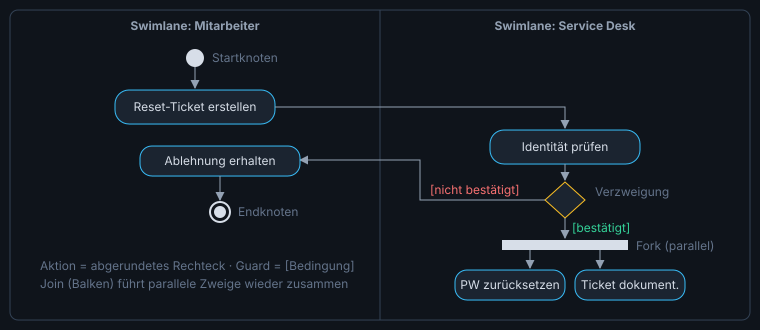

# 💻 Programmierung & Algorithmen

*Bereich: Software · Prüfungsrelevanz: ★★★*

> Compiler/Interpreter, Datentypen, Kontrollstrukturen, Pseudocode, Schreibtischtest, UML-Aktivitätsdiagramm.

[⬅ Inhaltsverzeichnis](README.md)

---

## Übersetzung von Programmen

<table><tr><th></th><th>Compiler</th><th>Interpreter</th></tr>
<tr><td>Arbeitsweise</td><td>übersetzt den gesamten Quellcode vorab in Maschinencode</td><td>führt den Code zur Laufzeit Zeile für Zeile aus</td></tr>
<tr><td>Vorteile</td><td>schnelle Ausführung, Fehler vor dem Start erkannt, Quellcode bleibt geschützt</td><td>plattformunabhängig, schnelles Testen ohne Übersetzen</td></tr>
<tr><td>Nachteile</td><td>Übersetzung für jede Plattform, Wartezeit beim Kompilieren</td><td>langsamer, Interpreter muss installiert sein</td></tr>
<tr><td>Beispiele</td><td>C, C++, Go, Rust</td><td>Python, PHP, JavaScript, Bash</td></tr></table>

**Linker**: verbindet kompilierte Objektdateien und Bibliotheken zu einem ausführbaren Programm. **Mischform**: Java/C# werden in **Bytecode** kompiliert, der von einer virtuellen Maschine (JVM/.NET CLR) mit JIT-Compiler ausgeführt wird. **Skriptsprachen** (Python, PowerShell, Bash) automatisieren Aufgaben, meist interpretiert. **Bibliothek** = Sammlung wiederverwendbarer Funktionen, die man aufruft; **Framework** = Grundgerüst, das den Ablauf vorgibt und eigenen Code aufruft (Inversion of Control), z. B. Laravel, Spring, Angular.

## Programmierparadigmen

**Prozedural**: Ablauf als Folge von Anweisungen und Prozeduren/Funktionen (C). **Objektorientiert**: Daten und Methoden in Objekten/Klassen gekapselt (Java, C#, Python). (Vererbung/Polymorphie im Detail: AP2.)

## Datentypen & Variablen

<table><tr><th>Typ</th><th>Beispiel</th><th>Hinweis</th></tr>
<tr><td>Integer (int)</td><td>42, −7</td><td>Ganzzahl</td></tr>
<tr><td>Float/Double</td><td>3.14</td><td>Gleitkommazahl</td></tr>
<tr><td>Boolean</td><td>true / false</td><td>Wahrheitswert</td></tr>
<tr><td>Char</td><td>'A'</td><td>einzelnes Zeichen</td></tr>
<tr><td>String</td><td>"Hallo"</td><td>Zeichenkette</td></tr>
<tr><td>Array/Liste</td><td>[3, 7, 1]</td><td>mehrere Werte, Index meist ab <b>0</b></td></tr></table>

Eine **Variable** ist ein benannter Speicherplatz mit Datentyp; eine **Konstante** ist nach Zuweisung nicht änderbar. Operatoren: arithmetisch (+ − \* / %), Vergleich (== != < > <= >=), logisch (UND/AND/&&, ODER/OR/||, NICHT/NOT/!). **Modulo %** = Rest der ganzzahligen Division (17 % 5 = 2) – z. B. für „gerade Zahl?“ (x % 2 == 0).

## Kontrollstrukturen

- **Sequenz**: Anweisungen nacheinander.
- **Verzweigung/Selektion**: WENN … DANN … SONST (if/else); Mehrfachauswahl (switch/case).
- **Schleife/Iteration**: **kopfgesteuert** (while – Bedingung vorher, evtl. 0 Durchläufe), **fußgesteuert** (do-while – mindestens 1 Durchlauf), **Zählschleife** (for – feste Anzahl).

## Pseudocode (Beispiel)

```
FUNKTION summeGerade(zahlen: Array von Ganzzahl): Ganzzahl
    summe ← 0
    FÜR i ← 0 BIS länge(zahlen) − 1
        WENN zahlen[i] MOD 2 = 0 DANN
            summe ← summe + zahlen[i]
        ENDE WENN
    ENDE FÜR
    RÜCKGABE summe
ENDE FUNKTION
```

Funktion = benannter, wiederverwendbarer Codeblock mit Parametern und ggf. Rückgabewert (Prozedur: ohne Rückgabewert).

## Schreibtischtest (Trace-Tabelle)

Algorithmus Schritt für Schritt „auf Papier“ ausführen und den Wert jeder Variablen nach jedem Schritt in eine Tabelle eintragen. Ziel: Ergebnis vorhersagen, logische Fehler finden.

```
x ← 1
s ← 0
SOLANGE x <= 4
    s ← s + x * 2
    x ← x + 1
ENDE SOLANGE
AUSGABE s
```

<table><tr><th>Durchlauf</th><th>x (vorher)</th><th>s</th><th>x (nachher)</th></tr>
<tr><td>1</td><td>1</td><td>2</td><td>2</td></tr><tr><td>2</td><td>2</td><td>6</td><td>3</td></tr>
<tr><td>3</td><td>3</td><td>12</td><td>4</td></tr><tr><td>4</td><td>4</td><td>20</td><td>5</td></tr></table>

Ausgabe: **20**. Typische Fehler: **Off-by-one** (< statt <=, Index bis länge statt länge−1), Endlosschleife (Zähler wird nicht verändert), falsche Initialisierung, falscher Vergleichsoperator, Variable im falschen Gültigkeitsbereich.

**Fehlerarten**: **Syntaxfehler** (formal: Tippfehler, fehlende Klammer – Compiler meldet ihn), **Laufzeitfehler** (Division durch 0, Datei fehlt), **logischer/semantischer Fehler** (Programm läuft, Ergebnis falsch – nur durch Tests/Debugging zu finden). **Debugging**: Haltepunkte (Breakpoints), Einzelschritt, Variablen beobachten.

## UML-Aktivitätsdiagramm

Modelliert Abläufe (Geschäftsprozesse, Algorithmen). **Die einzige Ablaufdiagramm-Notation der AP1** (Struktogramm und PAP sind gestrichen).

<table><tr><th>Element</th><th>Symbol</th><th>Bedeutung</th></tr>
<tr><td>Startknoten</td><td>● ausgefüllter Kreis</td><td>Beginn</td></tr>
<tr><td>Endknoten</td><td>◉ Kreis mit Punkt</td><td>Ende der gesamten Aktivität</td></tr>
<tr><td>Ablaufende</td><td>⊗ Kreis mit Kreuz</td><td>Ende eines Zweiges (Rest läuft weiter)</td></tr>
<tr><td>Aktion</td><td>▭ abgerundetes Rechteck</td><td>Tätigkeit, z. B. „Benutzer anlegen“</td></tr>
<tr><td>Kontrollfluss</td><td>→ Pfeil</td><td>Reihenfolge</td></tr>
<tr><td>Verzweigung (Decision)</td><td>◇ Raute mit 1 Ein-, mehreren Ausgängen</td><td>Bedingungen in <b>Guards</b> [eckige Klammern], z. B. [Passwort korrekt] / [sonst]</td></tr>
<tr><td>Zusammenführung (Merge)</td><td>◇ Raute mit mehreren Ein-, 1 Ausgang</td><td>Zweige laufen wieder zusammen</td></tr>
<tr><td>Gabelung (Fork)</td><td>▬ Balken, 1 Ein-, mehrere Ausgänge</td><td>Parallele Abläufe starten</td></tr>
<tr><td>Vereinigung (Join)</td><td>▬ Balken, mehrere Ein-, 1 Ausgang</td><td>Wartet, bis alle parallelen Zweige fertig sind</td></tr>
<tr><td>Swimlane / Partition</td><td>Bahnen</td><td>Wer ist verantwortlich (Kunde, Service Desk, System)?</td></tr>
<tr><td>Objektknoten</td><td>▭ Rechteck</td><td>Daten/Dokumente, z. B. „Ticket“</td></tr></table>



Schleifen werden über eine Verzweigung mit Rückpfeil zu einem Merge-Knoten dargestellt. Guards müssen sich gegenseitig ausschließen und vollständig sein.

Weitere UML-Diagramme (Überblick): Anwendungsfalldiagramm (Use Case – Akteure & Funktionen), Klassendiagramm, Sequenzdiagramm (Nachrichtenaustausch über Zeit).

## Pseudocode in der AP1 – Konventionen

Es gibt keine verbindliche Norm. In IHK-Aufgaben siehst du deutsche oder englische Schlüsselwörter. Wichtig: eindeutig, eingerückt, jede Kontrollstruktur sauber beendet.

<table><tr><th>Deutsch</th><th>Englisch</th><th>Bedeutung</th></tr>
<tr><td>x ← 5 / x := 5</td><td>x = 5</td><td>Zuweisung</td></tr>
<tr><td>WENN … DANN … SONST … ENDE WENN</td><td>IF … THEN … ELSE … END IF</td><td>Verzweigung</td></tr>
<tr><td>SOLANGE … ENDE SOLANGE</td><td>WHILE … END WHILE</td><td>kopfgesteuerte Schleife</td></tr>
<tr><td>WIEDERHOLE … BIS …</td><td>REPEAT … UNTIL …</td><td>fußgesteuert (läuft, bis Bedingung wahr)</td></tr>
<tr><td>FÜR i ← 1 BIS n</td><td>FOR i = 1 TO n</td><td>Zählschleife</td></tr>
<tr><td>FUNKTION name(p): Typ … RÜCKGABE</td><td>FUNCTION … RETURN</td><td>Funktion</td></tr>
<tr><td>AUSGABE / EINGABE</td><td>OUTPUT / INPUT</td><td>Ein-/Ausgabe</td></tr>
<tr><td>MOD, DIV</td><td>%, //</td><td>Rest, ganzzahlige Division</td></tr></table>

> [!TIP]
> Typische AP1-Aufgaben: (1) Schreibtischtest mit Wertetabelle, (2) Lücken im Algorithmus ergänzen, (3) fehlerhafte Zeile finden und korrigieren, (4) Ablauf als UML-Aktivitätsdiagramm darstellen. Große Programme selbst schreiben ist AP2.

> [!WARNING]
> WIEDERHOLE … BIS *Bedingung* läuft, **bis** die Bedingung wahr ist – das Gegenteil von SOLANGE. „SOLANGE x < 10“ entspricht „BIS x >= 10“.

## Grundbegriffe Objektorientierung (nur Überblick für die AP1)

- **Klasse**: Bauplan/Vorlage mit Attributen (Eigenschaften) und Methoden (Funktionen), z. B. Klasse `Notebook` mit Attributen `seriennummer`, `ram` und Methode `starten()`.
- **Objekt** (Instanz): konkretes Exemplar einer Klasse, z. B. das Notebook mit Seriennummer 4711.
- **Kapselung**: Attribute sind nach außen geschützt (private) und nur über Methoden zugänglich (Getter/Setter).
- Vererbung und Polymorphie werden seit 2025 erst in der AP2 geprüft.

## Sichtbarkeit & Klassendiagramm (Grundlagen)

<table><tr><th>UML</th><th>Sichtbarkeit</th><th>Zugriff</th></tr>
<tr><td>+</td><td>public</td><td>von überall</td></tr>
<tr><td>−</td><td>private</td><td>nur innerhalb der Klasse</td></tr>
<tr><td>#</td><td>protected</td><td>Klasse und abgeleitete Klassen</td></tr></table>

```
┌──────────────────────────┐
│        Notebook          │  ← Klassenname
├──────────────────────────┤
│ - seriennummer: String   │  ← Attribute (privat)
│ - ramGB: int             │
├──────────────────────────┤
│ + starten(): void        │  ← Methoden (öffentlich)
│ + getRamGB(): int        │
└──────────────────────────┘
```

Ein **Objekt** ist eine konkrete Instanz, z. B. `nb1 : Notebook` mit seriennummer = "4711". Über **Getter/Setter** wird kontrolliert auf private Attribute zugegriffen (Kapselung).

## Use-Case-Diagramm (Überblick)

Zeigt **Akteure** (Strichmännchen, z. B. Mitarbeiter, Admin) und die **Anwendungsfälle** (Ellipsen, z. B. „Ticket erstellen“) innerhalb der **Systemgrenze** (Rechteck) – also *was* ein System für wen leistet, nicht wie.

## Bildschirmmasken & Corporate Identity

**Corporate Identity (CI)** bzw. **Corporate Design (CD)**: einheitliches Erscheinungsbild des Unternehmens – Logo, Farben, Schriftarten, Bildsprache, Tonalität. Eingabemasken und Software sollten das CD übernehmen (Wiedererkennung, Professionalität). Gute **Maskengestaltung**: logische Gruppierung und Reihenfolge (Tab-Reihenfolge), Pflichtfelder kennzeichnen, sinnvolle Vorbelegungen, Eingabeprüfung mit verständlichen Fehlermeldungen, ausreichender Kontrast und Schriftgröße (Barrierefreiheit), konsistente Bedienelemente (ISO 9241-110).

## HTML, XML, JSON & Dateiformate

**HTML**: Auszeichnungssprache für Webseiten (`<h1>`, `<p>`, `` – Alternativtext für Barrierefreiheit). **XML**: strukturierte Daten mit eigenen Tags, muss wohlgeformt sein (jedes Tag geschlossen, korrekt verschachtelt). **JSON**: leichtgewichtiges Datenformat für APIs (`{"name": "Isa", "ram": 16}`). **CSV**: Tabellendaten als Text.

<table><tr><th>Format</th><th>Einsatz</th></tr>
<tr><td>PDF / PDF/A</td><td>Dokumente plattformunabhängig; PDF/A für Langzeitarchivierung</td></tr>
<tr><td>DOCX / XLSX / ODT</td><td>Office-Dokumente (ODT = offenes Format)</td></tr>
<tr><td>JPEG / PNG / SVG / WebP</td><td>Foto (verlustbehaftet) / Grafik mit Transparenz (verlustfrei) / Vektorgrafik (skalierbar) / Web</td></tr>
<tr><td>MP4 (H.264/H.265) / MP3</td><td>Video / Audio (komprimiert)</td></tr>
<tr><td>ZIP / 7z</td><td>Archive, verlustfrei komprimiert</td></tr></table>

## Variablen, Konstanten und Datentypen

Eine **Variable** ist ein benannter Speicherplatz, dessen Wert sich ändern kann. Eine **Konstante** bekommt ihren Wert einmal und behält ihn (z. B. `UST ← 19`). Der **Datentyp** legt fest, welche Werte erlaubt sind und was man damit tun kann.

<table><tr><th>Datentyp</th><th>Inhalt</th><th>Beispiel</th><th>typisch für</th></tr>
<tr><td>Ganzzahl (Integer)</td><td>Zahlen ohne Komma</td><td>42, −7</td><td>Anzahl, Alter, Zähler</td></tr>
<tr><td>Gleitkommazahl (Float/Double)</td><td>Zahlen mit Komma</td><td>19,99</td><td>Preis, Messwert, Durchschnitt</td></tr>
<tr><td>Zeichenkette (String)</td><td>Text</td><td>"Hamburg"</td><td>Name, PLZ, Telefonnummer, IP-Adresse</td></tr>
<tr><td>Wahrheitswert (Boolean)</td><td>wahr oder falsch</td><td>wahr</td><td>„ist aktiv?“, „Newsletter?“</td></tr>
<tr><td>Zeichen (Char)</td><td>ein einzelnes Zeichen</td><td>'A'</td><td>Kennbuchstabe</td></tr>
<tr><td>Array / Liste</td><td>mehrere Werte desselben Typs</td><td>[4, 9, 2]</td><td>Messreihe, Namensliste</td></tr></table>

> [!IMPORTANT]
> **Merke:** PLZ und Telefonnummer sind **Zeichenketten**, keine Zahlen – man rechnet nicht mit ihnen, und führende Nullen (01067) würden als Zahl verloren gehen.

## Operatoren

<table><tr><th>Art</th><th>Operatoren</th><th>Ergebnis</th></tr>
<tr><td>Arithmetisch</td><td>+  −  *  /  DIV  MOD</td><td>Zahl (17 DIV 5 = 3, 17 MOD 5 = 2)</td></tr>
<tr><td>Vergleich</td><td>=  &lt;&gt;  &lt;  &gt;  &lt;=  &gt;=</td><td>Wahrheitswert</td></tr>
<tr><td>Logisch</td><td>UND  ODER  NICHT</td><td>Wahrheitswert</td></tr></table>

**Wahrheitstabelle** – die musst du auswendig hinschreiben können:

<table><tr><th>A</th><th>B</th><th>A UND B</th><th>A ODER B</th><th>NICHT A</th></tr>
<tr><td>falsch</td><td>falsch</td><td>falsch</td><td>falsch</td><td>wahr</td></tr>
<tr><td>falsch</td><td>wahr</td><td>falsch</td><td>wahr</td><td>wahr</td></tr>
<tr><td>wahr</td><td>falsch</td><td>falsch</td><td>wahr</td><td>falsch</td></tr>
<tr><td>wahr</td><td>wahr</td><td>wahr</td><td>wahr</td><td>falsch</td></tr></table>

**UND** ist nur wahr, wenn beide Seiten wahr sind. **ODER** ist wahr, sobald mindestens eine Seite wahr ist. Rangfolge: erst NICHT, dann UND, dann ODER – im Zweifel Klammern setzen.

## Funktionen

Eine **Funktion** ist ein benannter Programmteil, der eine Aufgabe erledigt. Sie bekommt Werte über **Parameter** und liefert ein Ergebnis über den **Rückgabewert**. Eine **Prozedur** gibt nichts zurück.

```
FUNKTION brutto(netto, ust): Kommazahl
    RÜCKGABE netto * (1 + ust / 100)
ENDE FUNKTION

preis ← brutto(200, 19)      // preis = 238
```

Vorteile: Code wird **wiederverwendbar**, **übersichtlicher**, leichter zu **testen** und Änderungen sind nur an einer Stelle nötig.

> [!TIP]
> **Schreibtischtest – so gehst du vor:** Lege eine Tabelle an, eine Spalte pro Variable plus eine für die Bedingung. Jede Zeile ist ein Schritt. Schreibe jeden neuen Wert hin, auch wenn er dir klar erscheint – die meisten Fehler passieren beim Kopfrechnen über mehrere Schleifendurchläufe.

## BPMN – nur zum Wiedererkennen

> [!TIP]
> **Einordnung:** Der neue Katalog nennt neben UML auch BPMN als neuere Darstellungsform. Für die AP1 ist das UML-Aktivitätsdiagramm der sichere Schwerpunkt. Bei BPMN reicht es, die Grundsymbole wiederzuerkennen – frag in der Schule nach, ob es dort behandelt wird.

<table><tr><th>BPMN-Symbol</th><th>Bedeutung</th><th>entspricht im Aktivitätsdiagramm</th></tr>
<tr><td>Kreis (dünner Rand)</td><td>Startereignis</td><td>Startknoten</td></tr>
<tr><td>Kreis (dicker Rand)</td><td>Endereignis</td><td>Endknoten</td></tr>
<tr><td>abgerundetes Rechteck</td><td>Aufgabe (Task)</td><td>Aktion</td></tr>
<tr><td>Raute mit X</td><td>exklusives Gateway: genau ein Weg</td><td>Verzweigung</td></tr>
<tr><td>Raute mit +</td><td>paralleles Gateway: alle Wege gleichzeitig</td><td>Gabelung/Vereinigung</td></tr>
<tr><td>Pool und Lane</td><td>Beteiligte und ihre Zuständigkeiten</td><td>Swimlane</td></tr></table>

---

## 🃏 Karteikarten (53)

| Frage | Antwort |
|---|---|
| Compiler vs. Interpreter | Compiler: übersetzt vorab komplett, schnelle Ausführung. Interpreter: führt zur Laufzeit zeilenweise aus, plattformunabhängig. |
| Linker | Verbindet Objektdateien und Bibliotheken zu einem ausführbaren Programm. |
| Bytecode | Plattformunabhängiger Zwischencode (Java, C#), ausgeführt von einer virtuellen Maschine. |
| Bibliothek vs. Framework | Bibliothek: eigener Code ruft Funktionen auf. Framework: gibt Struktur vor und ruft eigenen Code auf. |
| Kopf- vs. fußgesteuerte Schleife | Kopf (while): Prüfung vorher, evtl. 0 Durchläufe. Fuß (do-while): mindestens 1 Durchlauf. |
| Zählschleife | for-Schleife mit fester Anzahl Durchläufe. |
| Modulo | Rest der ganzzahligen Division: 17 % 5 = 2. |
| Gerade Zahl prüfen | x % 2 == 0. |
| Array-Index | Beginnt in den meisten Sprachen bei 0; letzter Index = Länge − 1. |
| Schreibtischtest | Manuelles Durchlaufen eines Algorithmus mit Notieren aller Variablenwerte in einer Tabelle. |
| Off-by-one-Fehler | Schleife läuft einmal zu oft oder zu wenig (z. B. <= statt <). |
| Syntax- vs. Logikfehler | Syntax: formaler Fehler, Compiler meldet ihn. Logik: Programm läuft, liefert aber falsches Ergebnis. |
| UML-Aktivitätsdiagramm: Startknoten | Ausgefüllter schwarzer Kreis. |
| UML-Aktivitätsdiagramm: Endknoten | Kreis mit ausgefülltem Punkt (Bullseye). |
| UML: Raute | Verzweigung (Decision) oder Zusammenführung (Merge); Bedingungen als Guards in [ ]. |
| UML: Balken (Fork/Join) | Fork: startet parallele Abläufe. Join: wartet auf alle parallelen Zweige. |
| Guard | Bedingung in eckigen Klammern an einem Kontrollfluss nach einer Verzweigung, z. B. [x > 10]. |
| Swimlane | Partition im Aktivitätsdiagramm, zeigt Verantwortlichkeit (Akteur/System). |
| Aktion im Aktivitätsdiagramm | Rechteck mit abgerundeten Ecken. |
| Debugging-Werkzeuge | Breakpoints, Einzelschrittausführung, Variablenüberwachung. |
| WIEDERHOLE … BIS | Fußgesteuerte Schleife, läuft mindestens einmal und so lange, BIS die Bedingung wahr ist. |
| DIV | Ganzzahlige Division: 17 DIV 5 = 3. |
| Typische AP1-Pseudocode-Aufgaben | Schreibtischtest, Lücken ergänzen, Fehler finden, als Aktivitätsdiagramm darstellen. |
| Klasse | Bauplan mit Attributen und Methoden. |
| Objekt / Instanz | Konkretes Exemplar einer Klasse. |
| Attribut vs. Methode | Attribut: Eigenschaft/Datenfeld. Methode: Funktion des Objekts. |
| Kapselung | Daten werden geschützt (private) und nur über Methoden verändert. |
| UML-Sichtbarkeit + / − / # | public / private / protected. |
| private | Zugriff nur innerhalb der eigenen Klasse. |
| Getter/Setter | Methoden für kontrollierten Lese-/Schreibzugriff auf private Attribute. |
| Use-Case-Diagramm | Akteure + Anwendungsfälle innerhalb der Systemgrenze – zeigt WAS das System leistet. |
| Corporate Identity / Corporate Design | Einheitliches Erscheinungsbild (Logo, Farben, Schrift) – auch in Bildschirmmasken. |
| Gute Bildschirmmaske | Logische Gruppierung, Tab-Reihenfolge, Pflichtfelder markiert, Eingabeprüfung, Kontrast, CD. |
| XML wohlgeformt | Jedes Tag geschlossen, korrekt verschachtelt, ein Wurzelelement. |
| JSON | Leichtgewichtiges Datenformat {"schlüssel": wert}, typisch für APIs. |
| PDF/A | PDF-Variante für die Langzeitarchivierung. |
| PNG vs. JPEG vs. SVG | PNG: verlustfrei, Transparenz. JPEG: Fotos, verlustbehaftet. SVG: Vektor, beliebig skalierbar. |
| Variable vs. Konstante | Variable: Wert kann sich ändern. Konstante: Wert wird einmal festgelegt und bleibt gleich. |
| Datentyp für eine Postleitzahl | Zeichenkette (String) – es wird nicht gerechnet, führende Nullen müssen erhalten bleiben. |
| Datentyp für einen Preis (19,99 €) | Gleitkommazahl (Float/Double) bzw. Dezimalzahl. |
| Datentyp für „Benutzer ist aktiv“ | Wahrheitswert (Boolean): wahr oder falsch. |
| Datentyp für die Anzahl der Arbeitsplätze | Ganzzahl (Integer). |
| Vergleichsoperatoren | = gleich, <> ungleich, < kleiner, > größer, <= kleiner gleich, >= größer gleich. Ergebnis ist immer wahr oder falsch. |
| Wann ist A UND B wahr? | Nur wenn A und B beide wahr sind. |
| Wann ist A ODER B wahr? | Sobald mindestens eines von beiden wahr ist (auch wenn beide wahr sind). |
| Rangfolge der logischen Operatoren | NICHT vor UND vor ODER – Klammern machen es eindeutig. |
| Parameter | Wert, der einer Funktion beim Aufruf übergeben wird. |
| Rückgabewert | Ergebnis, das eine Funktion an die aufrufende Stelle zurückliefert. |
| Funktion vs. Prozedur | Funktion liefert einen Rückgabewert, Prozedur führt nur Anweisungen aus. |
| Zwei Vorteile von Funktionen | Wiederverwendbarkeit und Übersichtlichkeit; außerdem leichter testbar und Änderungen nur an einer Stelle. |
| Vorgehen beim Schreibtischtest | Tabelle mit einer Spalte je Variable, Zeile für Zeile den Code durchgehen und jeden neuen Wert notieren. |
| BPMN | Business Process Model and Notation – grafische Sprache zur Darstellung von Geschäftsprozessen. |
| BPMN: Raute mit X bzw. mit + | X = exklusives Gateway (genau ein Weg). + = paralleles Gateway (alle Wege gleichzeitig). |

## ✍️ Übungsfragen (44)

**1.** Schreibtischtest: x ← 10; y ← 0; SOLANGE x > 0: y ← y + x; x ← x − 3. Welchen Wert hat y am Ende?

<details><summary>Lösung</summary>

**22**<br>x: 10,7,4,1 → y = 10+7+4+1 = 22; danach x = −2.

</details>

**2.** a ← 5; b ← 3; WENN a > b DANN a ← a \* 2 SONST b ← b \* 2; c ← a − b. Wert von c?

<details><summary>Lösung</summary>

**7**<br>a = 10, c = 10 − 3 = 7.

</details>

**3.** FÜR i ← 1 BIS 5: s ← s + i (s startet bei 0). Wert von s am Ende?

<details><summary>Lösung</summary>

**15**<br>1+2+3+4+5 = 15.

</details>

**4.** Wie lautet das Ergebnis von 23 MOD 4?

<details><summary>Lösung</summary>

**3**<br>23 = 5·4 + 3.

</details>

**5.** Welche Schleife wird mindestens einmal durchlaufen?

<details><summary>Lösung</summary>

**Musterlösung (2 P):** do-while (fußgesteuert)

</details>

**6.** Welches Element stellt im UML-Aktivitätsdiagramm eine Verzweigung dar?

<details><summary>Lösung</summary>

**Musterlösung (2 P):** Raute

</details>

**7.** Wie werden Bedingungen an den Ausgängen einer Verzweigung notiert?

<details><summary>Lösung</summary>

**Musterlösung (2 P):** Als Guards in eckigen Klammern<br>z. B. [Betrag > 1000].

</details>

**8.** Welches Symbol modelliert parallele Abläufe?

<details><summary>Lösung</summary>

**Musterlösung (2 P):** Gabelung (Fork) als dicker Balken

</details>

**9.** Nennen Sie eine Programmiersprache, die typischerweise interpretiert wird.

<details><summary>Lösung</summary>

**Musterlösung (2 P):** Z. B. Python, JavaScript oder PHP

</details>

**10.** Ein Array hat 8 Elemente. Welcher ist der letzte gültige Index (bei Start 0)?

<details><summary>Lösung</summary>

**Musterlösung (2 P):** 7

</details>

**11.** Eine Schleife soll 10-mal laufen: FÜR i ← 0 SOLANGE i <= 10. Welcher Fehler liegt vor?

<details><summary>Lösung</summary>

**Musterlösung (2 P):** Off-by-one – 11 Durchläufe<br>0 bis 10 = 11 Durchläufe; richtig: i < 10.

</details>

**12.** Ein Programm stürzt bei Division durch 0 ab. Welche Fehlerart?

<details><summary>Lösung</summary>

**Musterlösung (2 P):** Laufzeitfehler

</details>

**13.** Was bedeutet der Knoten „Kreis mit Kreuz“ im Aktivitätsdiagramm?

<details><summary>Lösung</summary>

**Musterlösung (2 P):** Ende eines einzelnen Ablaufzweigs<br>Ablaufende (Flow Final).

</details>

**14.** Nennen Sie drei Merkmale eines Compilers.

<details><summary>Lösung</summary>

**Musterlösung (3 P):** Je 1: übersetzt den gesamten Quellcode vor der Ausführung in Maschinencode; das Programm läuft danach meist schneller als interpretiert; Syntaxfehler werden schon beim Übersetzen erkannt; zum Ausführen ist der Compiler nicht mehr nötig; nach jeder Änderung muss neu übersetzt werden.

</details>

**15.** Erstellen Sie eine Trace-Tabelle für: n ← 4; f ← 1; SOLANGE n > 1: f ← f \* n; n ← n − 1. Geben Sie das Ergebnis f an. (4 Punkte)

<details><summary>Lösung</summary>

**Musterlösung (4 P):** Start: n=4, f=1. 1. Durchlauf: f=4, n=3. 2.: f=12, n=2. 3.: f=24, n=1. Bedingung n>1 falsch → Ende. Ergebnis f = 24 (Fakultät 4!). (je Zeile 1 Punkt, Ergebnis 1 – max. 4)

</details>

**16.** Beschreiben Sie, wie ein Login-Vorgang mit maximal drei Versuchen im UML-Aktivitätsdiagramm modelliert wird (Elemente nennen). (4 Punkte)

<details><summary>Lösung</summary>

**Musterlösung (4 P):** Startknoten → Aktion „Zugangsdaten eingeben“ (1) → Verzweigung (Raute) mit Guards [korrekt] → Aktion „Anmelden“ → Endknoten (1); [falsch und Versuche < 3] → Aktion „Fehlversuch zählen“ → Rückführung über Merge-Knoten zur Eingabe (Schleife) (1); [falsch und Versuche = 3] → Aktion „Konto sperren“ → Endknoten (1).

</details>

**17.** Erläutern Sie den Unterschied zwischen Compiler und Interpreter und nennen Sie je eine Sprache. (4 Punkte)

<details><summary>Lösung</summary>

**Musterlösung (4 P):** Ein Compiler übersetzt den gesamten Quellcode vor der Ausführung in Maschinencode; das Programm läuft danach schnell und ohne Compiler (1), z. B. C/C++ (1). Ein Interpreter liest und führt den Quellcode zur Laufzeit Anweisung für Anweisung aus; langsamer, aber plattformunabhängig und ohne Übersetzungsschritt (1), z. B. Python/PHP (1).

</details>

**18.** Wie lautet 17 DIV 5?

<details><summary>Lösung</summary>

**3**<br>Ganzzahlige Division ohne Rest.

</details>

**19.** Welche Bedingung entspricht „SOLANGE zahl < 100“ in einer WIEDERHOLE-BIS-Schleife?

<details><summary>Lösung</summary>

**Musterlösung (2 P):** BIS zahl >= 100<br>BIS = Abbruchbedingung = Negation der SOLANGE-Bedingung.

</details>

**20.** Was ist ein Objekt in der objektorientierten Programmierung?

<details><summary>Lösung</summary>

**Musterlösung (2 P):** Eine konkrete Instanz einer Klasse

</details>

**21.** Was bedeutet das „−“ vor einem Attribut im UML-Klassendiagramm?

<details><summary>Lösung</summary>

**Musterlösung (2 P):** private

</details>

**22.** Warum werden Attribute meist private deklariert?

<details><summary>Lösung</summary>

**Musterlösung (2 P):** Kapselung – Zugriff nur kontrolliert über Methoden

</details>

**23.** Welches Diagramm zeigt Akteure und Anwendungsfälle eines Systems?

<details><summary>Lösung</summary>

**Musterlösung (2 P):** Use-Case-Diagramm

</details>

**24.** Welche Punkte gehören zu einer guten, CI-konformen Eingabemaske? Nennen Sie drei.

<details><summary>Lösung</summary>

**Musterlösung (3 P):** Je 1 Punkt (max. 3): Firmenfarben und -logo; Pflichtfelder kennzeichnen; Verständliche Fehlermeldungen.

</details>

**25.** Welches Format eignet sich für ein Logo, das auf Visitenkarte und Plakat gleich scharf sein soll?

<details><summary>Lösung</summary>

**Musterlösung (2 P):** SVG<br>Vektorgrafik, verlustfrei skalierbar.

</details>

**26.** Welches Dateiformat ist für die Langzeitarchivierung von Rechnungen vorgesehen?

<details><summary>Lösung</summary>

**Musterlösung (2 P):** PDF/A

</details>

**27.** Welchen Datentyp wählen Sie für eine Postleitzahl?

<details><summary>Lösung</summary>

**Musterlösung (2 P):** Zeichenkette (String)<br>Mit einer PLZ wird nicht gerechnet, und führende Nullen (z. B. 01067) gingen als Zahl verloren.

</details>

**28.** Welchen Datentyp wählen Sie für das Merkmal „Newsletter abonniert (ja/nein)“?

<details><summary>Lösung</summary>

**Musterlösung (2 P):** Wahrheitswert (Boolean)<br>Es gibt nur zwei Zustände: wahr oder falsch.

</details>

**29.** Welchen Datentyp wählen Sie für einen Preis wie 19,99 €?

<details><summary>Lösung</summary>

**Musterlösung (2 P):** Gleitkommazahl (Float/Double) bzw. Dezimalzahl<br>Der Wert hat Nachkommastellen.

</details>

**30.** a ← 7; b ← 2; c ← a DIV b + a MOD b. Welchen Wert hat c?

<details><summary>Lösung</summary>

**4**<br>7 DIV 2 = 3, 7 MOD 2 = 1, 3 + 1 = 4.

</details>

**31.** Welchen Wahrheitswert hat der Ausdruck (5 > 3) UND NICHT (2 = 2)?

<details><summary>Lösung</summary>

**Musterlösung (2 P):** falsch<br>5 > 3 ist wahr, 2 = 2 ist wahr, NICHT wahr = falsch, wahr UND falsch = falsch.

</details>

**32.** Welchen Wahrheitswert hat der Ausdruck wahr ODER falsch UND falsch?

<details><summary>Lösung</summary>

**Musterlösung (2 P):** wahr<br>UND bindet stärker als ODER: falsch UND falsch = falsch, wahr ODER falsch = wahr.

</details>

**33.** Vervollständigen Sie die Wahrheitstabelle für A UND B sowie A ODER B für alle vier Kombinationen von A und B.

<details><summary>Lösung</summary>

**Musterlösung (4 P):** A falsch, B falsch → UND falsch, ODER falsch (1). A falsch, B wahr → UND falsch, ODER wahr (1). A wahr, B falsch → UND falsch, ODER wahr (1). A wahr, B wahr → UND wahr, ODER wahr (1).

</details>

**34.** FUNKTION f(x, y): RÜCKGABE x \* 2 + y. Anschließend: z ← f(3, 4) + f(1, 1). Welchen Wert hat z?

<details><summary>Lösung</summary>

**13**<br>f(3, 4) = 10, f(1, 1) = 3, zusammen 13.

</details>

**35.** summe ← 0; FÜR i ← 1 BIS 3: FÜR j ← 1 BIS 2: summe ← summe + i \* j. Welchen Wert hat summe am Ende?

<details><summary>Lösung</summary>

**18**<br>i = 1: 1 + 2 = 3; i = 2: 2 + 4 = 6; i = 3: 3 + 6 = 9; Summe 18.

</details>

**36.** n ← 37; z ← 0; SOLANGE n > 0: n ← n DIV 2; z ← z + 1. Welchen Wert hat z am Ende?

<details><summary>Lösung</summary>

**6**<br>n: 37 → 18 → 9 → 4 → 2 → 1 → 0, das sind 6 Durchläufe.

</details>

**37.** werte ← [4, 9, 2, 7]; m ← werte[0]; FÜR i ← 1 BIS 3: WENN werte[i] < m DANN m ← werte[i]. Welchen Wert hat m am Ende?

<details><summary>Lösung</summary>

**2**<br>Der Algorithmus sucht das Minimum: 4 → (9 nein) → 2 → (7 nein).

</details>

**38.** x ← 5; WIEDERHOLE: x ← x − 2 BIS x < 0. Wie oft wird der Schleifenkörper ausgeführt?

<details><summary>Lösung</summary>

**3**<br>x: 5 → 3 → 1 → −1. Erst nach dem dritten Durchlauf ist x < 0.

</details>

**39.** text ← "Server"; n ← 0; FÜR i ← 0 BIS länge(text) − 1: WENN text[i] = "e" DANN n ← n + 1. Welchen Wert hat n?

<details><summary>Lösung</summary>

**2**<br>S-e-r-v-e-r enthält zweimal „e“ (Index 1 und 4).

</details>

**40.** Führen Sie einen Schreibtischtest durch: a ← 12; b ← 18; SOLANGE a <> b: WENN a > b DANN a ← a − b SONST b ← b − a. Notieren Sie die Werte von a und b nach jedem Durchlauf und nennen Sie das Ergebnis.

<details><summary>Lösung</summary>

**Musterlösung (4 P):** Start: a = 12, b = 18 (1). 1. Durchlauf: a > b ist falsch → b = 6 (1). 2. Durchlauf: a > b ist wahr → a = 6 (1). Jetzt gilt a = b, die Schleife endet. Ergebnis: 6 – der größte gemeinsame Teiler von 12 und 18 (1).

</details>

**41.** Schreiben Sie in Pseudocode eine Funktion istGerade(zahl), die wahr zurückgibt, wenn die übergebene Zahl gerade ist, und sonst falsch.

<details><summary>Lösung</summary>

**Musterlösung (4 P):** 

```text
FUNKTION istGerade(zahl): Wahrheitswert (1)
    WENN zahl MOD 2 = 0 DANN (1)
        RÜCKGABE wahr (1)
    SONST
        RÜCKGABE falsch (1)
    ENDE WENN
ENDE FUNKTION
Kürzer und ebenfalls richtig: RÜCKGABE zahl MOD 2 = 0.
```


</details>

**42.** Schreiben Sie in Pseudocode einen Algorithmus, der den Durchschnitt aller Werte im Array messwerte berechnet und ausgibt.

<details><summary>Lösung</summary>

**Musterlösung (5 P):** 

```text
summe ← 0 (1)
FÜR i ← 0 BIS länge(messwerte) − 1 (1)
    summe ← summe + messwerte[i] (1)
ENDE FÜR
durchschnitt ← summe / länge(messwerte) (1)
AUSGABE durchschnitt (1)
Auch richtig: FÜR JEDEN wert IN messwerte. Wichtig: Summe vor der Schleife auf 0 setzen und erst nach der Schleife teilen.
```


</details>

**43.** Erläutern Sie den Unterschied zwischen Parameter und Rückgabewert einer Funktion und nennen Sie einen Vorteil von Funktionen.

<details><summary>Lösung</summary>

**Musterlösung (3 P):** Parameter: Werte, die der Funktion beim Aufruf übergeben werden (1). Rückgabewert: Ergebnis, das die Funktion an die aufrufende Stelle zurückliefert (1). Vorteil (1): Wiederverwendbarkeit, bessere Übersicht, leichteres Testen, Änderungen nur an einer Stelle.

</details>

**44.** Ein Programm soll nur dann Zugriff gewähren, wenn der Benutzer angemeldet ist und zusätzlich entweder Administrator ist oder die Datei ihm gehört. Formulieren Sie die Bedingung in Pseudocode.

<details><summary>Lösung</summary>

**Musterlösung (3 P):** WENN angemeldet UND (istAdmin ODER istBesitzer) DANN … (2). Die Klammern sind nötig, weil UND stärker bindet als ODER – ohne Klammern bekäme jeder Besitzer auch unangemeldet Zugriff (1).

</details>


[⬅ Inhaltsverzeichnis](README.md)
