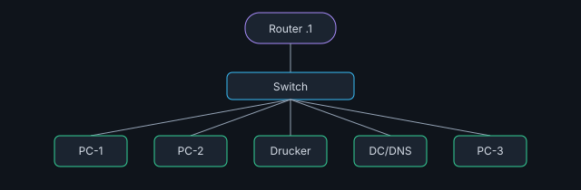
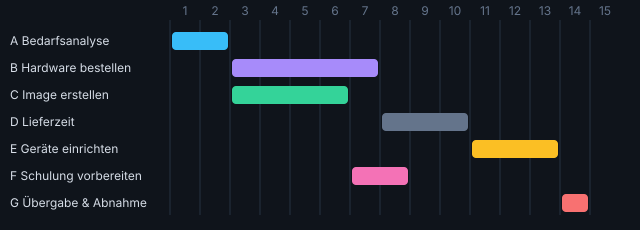

# 📎 Aufgaben mit Anlagen

Wie in der echten Prüfung: Datenblätter, Verträge, Logs und Angebote auswerten.

[⬅ Inhaltsverzeichnis](README.md)

## 🖥️ Datenblatt: Monitor für die Grafikabteilung

*Datenblatt · Englisch · Hardware*

**Situation:** Eine Grafikerin arbeitet mit einem Business-Notebook (USB-C, benötigt 65 W zum Laden) und braucht einen Monitor für farbverbindliche Bildbearbeitung. Am Arbeitsplatz soll möglichst nur ein Kabel angeschlossen werden. Werten Sie das englische Datenblatt (Anlage) aus.

**Anlage:**

<table><tr><th colspan="2">VISTA ProColor 27U – Specifications</th></tr>
<tr><td>Panel type</td><td>IPS, 27″, anti-glare</td></tr><tr><td>Resolution</td><td>3840 × 2160 @ 60 Hz</td></tr>
<tr><td>Color gamut</td><td>100 % sRGB, 98 % DCI-P3, 99 % Adobe RGB; factory calibrated (ΔE &lt; 2), hardware calibration supported</td></tr>
<tr><td>Brightness / Contrast</td><td>400 cd/m² / 1300:1</td></tr>
<tr><td>Inputs</td><td>2 × HDMI 2.0, 1 × DisplayPort 1.4, 1 × USB-C (DP Alt Mode, Power Delivery up to 90 W)</td></tr>
<tr><td>USB hub</td><td>4 × USB-A 3.2 Gen 1, RJ45 (1 GbE) via USB-C</td></tr>
<tr><td>Ergonomics</td><td>height-adjustable 130 mm, tilt −5°/+21°, swivel ±45°, pivot 90°</td></tr>
<tr><td>Power consumption</td><td>typical 32 W, max. 180 W (with USB load), standby 0.3 W</td></tr>
<tr><td>Certifications</td><td>TCO Certified, EPEAT, TÜV Flicker Free, EU energy class F</td></tr>
<tr><td>Warranty</td><td>3 years advanced exchange</td></tr></table>

**1.** Ist der Monitor für farbverbindliches Arbeiten geeignet? Begründen Sie Ihre Antwort.

<details><summary>Lösung</summary>

**Musterlösung (3 P):** Ja: IPS-Panel, 99 % Adobe RGB, werkskalibriert, Hardwarekalibrierung möglich

</details>


**2.** Reicht ein einzelnes USB-C-Kabel, um Bild zu übertragen UND das Notebook zu laden? Begründen Sie Ihre Antwort.

<details><summary>Lösung</summary>

**Musterlösung (3 P):** Ja – DP Alt Mode für das Bild und Power Delivery bis 90 W (Notebook braucht 65 W)

</details>


**3.** Welche ergonomischen Funktionen bietet der Monitor laut Datenblatt? Nennen Sie drei.

<details><summary>Lösung</summary>

**Musterlösung (3 P):** Je 1 Punkt (max. 3): Höhenverstellung; Neigen; Hochkant-Drehung (Pivot). Webcam ist nicht aufgeführt.

</details>


**4.** Der Monitor läuft typisch 8 h an 220 Tagen. Wie viele kWh verbraucht er pro Jahr (typische Leistung)?

<details><summary>Lösung</summary>

**56.32 kWh**<br>0,032 kW × 8 h × 220 = 56,32 kWh.

</details>


**5.** Nennen Sie zwei weitere Vorteile, die sich aus dem USB-Hub mit RJ45 für den Arbeitsplatz ergeben. (2 Punkte)

<details><summary>Lösung</summary>

**Musterlösung (2 P):** Je 1: Netzwerk (LAN) läuft über dasselbe USB-C-Kabel – keine separate Dockingstation nötig; Tastatur/Maus/Peripherie am Monitor angeschlossen; weniger Kabel (Clean Desk); schneller Wechsel des Notebooks (Desk-Sharing).

</details>


---

## 💻 Angebotsvergleich: Notebooks für den Außendienst

*Datenblatt · Wirtschaft · OS*

**Situation:** Für 10 Außendienstmitarbeitende sollen Notebooks beschafft werden. Anforderungen: Einbindung in Microsoft Entra ID, Festplattenverschlüsselung, mindestens 16 GB RAM, Gewicht unter 1,5 kg, Akkulaufzeit mind. 10 h, mobiles Internet ohne Hotspot.

**Anlage:**

<table><tr><th>Merkmal</th><th>Angebot A „Travel 14“</th><th>Angebot B „Office 15“</th><th>Angebot C „Business 14 LTE“</th></tr>
<tr><td>CPU</td><td>Core Ultra 5</td><td>Core i5 (Vorjahr)</td><td>Core Ultra 5</td></tr>
<tr><td>RAM</td><td>16 GB (verlötet)</td><td>8 GB (aufrüstbar)</td><td>16 GB</td></tr>
<tr><td>SSD</td><td>512 GB NVMe</td><td>256 GB SATA</td><td>512 GB NVMe</td></tr>
<tr><td>Betriebssystem</td><td>Windows 11 Home</td><td>Windows 11 Pro</td><td>Windows 11 Pro</td></tr>
<tr><td>TPM 2.0</td><td>ja</td><td>ja</td><td>ja</td></tr>
<tr><td>Gewicht</td><td>1,25 kg</td><td>1,85 kg</td><td>1,38 kg</td></tr>
<tr><td>Akkulaufzeit</td><td>14 h</td><td>7 h</td><td>12 h</td></tr>
<tr><td>Mobilfunk</td><td>–</td><td>–</td><td>LTE/5G-Modul, eSIM</td></tr>
<tr><td>Listenpreis netto</td><td>1.090 €</td><td>890 €</td><td>1.390 €</td></tr>
<tr><td>Rabatt / Skonto</td><td>5 % / 2 %</td><td>– / 3 %</td><td>10 % / 2 %</td></tr></table>

**1.** Welches Angebot erfüllt ALLE Anforderungen? Begründen Sie Ihre Antwort.

<details><summary>Lösung</summary>

**Musterlösung (3 P):** C – A hat Windows Home (kein Entra Join/BitLocker) und kein LTE; B hat nur 8 GB, ist zu schwer, Akku zu kurz, kein LTE.

</details>


**2.** Warum scheidet Angebot A trotz guter Hardware aus?

<details><summary>Lösung</summary>

**Musterlösung (3 P):** Windows 11 Home kann nicht in Entra ID eingebunden werden und bietet kein BitLocker; zudem kein Mobilfunk

</details>


**3.** Berechnen Sie den Bareinkaufspreis pro Gerät für Angebot C.

<details><summary>Lösung</summary>

**1225.98 €**<br>1.390 − 10 % = 1.251; − 2 % Skonto = 1.225,98 €.

</details>


**4.** Wie hoch ist der Bareinkaufspreis für alle 10 Geräte (Angebot C)?

<details><summary>Lösung</summary>

**12259.8 €**<br>10 × 1.225,98 = 12.259,80 €.

</details>


**5.** Begründen Sie, warum das Mobilfunkmodul für diese Zielgruppe sinnvoll ist. (2 Punkte)

<details><summary>Lösung</summary>

**Musterlösung (2 P):** Die Mitarbeitenden sind unterwegs (Kunde, Bahn, Auto) und brauchen jederzeit Zugriff auf CRM/Mail (1); ein integriertes Modul ist sicherer und bequemer als Smartphone-Hotspot oder öffentliche WLANs und schont den Smartphone-Akku (1).

</details>


---

## 🚨 Englische Sicherheitswarnung (Security Advisory)

*Englisch · Sicherheit*

**Situation:** Ihr Unternehmen setzt an zwei Standorten die Firewall „NetBridge 3000“ mit Firmware 4.2.7 ein. Die Fernverwaltung (Web-Admin) ist aus dem Internet erreichbar. Ihr Vorgesetzter bittet Sie, die folgende Meldung des Herstellers auszuwerten.

**Anlage:**

```text
SECURITY ADVISORY NB-2026-014          Severity: CRITICAL (CVSS 9.8)

Summary: A vulnerability in the web management interface of NetBridge 3000
firewalls allows an unauthenticated remote attacker to execute arbitrary
code with root privileges.

Affected versions: Firmware 4.0.0 through 4.2.8
Fixed versions:    Firmware 4.2.9 and later

Workaround: If you cannot update immediately, disable remote management
on the WAN interface or restrict access to trusted IP addresses.

There is evidence that this vulnerability is being actively exploited.
Customers are strongly advised to update as soon as possible.
```

**1.** Ist Ihre Firewall betroffen?

<details><summary>Lösung</summary>

**Musterlösung (2 P):** Ja – 4.2.7 liegt im betroffenen Bereich 4.0.0 bis 4.2.8

</details>


**2.** Was bedeutet „unauthenticated remote attacker“? Begründen Sie Ihre Antwort.

<details><summary>Lösung</summary>

**Musterlösung (3 P):** Ein Angreifer ohne Anmeldung, der aus der Ferne (z. B. Internet) angreift

</details>


**3.** Welches Schutzziel ist bei „execute arbitrary code with root privileges“ gefährdet? Begründen Sie Ihre Antwort.

<details><summary>Lösung</summary>

**Musterlösung (3 P):** Alle drei: Vertraulichkeit, Integrität und Verfügbarkeit – Volle Kontrolle über das Gerät.

</details>


**4.** Beschreiben Sie die Sofortmaßnahme (Workaround) und die dauerhafte Lösung auf Deutsch. (3 Punkte)

<details><summary>Lösung</summary>

**Musterlösung (3 P):** Sofort: Fernverwaltung auf der WAN-Schnittstelle deaktivieren bzw. nur von vertrauenswürdigen IP-Adressen zulassen (1). Dauerhaft: Firmware auf 4.2.9 oder neuer aktualisieren (1). Zusätzlich: wegen aktiver Ausnutzung Logs auf Kompromittierung prüfen, Zugangsdaten ändern, Vorfall dokumentieren (1).

</details>


---

## 📄 Englischer Lizenzvertrag (EULA-Auszug)

*Englisch · Lizenz · Recht*

**Situation:** Ein Kollege möchte eine gekaufte Lizenz der Software „DiagramPro 8“ auf seinem Büro-PC, seinem Firmen-Notebook und zu Hause auf seinem privaten PC installieren. Außerdem soll die Lizenz nach seinem Ausscheiden an eine Nachfolgerin gehen.

**Anlage:**

```text
DiagramPro 8 – End User License Agreement (excerpt)

2.1 Grant. The licensee may install and use one copy of the Software on one
    primary device. The licensee may also install a second copy on one
    portable device, provided that both copies are used exclusively by the
    same named user and not at the same time.
2.2 Restrictions. The Software may not be used on private devices for
    commercial purposes. Reverse engineering is not permitted.
2.3 Transfer. The licensee may transfer the license to another user within
    the same organization once, provided that all copies are removed from
    the original user's devices.
2.4 Term. This license is perpetual. Updates are provided for 12 months
    from the date of purchase.
```

**1.** Darf der Kollege die Software auf Büro-PC UND Firmen-Notebook installieren? Begründen Sie Ihre Antwort.

<details><summary>Lösung</summary>

**Musterlösung (3 P):** Ja – ein Hauptgerät plus ein tragbares Gerät, wenn nur er sie nutzt und nicht gleichzeitig – Ziffer 2.1.

</details>


**2.** Darf er sie zusätzlich auf seinem privaten PC für die Arbeit nutzen? Begründen Sie Ihre Antwort.

<details><summary>Lösung</summary>

**Musterlösung (3 P):** Nein – kommerzielle Nutzung auf privaten Geräten ist ausgeschlossen (2.2)

</details>


**3.** Kann die Lizenz an die Nachfolgerin übertragen werden? Begründen Sie Ihre Antwort.

<details><summary>Lösung</summary>

**Musterlösung (3 P):** Ja, einmalig innerhalb der Organisation, wenn alle Kopien beim Kollegen entfernt werden (2.3)

</details>


**4.** Welches Lizenzmodell beschreibt Ziffer 2.4? Begründen Sie Ihre Antwort.

<details><summary>Lösung</summary>

**Musterlösung (3 P):** Kauflizenz (unbefristet) mit 12 Monaten Updates – perpetual = unbefristet.

</details>


---

## 🗺️ Netzwerkplan mit Konfigurationsfehlern

*Netzwerk · Subnetting · Troubleshooting*

**Situation:** Im Netzwerk der Abteilung Vertrieb (Netz 192.168.40.0/26, Router 192.168.40.1, DHCP-Bereich .20–.50, DNS = Domänencontroller 192.168.40.5) melden einige Nutzer Probleme. Prüfen Sie die Konfiguration in der Anlage.

**Anlage:**



<table><tr><th>Gerät</th><th>IP-Adresse</th><th>Maske</th><th>Gateway</th><th>DNS</th></tr>
<tr><td>PC-1</td><td>192.168.40.23</td><td>255.255.255.192</td><td>192.168.40.1</td><td>192.168.40.5</td></tr>
<tr><td>PC-2</td><td>192.168.40.70</td><td>255.255.255.192</td><td>192.168.40.1</td><td>192.168.40.5</td></tr>
<tr><td>Drucker</td><td>192.168.40.30 (statisch)</td><td>255.255.255.192</td><td>192.168.40.1</td><td>192.168.40.5</td></tr>
<tr><td>DC/DNS</td><td>192.168.40.5 (statisch)</td><td>255.255.255.192</td><td>192.168.40.1</td><td>127.0.0.1</td></tr>
<tr><td>PC-3</td><td>192.168.40.44</td><td>255.255.255.0</td><td>192.168.40.1</td><td>8.8.8.8</td></tr></table>

**1.** Wie lautet die Broadcastadresse des Netzes 192.168.40.0/26? (nur letztes Oktett)

<details><summary>Lösung</summary>

**63**<br>/26 → Block 64 → 0–63, Broadcast .63.

</details>


**2.** Welches Problem hat PC-2? Begründen Sie Ihre Antwort.

<details><summary>Lösung</summary>

**Musterlösung (3 P):** 192.168.40.70 liegt außerhalb des Netzes .0–.63 – PC-2 erreicht weder Gateway noch Server

</details>


**3.** Welches Problem verursacht der Drucker? Begründen Sie Ihre Antwort.

<details><summary>Lösung</summary>

**Musterlösung (3 P):** Seine statische IP .30 liegt im DHCP-Bereich .20–.50 → möglicher IP-Konflikt

</details>


**4.** Was ist bei PC-3 falsch konfiguriert? Nennen Sie zwei.

<details><summary>Lösung</summary>

**Musterlösung (2 P):** Je 1 Punkt (max. 2): Subnetzmaske /24 statt /26; DNS 8.8.8.8 statt Domänencontroller – Domänenanmeldung/Namensauflösung intern scheitert. .44 liegt im Netz; das Gateway ist korrekt.

</details>


**5.** Schlagen Sie für PC-2 und den Drucker je eine korrigierte Konfiguration vor. (2 Punkte)

<details><summary>Lösung</summary>

**Musterlösung (2 P):** PC-2: IP per DHCP beziehen oder eine freie Adresse im Bereich .2–.62 außerhalb des DHCP-Pools, z. B. 192.168.40.55/26 (1). Drucker: statische IP außerhalb des DHCP-Bereichs, z. B. 192.168.40.10, oder DHCP-Reservierung über die MAC-Adresse (1).

</details>


---

## ⌨️ Ausgabe von ipconfig /all auswerten

*Netzwerk · Troubleshooting · Kommandozeile*

**Situation:** Eine Mitarbeiterin meldet: „Ich komme weder ins Internet noch auf die Netzlaufwerke.“ Sie lassen sich die folgende Ausgabe zeigen.

**Anlage:**

```text
Ethernet-Adapter Ethernet:

   Verbindungsspezifisches DNS-Suffix:
   Beschreibung. . . . . . . . . . . : Intel(R) Ethernet Connection I219-LM
   Physische Adresse . . . . . . . . : 8C-16-45-3A-9F-21
   DHCP aktiviert. . . . . . . . . . : Ja
   Autokonfiguration aktiviert . . . : Ja
   Verbindungslokale IPv6-Adresse  . : fe80::b1c2:4d1e:77a0:3f12%12
   Autokonfiguration IPv4-Adresse  . : 169.254.112.45
   Subnetzmaske  . . . . . . . . . . : 255.255.0.0
   Standardgateway . . . . . . . . . :
   DNS-Server  . . . . . . . . . . . : fec0:0:0:ffff::1%1
```

**1.** Was bedeutet die Adresse 169.254.112.45? Begründen Sie Ihre Antwort.

<details><summary>Lösung</summary>

**Musterlösung (3 P):** APIPA – der Client hat keinen DHCP-Server erreicht und sich selbst eine Adresse gegeben

</details>


**2.** Warum fehlt ein Standardgateway?

<details><summary>Lösung</summary>

**Musterlösung (3 P):** Weil keine DHCP-Antwort kam – das Gateway wird sonst per DHCP mitgeteilt

</details>


**3.** Was zeigt „fe80::…“? Begründen Sie Ihre Antwort.

<details><summary>Lösung</summary>

**Musterlösung (3 P):** Automatisch erzeugte IPv6-Link-Local-Adresse, nur im lokalen Segment gültig

</details>


**4.** Nennen Sie drei konkrete Prüfschritte in sinnvoller Reihenfolge. (3 Punkte)

<details><summary>Lösung</summary>

**Musterlösung (3 P):** Z. B. (je 1): 1. Physische Verbindung prüfen – Kabel steckt, Link-LED an Netzwerkkarte/Switchport, Dose/Patchkabel. 2. ipconfig /release und ipconfig /renew ausführen. 3. DHCP-Server prüfen (läuft der Dienst, sind Adressen im Pool frei, richtiges VLAN am Switchport). Danach ping Gateway, nslookup testen und Lösung dokumentieren.

</details>


---

## 📊 Gantt-Diagramm eines Rollout-Projekts

*Projektmanagement · Planung*

**Situation:** Für den Rollout von 30 neuen Arbeitsplätzen liegt der folgende Balkenplan vor (Angaben in Arbeitstagen, Projektstart Tag 1).

**Anlage:**



**1.** Wie viele Arbeitstage dauert das Projekt insgesamt?

<details><summary>Lösung</summary>

**14 Tage**<br>G endet an Tag 14.

</details>


**2.** Welche Vorgänge laufen parallel zu B? Begründen Sie Ihre Antwort.

<details><summary>Lösung</summary>

**Musterlösung (3 P):** C und F – C (Tag 3–6) und F (Tag 7–8) überlappen mit B (Tag 3–7).

</details>


**3.** Welche Vorgänge liegen auf dem kritischen Pfad? Begründen Sie Ihre Antwort.

<details><summary>Lösung</summary>

**Musterlösung (3 P):** A – B – D – E – G – A(1–2) → B(3–7) → D(8–10) → E(11–13) → G(14) ohne Lücken.

</details>


**4.** Wie viele Tage Puffer hat Vorgang C (endet Tag 6, E beginnt Tag 11)?

<details><summary>Lösung</summary>

**4 Tage**<br>Freier Puffer: Tage 7–10 = 4 Tage.

</details>


**5.** Nennen Sie je einen Vor- und Nachteil eines Gantt-Diagramms gegenüber einem Netzplan. (2 Punkte)

<details><summary>Lösung</summary>

**Musterlösung (2 P):** Vorteil (1): anschaulich, Zeitbezug und Dauer sofort sichtbar, leicht verständlich für Kunden/Management. Nachteil (1): Abhängigkeiten, Puffer und kritischer Pfad sind nicht oder nur schwer erkennbar.

</details>


---

## 🧾 Zwei Angebote für Drucker vergleichen

*Wirtschaft · Datenblatt · Peripherie*

**Situation:** Eine Abteilung druckt ca. 3.000 Seiten s/w pro Monat. Es liegen zwei Angebote vor. Die Nutzungsdauer beträgt 3 Jahre.

**Anlage:**

<table><tr><th></th><th>Angebot 1: Tintenstrahl-MFP</th><th>Angebot 2: Laser-MFP</th></tr>
<tr><td>Anschaffung netto</td><td>299 €</td><td>749 €</td></tr>
<tr><td>Verbrauchsmaterial</td><td>Schwarzpatrone 39 € / 1.300 Seiten</td><td>Toner 89 € / 6.000 Seiten</td></tr>
<tr><td>Geschwindigkeit</td><td>20 ppm</td><td>40 ppm, Duplex</td></tr>
<tr><td>Max. Druckvolumen</td><td>1.500 Seiten/Monat empfohlen</td><td>6.000 Seiten/Monat empfohlen</td></tr>
<tr><td>Netzwerk / Sicherheit</td><td>WLAN</td><td>LAN, WLAN, PIN-Druck</td></tr></table>

**1.** Wie hoch sind die Kosten pro Seite bei Angebot 1 in Cent (2 Nachkommastellen)?

<details><summary>Lösung</summary>

**3 Cent**<br>39 ÷ 1.300 = 0,03 € = 3,00 Cent.

</details>


**2.** Wie hoch sind die Gesamtkosten von Angebot 2 über 3 Jahre (Anschaffung + Toner, ohne Papier) in €?

<details><summary>Lösung</summary>

**2351 €**<br>3.000 × 36 = 108.000 Seiten × 89/6.000 = 1.602 € + 749 € = 2.351 €.

</details>


**3.** Wie hoch sind die Gesamtkosten von Angebot 1 über 3 Jahre?

<details><summary>Lösung</summary>

**3539 €**<br>108.000 × 0,03 = 3.240 € + 299 € = 3.539 €.

</details>


**4.** Begründen Sie Ihre Empfehlung mit zwei Argumenten aus der Anlage. (3 Punkte)

<details><summary>Lösung</summary>

**Musterlösung (3 P):** Empfehlung: Angebot 2 (Laser-MFP) (1). Argumente (je 1): über 3 Jahre ca. 1.188 € günstiger trotz höherer Anschaffung; empfohlenes Druckvolumen (6.000 Seiten/Monat) passt zum Bedarf von 3.000, das Tintengerät ist mit 1.500 Seiten überfordert; doppelte Geschwindigkeit und Duplex; LAN und PIN-Druck für Vertraulichkeit.

</details>


---

## 📜 Firewall-Log auswerten

*Sicherheit · Englisch · Log*

**Situation:** Der Administrator zeigt Ihnen einen Auszug aus dem Log der Firewall vom Montagmorgen. Der Webserver hat die IP 203.0.113.10, der Mailserver 203.0.113.20.

**Anlage:**

```text
2027-01-18 03:12:01 DENY  TCP 198.51.100.77:51234 -> 203.0.113.10:22   (SSH)
2027-01-18 03:12:02 DENY  TCP 198.51.100.77:51236 -> 203.0.113.10:23   (TELNET)
2027-01-18 03:12:02 DENY  TCP 198.51.100.77:51240 -> 203.0.113.10:3389 (RDP)
2027-01-18 03:12:03 ALLOW TCP 198.51.100.77:51244 -> 203.0.113.10:443  (HTTPS)
2027-01-18 03:12:03 DENY  TCP 198.51.100.77:51250 -> 203.0.113.10:445  (SMB)
2027-01-18 07:45:10 ALLOW TCP 192.0.2.15:40112    -> 203.0.113.20:25   (SMTP)
```

**1.** Was deuten die Einträge von 198.51.100.77 um 03:12 Uhr an? Begründen Sie Ihre Antwort.

<details><summary>Lösung</summary>

**Musterlösung (3 P):** Einen Portscan – ein Angreifer prüft nacheinander typische Dienste-Ports – Viele Ports in wenigen Sekunden von derselben Quelle.

</details>


**2.** Warum wurde Port 443 erlaubt?

<details><summary>Lösung</summary>

**Musterlösung (3 P):** Der Webserver stellt HTTPS öffentlich bereit – die Regel ist gewollt

</details>


**3.** Welches Firewall-Prinzip zeigen die DENY-Einträge?

<details><summary>Lösung</summary>

**Musterlösung (2 P):** Default Deny – nur freigegebene Dienste sind erreichbar

</details>


**4.** Nennen Sie zwei Maßnahmen, die Sie nach dieser Auswertung empfehlen. (2 Punkte)

<details><summary>Lösung</summary>

**Musterlösung (2 P):** Je 1: Quell-IP beobachten/temporär sperren (IPS/Fail2ban/Geo-Blocking); Webserver härten und patchen, da Port 443 erreichbar ist; Alarmierung bei Portscans einrichten (IDS/SIEM); sicherstellen, dass RDP/SMB/Telnet nie aus dem Internet erreichbar sind; Logs regelmäßig auswerten.

</details>

